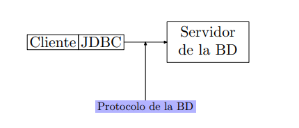
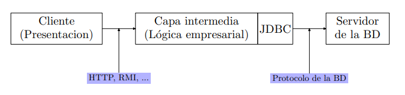
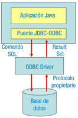
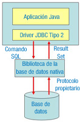
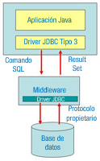
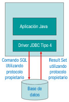
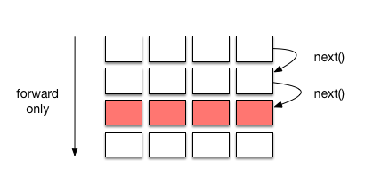
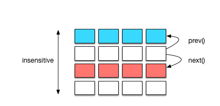
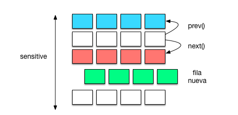

# 3A · Manejo de conectores JDBC

[Inicio de la entrega](../../INDICE.md) · [Ejercicios resueltos](../ejercicios/INDICE.md) · [Continuar con SQLite](3B-sqlite.md)

**Objetivo:** conectar Java con una base de datos, consultar información y modificarla de forma segura y transaccional.

<a id="indice"></a>
## Índice de apartados

- [Bases de datos, API y conexión](#bases-api-conexion)
- [Arquitectura y tipos de drivers](#arquitectura-drivers)
    - [Dos capas y tres capas](#nav-dos-capas-y-tres-capas)
    - [Clasificación de los controladores](#nav-clasificacion-de-los-controladores)
- [Preparar MySQL y Oracle](#preparar-conexion)
    - [Dependencias y registro](#nav-dependencias-y-registro)
    - [URL de conexión](#nav-url-de-conexion)
    - [Conexion.java · conexión completa](#archivo-conexion-java)
- [Objetos principales de JDBC](#objetos-jdbc)
- [Consultas y parámetros](#consultas-parametros)
    - [Elegir el método de ejecución](#nav-elegir-el-metodo-de-ejecucion)
    - [Recorrer los resultados](#nav-recorrer-los-resultados)
- [Metadatos](#metadatos)
- [Crear y modificar datos](#crear-modificar)
    - [Ejemplos complementarios: alumnos, columnas y ventas](#nav-ejemplos-complementarios-alumnos-columnas-y-ventas)
- [Procedimientos almacenados](#procedimientos)
- [Transacciones](#transacciones)
- [Cursores y resultados actualizables](#cursores)
    - [Movimiento del cursor](#nav-movimiento-del-cursor)
    - [Tipo y concurrencia](#nav-tipo-y-concurrencia)
    - [Modificar, insertar y borrar](#nav-modificar-insertar-y-borrar)
- [Actividades y referencias](#actividades)

<a id="bases-api-conexion"></a>
## 1. Bases de datos, API y conexión

Una base de datos relacional organiza los datos en **tablas**. Cada fila representa un registro; las columnas describen sus atributos. La **clave primaria** identifica cada fila y las **claves foráneas** relacionan tablas.

El **SGBD** almacena los datos, aplica restricciones y gestiona las consultas y transacciones. Una conexión permite que la aplicación le envíe instrucciones y reciba resultados.

**ODBC** y **JDBC** son interfaces distintas con un propósito similar: ofrecer una forma uniforme de acceder a diferentes gestores. JDBC está diseñada para Java. La aplicación utiliza las interfaces de `java.sql` y `javax.sql`; un **driver** implementa su comunicación con un motor concreto.

> **Idea clave.** JDBC unifica las llamadas Java, pero no hace que todo el SQL sea portable. Una sentencia específica de Oracle puede necesitar cambios para funcionar en MySQL o SQLite.

[↑ Volver al índice](#indice)

<a id="arquitectura-drivers"></a>
## 2. Arquitectura y tipos de drivers

<a id="nav-dos-capas-y-tres-capas"></a>
### Dos capas y tres capas

- **Dos capas:** la aplicación Java se conecta directamente al servidor de base de datos mediante su driver.

  

- **Tres capas:** el cliente se comunica con una capa de servicios y esta accede a los datos. Permite centralizar reglas de negocio, permisos y conexiones.

  

<a id="nav-clasificacion-de-los-controladores"></a>
### Clasificación de los controladores

| Tipo | Cómo funciona | Implicaciones |
|---|---|---|
| **1 · Puente JDBC–ODBC** | Traduce JDBC a ODBC. | Histórico; el puente incluido en el JDK se retiró en Java 8. Requiere configuración ODBC. |
| **2 · API nativa** | Traduce JDBC a la biblioteca nativa del fabricante. | Necesita cliente nativo compatible con el sistema operativo; usa JNI. |
| **3 · Middleware** | Un servidor intermedio traduce el protocolo del driver al del SGBD. | El cliente es Java puro, pero se añade una capa que debe administrarse. |
| **4 · Protocolo directo** | El driver Java habla directamente con el servidor. | Es la opción habitual de MySQL Connector/J y Oracle Thin. |









La expresión comercial **«tipo 5»** aparece en algunos materiales para drivers con prestaciones adicionales, pero no añade una quinta categoría a la clasificación clásica de cuatro tipos. Tampoco se puede afirmar que usar código nativo garantice mayor rendimiento: depende de la implementación y de la carga.

[↑ Volver al índice](#indice)

<a id="preparar-conexion"></a>
## 3. Preparar MySQL y Oracle

<a id="nav-dependencias-y-registro"></a>
### Dependencias y registro

1. Comprueba la versión del JDK y del servidor.
2. Añade el driver al **classpath**, mediante Maven o como JAR en el Build Path de Eclipse.
3. Configura la URL y las credenciales fuera del código.
4. Abre una conexión y comprueba el producto y la versión mediante `DatabaseMetaData`.

Los drivers JDBC 4 compatibles se descubren automáticamente. `Class.forName(...)` puede aparecer en ejemplos antiguos, pero normalmente no es necesario. `DriverManager` **no está obsoleto**; `DataSource` suele resultar más adecuado cuando se necesita configuración centralizada o un pool.

> **Tutorial complementario.** [Abrir el PDF local: incorporación del driver JDBC a Eclipse](../pdf/tutorial-driver-jdbc-eclipse.pdf). Es un tutorial histórico de la Universidad de Cádiz; las pantallas y versiones pueden diferir de las actuales.

<a id="nav-url-de-conexion"></a>
### URL de conexión

| Motor | Driver | Formato de ejemplo |
|---|---|---|
| MySQL | `com.mysql.cj.jdbc.Driver` | `jdbc:mysql://localhost:3306/world` |
| Oracle Thin, por servicio | `oracle.jdbc.OracleDriver` | `jdbc:oracle:thin:@//localhost:1521/XE` |
| Oracle Thin, por SID | `oracle.jdbc.OracleDriver` | `jdbc:oracle:thin:@localhost:1521:XE` |
| SQLite | `org.sqlite.JDBC` | `jdbc:sqlite:/ruta/chinook.db` |

En Oracle, **SID y nombre de servicio no son equivalentes**. Usa el dato real de tu instalación. Oracle OCI requiere bibliotecas nativas; la conexión interna del servidor (`jdbc:default:connection:`) corresponde a código Java ejecutado dentro de Oracle, no a una aplicación de escritorio común.

Un alias de `tnsnames.ora` describe un servicio de red. Por ejemplo:

```text
XE =
    (DESCRIPTION =
        (ADDRESS = (PROTOCOL = TCP)(HOST = localhost)(PORT = 1521))
        (CONNECT_DATA =
            (SERVER = DEDICATED)
            (SERVICE_NAME = XE)
        )
    )
```

Ese bloque es configuración Oracle Net, no Java. La disponibilidad de `XE` debe comprobarse; no se deduce del nombre del ejemplo.

[↑ Volver al índice](#indice)

<a id="archivo-conexion-java"></a>
### `src/main/java/jdbc/Conexion.java`

```java
package jdbc;

import java.sql.Connection;
import java.sql.DriverManager;
import java.sql.SQLException;
import java.util.Properties;

public final class Conexion {
    private Conexion() {
    }

    public static Connection abrir() throws SQLException {
        String url = System.getenv("DB_URL");
        if (url == null || url.isBlank()) {
            throw new SQLException("Define DB_URL antes de abrir la conexión");
        }

        Properties propiedades = new Properties();
        String usuario = System.getenv("DB_USER");
        String clave = System.getenv("DB_PASSWORD");
        if (usuario != null) {
            propiedades.setProperty("user", usuario);
        }
        if (clave != null) {
            propiedades.setProperty("password", clave);
        }
        return DriverManager.getConnection(url, propiedades);
    }

    public static void main(String[] args) {
        try (Connection conexion = abrir()) {
            System.out.println(
                    "Conexión correcta: " + conexion.getMetaData().getDatabaseProductName());
        } catch (SQLException ex) {
            System.err.printf("Error JDBC: %s | SQLState: %s | Código: %d%n", ex.getMessage(),
                    ex.getSQLState(), ex.getErrorCode());
        }
    }
}
```

**Lectura del ejemplo:** `try-with-resources` cierra la conexión incluso si falla una operación. El mensaje conserva información de diagnóstico sin imprimir contraseñas. La [preparación del proyecto](../documentacion/entorno-y-pruebas.md) incluye el POM y las instrucciones para extraer los archivos completos.

[↑ Volver al índice](#indice)

<a id="objetos-jdbc"></a>
## 4. Objetos principales de JDBC

| Objeto | Responsabilidad | Cierre |
|---|---|---|
| `Connection` | Sesión con el motor; crea sentencias y delimita transacciones. | Al terminar la operación o devolverla al pool. |
| `Statement` | Ejecuta SQL sin parámetros. | Tras utilizarlo. |
| `PreparedStatement` | Ejecuta una sentencia con parámetros tipados. | Tras utilizarlo; se puede reutilizar dentro de su alcance. |
| `CallableStatement` | Llama a un procedimiento o función almacenada. | Tras utilizarlo. |
| `ResultSet` | Recorre las filas de un resultado. | Tras recorrerlo; también se invalida al cerrar su sentencia. |
| `ResultSetMetaData` | Describe las columnas del resultado. | No es un recurso independiente que deba cerrarse. |
| `DatabaseMetaData` | Describe el motor, los objetos y las capacidades del driver. | Sus métodos pueden devolver ResultSet que sí hay que cerrar. |

Crear un segundo resultado con la misma sentencia suele cerrar el anterior. No conservar un `ResultSet` para utilizarlo después de cerrar su conexión.

[↑ Volver al índice](#indice)

<a id="consultas-parametros"></a>
## 5. Consultas y parámetros

<a id="nav-elegir-el-metodo-de-ejecucion"></a>
### Elegir el método de ejecución

| Método | Cuándo usarlo | Resultado |
|---|---|---|
| `executeQuery()` | Una consulta que devuelve filas. | `ResultSet`. |
| `executeUpdate()` | INSERT, UPDATE, DELETE o DDL compatible. | Número de filas afectadas; DDL suele devolver 0. |
| `execute()` | Resultado no conocido de antemano o llamada con varios resultados. | Booleano que indica si el primer resultado es un ResultSet; no significa «éxito o fracaso». |

Una consulta parametrizada separa **la instrucción SQL** de **los datos**:

```sql
SELECT ci.Name, ci.District, ci.Population
FROM city ci
JOIN country co ON co.Code = ci.CountryCode
WHERE co.Name = ? AND ci.Population >= ?
ORDER BY ci.Population DESC, ci.Name;
```

Cada `?` tiene un índice que empieza en **1**. Se asignan valores mediante `setString`, `setInt`, `setBigDecimal`, `setDate` o el método apropiado. Para un nulo SQL se utiliza `setNull(indice, Types.VARCHAR)`, por ejemplo.

> **Seguridad.** No concatenes entradas en el SQL. Con parámetros, una entrada como `' OR 1=1 --` se trata como texto y no cambia la estructura de la consulta. Los parámetros representan **valores**, no nombres de tablas, columnas ni cláusulas de ordenación.

El antiguo laboratorio interactivo se representa aquí como esta explicación y el [buscador completo de ciudades](../ejercicios/04-buscador-ciudades.md). No se conservan botones, campos ni etiquetas sueltas de una interfaz que ya no es funcional.

La preparación puede mejorar la reutilización y el rendimiento, pero la precompilación efectiva depende del motor y del driver. No es una garantía universal de que una consulta sea más rápida.

[↑ Volver al índice](#indice)

<a id="nav-recorrer-los-resultados"></a>
### Recorrer los resultados

El cursor empieza **antes de la primera fila**. Primero se llama a `next()` y después se leen las columnas. Se pueden identificar por su etiqueta o por su posición, cuyo primer índice también es 1.

Los métodos numéricos como `getInt()` devuelven 0 para un SQL NULL; comprobar `wasNull()` justo después si se necesita distinguirlo. `getBigDecimal()` permite trabajar con importes sin el error binario propio de `double`.

El [ejercicio de idiomas](../ejercicios/01-idiomas-espana.md) contiene el ciclo de consulta completo, con cierre de recursos y salida formateada.

[↑ Volver al índice](#indice)

<a id="metadatos"></a>
## 6. Metadatos

`ResultSetMetaData` permite consultar `getColumnCount()`, `getColumnLabel()`, `getColumnTypeName()` y otras propiedades de las columnas obtenidas.

`DatabaseMetaData` describe la base completa:

| Método | Información que aporta |
|---|---|
| `getDatabaseProductName()` | Nombre del SGBD. |
| `getDriverName()` / `getDriverVersion()` | Driver utilizado y versión. |
| `getTables(...)` | Catálogo, esquema, nombre y tipo de cada tabla que cumple los filtros. |
| `getColumns(...)` | Columnas, tipos, nulabilidad y otros atributos. |
| `getPrimaryKeys(...)` | Claves primarias de una tabla. |
| `getImportedKeys(...)` | Claves foráneas de la tabla hacia otras. |
| `getExportedKeys(...)` | Referencias desde otras tablas a su clave primaria. |
| `getSchemas()` | Esquemas disponibles. |
| `getProcedures(...)` / `getFunctions(...)` | Rutinas disponibles. |
| `getSQLKeywords()` / `getStringFunctions()` | Palabras adicionales y funciones soportadas. |
| `supportsTransactions()` | Si el motor admite transacciones. |
| `supportsAlterTableWithAddColumn()` / `supportsAlterTableWithDropColumn()` | Capacidades de ALTER TABLE. |
| `supportsResultSetConcurrency(...)` | Combinaciones de tipo y actualización admitidas. |
| `getMaxConnections()` | Máximo declarado por el driver; 0 puede significar desconocido o sin límite conocido. |

Los filtros de patrones suelen admitir `%` y `_`. **`null` no equivale siempre a «catálogo predeterminado»**: generalmente significa no restringir ese criterio. En MySQL se utiliza habitualmente el catálogo para seleccionar la base; en otros motores es relevante el esquema. El [ejercicio de tablas](../ejercicios/02-metadatos-tablas.md) utiliza los datos de la conexión y muestra un recuento final.

[↑ Volver al índice](#indice)

<a id="crear-modificar"></a>
## 7. Crear y modificar datos

Para DML se recomienda `PreparedStatement`, columnas explícitas y una condición `WHERE` que identifique exactamente las filas deseadas.

- **INSERT:** añade una fila y debe respetar PK, FK y restricciones.
- **UPDATE:** modifica las filas que cumplen el filtro.
- **DELETE:** elimina las filas filtradas. Sin `WHERE`, puede borrar toda la tabla.
- **DDL:** crea o altera estructuras; algunos motores realizan commits implícitos. No asumir que un rollback deshace un CREATE TABLE en MySQL.

El [ejercicio DML](../ejercicios/03-insertar-actualizar-borrar.md) inserta una ciudad temporal, cambia su población y elimina **esa misma fila**, sin borrar datos ajenos. La [actividad SQLite](../ejercicios/08-chinook-sqlite.md) y el tema 3B desarrollan creación de tablas y restricciones.

<a id="nav-ejemplos-complementarios-alumnos-columnas-y-ventas"></a>
### Ejemplos complementarios: alumnos, columnas y ventas

El libro también utilizaba un array de alumnos, información de columnas y un Map de ventas de café. Se conservan esas ideas en **una clase completa revisada**, en vez de mantener programas rotos o bloques dispersos.

Preparar una base vacía de prácticas. `crearAlumnos` crea una tabla e inserta tres objetos Alumno; no se ejecuta sobre una tabla ajena ya existente. `describirColumnas` muestra nombre y tipo de las columnas seleccionadas. `actualizarVentas` agrupa los dos UPDATE de cada café en una sola transacción y verifica que el nombre exista.

El método `editarConCursor` demuestra las tres operaciones de un resultado actualizable: cambiar el nombre del alumno 1, insertar el 4 y borrar el 2. Requiere soporte real de desplazamiento y actualización, que las pruebas comprueban en H2. No se ejecuta esa parte en SQLite, cuyo driver no ofrece ese tipo de cursor.

### `src/main/java/jdbc/EjemplosJdbc.java`

```java
package jdbc;

import java.sql.Connection;
import java.sql.PreparedStatement;
import java.sql.ResultSet;
import java.sql.ResultSetMetaData;
import java.sql.SQLException;
import java.sql.SQLFeatureNotSupportedException;
import java.sql.Statement;
import java.util.ArrayList;
import java.util.List;
import java.util.Map;

public final class EjemplosJdbc {
    private EjemplosJdbc() {
    }

    private static final class Alumno {
        private final String dni;
        private final String nombre;
        private final String ape1;
        private final String ape2;

        private Alumno(String dni, String nombre, String ape1, String ape2) {
            this.dni = dni;
            this.nombre = nombre;
            this.ape1 = ape1;
            this.ape2 = ape2;
        }
    }

    public static void crearAlumnos(Connection conexion) throws SQLException {
        try (Statement sentencia = conexion.createStatement()) {
            sentencia.executeUpdate("CREATE TABLE alumnos (dni VARCHAR(10) PRIMARY KEY, "
                    + "nombre VARCHAR(60) NOT NULL, ape1 VARCHAR(60), ape2 VARCHAR(60))");
        }
        Alumno[] alumnos = {new Alumno("1", "Ana", "Lopez", "Blanco"),
                new Alumno("2", "Pepe", "Ruiz", "Negro"), new Alumno("3", "Dani", "Rey", "Blanco")};
        Transacciones.ejecutar(conexion, () -> {
            String sql = "INSERT INTO alumnos (dni, nombre, ape1, ape2) VALUES (?, ?, ?, ?)";
            try (PreparedStatement sentencia = conexion.prepareStatement(sql)) {
                for (Alumno alumno : alumnos) {
                    sentencia.setString(1, alumno.dni);
                    sentencia.setString(2, alumno.nombre);
                    sentencia.setString(3, alumno.ape1);
                    sentencia.setString(4, alumno.ape2);
                    sentencia.executeUpdate();
                }
            }
            return null;
        });
    }

    public static List<String> describirColumnas(Connection conexion) throws SQLException {
        List<String> columnas = new ArrayList<>();
        try (Statement sentencia = conexion.createStatement();
                ResultSet filas = sentencia.executeQuery("SELECT dni, nombre FROM alumnos")) {
            ResultSetMetaData metadatos = filas.getMetaData();
            for (int indice = 1; indice <= metadatos.getColumnCount(); indice++) {
                columnas.add(metadatos.getColumnLabel(indice) + ": "
                        + metadatos.getColumnTypeName(indice));
            }
        }
        return columnas;
    }

    public static void actualizarVentas(Connection conexion, Map<String, Integer> ventas)
            throws SQLException {
        Transacciones.ejecutar(conexion, () -> {
            try (PreparedStatement semana = conexion.prepareStatement(
                         "UPDATE COFFEES SET SALES = ? WHERE COF_NAME = ?");
                    PreparedStatement total = conexion.prepareStatement(
                            "UPDATE COFFEES SET TOTAL = TOTAL + ? WHERE COF_NAME = ?")) {
                for (Map.Entry<String, Integer> venta : ventas.entrySet()) {
                    if (venta.getKey() == null || venta.getValue() == null
                            || venta.getValue() < 0) {
                        throw new IllegalArgumentException("Venta inválida");
                    }
                    semana.setInt(1, venta.getValue());
                    semana.setString(2, venta.getKey());
                    total.setInt(1, venta.getValue());
                    total.setString(2, venta.getKey());
                    if (semana.executeUpdate() != 1 || total.executeUpdate() != 1) {
                        throw new SQLException("No se encontró el café " + venta.getKey());
                    }
                }
            }
            return null;
        });
    }

    public static void editarConCursor(Connection conexion) throws SQLException {
        Transacciones.ejecutar(conexion, () -> {
            try (Statement sentencia = conexion.createStatement(
                         ResultSet.TYPE_SCROLL_INSENSITIVE, ResultSet.CONCUR_UPDATABLE);
                    ResultSet filas = sentencia.executeQuery(
                            "SELECT dni, nombre, ape1, ape2 FROM alumnos ORDER BY dni")) {
                if (filas.getConcurrency() != ResultSet.CONCUR_UPDATABLE
                        || filas.getType() == ResultSet.TYPE_FORWARD_ONLY) {
                    throw new SQLFeatureNotSupportedException("Cursor no compatible");
                }
                while (filas.next()) {
                    if ("1".equals(filas.getString("dni"))) {
                        filas.updateString("nombre", "Ana Maria");
                        filas.updateRow();
                    }
                }
                filas.moveToInsertRow();
                filas.updateString("dni", "4");
                filas.updateString("nombre", "Marta");
                filas.updateString("ape1", "Sanz");
                filas.updateString("ape2", "Gil");
                filas.insertRow();
                filas.moveToCurrentRow();
                filas.beforeFirst();
                while (filas.next()) {
                    if ("2".equals(filas.getString("dni"))) {
                        filas.deleteRow();
                        break;
                    }
                }
            }
            return null;
        });
    }
}
```

La creación de la estructura se separa de la transacción de inserciones: no se promete rollback de DDL en todos los motores. El ejemplo de ventas requiere `COFFEES(COF_NAME, SALES, TOTAL)` con nombre de café único y columnas numéricas no nulas; la prueba crea esa tabla explícitamente.

[↑ Volver al índice](#indice)

<a id="procedimientos"></a>
## 8. Procedimientos almacenados

Un procedimiento es un subprograma guardado en el servidor. Una función devuelve un valor; puede tener además parámetros según el motor. En Oracle se escriben normalmente en PL/SQL; en MySQL la sintaxis es distinta. SQLite no proporciona procedimientos almacenados equivalentes.

`CallableStatement` se crea mediante `prepareCall()`:

| Llamada | Significado |
|---|---|
| `{call insertaCliente(?, ?, ?)}` | Procedimiento con tres parámetros. |
| `{? = call funcion(?, ?)}` | Función: la posición 1 recibe el retorno. |
| `begin procedimiento(?); end;` | Bloque PL/SQL, específico de Oracle. |

Los parámetros **IN** se asignan con `setXxx`; los **OUT** se registran con `registerOutParameter` antes de ejecutar y se recuperan con `getXxx` después. Una llamada preparada se ejecuta con `execute()` sin volver a pasar SQL.

> **Ejemplo completo.** [Crear clientes, definir el procedimiento e invocarlo desde Java](../ejercicios/07-procedimiento-clientes.md). Se utiliza una base de prácticas y no se fija un DEFINER administrativo como `root` en el procedimiento.

[↑ Volver al índice](#indice)

<a id="transacciones"></a>
## 9. Transacciones

Una transacción agrupa operaciones que deben completarse como una unidad.

| Propiedad ACID | Qué significa |
|---|---|
| **Atomicidad** | Se confirman todos los cambios o se deshacen todos. |
| **Consistencia** | Las restricciones y reglas de negocio se respetan al completar la transacción. |
| **Aislamiento** | Controla cómo interactúan las transacciones concurrentes. No implica que todos los niveles eviten cualquier anomalía. |
| **Durabilidad** | Los cambios confirmados persisten conforme a las garantías del motor y su configuración. |

En JDBC, una conexión nueva suele tener autocommit activado. Para agrupar operaciones:

1. Desactivar autocommit **antes** de las escrituras.
2. Ejecutar las operaciones y verificar sus recuentos.
3. Confirmar con `commit()` únicamente cuando todo haya terminado correctamente.
4. Ante una excepción, realizar `rollback()` y propagar el error.

Un UPDATE que no encuentra filas **no lanza necesariamente una excepción**: devuelve 0. Por eso el [ejercicio de transferencia de población](../ejercicios/05-transacciones-paises.md) exige que ambos UPDATE afecten a una fila y prueba el fallo con un país inexistente.

Un `Savepoint` permite deshacer parte de una transacción; no sustituye al commit final. Los niveles habituales son READ_UNCOMMITTED, READ_COMMITTED, REPEATABLE_READ y SERIALIZABLE; el soporte y sus detalles dependen del SGBD.

Para procesar un `Map<String, Integer>` de ventas, se recorre `entrySet()`, se asignan sus claves y valores como parámetros y se confirman **todas** las actualizaciones al final, no una a una. El patrón de rollback es el mismo del ejercicio 5.

[↑ Volver al índice](#indice)

<a id="cursores"></a>
## 10. Cursores y resultados actualizables

<a id="nav-movimiento-del-cursor"></a>
### Movimiento del cursor

| Método | Efecto | Resultado |
|---|---|---|
| `next()` | Avanza una fila. | `true` si queda situado en una fila válida. |
| `previous()` | Retrocede una fila. | `true` si queda situado en una fila válida. |
| `first()` | Va a la primera fila. | `false` si no hay filas. |
| `last()` | Va a la última fila. | `false` si no hay filas. |
| `beforeFirst()` | Se sitúa antes de la primera fila. | No devuelve booleano. |
| `afterLast()` | Se sitúa después de la última fila. | No devuelve booleano. |
| `absolute(n)` | Va a la fila n; los negativos cuentan desde el final. | Indica si la posición es válida. |
| `relative(n)` | Se desplaza respecto a la posición actual. | Indica si la posición es válida. |

Los movimientos distintos de avanzar requieren un resultado desplazable. No se pueden dar por disponibles en cualquier driver.

<a id="nav-tipo-y-concurrencia"></a>
### Tipo y concurrencia

| Configuración | Comportamiento |
|---|---|
| `TYPE_FORWARD_ONLY` | Solo avanza. Es el tipo habitual por defecto. |
| `TYPE_SCROLL_INSENSITIVE` | Permite desplazarse sin garantizar reflejar cambios externos. |
| `TYPE_SCROLL_SENSITIVE` | Solicita sensibilidad a cambios externos; depende del soporte del driver. |
| `CONCUR_READ_ONLY` | Solo lectura. |
| `CONCUR_UPDATABLE` | Solicita modificar la tabla a través del resultado. |







<a id="nav-modificar-insertar-y-borrar"></a>
### Modificar, insertar y borrar

- **Actualizar:** leer la fila, asignar el nuevo valor con `updateBigDecimal(...)` u otro `updateXxx`, y llamar a `updateRow()`.
- **Insertar:** `moveToInsertRow()`, asignar todos los campos obligatorios, `insertRow()` y `moveToCurrentRow()`.
- **Borrar:** situar el cursor en una fila válida y llamar a `deleteRow()`.

`updateRow()` envía la modificación, pero **no sustituye a `commit()`**. Un resultado actualizable suele requerir una consulta sencilla de una sola tabla, con su clave primaria y sin agregados o uniones. Comprobar `getConcurrency()`; algunos drivers degradan una solicitud no soportada.

La [práctica de salarios](../ejercicios/06-practica-salarios.md) aplica este mecanismo de manera completa: recorrido fila a fila, importes con `BigDecimal`, una sola subida por empleado y una única transacción.

[↑ Volver al índice](#indice)

<a id="actividades"></a>
## 11. Actividades y referencias

**Practicar ahora:** [idiomas](../ejercicios/01-idiomas-espana.md), [metadatos](../ejercicios/02-metadatos-tablas.md), [DML](../ejercicios/03-insertar-actualizar-borrar.md), [buscador](../ejercicios/04-buscador-ciudades.md), [transacciones](../ejercicios/05-transacciones-paises.md), [salarios](../ejercicios/06-practica-salarios.md) y [procedimientos](../ejercicios/07-procedimiento-clientes.md).

Consulta las [referencias con títulos descriptivos](../documentacion/referencias.md) y la [guía de preparación y pruebas](../documentacion/entorno-y-pruebas.md). No es necesario descargar un JAR del archivo histórico para usar los ejemplos revisados: el POM documenta las dependencias utilizadas.

[↑ Volver al índice](#indice)
