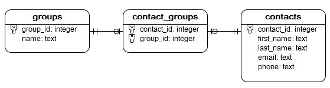
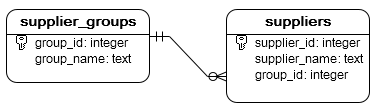
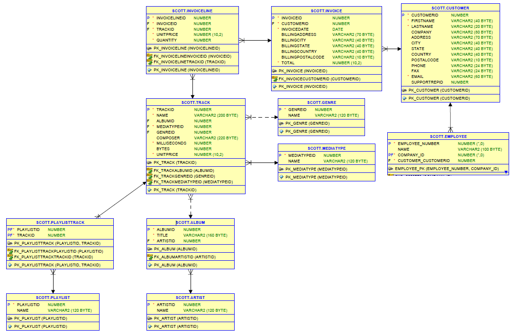

# 3B · Bases de datos embebidas: SQLite

[Inicio de la entrega](../../INDICE.md) · [Volver a JDBC](3A-manejo-de-conectores.md) · [Actividad Chinook resuelta](../ejercicios/08-chinook-sqlite.md)

**Objetivo:** comprender el modelo embebido, utilizar la consola SQLite y crear una base con restricciones y acceso JDBC.

<a id="indice"></a>
## Índice de apartados

- [Cliente-servidor frente a motor embebido](#arquitecturas)
- [Características y límites de SQLite](#caracteristicas)
- [Instalación y consola](#consola)
- [Tipos y sintaxis](#tipos)
- [Tablas y restricciones](#tablas)
    - [Contactos y grupos: ejemplo completo](#nav-contactos-y-grupos-ejemplo-completo)
    - [Qué garantiza cada restricción](#nav-que-garantiza-cada-restriccion)
- [Identificadores y claves foráneas](#identificadores)
    - [rowid e INTEGER PRIMARY KEY](#nav-rowid-e-integer-primary-key)
    - [Ejemplo de proveedores](#nav-ejemplo-de-proveedores)
- [Transacciones y puntos de retorno](#transacciones)
- [Consultas, Chinook y JDBC](#consultas-jdbc)

<a id="arquitecturas"></a>
## 1. Cliente-servidor frente a motor embebido

| Aspecto | Cliente-servidor | Embebida |
|---|---|---|
| Ejecución | Un servicio independiente administra los datos. | El motor se integra en el proceso de la aplicación. |
| Acceso | Habitualmente por red, incluso desde la misma máquina. | Llamadas locales al motor y acceso a archivos. |
| Usuarios y permisos | El servidor gestiona cuentas, permisos y conexiones. | En SQLite, la protección básica depende del acceso al archivo y de la aplicación. |
| Despliegue | Requiere instalar y administrar un servidor. | Se distribuye el motor con la aplicación. |
| Uso habitual | Aplicaciones con muchos clientes y datos centralizados. | Escritorio, móviles, cachés y trabajo sin conexión. |

MySQL, PostgreSQL y Oracle son ejemplos habituales de servidores. SQLite es embebida; H2, Derby o HSQLDB ofrecen distintos modos de funcionamiento. «Embebida» no significa que una aplicación no pueda compartir información: significa que **el motor no necesita un servidor independiente** en ese modo.

[↑ Volver al índice](#indice)

<a id="caracteristicas"></a>
## 2. Características y límites de SQLite

SQLite es una biblioteca escrita en C, de dominio público. Una base persistente se guarda normalmente en un archivo; durante el funcionamiento pueden aparecer archivos auxiliares de diario o WAL.

- **Sin configuración de servidor:** no exige crear cuentas del motor ni abrir un puerto.
- **Portabilidad:** el formato de archivo es multiplataforma; las aplicaciones necesitan un driver o biblioteca compatible.
- **Transacciones ACID:** permite agrupar operaciones y recuperar un estado consistente ante fallos dentro de sus garantías de configuración.
- **Buena opción local:** funciona sin red y requiere pocos recursos de administración.
- **Concurrencia de escritura limitada:** se serializan las escrituras; WAL mejora la convivencia de lectores y escritor, no permite múltiples escritores simultáneos.

> **Corrección del material histórico.** No se mantienen como verdades actuales las cifras antiguas de tamaño de biblioteca o límite de base de datos. Tampoco la afirmación «solo admite LEFT JOIN»: SQLite incorporó RIGHT y FULL OUTER JOIN en la versión 3.39.0. DROP COLUMN existe desde 3.35.0, con restricciones. Comprueba la versión de tu instalación y la documentación oficial.

SQLite tiene diferencias frente a otros motores: ALTER TABLE es más limitado, no hay procedimientos almacenados al estilo de MySQL/Oracle y los triggers son por fila. Las vistas no se modifican directamente; pueden utilizarse triggers INSTEAD OF para implementar determinadas operaciones.

[↑ Volver al índice](#indice)

<a id="consola"></a>
## 3. Instalación y consola

En Windows se descargan las herramientas de consola compatibles desde la página oficial y se añade su carpeta a `PATH`. En Linux o macOS pueden instalarse con el gestor de paquetes del sistema. No hace falta instalar un servidor SQLite.

**Comprobar la instalación y abrir una base:**

```bash
sqlite3 --version
sqlite3 ejemplo.db
```

Si el archivo no existe, SQLite puede crearlo. La aplicación debe tener permiso de escritura en su carpeta. Un error en una ruta puede crear accidentalmente una base vacía en otro lugar.

**Órdenes de la consola:** no son SQL, empiezan por punto y no llevan punto y coma.

| Orden | Uso |
|---|---|
| `.help` | Mostrar la ayuda de la consola. |
| `.open ejemplo.db` | Abrir otra base. |
| `.databases` | Listar los archivos adjuntos y sus nombres lógicos. |
| `.tables` | Listar las tablas y vistas visibles. |
| `.schema` | Mostrar el SQL de definición del esquema. |
| `.schema contacts` | Mostrar la definición del objeto indicado. |
| `.headers on` | Incluir los nombres de las columnas en la salida. |
| `.mode column` | Presentar los resultados alineados por columnas. |
| `.timer on` | Mostrar el tiempo de ejecución. |
| `.echo on` | Repetir las instrucciones leídas. |
| `.read archivo.sql` | Ejecutar las instrucciones de un archivo. |
| `.import archivo.csv tabla` | Importar datos; configurar primero el modo y revisar si hay cabecera. |
| `.exit` | Salir. |

No pegar `sqlite>` ni los indicadores de continuación como parte de la orden. **DB Browser for SQLite** es una alternativa gráfica para examinar tablas y ejecutar SQL; su descarga aparece en las [referencias](../documentacion/referencias.md).

[↑ Volver al índice](#indice)

<a id="tipos"></a>
## 4. Tipos y sintaxis

Las instrucciones SQL se terminan con `;`. Se pueden comentar con `--` o `/* ... */`. Las palabras clave no distinguen mayúsculas de minúsculas; las comparaciones de texto dependen de la colación y del operador empleado.

SQLite distingue **clases de almacenamiento** de **afinidades de columna**:

| Clase de almacenamiento | Uso |
|---|---|
| `NULL` | Ausencia de valor. |
| `INTEGER` | Enteros con signo. |
| `REAL` | Coma flotante. |
| `TEXT` | Texto. |
| `BLOB` | Datos binarios. |

`NUMERIC` es una afinidad, **no una sexta clase de almacenamiento**. En tablas ordinarias, el tipo declarado influye en las conversiones, pero no siempre impide almacenar otras clases. Las tablas STRICT añaden comprobaciones de tipo con sus reglas propias.

Los booleanos suelen representarse con 0 y 1. No hay una clase de almacenamiento exclusiva para fechas: se pueden representar como texto ISO, números julianos o marcas de tiempo, manteniendo una convención coherente.

[↑ Volver al índice](#indice)

<a id="tablas"></a>
## 5. Tablas y restricciones

<a id="nav-contactos-y-grupos-ejemplo-completo"></a>
### Contactos y grupos: ejemplo completo

Un contacto tiene nombre, apellidos, correo y teléfono. El correo y el teléfono deben ser únicos. Un contacto puede pertenecer a varios grupos; la relación muchos a muchos utiliza una tabla intermedia.



**SQL · Esquema de contactos** — ejecutar una vez en una base nueva de prácticas:

```sql
PRAGMA foreign_keys = ON;

CREATE TABLE contacts (
    contact_id INTEGER PRIMARY KEY,
    first_name TEXT NOT NULL,
    last_name TEXT NOT NULL,
    email TEXT NOT NULL UNIQUE,
    phone TEXT NOT NULL UNIQUE
);

CREATE TABLE groups (
    group_id INTEGER PRIMARY KEY,
    name TEXT NOT NULL UNIQUE
);

CREATE TABLE contact_groups (
    contact_id INTEGER NOT NULL,
    group_id INTEGER NOT NULL,
    PRIMARY KEY (contact_id, group_id),
    FOREIGN KEY (contact_id) REFERENCES contacts (contact_id)
        ON DELETE CASCADE,
    FOREIGN KEY (group_id) REFERENCES groups (group_id)
        ON DELETE CASCADE
);

INSERT INTO contacts (first_name, last_name, email, phone)
VALUES ('Ana', 'Lopez', 'ana@ejemplo.invalid', '555-0101');

INSERT INTO groups (name)
VALUES ('Clase'), ('Proyecto');

INSERT INTO contact_groups (contact_id, group_id)
VALUES (1, 1), (1, 2);

SELECT c.first_name, g.name
FROM contacts c
JOIN contact_groups cg ON cg.contact_id = c.contact_id
JOIN groups g ON g.group_id = cg.group_id
ORDER BY g.name;
```

La consulta devuelve a Ana en los grupos Clase y Proyecto. La PK compuesta impide registrar dos veces la misma pertenencia. Las FK garantizan que los contactos y grupos referenciados existan.

> **Regla de negocio.** Esta estructura admite un contacto sin grupos. Si el requisito es «cada contacto debe pertenecer al menos a uno», la aplicación debe comprobarlo dentro de su transacción o implementar una estrategia adicional; las dos FK no lo garantizan por sí solas.

[↑ Volver al índice](#indice)

<a id="nav-que-garantiza-cada-restriccion"></a>
### Qué garantiza cada restricción

| Restricción | Finalidad | Matiz importante |
|---|---|---|
| `PRIMARY KEY` | Identificar una fila de forma única. | `INTEGER PRIMARY KEY` tiene un tratamiento especial como alias de rowid. En tablas ordinarias existen peculiaridades históricas de nulabilidad en otras PK; declarar NOT NULL explícitamente cuando proceda. |
| `NOT NULL` | Exigir un valor. | No impide por sí sola una cadena vacía. |
| `UNIQUE` | Impedir valores repetidos. | SQLite permite varios NULL en una restricción UNIQUE. |
| `CHECK` | Validar una expresión, por ejemplo `edad >= 18`. | Combinar con NOT NULL si no se admite ausencia de valor. |
| `FOREIGN KEY` | Mantener una referencia válida. | Activar y comprobar `PRAGMA foreign_keys` en cada conexión. |
| `DEFAULT` | Proporcionar un valor cuando se omite la columna. | No reemplaza un NULL proporcionado explícitamente. |

[↑ Volver al índice](#indice)

<a id="identificadores"></a>
## 6. Identificadores y claves foráneas

<a id="nav-rowid-e-integer-primary-key"></a>
### rowid e INTEGER PRIMARY KEY

Una tabla ordinaria tiene un `rowid` de entero **con signo de 64 bits**. Una columna declarada exactamente `INTEGER PRIMARY KEY` actúa como su alias. Al omitir el identificador, SQLite suele asignar uno nuevo; no es necesario añadir AUTOINCREMENT para obtener esa asignación.

`AUTOINCREMENT` evita reutilizar identificadores previamente usados conforme a sus reglas y añade coste. Sin él pueden reutilizarse algunos valores eliminados. No asumir que los números siempre serán consecutivos ni que nunca se repiten.

`WITHOUT ROWID` utiliza la PK declarada como estructura de almacenamiento y tiene requisitos distintos. No se puede combinar con el comportamiento especial de AUTOINCREMENT.

<a id="nav-ejemplo-de-proveedores"></a>
### Ejemplo de proveedores



**SQL · Esquema de proveedores:**

```sql
CREATE TABLE supplier_groups (
    group_id INTEGER PRIMARY KEY,
    group_name TEXT NOT NULL
);

CREATE TABLE suppliers (
    supplier_id INTEGER PRIMARY KEY,
    supplier_name TEXT NOT NULL,
    group_id INTEGER NOT NULL,
    FOREIGN KEY (group_id) REFERENCES supplier_groups (group_id)
);
```

**Acciones referenciales:**

- **CASCADE:** propaga el borrado o cambio de clave.
- **SET NULL:** pone la FK a NULL; necesita que la columna permita nulos.
- **SET DEFAULT:** aplica el valor por defecto, que también debe respetar la integridad referencial.
- **RESTRICT:** rechaza inmediatamente determinados cambios cuando existen dependientes.
- **NO ACTION:** se comprueba según el momento de validación de la restricción; no es idéntico a RESTRICT en todos los casos.

[↑ Volver al índice](#indice)

<a id="transacciones"></a>
## 7. Transacciones y puntos de retorno

Fuera de una transacción explícita, SQLite puede confirmar automáticamente cada instrucción cuando finaliza. Para agrupar operaciones se utiliza BEGIN y se termina con COMMIT o ROLLBACK.

**SQL · Punto de retorno**, después del ejemplo de contactos:

```sql
BEGIN IMMEDIATE;

UPDATE contacts
SET first_name = 'Ana Maria'
WHERE contact_id = 1;

SAVEPOINT antes_del_telefono;

UPDATE contacts
SET phone = '555-9999'
WHERE contact_id = 1;

ROLLBACK TO SAVEPOINT antes_del_telefono;
RELEASE SAVEPOINT antes_del_telefono;
COMMIT;
```

Se conserva el cambio de nombre, pero el teléfono vuelve a `555-0101`. `ROLLBACK TO` no finaliza toda la transacción; `RELEASE` libera el punto de retorno.

BEGIN admite DEFERRED, IMMEDIATE y EXCLUSIVE. IMMEDIATE intenta adquirir desde el inicio el permiso de escritura y puede fallar si hay otro escritor. El comportamiento de EXCLUSIVE depende también del modo de diario. La palabra correcta es **IMMEDIATE**, no «INMEDIATE».

En Java se utiliza el control transaccional de `Connection`; no se mezcla sin necesidad con sentencias BEGIN manuales.

[↑ Volver al índice](#indice)

<a id="consultas-jdbc"></a>
## 8. Consultas, Chinook y JDBC

La sintaxis SELECT permite filtros, uniones, agrupación, agregados y ordenación, con las particularidades que documenta SQLite.

**Chinook** es una base de ejemplo con artistas, álbumes, canciones, géneros, clientes y facturas:



La actividad no queda escondida al final del tema: está agrupada en [Chinook · Enunciado, consultas y solución](../ejercicios/08-chinook-sqlite.md). Incluye los comandos de exploración, álbumes con canciones de jazz y total facturado por cliente.

### Acceso desde Java

Añade `org.xerial:sqlite-jdbc` al proyecto y utiliza una URL con una ruta válida o `jdbc:sqlite::memory:` para una base temporal. La clase [Conexion](3A-manejo-de-conectores.md#preparar-conexion) también sirve para SQLite si se configura `DB_URL`; no requiere las credenciales de un servidor.

El [ejercicio de metadatos](../ejercicios/02-metadatos-tablas.md) puede utilizarse con SQLite para conocer producto, driver y tablas. La suite JDBC utiliza SQLite real en memoria para comprobar consultas, parámetros, DML y rollback. El viejo driver 3.23.1 del aula se conserva únicamente en el archivo de extracción; no se distribuye como dependencia recomendada de esta edición.

[Referencias oficiales de SQLite y DB Browser](../documentacion/referencias.md) · [Preparación y pruebas](../documentacion/entorno-y-pruebas.md)

[↑ Volver al índice](#indice)
