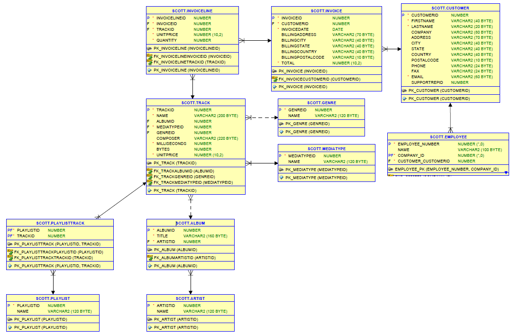

# 8 · Consultas de la base Chinook en SQLite

[Todos los ejercicios](INDICE.md) · [Tema: SQLite](../contenidos/3B-sqlite.md)

**Procedencia:** ejercicios integrados en el capítulo 1.7 del libro 3B. Se agrupan aquí para que sean localizables junto a las demás actividades.

## Enunciado

1. Abrir una base Chinook existente o crearla a partir de su script.
2. Utilizar `.tables`, `.schema nombre_tabla` y `.schema`, explicando qué muestran.
3. Consultar las tablas para familiarizarse con su contenido.
4. Listar los álbumes que tengan **al menos una canción de jazz**.
5. Mostrar, por cada cliente —identificador, nombre y apellidos—, **el total facturado**.

## Preparación

La base completa Chinook no estaba adjunta en los recursos recuperados de estas dos secciones. No se presenta la muestra mínima de prueba como si fuese la base oficial completa. Para trabajar con todo el conjunto de datos se puede obtener la versión SQLite del [proyecto oficial Chinook](https://github.com/lerocha/chinook-database).

La solución utiliza la variante de nombres del esquema de SQLite Tutorial: `albums`, `artists`, `tracks`, `genres`, `customers` e `invoices`. Otras distribuciones usan tablas en singular como `Album` o `Customer`: comprobar `.tables` y adaptar esos nombres, no cambiar las relaciones a ciegas.



## 1. Abrir y explorar

Desde una terminal:

```bash
sqlite3 chinook.db
```

En la consola SQLite, **alternativa A:** utilizar un archivo que ya contiene la base. **Alternativa B:** abrir un archivo nuevo y ejecutar el script de esa distribución con `.read`. No importar sobre una base ya cargada sin comprobar cómo trata el script los objetos existentes.

```text
.open chinook.db
.tables
.schema albums
.schema
.headers on
.mode column
```

- `.tables` permite identificar los nombres reales.
- `.schema albums` muestra el CREATE TABLE y objetos asociados de esa tabla.
- `.schema` muestra las definiciones del conjunto de objetos; no es un listado de todas sus filas.

## 2. Primeras consultas

```sql
SELECT ArtistId, Name
FROM artists
ORDER BY Name
LIMIT 10;

SELECT AlbumId, Title, ArtistId
FROM albums
ORDER BY AlbumId
LIMIT 10;
```

## 3. Álbumes con al menos una canción de jazz

```sql
SELECT a.AlbumId, a.Title
FROM albums a
WHERE EXISTS (
    SELECT 1
    FROM tracks t
    JOIN genres g ON g.GenreId = t.GenreId
    WHERE t.AlbumId = a.AlbumId
        AND g.Name = 'Jazz'
)
ORDER BY a.Title, a.AlbumId;
```

**Por qué EXISTS:** basta con que exista una canción que cumpla la condición. Cada álbum se muestra una sola vez, aunque tenga varias canciones de jazz. Una alternativa válida sería una unión con `SELECT DISTINCT`.

## 4. Total facturado por cliente

```sql
SELECT c.CustomerId, c.FirstName, c.LastName,
    ROUND(COALESCE(SUM(i.Total), 0), 2) AS TotalFacturado
FROM customers c
LEFT JOIN invoices i ON i.CustomerId = c.CustomerId
GROUP BY c.CustomerId, c.FirstName, c.LastName
ORDER BY c.CustomerId;
```

**Por qué LEFT JOIN:** conserva también a los clientes sin facturas. `COALESCE` transforma su total NULL en cero. Se suman los totales de `invoices`, no se vuelve a unir `invoice_items` multiplicando cada total por el número de líneas.

El redondeo muestra dos decimales en el cálculo; la consola puede no imprimir ceros finales. No se atribuye una moneda sin comprobar el conjunto de datos.

## Comprobaciones

La muestra mínima de pruebas incluye un álbum con dos canciones de jazz, otro sin jazz, un cliente con dos facturas y otro sin ninguna. Se comprueba que:

- El álbum de jazz aparece **una sola vez**.
- El cliente con dos facturas tiene la suma correcta.
- El cliente sin facturas sigue apareciendo con total cero.

**Fuente:** libro [3B del aula](https://aulavirtual3.educa.madrid.org/ies.alonsodeavellan.alcala/mod/book/view.php?id=215931), capítulo de ejercicios.
