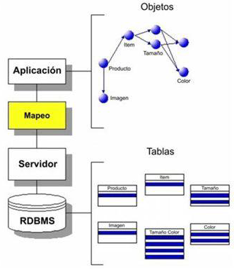
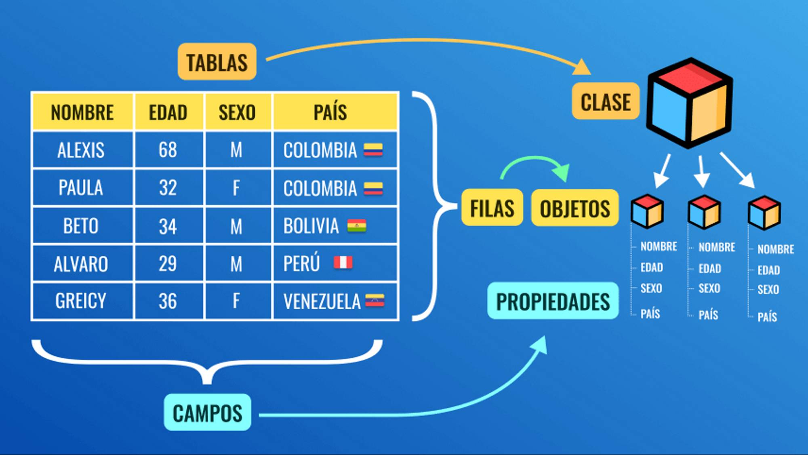
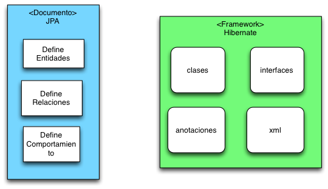
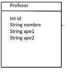
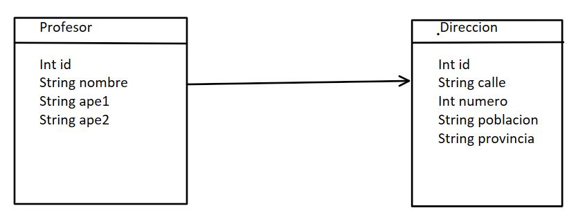
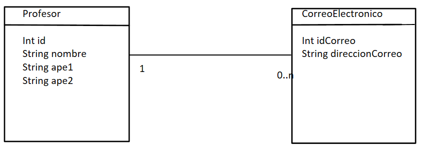
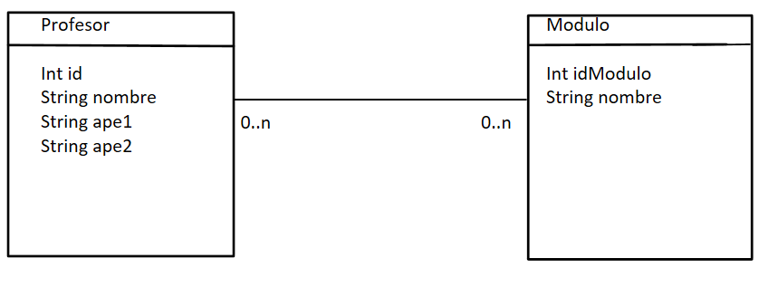
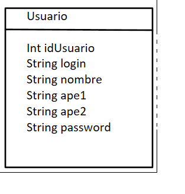
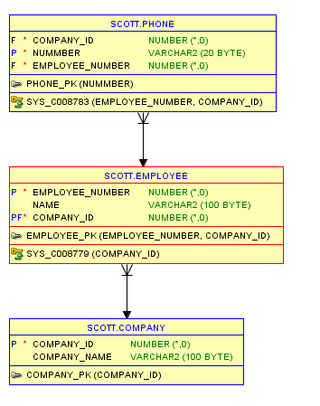
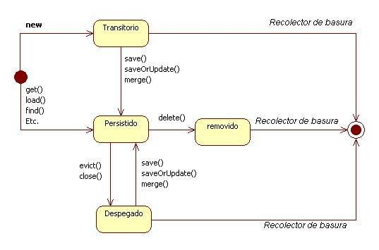

# 4A · Mapeo objeto-relacional con Hibernate

[Inicio de la entrega](../../INDICE.md) · [Proyecto completo](4B-proyecto-hibernate.md) · [Ejemplos resueltos](../ejercicios/INDICE.md)

**Objetivo:** mapear objetos Java a tablas, definir relaciones y controlar su ciclo de vida sin confundir el modelo en memoria con el estado persistente.

## Índice de apartados

- [Persistencia, ORM y JPA](#orm-jpa)
- [Entidades y anotaciones](#entidades)
- [Configuración y sesiones](#configuracion)
- [Relaciones y propietario](#relaciones)
    - [Uno a uno](#nav-uno-a-uno)
    - [Uno a muchos y muchos a uno](#nav-uno-a-muchos-y-muchos-a-uno)
    - [Muchos a muchos](#nav-muchos-a-muchos)
- [Cascadas y eliminación de huérfanos](#cascadas)
- [Igualdad e identificadores](#identificadores)
    - [equals y hashCode](#nav-equals-y-hashcode)
    - [Identificador simple](#nav-identificador-simple)
    - [Identificador compuesto](#nav-identificador-compuesto)
- [Contexto de persistencia](#contexto)
- [Errores frecuentes y soluciones](#errores)

## 1. Persistencia, ORM y JPA

**Persistir** significa conservar información más allá de la vida del objeto o del proceso que la creó. Una base relacional almacena filas y relaciones entre tablas; Java trabaja con objetos y referencias.

El **mapeo objeto-relacional —ORM—** describe la correspondencia entre ambos modelos:

| Modelo relacional | Modelo de objetos |
|---|---|
| Tabla | Entidad o clase mapeada. |
| Fila | Instancia con identidad persistente. |
| Columna | Atributo persistente. |
| Clave foránea | Asociación entre entidades. |

**JPA es una especificación**, no un framework ejecutable por sí solo. Hibernate es un proveedor que implementa esa especificación y añade API propias, como `Session` y HQL. EclipseLink es otro proveedor.

> **Versión de esta entrega.** Los ejemplos revisados utilizan Hibernate **5.4.33.Final**, Java 11+ y anotaciones **`javax.persistence`**. No mezclar esos imports ni sus dialectos con ejemplos de Hibernate 6/7 basados en `jakarta.persistence`. Se conserva el entorno docente; no se recomienda esta versión histórica para un sistema nuevo en producción.

[↑ Volver al índice](#indice)

## 2. Entidades y anotaciones

Una entidad necesita una identidad persistente y un constructor público o protegido sin argumentos. No debe depender de un constructor con parámetros para que Hibernate pueda cargarla.

| Anotación | Finalidad |
|---|---|
| `@Entity` | Declara la entidad y, opcionalmente, su nombre para las consultas. |
| `@Table` | Selecciona la tabla y sus restricciones declarativas. |
| `@Id` | Identificador de la entidad. |
| `@GeneratedValue` | Estrategia para generar el identificador. |
| `@Column` | Nombre y propiedades del mapeo de una columna. |
| `@Transient` | Excluye un atributo de la persistencia. |
| `@Lob` | Mapea texto o binarios de gran tamaño, según el tipo Java. |
| `@Temporal` | Define semántica temporal para Date/Calendar antiguos; no para LocalDate. |
| `@Enumerated` | Define cómo se persiste un enum; STRING evita depender de su posición ordinal. |
| `@Version` | Campo de versión para control de concurrencia optimista. |
| `@Inheritance` | Estrategia para una jerarquía de entidades. |
| `@DiscriminatorColumn` / `@DiscriminatorValue` | Identifican el tipo concreto en estrategias que usan discriminador. |

### Acceso por campos o por propiedades

La posición de `@Id` indica normalmente el tipo de acceso. Si se anota el campo, JPA accede a los campos; si se anota el getter, accede a las propiedades. No mezclar estilos sin `@Access` y una razón explícita.

Los getters y setters no son obligatorios para el mapeo por campos, pero resultan útiles para encapsular reglas de negocio y evitar accesos directos a los campos de proxies diferidos.

**Ejemplo completo:** la entidad `Usuario` y sus archivos de configuración están en [4B](4B-proyecto-hibernate.md#proyecto-revisado). El conjunto de entidades Profesor, Direccion, Correo, Modulo, Company, Employee y Phone se encuentra en [relaciones y claves resueltas](../ejercicios/01-relaciones-claves.md).

[↑ Volver al índice](#indice)

## 3. Configuración y sesiones

| Arranque | Configuración | Objeto de entrada |
|---|---|---|
| Hibernate nativo | `hibernate.cfg.xml` | `SessionFactory` → `Session`. |
| JPA estándar | `META-INF/persistence.xml`, unidad de persistencia | `EntityManagerFactory` → `EntityManager`. |

Ambos pueden utilizar Hibernate como proveedor; no son dos archivos que deban duplicarse obligatoriamente. Esta entrega desarrolla **Hibernate nativo** para mantener un recorrido coherente con la práctica.

La fábrica es costosa de construir: se crea una para la aplicación, se reutiliza y se cierra al terminar. La sesión se abre para una unidad de trabajo y **no se comparte entre hilos**.

La configuración declara dependencias, conexión, dialecto, entidades y política de esquema. `create` y `create-drop` son destructivos: la solución de 4B solo usa `create-drop` sobre **H2 en memoria**. En una base persistente se necesita un esquema de prácticas y una política consciente de creación o validación.

[↑ Volver al índice](#indice)

## 4. Relaciones y propietario

### Uno a uno

Una entidad referencia a una sola entidad del otro tipo. Se puede usar una FK única o una PK compartida; son diseños distintos.

- **Unidireccional:** solo existe una referencia Java. En el ejemplo revisado, `Profesor.perfil` apunta a Perfil.
- **Bidireccional:** ambos lados se referencian. `Profesor.direccion` es el propietario y `Direccion.profesor` declara `mappedBy = "direccion"`.
- **PK compartida:** requiere modelar la dependencia de identidad; `@MapsId` puede mapearla. No se consigue una relación bidireccional correcta colocando `@PrimaryKeyJoinColumn` en ambos lados sin definir quién es el propietario.

### Uno a muchos y muchos a uno

Una fila hija guarda normalmente la FK del padre. Por ello, en una relación bidireccional, el `@ManyToOne` suele ser propietario y el `@OneToMany` utiliza `mappedBy` con el **nombre del atributo Java del hijo**.

| Colección | Cuándo usarla | Orden |
|---|---|---|
| `Set` | No interesan duplicados según la política de igualdad elegida. | No garantiza un orden de iteración. |
| `List` con `@OrderColumn` | La posición es parte de la relación y debe persistirse. | Columna de posición. |
| Colección con `@OrderBy` | Se desea recuperar ordenada por atributos de sus elementos. | Orden de consulta, no una posición editable independiente. |

Se inicializan las colecciones al construir las entidades. En la solución revisada se usa `@OrderColumn`, no la anotación antigua `@IndexColumn`.

### Muchos a muchos

Una tabla intermedia contiene las FK de ambas entidades. Solo un lado declara `@JoinTable`; el otro usa `mappedBy`. Cuando la relación tiene atributos propios —fecha de asignación, horas, etc.— suele convenir convertir esa tabla intermedia en otra entidad.

> **Mantener ambos lados.** Asignar una relación en memoria no sincroniza automáticamente todas las referencias Java. Los métodos `addModulo`, `removeModulo`, `setDireccion` y `addCorreo` del ejemplo mantienen el grafo coherente. El lado propietario determina las escrituras de la relación.

[↑ Volver al índice](#indice)

## 5. Cascadas y eliminación de huérfanos

Las cascadas indican qué operaciones se propagan **desde una entidad a otra**, no cómo funciona ON DELETE CASCADE en SQL.

| Cascada | Propaga |
|---|---|
| `PERSIST` | Hacer persistente una entidad nueva. |
| `MERGE` | Copiar su estado a una instancia gestionada. |
| `REMOVE` | Eliminarla. |
| `REFRESH` | Recargar el estado desde la base. |
| `DETACH` | Separarla del contexto. |
| `ALL` | El conjunto anterior. |

**Usar ALL con criterio:** puede encajar entre un padre y unos hijos cuyo ciclo de vida depende de él, como una factura y sus líneas. No es una configuración general apropiada para módulos compartidos por varios profesores ni para un hijo que referencia a un padre común.

`orphanRemoval = true` elimina el hijo cuando deja de pertenecer a una relación dependiente gestionada. No sustituye al mantenimiento de ambos lados y no debe aplicarse a entidades compartidas como si fueran propiedad exclusiva.

La prueba de muchos a muchos verifica expresamente que borrar un profesor **no borre un módulo que utiliza otro profesor**.

[↑ Volver al índice](#indice)

## 6. Igualdad e identificadores

### equals y hashCode

Las clases empleadas como claves compuestas deben implementar `equals` y `hashCode` por sus valores. Para las entidades no se debe elegir una política de igualdad por inercia:

- Un ID generado aún no existe al crear el objeto y puede afectar a un HashSet si se usa incorrectamente.
- Una clave natural puede servir si es **única, no nula e inmutable**.
- No utilizar un nombre editable o un login nulo como si fuese una identidad segura.
- Mantener el contrato: objetos iguales deben tener el mismo hash.

La versión histórica del `hashCode()` de Usuario usaba una variable local sin inicializar y no compilaba. La entrega final no reproduce ese código defectuoso; la clave `EmployeeId` incluye una implementación completa y probada.

### Identificador simple

- **Asignado:** la aplicación proporciona el valor antes de persistir.
- **IDENTITY:** lo genera una columna de identidad, con soporte dependiente del motor.
- **SEQUENCE:** utiliza una secuencia y un `@SequenceGenerator` declarado con nombre coherente.
- **TABLE:** emplea una tabla auxiliar para obtener identificadores.

No asumir que todas las estrategias sirven en SQLite o en cualquier versión de Oracle. La solución usa IDENTITY y SEQUENCE en H2 para demostrar ambas; eso no certifica todos los perfiles de servidor.

### Identificador compuesto

`@EmbeddedId` agrupa varios campos en una clase `@Embeddable`. La clase de clave debe ser Serializable, tener constructor vacío e implementar igualdad por valor. Otra estrategia es `@IdClass`, con nombres y tipos coherentes con los campos identificadores de la entidad.

La solución elige una sola variante completa:

1. `EmployeeId` contiene `companyId` y `employeeNumber`.
2. `Employee` utiliza `@EmbeddedId` y relaciona Company mediante `@MapsId("companyId")`.
3. `Phone` referencia las dos columnas de la PK con `@JoinColumns`.
4. `Company.employees` contiene **Employee**, no EmployeeId: una clave embebida no es una entidad a la que se pueda apuntar con OneToMany.

No modificar una clave después de persistirla. El ID escalar y la asociación a Company deben ser coherentes; `@MapsId` expresa esa relación.

[↑ Volver al índice](#indice)

## 7. Contexto de persistencia

| Estado | Qué ocurre |
|---|---|
| Nuevo o transitorio | No está asociado a un contexto ni necesariamente a una fila. |
| Gestionado o persistente | El contexto sigue sus cambios; pueden enviarse al hacer flush. |
| Separado o detached | Tiene identidad, pero ya no está gestionado por ese contexto. |
| Eliminado | Se ha marcado para su borrado al sincronizar y confirmar. |

El diagrama procede de la documentación histórica y muestra métodos de Hibernate 5; no convierte `saveOrUpdate` o `update` en la opción universal para versiones posteriores.

**Operaciones importantes:**

- `persist`: hace persistente un objeto nuevo.
- `get` / `find`: cargan por ID y pueden devolver `null` si no existe.
- `load`: puede devolver un proxy y retrasar la detección de una fila inexistente.
- `merge`: copia el estado a una instancia gestionada y **devuelve esa instancia**, que no tiene por qué ser la misma que se pasó.
- `remove`: elimina una entidad gestionada dentro de una transacción.
- `evict` / `detach`: separan del contexto; no borran la fila.
- `refresh`: vuelve a leer la fila y descarta cambios locales de la instancia gestionada.
- `flush`: sincroniza el contexto con la base; **no equivale a commit**.
- `clear`: desconecta todas las entidades del contexto.

### Concurrencia

Un campo `@Version` permite detectar modificaciones incompatibles mediante bloqueo optimista. Los bloqueos pesimistas, como `PESSIMISTIC_WRITE`, requieren una transacción y soporte del motor. La prueba local demuestra el uso de la API, no una prueba de carga concurrente entre varios clientes.

[↑ Volver al índice](#indice)

## 8. Errores frecuentes y soluciones

| Problema | Causa habitual | Solución |
|---|---|---|
| `LazyInitializationException` | Acceder fuera de sesión a una asociación no cargada. | Cargar lo necesario dentro de la unidad de trabajo, con una consulta fetch o una proyección adecuada. |
| `NonUniqueObjectException` | Asociar dos instancias distintas del mismo ID al mismo contexto. | Usar la entidad gestionada o merge según el objetivo. |
| `NonUniqueResultException` | Pedir un resultado único para una consulta que devuelve varios. | Ajustar la condición o utilizar una lista. |
| Un campo de un proxy LAZY aparece nulo | Se lee directamente el campo público sin inicializar el proxy. | Utilizar getters dentro de la sesión o inicializar/desenvolver el proxy. |
| La entidad no se reconoce | Falta registro de la clase o paquete incorrecto. | Revisar mapping, imports y nombres binarios de clases anidadas. |
| Se pierden cambios o recursos | Faltan commit, rollback o cierre de sesión. | Utilizar el patrón completo de 4B y descartar la sesión tras un fallo. |

No resolver la carga diferida poniendo todas las relaciones en EAGER ni dejando una sesión global abierta. Diseñar qué datos necesita cada consulta.

**Continuar:** [4B · Proyecto completo](4B-proyecto-hibernate.md), [relaciones resueltas](../ejercicios/01-relaciones-claves.md), [pruebas reproducibles](../documentacion/verificacion.md) y [referencias](../documentacion/referencias.md).

[↑ Volver al índice](#indice)
