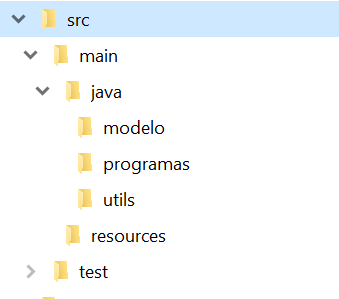

# 4B · Proyecto completo con Hibernate y Maven

[Inicio de la entrega](../../INDICE.md) · [Fundamentos ORM](4A-mapeo-objeto-relacional.md) · [Consultas HQL](4C-consultas.md)

<a id="indice"></a>
## Índice de apartados

- [1. Qué se entrega](#nav-que-se-entrega)
- [2. Estructura del proyecto](#nav-estructura-del-proyecto)
- [3. Preparación paso a paso](#nav-preparacion-paso-a-paso)
- [4. Archivos completos revisados](#proyecto-revisado)
    - [pom.xml · dependencias](#archivo-pom-xml)
    - [hibernate.cfg.xml · configuración](#archivo-hibernate-cfg-xml)
    - [Usuario.java · entidad](#archivo-usuario-java)
    - [HibernateUtils.java · fábrica de sesiones](#archivo-hibernateutils-java)
    - [Main.java · operaciones CRUD](#archivo-main-java)
- [5. Cómo funciona el CRUD](#nav-como-funciona-el-crud)
- [6. Adaptación a los motores del aula](#nav-adaptacion-a-los-motores-del-aula)
    - [MySQL 8](#nav-mysql-8)
    - [Oracle](#nav-oracle)
    - [SQLite](#nav-sqlite)
- [7. Qué se ha corregido respecto a los adjuntos](#nav-que-se-ha-corregido-respecto-a-los-adjuntos)

<a id="nav-que-se-entrega"></a>
## 1. Qué se entrega

Un proyecto de referencia **editorial y completo**, con paquetes coherentes, entidad, configuración, utilidad de sesiones y CRUD. El capítulo «proyecto completo» del aula no tenía archivo adjunto: esta solución **no se hace pasar por esa descarga ausente**.

Se utiliza Java 11+, Hibernate 5.4.33.Final y `javax.persistence`. El entorno de prueba es H2 en memoria. Las dependencias son históricas y están fijadas para reproducir la lección, no para recomendar su uso en producción.

[↑ Volver al índice](#indice)

<a id="nav-estructura-del-proyecto"></a>
## 2. Estructura del proyecto



```text
ut03-referencia/
    pom.xml
    src/
        main/
            java/
                modelo/Usuario.java
                programas/Main.java
                utils/HibernateUtils.java
            resources/
                hibernate.cfg.xml
        test/
            java/revision/RevisionTest.java
```

Los ejemplos de [relaciones](../ejercicios/01-relaciones-claves.md) añaden `modelo/Mapeos.java`; los de [consultas](../ejercicios/02-consultas.md) añaden `consultas/Consultas.java`. Son parte del mismo proyecto, no archivos que deban copiarse al mismo paquete sin respetar sus rutas.

[↑ Volver al índice](#indice)

<a id="nav-preparacion-paso-a-paso"></a>
## 3. Preparación paso a paso

1. Crear un proyecto Maven e importar el POM.
2. Colocar cada clase en el paquete indicado por su encabezado.
3. Guardar `hibernate.cfg.xml` en `src/main/resources`, para que esté en el classpath.
4. Registrar las entidades. Las de la clase anidada Mapeos se registran en la suite con `addAnnotatedClass`.
5. Compilar y ejecutar las pruebas según la [guía reproducible](../documentacion/verificacion.md).

> **Entorno desechable.** El XML de referencia usa `create-drop` exclusivamente en `jdbc:h2:mem:...`. No copiar esa política a una base con información que deba conservarse.

[↑ Volver al índice](#indice)

<a id="proyecto-revisado"></a>
## 4. Archivos completos revisados

<a id="archivo-pom-xml"></a>
### `pom.xml`

```xml
<project xmlns="http://maven.apache.org/POM/4.0.0"
         xmlns:xsi="http://www.w3.org/2001/XMLSchema-instance"
         xsi:schemaLocation="http://maven.apache.org/POM/4.0.0 https://maven.apache.org/xsd/maven-4.0.0.xsd">
  <modelVersion>4.0.0</modelVersion>
  <groupId>dam2.acceso</groupId>
  <artifactId>ut03-referencia</artifactId>
  <version>1.0-SNAPSHOT</version>
  <properties>
    <maven.compiler.release>11</maven.compiler.release>
    <project.build.sourceEncoding>UTF-8</project.build.sourceEncoding>
  </properties>
  <dependencies>
    <dependency>
      <groupId>org.hibernate</groupId>
      <artifactId>hibernate-core</artifactId>
      <version>5.4.33.Final</version>
    </dependency>
    <dependency>
      <groupId>com.h2database</groupId>
      <artifactId>h2</artifactId>
      <version>1.4.200</version>
      <scope>runtime</scope>
    </dependency>
    <dependency>
      <groupId>junit</groupId>
      <artifactId>junit</artifactId>
      <version>4.13.2</version>
      <scope>test</scope>
    </dependency>
    <dependency>
      <groupId>org.xerial</groupId>
      <artifactId>sqlite-jdbc</artifactId>
      <version>3.42.0.0</version>
      <scope>test</scope>
    </dependency>
    <dependency>
      <groupId>com.github.gwenn</groupId>
      <artifactId>sqlite-dialect</artifactId>
      <version>0.1.2</version>
      <scope>test</scope>
    </dependency>
  </dependencies>
  <build>
    <plugins>
      <plugin>
        <groupId>org.apache.maven.plugins</groupId>
        <artifactId>maven-compiler-plugin</artifactId>
        <version>3.13.0</version>
      </plugin>
      <plugin>
        <groupId>org.apache.maven.plugins</groupId>
        <artifactId>maven-surefire-plugin</artifactId>
        <version>3.2.5</version>
      </plugin>
    </plugins>
  </build>
</project>
```

[↑ Volver al índice](#indice)

<a id="archivo-hibernate-cfg-xml"></a>
### `src/main/resources/hibernate.cfg.xml`

```xml
<?xml version="1.0" encoding="UTF-8"?>
<!DOCTYPE hibernate-configuration PUBLIC
  "-//Hibernate/Hibernate Configuration DTD 3.0//EN"
  "http://www.hibernate.org/dtd/hibernate-configuration-3.0.dtd">
<hibernate-configuration>
  <session-factory>
    <property name="hibernate.connection.driver_class">org.h2.Driver</property>
    <property name="hibernate.connection.url">jdbc:h2:mem:ut03;DB_CLOSE_DELAY=-1</property>
    <property name="hibernate.connection.username">sa</property>
    <property name="hibernate.connection.password"></property>
    <property name="hibernate.dialect">org.hibernate.dialect.H2Dialect</property>
    <property name="hibernate.hbm2ddl.auto">create-drop</property>
    <property name="hibernate.show_sql">false</property>
    <mapping class="modelo.Usuario"/>
  </session-factory>
</hibernate-configuration>
```

<a id="archivo-usuario-java"></a>
### `src/main/java/modelo/Usuario.java`

```java
package modelo;

import java.io.Serializable;
import java.time.LocalDate;
import javax.persistence.*;

@Entity
@Table(name = "usuarios")
public class Usuario implements Serializable {
    private static final long serialVersionUID = 1L;
    @Id private int seq;
    @Column(nullable = false, unique = true) private String userNombre;
    private LocalDate creacionFecha;
    private String creacionUsuario;
    private LocalDate modificaFecha;
    private String modificaUsuario;

    public Usuario() {
    }

    public Usuario(int seq, String userNombre) {
        this.seq = seq;
        this.userNombre = userNombre;
        this.creacionFecha = LocalDate.of(2026, 1, 1);
        this.creacionUsuario = "ejemplo";
    }

    public int getSeq() {
        return seq;
    }
    public String getUserNombre() {
        return userNombre;
    }
    public void setUserNombre(String userNombre) {
        this.userNombre = userNombre;
    }
}
```

[↑ Volver al índice](#indice)

<a id="archivo-hibernateutils-java"></a>
### `src/main/java/utils/HibernateUtils.java`

```java
package utils;

import org.hibernate.SessionFactory;
import org.hibernate.cfg.Configuration;

public final class HibernateUtils {
    private static final SessionFactory FACTORY =
            new Configuration().configure().buildSessionFactory();

    private HibernateUtils() {
    }

    public static SessionFactory getSessionFactory() {
        return FACTORY;
    }

    // Llamar una sola vez al terminar toda la aplicación, no tras cada operación.
    public static void shutdown() {
        FACTORY.close();
    }
}
```

[↑ Volver al índice](#indice)

<a id="archivo-main-java"></a>
### `src/main/java/programas/Main.java`

```java
package programas;

import modelo.Usuario;
import org.hibernate.Session;
import org.hibernate.Transaction;
import utils.HibernateUtils;

public final class Main {
    public static void main(String[] args) {
        try {
            ejecutarCrud();
        } finally {
            HibernateUtils.shutdown();
        }
    }

    public static void ejecutarCrud() {
        try (Session session = HibernateUtils.getSessionFactory().openSession()) {
            Transaction tx = session.beginTransaction();
            try {
                session.persist(new Usuario(1, "Manolo"));
                session.flush();
                session.clear();
                Usuario usuario = session.get(Usuario.class, 1);
                if (usuario == null) {
                    throw new IllegalStateException("No se recuperó el usuario");
                }
                usuario.setUserNombre("Manuel");
                session.flush();
                session.clear();
                usuario = session.get(Usuario.class, 1);
                if (!"Manuel".equals(usuario.getUserNombre())) {
                    throw new IllegalStateException("No se guardó el cambio");
                }
                session.remove(usuario);
                session.flush();
                session.clear();
                if (session.get(Usuario.class, 1) != null) {
                    throw new IllegalStateException("No se eliminó el usuario");
                }
                tx.commit();
            } catch (RuntimeException ex) {
                try {
                    if (tx.isActive()) {
                        tx.rollback();
                    }
                } catch (RuntimeException rollbackError) {
                    ex.addSuppressed(rollbackError);
                }
                throw ex;
            }
        }
    }
}
```

[↑ Volver al índice](#indice)

<a id="nav-como-funciona-el-crud"></a>
## 5. Cómo funciona el CRUD

- `HibernateUtils` crea una única fábrica; no crea una fábrica por consulta.
- `Main` abre una sesión y comienza una transacción.
- Persiste Usuario, fuerza flush y limpia el contexto antes de releer. Así no confunde un objeto que ya está en memoria con una lectura real de la fila.
- Modifica, vuelve a releer y elimina, comprobando los resultados.
- Ante un fallo, hace rollback, conserva posibles errores del propio rollback y propaga el error original.
- La sesión se cierra mediante try-with-resources y la fábrica al terminar la aplicación.

La entidad omite el password en claro del ejemplo histórico: un ejemplo ORM no debe enseñar a almacenar credenciales sin protección. `LocalDate` tiene soporte en esta versión sin `@Temporal`. El acceso de JPA es por campos.

[↑ Volver al índice](#indice)

<a id="nav-adaptacion-a-los-motores-del-aula"></a>
## 6. Adaptación a los motores del aula

<a id="nav-mysql-8"></a>
### MySQL 8

- **Dependencia adicional:** `mysql:mysql-connector-java:8.0.28`.
- **Driver:** `com.mysql.cj.jdbc.Driver`.
- **Dialecto de Hibernate 5.4:** `org.hibernate.dialect.MySQL8Dialect`.
- **URL de ejemplo:** `jdbc:mysql://localhost:3306/ejemplo`.

<a id="nav-oracle"></a>
### Oracle

- **Dependencia adicional:** `com.oracle.database.jdbc:ojdbc10:19.12.0.0`.
- **Driver:** `oracle.jdbc.OracleDriver`.
- **Dialecto de Hibernate 5.4:** `org.hibernate.dialect.Oracle10gDialect`.
- **URL por servicio:** `jdbc:oracle:thin:@//localhost:1521/xe`.

<a id="nav-sqlite"></a>
### SQLite

- **Dependencias adicionales:** `org.xerial:sqlite-jdbc:3.42.0.0` y `com.github.gwenn:sqlite-dialect:0.1.2`.
- **Driver:** `org.sqlite.JDBC`.
- **Dialecto externo para Hibernate 5.4:** `org.sqlite.hibernate.dialect.SQLiteDialect`.
- **URL de ejemplo:** `jdbc:sqlite:/ruta/ejemplo.db`.

Elegir SID o servicio según la instalación real de Oracle; el formato por SID usa `@localhost:1521:xe`. Configurar usuario, contraseña y permisos reales sin introducirlos en un repositorio.

Para una base existente se necesita un esquema preparado y una política como `validate`, si el dialecto puede validar sus metadatos, o `none` cuando se administra manualmente. **`update` no sustituye a una migración revisada**, y `create` puede destruir tablas.

Las dependencias SQLite del POM tienen alcance test para comprobar un CRUD real en memoria con esquema explícito; una aplicación SQLite necesita el driver y dialecto en su classpath normal. Esa prueba cubre Usuario, no todas las relaciones ni la generación SEQUENCE del ejemplo H2.

[↑ Volver al índice](#indice)

<a id="nav-que-se-ha-corregido-respecto-a-los-adjuntos"></a>
## 7. Qué se ha corregido respecto a los adjuntos

El paquete del aula contenía dos Java y seis XML, además de tres ZIP anidados. El Main tenía un catch sin try y no incluía la entidad Usuario; había paquetes inconsistentes, cierres incompletos y configuraciones con `create` sobre bases persistentes.

Esta edición proporciona **una única versión coherente**. No repite ocho bloques originales defectuosos después de la solución ni presenta los ZIP como nuevos temas. Los originales permanecen en el archivo de extracción para auditoría.

[Ejemplos completos de relaciones](../ejercicios/01-relaciones-claves.md) · [Pruebas y límites](../documentacion/verificacion.md)

[↑ Volver al índice](#indice)
