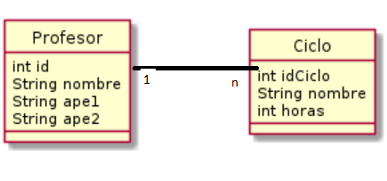

# 4C · HQL y consultas Criteria

[Inicio de la entrega](../../INDICE.md) · [Proyecto Hibernate](4B-proyecto-hibernate.md) · [Consultas completas resueltas](../ejercicios/02-consultas.md)

**Objetivo:** consultar entidades por sus atributos, enlazar parámetros y controlar resultados, paginación y modificaciones masivas.

<a id="indice"></a>
## Índice de apartados

- [Modelo y nombres](#modelo)
- [Filtros, literales y parámetros](#filtros)
- [Agregados, agrupación y uniones](#agregados)
- [Resultados y paginación](#resultados)
- [Consultas nombradas](#nombradas)
- [DML masiva](#dml)
- [Criteria](#criteria)

<a id="modelo"></a>
## 1. Modelo y nombres

HQL consulta **entidades Java y sus atributos**, no las tablas y columnas SQL directamente. `Profesor` es un nombre de entidad; `p.nombre` es un atributo persistente.



La solución utiliza un modelo explícito: cada Ciclo puede referenciar a un Profesor. Los dos diagramas externos adicionales que daban 404 no se reconstruyen por conjetura. El esquema de las entidades revisadas está definido por el código del [ejemplo completo](../ejercicios/01-relaciones-claves.md).

**HQL · Consulta básica:**

```sql
SELECT p
FROM Profesor p
ORDER BY p.nombre, p.id
```

El bloque utiliza resaltado SQL por legibilidad, pero es HQL y debe enviarse a Hibernate, no pegarse en una consola SQL. Los nombres de entidades y atributos deben coincidir con Java; `Profesor`, `Profesores` y `profesor` no son intercambiables salvo mapeo explícito.

[↑ Volver al índice](#indice)

<a id="filtros"></a>
## 2. Filtros, literales y parámetros

HQL permite operadores de comparación, lógicos y aritméticos; también BETWEEN, IN, LIKE e IS NULL. Para un nulo no utilizar `= NULL`.

**HQL · Consulta parametrizada:**

```sql
SELECT p
FROM Profesor p
WHERE p.nombre = :nombre
    AND p.ape1 = :ape1
    AND p.ape2 = :ape2
```

Los parámetros se enlazan por nombre con `setParameter("nombre", valor)`. No usar índices numéricos para un marcador con nombre. Los posicionales modernos llevan ordinal, como `?1`; no reutilizar el `?` sin número de ejemplos antiguos.

> **Seguridad y tipos.** Nunca concatenar entradas del usuario. Utilizar parámetros del tipo correspondiente al atributo: enteros, BigDecimal o tipos temporales compatibles. No asumir que una cadena con una fecha es una comparación temporal portable.

Las cadenas que contienen apóstrofos se pasan como datos. La sensibilidad a mayúsculas de sus **valores** depende del motor y la colación; no se debe afirmar que dos consultas con textos de distinta capitalización sean siempre equivalentes.

El material original mencionaba una entidad TiposBasicos que no se entregó completa y mezclaba `dataDate` con `dateDate`. Esos fragmentos no se presentan aquí como programas listos para ejecutar: se explica la regla y se utilizan las entidades completas de la solución.

[↑ Volver al índice](#indice)

<a id="agregados"></a>
## 3. Agregados, agrupación y uniones

| Operación | Resultado |
|---|---|
| `COUNT(p)` | Número de entidades; normalmente Long. |
| `AVG(c.horas)` | Media; no asumir Integer. |
| `SUM(c.horas)` | Suma, con tipo dependiente de la expresión. |
| `MIN(...)` / `MAX(...)` | Extremos de la expresión. |
| `GROUP BY` | Agrupa por los atributos indicados. |
| `HAVING` | Filtra después de agrupar. |
| Subconsulta | Consulta anidada, por ejemplo comparar con la media. |

**HQL · Ciclos por encima de la media:**

```sql
SELECT c
FROM Ciclo c
WHERE c.horas > (
    SELECT AVG(c2.horas)
    FROM Ciclo c2
)
```

**HQL · Unión por una asociación real:**

```sql
SELECT c.nombre, p.nombre
FROM Ciclo c
JOIN c.profesor p
ORDER BY c.id
```

Un producto cartesiano de dos entidades no es una relación por sí mismo. No escribir un JOIN con ON vacío ni referenciar `profesor.ciclo` si ese atributo no existe en el modelo.

`JOIN FETCH` permite recuperar una asociación junto a su propietario antes de cerrar la sesión. Usarlo según la necesidad de la consulta; no paginar una colección fetch suponiendo que la paginación por filas SQL sea equivalente a paginar entidades padre.

[↑ Volver al índice](#indice)

<a id="resultados"></a>
## 4. Resultados y paginación

| Selección | Tipo de resultado del ejemplo |
|---|---|
| `SELECT p` | `List<Profesor>`. |
| `SELECT p.nombre` | `List<String>`. |
| `SELECT p.id, p.nombre` | `List<Object[]>`. |
| Un resultado por PK | Profesor o null. |

Utilizar consultas tipadas para que el código no dependa de listas raw ni conversiones innecesarias. `uniqueResult()` puede devolver null o lanzar `NonUniqueResultException` si hay varios resultados; comprobar ambos casos.

### Paginación estable

1. Validar que la página sea mayor o igual a cero.
2. Validar que el tamaño sea positivo.
3. Incluir un orden determinista, normalmente con el ID como desempate.
4. Calcular el desplazamiento sin desbordamiento.
5. Aplicar `setFirstResult` y `setMaxResults`.

El recuento se mantiene como long. El número de páginas se puede calcular por división entera y resto, sin pasar por double ni redondear con precisión insuficiente.

[↑ Volver al índice](#indice)

<a id="nombradas"></a>
## 5. Consultas nombradas

`@NamedQuery` guarda una consulta con un nombre estable. Varias se agrupan en `@NamedQueries`, **separadas por comas**. El ejemplo Profesor declara `Profesores.findAll` y `Profesores.ByName`.

La consulta se obtiene mediante su nombre como cadena, por ejemplo `createNamedQuery("Profesores.ByName", Profesor.class)`, y sus valores se asignan con `setParameter`. No escribir el nombre sin comillas ni usar `setString` como patrón moderno.

[↑ Volver al índice](#indice)

<a id="dml"></a>
## 6. Modificaciones masivas

HQL admite UPDATE, DELETE e INSERT SELECT en Hibernate 5. Estas operaciones deben ejecutarse dentro de una transacción.

- **UPDATE:** comprobar espacios al concatenar cadenas Java; `"update Profesor" + "set ..."` produciría un nombre inválido.
- **DELETE:** una operación masiva no ejecuta automáticamente las cascadas JPA de cada entidad. No borrar padres con dependientes sin planificar las FK y su ciclo de vida.
- **INSERT SELECT:** alinear entidad destino, atributos y alias de la selección. No es el INSERT SQL con VALUES. Los IDs explícitos pueden interferir con el generador automático.

> **Contexto de persistencia.** Una DML masiva no actualiza automáticamente el estado de todas las entidades ya cargadas. La solución hace flush antes y clear después; clear desconecta también otras entidades, por lo que el alcance de la unidad de trabajo debe ser consciente.

[↑ Volver al índice](#indice)

<a id="criteria"></a>
## 7. Criteria: consulta construida desde Java

Criteria permite construir la consulta mediante `CriteriaBuilder`, `CriteriaQuery` y `Root`, componiendo condiciones sin concatenar SQL o HQL. Los nombres de atributo escritos como cadenas siguen pudiendo contener errores; el metamodelo estático puede mejorar su comprobación.

El ejemplo `buscarCriteria` aplica los mismos tres filtros que `buscar` y `buscarNombrada`. Las pruebas comparan los resultados con datos que contienen un apóstrofo y con una entrada de intento de inyección.

Esta sección es una **ampliación editorial**: el material recuperado desarrollaba HQL, pero no una lección completa de Criteria. No se atribuye este código al profesor.

**Aplicar los conceptos:** [consultas completas y resueltas](../ejercicios/02-consultas.md) · [pruebas reproducibles](../documentacion/verificacion.md) · [referencias](../documentacion/referencias.md).

[↑ Volver al índice](#indice)
