# 3A Manejo de conectores

> **Esta es la transcripción de archivo, no la entrega final.** [Abrir 3A editado y revisado](../../entrega-final/UT02/contenidos/3A-manejo-de-conectores.md). La edición final corrige el formato y el código, y sustituye la transcripción del PDF por un enlace al archivo.

[← UT02 · Índice de la unidad](../INDICE.md)

> **Unidad:** UT02 · Manejo de conectores  
> **Tipo de recurso:** Libro · 24 capítulos · ejemplos y documentos adjuntos integrados  
> **Fuente:** [Libro del aula](https://aulavirtual3.educa.madrid.org/ies.alonsodeavellan.alcala/mod/book/view.php?id=215930)

> **Criterio editorial:** contenido del aula sin resumir ni actualizar sus versiones. Se mejora la estructura y se normalizan los espacios de sangría del código; los archivos originales permanecen intactos.


## Índice

- [1. Introducción](#1-introduccion)
- [2. Protocolos de acceso a bases de datos.](#2-protocolos-de-acceso-a-bases-de-datos)
- [3. Conexión a bases de datos con API JDBC](#3-conexion-a-bases-de-datos-con-api-jdbc)
  - [3.1. Arquitectura JDBC](#3-1-arquitectura-jdbc)
  - [3.2. Conectores o Drivers.](#3-2-conectores-o-drivers)
  - [3.3. Tipos de conectores](#3-3-tipos-de-conectores)
  - [3.4. Conectores tipo 1 y tipo 2.](#3-4-conectores-tipo-1-y-tipo-2)
    - [TIPO1: puente JDBC-ODBC](#tipo1-puente-jdbc-odbc)
    - [TIPO2: controlador parcial de Java](#tipo2-controlador-parcial-de-java)
  - [3.5. Conectores tipo 3 y tipo 4.](#3-5-conectores-tipo-3-y-tipo-4)
    - [TIPO3: controlador Java puro para middleware de base de datos](#tipo3-controlador-java-puro-para-middleware-de-base-de-datos)
    - [TIPO4: controlador Java puro para directo a base de datos](#tipo4-controlador-java-puro-para-directo-a-base-de-datos)
      - [Tipo 4: Protocolo nativo.](#tipo-4-protocolo-nativo)
- [4. Drivers de Oracle](#4-drivers-de-oracle)
- [5. Drivers MySQL](#5-drivers-mysql)
  - [1. Controladores estándar para múltiples lenguajes](#1-controladores-estandar-para-multiples-lenguajes)
  - [2. Enfoque en JDBC: MySQL Connector/J](#2-enfoque-en-jdbc-mysql-connector-j)
  - [Características clave de Connector/J:](#caracteristicas-clave-de-connector-j)
  - [3. Frameworks de persistencia (para proyectos grandes)](#3-frameworks-de-persistencia-para-proyectos-grandes)
- [6. Configurar conectores de la base de datos en proyecto java](#6-configurar-conectores-de-la-base-de-datos-en-proyecto-java)
  - [Tutorial adjunto · Incorporación del driver JDBC a Eclipse](#tutorial-adjunto-incorporacion-del-driver-jdbc-a-eclipse)
    - [Página 1](#pagina-1)
    - [Página 2](#pagina-2)
    - [Página 3](#pagina-3)
    - [Página 4](#pagina-4)
    - [Página 5](#pagina-5)
    - [Página 6](#pagina-6)
    - [Página 7](#pagina-7)
    - [Página 8](#pagina-8)
    - [Página 9](#pagina-9)
    - [Página 10](#pagina-10)
    - [Página 11](#pagina-11)
    - [Página 12](#pagina-12)
      - [Extracción textual del código (sin depurar)](#extraccion-textual-del-codigo-sin-depurar)
    - [Página 13](#pagina-13)
- [7. JDBC Conexión a una base de datos.](#7-jdbc-conexion-a-una-base-de-datos)
  - [Registrar el driver en el IDE](#registrar-el-driver-en-el-ide)
  - [Descargar drivers](#descargar-drivers)
- [8. Ejecución sentencias SQL I](#8-ejecucion-sentencias-sql-i)
- [9. Ejecucion de sentencias de la base de datos II](#9-ejecucion-de-sentencias-de-la-base-de-datos-ii)
  - [9.1. Sentencias que devuelven varias filas (consultas)](#9-1-sentencias-que-devuelven-varias-filas-consultas)
  - [9.2. Consultas al Diccionario de Datos](#9-2-consultas-al-diccionario-de-datos)
  - [9.3. Sentencias DML: actualizacion, borrado e insercion.](#9-3-sentencias-dml-actualizacion-borrado-e-insercion)
  - [9.4. Sentencias preparadas](#9-4-sentencias-preparadas)
    - [Sentencias"preparadas" PreparedStatement](#sentencias-preparadas-preparedstatement)
    - [Laboratorio visual · Datos que no se convierten en código](#laboratorio-visual-datos-que-no-se-convierten-en-codigo)
      - [Una entrada debe ser un dato. No una instrucción SQL.](#una-entrada-debe-ser-un-dato-no-una-instruccion-sql)
      - [La misma entrada. Dos consultas.](#laboratorio-sql-injection-la-misma-entrada-dos-consultas)
        - [Statement](#laboratorio-sql-injection-statement)
        - [PreparedStatement](#laboratorio-sql-injection-preparedstatement)
        - [¿Cómo cambia la consulta `' OR 1=1 --` ?](#laboratorio-sql-injection-como-cambia-la-consulta-or-1-1)
      - [Primero la consulta. Después el dato.](#laboratorio-sql-injection-primero-la-consulta-despues-el-dato)
      - [La diferencia está en estas líneas](#laboratorio-sql-injection-la-diferencia-esta-en-estas-lineas)
      - [Representación visual estática](#representacion-visual-estatica)
  - [9.5. Ejemplo sentencias de creación de tablas y de inserción de filas](#9-5-ejemplo-sentencias-de-creacion-de-tablas-y-de-insercion-de-filas)
- [10. Ejecución de procedimientos almacenados en la base de datos Oracle](#10-ejecucion-de-procedimientos-almacenados-en-la-base-de-datos-oracle)
- [11. Ejecución de procedimientos almacenados en la base de datos de MySQL.](#11-ejecucion-de-procedimientos-almacenados-en-la-base-de-datos-de-mysql)
  - [Realizar estos pasos como Ejercicio](#realizar-estos-pasos-como-ejercicio)
  - [Ejemplo adjunto · Crear la tabla clientes](#ejemplo-adjunto-crear-la-tabla-clientes)
  - [Ejemplo adjunto · Rutina insertar cliente](#ejemplo-adjunto-rutina-insertar-cliente)
  - [Ejemplo adjunto · Invocar el procedimiento desde Java](#ejemplo-adjunto-invocar-el-procedimiento-desde-java)
- [12. Transacciones](#12-transacciones)
- [13. Recuperación y modificación de valores de ResultSet](#13-recuperacion-y-modificacion-de-valores-de-resultset)
- [14. Ejemplo completo de uso ResultSet para actualización](#14-ejemplo-completo-de-uso-resultset-para-actualizacion)
- [Fuentes locales y adjuntos](#fuentes-locales-y-adjuntos)

---

<a id="1-1-introduccion"></a>
<a id="1-introduccion"></a>
## 1. Introducción

Actualmente, las **bases de datos relacionales** constituyen el **sistema de almacenamiento** probablemente más **extendido**, aunque otros sistemas de almacenamiento de la información se estén abriendo paso poco a poco.

Una **base de datos relacional** se puede definir, de una manera simple, como aquella que presenta la información en tablas con **filas** y **columnas**.

Una tabla o relación es una **colección de objetos del mismo tipo (filas o tuplas).**

En cada tabla de una base de datos se elige una **clave primaria** para identificar de manera unívoca a cada fila de la misma.

El sistema gestor de bases de datos **(SGBD)** , en inglés conocido como: Database Management System (**DBMS**) gestiona el modo en que los datos se almacenan, mantienen y recuperan.

En el caso de una base de datos relacional, el sistema gestor de base de datos (SGBDR) se denomina: Relational Database Management System (**RDBMS**).

Tradicionalmente, la programación de bases de datos ha sido como una torre de Babel: gran cantidad de productos de bases de datos en el mercado y cada uno "hablando" en su lenguaje privado con las aplicaciones.

**Conexión de base de datos (De Wikipedia):**

- **En informática , una conexión de base de datos es el medio por el cual un servidor de base de datos y su software cliente se comunican entre sí.** El término se utiliza independientemente de si el cliente y el servidor están en máquinas diferentes.
- El cliente utiliza una conexión de base de datos p**ara enviar comandos y recibir respuestas del servidor.**
- Una base de datos se **almacena como un archivo** o un conjunto de archivos en un disco o cinta magnética, disco óptico o algún otro dispositivo de almacenamiento secundario.

**Correcto.**  JDBC hace que sea muy sencilla la conexión de ese tipo de bases de datos.

**Incorrecto.**  JDBC hace que sea muy sencilla la conexión de ese tipo de bases de datos.

**Verdadero.** JDBC hace que sea muy sencilla la conexión de ese tipo de bases de
datos.

<a id="2-protocolos-de-acceso-a-bases-de-datos"></a>
## 2. Protocolos de acceso a bases de datos.

**Inicialmente cada SGBD tiene su propia conexión y su propio API**

Cada empresa desarrolladora de un SGBD implementaba soluciones propietarias específicas para su sistema, pero pronto se dieron cuenta de que colaborando conjuntamente podían sacar mayor rendimiento y avanzar mucho más rápidamente. 

**Primer estándar de conectividad**

**ODBC** significa **Open Database Connectivity** (Conectividad de Base de Datos Abierta). Es un **estándar de interfaz** desarrollado por Microsoft que permite que las aplicaciones se conecten a diferentes sistemas de gestión de bases de datos (DBMS) de manera uniforme, sin importar el fabricante o el tipo de base de datos.

La llegada del **ODBC**representó un avance sin precedentes en el camino hacia la interoperabilidad entre bases de datos y lenguajes de programación. La mayoría de empresas desarrolladoras de **sistemas gestores de bases de datos incorporaron los drivers**de conectividad a las utilidades de sus sistemas y los lenguajes de programación más importantes desarrollaron bibliotecas específicas para soportar el **API ODBC**.

**Java no de adapta bien**

Aunque la industria aceptó **ODBC** como medio principal para acceso a bases de datos en Windows, la verdad es que no se introduce bien en el mundo Java, debido a la complejidad que presenta **ODBC**, y que entre otras cosas ha impedido su transición fuera del entorno Windows.

Sistema de conexión **ODBC** configurado usando diferentes controladores (drivers) y un API estándar.

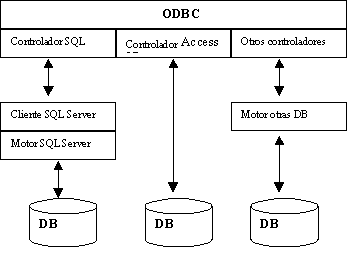

**JDBC**  (**Java Database Connectivity**)

Se trata de un API bastante similar a **ODBC** en cuanto a funcionalidad,  **implementado específicamente para usar con el lenguaje Java**, adaptado a las especificidades de Java.

La **funcionalidad se encuentra capsulada en clases** (ya que Java es un lenguaje totalmente orientado a objetos) y además, **no depende de ninguna plataforma específica**, de acuerdo con la característica multiplataforma defendida por Java.

La idea en el desarrollo de JDBCera intentar ser tan **sencillo** como fuera posible, pero proporcionando a los desarrolladores la máxima **flexibilidad**.

Java, mediante**JDBC**, permite **simplificar el acceso a bases de datos relacionales**, proporcionando un lenguaje mediante el cual las aplicaciones pueden comunicarse con motores de bases de datos.

**Objetivos** - Sun desarrolló este API (java.sql.\*)para el acceso a bases de datos, con tres **objetivos** principales en mente:

- **Ser un API con soporte de SQL:** poder construir sentencias SQL e insertarlas dentro de llamadas al API de Java.
- Aprovechar la **experiencia de los API's** de bases de datos existentes.
- Ser lo más **sencillo** posible.

Los **fabricantes** de Los Sistemas Gestores de Bases de Datos **proporcionan la implementación de esa interfaz** (Drivers).

JDBC es similar en estructura a ODBC. Una aplicación JDBC está compuesta de varias capas, como se muestra en la figura

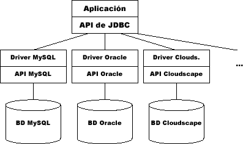

- Capa de Aplicación:

La **capa superior** en este modelo es la aplicación Java. Las aplicaciones Java son portátiles: puede ejecutar una aplicación Java sin modificaciones en cualquier sistema que tenga instalado una maquina virtual java  (Java runtime environment).

- API de JDBC

Una aplicación Java que utiliza **JDBC puede comunicarse con muchas bases de datos con pocas modificaciones,** si es que las hay. Al igual que ODBC, **JDBC proporciona una manera consistente de conectarse a una base de datos**, ejecutar comandos y recuperar los resultados.

Al igual que ODBC, **JDBC no impone un lenguaje de comando común:** puede usar la sintaxis específica de Oracle cuando está conectado a un servidor Oracle y la sintaxis específica de MySQL cuando está conectado a un servidor MySQL.

- Driver

**La Api  JDBC tiene la interfaz DriverManager,  responsable de localizar un controlador JDBC que necesita la aplicación**. Cuando una aplicación **cliente solicita una conexión de base de datos**, la solicitud se expresa en forma de una **URL (Uniform Resource Locator)**. Una URL de JDBC es similar a las URL que utiliza con un navegador web.  Para conectarnos a la base de datos Oracle,  por ejemplo: jdbc:oracle:thin:ejemplo/ejemplo@localhost:1521:XE

A medida que cada controlador se carga en una Máquina Virtual de Java (VM), se registra con el **DriverManager JDBC** .**Cuando una aplicación solicita una conexión, el DriverManager pregunta a cada Controlador si puede conectarse a la base de datos especificada en la URL dada.** Tan pronto como encuentra un controlador adecuado, la búsqueda se detiene y el controlador intenta establecer una conexión con la base de datos. Si el intento de conexión falla, el **Controlador**lanzará una **SQLException**a la aplicación. Si la conexión se completa con éxito, el controlador crea un objeto de conexión y lo devuelve a la aplicación.

<a id="3-conexion-a-bases-de-datos-con-api-jdbc"></a>
## 3. Conexión a bases de datos con API JDBC

**JDBC: Java DataBase Connectivity** (en español: Conectividad a bases de datos de Java), **es una API que permite la ejecución de operaciones sobre bases de datos desde el lenguaje de programación Java,** independientemente del sistema operativo donde se ejecute o de la base de datos a la cual se accede, utilizando el dialecto SQL del modelo de base de datos que se utilice.

Arquitectura de Conexión:

- **El API JDBC ( java.sql.\*) se presenta como una colección de interfaces Java y métodos de gestión de manejadores de conexión hacia la base de datos.** Es decir el lenguaje los incorpora como punto de extensibilidad en el sistema a la hora de conectarnos a una base datos
- **Un manejador (driver) de conexiones** hacia un modelo de base de datos en particular **es un conjunto de clases que implementan las interfaces Java** y que utilizan los métodos de registro para declarar los tipos de localizadores a base de datos (URL) que pueden manejar.

**Para utilizar una base de datos particular, el usuario ejecuta su programa junto con la biblioteca de conexión apropiada al modelo de su base de datos, y accede a ella estableciendo una conexión; para ello provee el localizador a la base de datos y los parámetros de conexión específicos.** A partir de allí puede realizar cualquier tipo de tarea con la base de datos a la que tenga permiso: consulta, actualización, creación, modificación y borrado de tablas, ejecución de procedimientos almacenados en la base de datos, etc.

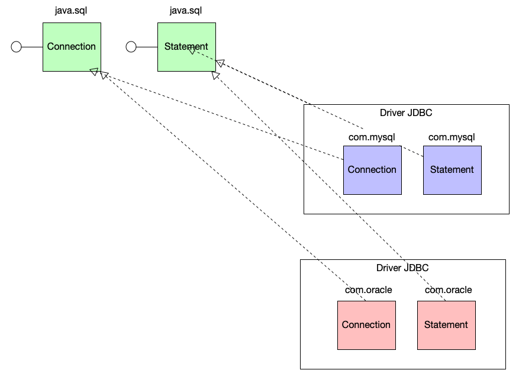

<a id="3-1-arquitectura-jdbc"></a>
### 3.1. Arquitectura JDBC

En el **modelo de dos capas**, una aplicación se comunica directamente a la fuente de datos. Esto necesita un conector JDBC que pueda comunicar con la fuente de datos específica a la que acceder.

**Los comandos o instrucciones del usuario se envían a la base de datos y los resultados se devuelven al usuario.** La fuente de datos puede estar ubicada en otra máquina a la que el usuario se conecte por red. A esto se denomina configuración cliente/servidor, con la máquina del usuario como cliente y la máquina que aloja los datos como servidor.

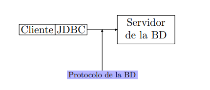

En el **modelo de tres capas**, los comandos se envían a una capa intermedia de servicios, la cual envía los comandos a la fuente de datos. La fuente de datos procesa los comandos y envía los resultados de vuelta la capa intermedia, desde la que luego se le envían al usuario.

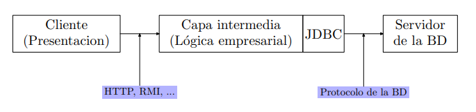

**Incorrecto.**  Son dos APIs distintas.

**Correcto.**  Son dos APIs distintas.

**Falso.** Son dos APIs distintas.

<a id="3-2-conectores-o-drivers"></a>
### 3.2. Conectores o Drivers.

**Un conector o driver es un conjunto de clases encargadas de implementar los interfaces del API y acceder a la base de datos.**

Para poder conectarse a una base de datos y lanzar consultas, una aplicación necesita tener un driver adecuado.

El conector lo proporciona el fabricante de la base de datos o bien un tercero.

Cuando se construye una aplicación de base de datos, **JDBC oculta lo específico de cada base de datos**, de modo que el programador se ocupe sólo de su aplicación.  El código de nuestra aplicación no depende del driver, puesto que trabajamos mediante los paquetes**java.sql** y **javax.sql.**

JDBC ofrece las clases e interfaces para:

- Establecer una conexión a una base de datos.
- Ejecutar una consulta.
- Procesar los resultados.

**La clase usada es DriverManager**

Es la **clase usada** de JDBC para gestionar los drivers de bases de datos y establecer conexiones. Esta en desuso, y se usa más la interfaz **DataSource**

**Responsabilidades principales:**

- - Registrar y administrar los drivers JDBC disponibles.
  - Proporcionar el método `getConnection()` para obtener una conexión a la base de datos.

**Las interfaces más usadas son:**

1. **Connection:**Representa una **sesión de conexión**con una base de datos específica. Es el punto de partida para ejecutar sentencias SQL.
2. **Statement:** Se utiliza para **ejecutar sentencias SQL estáticas**(sin parámetros) y obtener sus resultados.
3. **ResultSet:** Representa el conjunto de **resultados** **devuelto por una consulta** (normalmente un `SELECT`). Mantiene un cursor que apunta a la fila actual.
4. **DataSource:**Alternativa moderna a `DriverManager`. Representa una **fuente de datos** y suele implementarse mediante **pooling de conexiones** (como HikariCP, Apache DBCP, etc.).

**Ejemplo:**

programa que lista números de empleado, nombre y oficio:

```java
import java.sql.Connection;
import java.sql.DriverManager;
import java.sql.ResultSet;
import java.sql.SQLException;
import java.sql.Statement;
public class ConsultaSencilla {
 public static void main(String[] args) {
 Connection conexion;
 try {
 String urljdbc = "jdbc:oracle:thin:@localhost:1521:XE";
        //la base de datos esta en local y el servicio Oracle es XE 
        //se utiliza   thin driver 
 conexion = DriverManager.getConnection(urljdbc, "ejemplo", ejemplo"); 
 Statement smt = conexion.createStatement();
 ResultSet rset = smt.executeQuery("select  empno, ename , job from emp order by 1");
 while (rset.next())
 System.out.println("empleado numero " + rset.getString(1) + " nombre " + rset.getString(2) + " oficio "  + rset.getString(3));
 conexion.close();
 } catch (SQLException e) {
 e.printStackTrace();
 }
 }
}
```

La API de JDBC provee acceso a datos desde Java. Usando esta API podemos acceder a variadas fuentes de datos: bases de datos relacionales, hojas de cálculo (spreadsheets) y archivos planos.

Aquí encontraras un tutorial  bastante completo de JDBC con bases de datos Oracle:

[I](https://www.oracle.com/technetwork/database/application-development/jdbc/overview/quickstart-4308895.html)[ntroduccion a JDBC Oracle](https://www.oracle.com/technetwork/database/application-development/jdbc/overview/quickstart-4308895.html)

Hay cinco tipos de drivers JDBC: Tipo 1, Tipo 2, Tipo 3 , Tipo 4 y Tipo 5, que veremos a continuación.

<a id="3-3-tipos-de-conectores"></a>
### 3.3. Tipos de conectores

Hoy en día, hay cinco tipos de controladores JDBC en uso:

- Tipo 1: puente JDBC-ODBC
- Tipo 2: controlador parcial de Java
- Tipo 3: controlador Java puro para middleware de base de datos
- Tipo 4: controlador Java puro para directo a base de datos
- Tipo 5: controladores altamente funcionales con un rendimiento superior

<a id="3-4-conectores-tipo-1-y-tipo-2"></a>
### 3.4. Conectores tipo 1 y tipo 2.

<a id="tipo1-puente-jdbc-odbc"></a>
#### TIPO1: puente JDBC-ODBC

[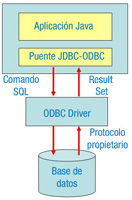](../originales/UT02-manejo-de-conectores/215930-3A%20Manejo%20de%20conectores.%20Libro/fd5e5b5a2d-AD03_CONT_R09_drivertipo1.JPG "Ampliar imagen.")

**Los conectores tipo 1 se denominan también JDBC-ODBC Bridge (puente JDBC-ODBC).**

Proporcionan un puente entre el API JDBC y el API ODBC. El driver JDBC-ODBC Bridge **traduce las llamadas JDBC a llamadas ODBC** y las envía a la fuente de datos ODBC.

Como **ventajas** destacar:

- **No se necesita un driver específico de cada base de datos de tipo ODBC.**
- **Está soportado por muchos fabricantes**, por lo que tenemos acceso a muchas Bases de Datos.

Como **desventajas** señalar:

- Hay **plataformas que no lo tienen implementado**.
- El **rendimiento no es óptimo** ya que la llamada JDBC se realiza a través del puente hasta el conector ODBC y de ahí al interface de conectividad de la base de datos. El resultado recorre el camino inverso.
- Se tiene que **registrar manualmente en el gestor de ODBC** teniendo que configurar el DSN (Data Source Names, Nombres de fuentes de datos).

El puente se implementa como el paquete sun.jdbc.odbc y contiene una biblioteca nativa utilizada para acceder a ODBC.

**Eliminado desde Java 8**

<a id="tipo2-controlador-parcial-de-java"></a>
#### TIPO2: controlador parcial de Java

[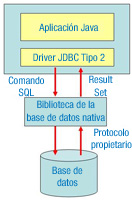](../originales/UT02-manejo-de-conectores/215930-3A%20Manejo%20de%20conectores.%20Libro/dbcecbd0e3-AD03_CONT_R10_drivertipo2.JPG "Ampliar imagen.")

**Los conectores tipo 2 se conocen también como: API nativa**

**Convierten las llamadas JDBC a llamadas específicas de la base de datos para bases de datos como SQL Server, Informix, Oracle, o Sybase.**

El conector tipo 2 se comunica directamente con el servidor de bases de datos, por lo que es **necesario que haya código en la máquina cliente**. Esto tiene el **inconveniente** que la librería de la bases de datos del vendedor necesita cargarse en cada máquina cliente. Por esta razón los drivers tipo 2 **no pueden usarse para Internet.**

**No es muy común.**

Los drivers Tipo  2 utilizan código nativo vía JNI, por lo que son más eficientes.

 **Para saber más**

En este enlace puede ver información sobre [JNI](http://es.wikipedia.org/wiki/Java_Native_Interface "Acceder a la definición de JNI.")

**Correcto.**  La afirmación es correcta, porque hay que cargar librerías de la base de datos en la máquina cliente.

**Incorrecto.**  La afirmación es correcta, porque hay que cargar librerías de la base de datos en la máquina cliente.

&amp;amp;amp;amp;lt;div class="feedback"&amp;amp;amp;amp;gt;&amp;amp;amp;amp;lt;strong&amp;amp;amp;amp;gt;Verdadero.&amp;amp;amp;amp;lt;/strong&amp;amp;amp;amp;gt; La afirmación es correcta, porque hay que cargar librerías de la base de datos en la máquina cliente.
&amp;amp;amp;amp;lt;/div&amp;amp;amp;amp;gt;

<a id="3-5-conectores-tipo-3-y-tipo-4"></a>
### 3.5. Conectores tipo 3 y tipo 4.

<a id="tipo3-controlador-java-puro-para-middleware-de-base-de-datos"></a>
#### TIPO3: controlador Java puro para middleware de base de datos

[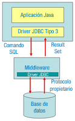](../originales/UT02-manejo-de-conectores/215930-3A%20Manejo%20de%20conectores.%20Libro/e4bf098670-AD03_CONT_R11_drivertipo3.JPG "Ampliar imagen")

**Tipo 3: JDBC-Net pure Java driver.**

**Tiene una aproximación de tres capas**. Las peticiones JDBC a la base de datos se pasan a través de la red al servidor de la capa **intermedia**(middleware). Este servidor traduce este protocolo independiente del sistema gestor a protocolo específico del sistema gestor y se envía a la base de datos. Los resultados se mandan de vuelta al middleware y se enrutan al cliente.

Este driver está basado en servidor, por lo que **no se necesita ninguna librería de base de datos en las máquinas clientes**. Normalmente, un driver de tipo 3 proporciona soporte para **balanceo de carga,** funciones avanzadas de administrador de sistemas tales como auditoría, etc.

**Es útil para aplicaciones en Internet.**

Muy poco frecuente

<a id="tipo4-controlador-java-puro-para-directo-a-base-de-datos"></a>
#### TIPO4: controlador Java puro para directo a base de datos

 [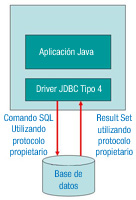](../originales/UT02-manejo-de-conectores/215930-3A%20Manejo%20de%20conectores.%20Libro/95dc694a8a-AD03_CONT_R12_drivertipo4.JPG "Ampliar imagen")

<a id="tipo-4-protocolo-nativo"></a>
##### Tipo 4: Protocolo nativo.

En este caso se trata de **conectores que convierten directamente las llamadas JDBC al protocolo de red usando por el sistema gestor de la base de datos**. Esto permite una **llamada directa desde la máquina cliente al servidor del sistema gestor de base de datos** y es una solución excelente para acceso en **intranets**.

Como ventaja se tiene que no es necesaria traducción adicional o capa middleware, **lo que mejora el rendimiento,** siendo éste mejor que en el caso de los tipos 1 y 2.

Además, **no se necesita instalar ningún software especial en el cliente o en el servidor.**

Como **inconveniente**, de este tipo de conectores, el usuario necesita un **driver diferente** para cada base de datos.

**Es el más común.**

Unos ejemplos de este tipo de conector es **Oracle Thin y MySQL Conector/J**

 **Para saber más**

En la siguiente web puedes ver información sobre Oracle Thin y otros conectores de Oracle.

[Conectores Oracle](http://www.orafaq.com/wiki/JDBC)

<a id="4-drivers-de-oracle"></a>
## 4. Drivers de Oracle

**Tipos de drivers JDBC que Oracle**

**Oracle ofrece 3 formas distintas** para conectar aplicaciones Java con una base de datos Oracle. Cada una con características propias

- **JDBC Thin Driver (Tipo 4),**
  - **Qué es:** Un driver escrito 100% en Java que se conecta **directamente** a Oracle usando sockets TCP/IP, sin necesidad de instalar software cliente de Oracle en la máquina.
  - **Ventaja:** Es independiente de la plataforma (funciona en Windows, Linux, Mac, etc.) y hasta puede ejecutarse desde un navegador web (applets, en su época).
  - **Cómo se usa (formatos de URL):**
  - Los  formatos de URL:

    - - SID: (ya no se recomienda para uso de Oracle)  

        ```java
         jdbc: oracle: thin: [<user> / <password>] @ <host> [: <port>]: <SID>
        ```
      - Servicios (recomendado):  

        ```java
         jdbc: oracle: thin: [<user> / <password>] @ // <host> [: <port>] / <service>
        ```
      - TNSNames (usando un alias definido en el archivo `tnsnames.ora)`:  

        ```java
         jdbc: oracle: thin: [<user> / <password>] @ <TNSName>
        ```
- **JDBC [OCI](http://www.orafaq.com/wiki/OCI "OCI") (Oracle Call Interfaces)** (Tipo 2)
  - **Qué es:** Un driver que usa las **interfaces nativas** de Oracle (OCI) a través de SQL\*Net. Es decir, **necesita tener instalado el cliente de Oracle** en la máquina.
  - **Ventaja:** Ofrece mayor compatibilidad con una versión específica de Oracle y mejor rendimiento en ciertos casos.
  - **Desventaja:** Es **específico de la plataforma** (no es portable como el Thin), porque usa bibliotecas nativas.
  - Ejemplo de formato de URL:

    ```java
    jdbc: oracle: oci: @myhost: 1521: orcl
    ```
- JDBC KPRB driver (default connection)
  - **Qué es:** Un driver especial que se usa **dentro de la propia base de datos Oracle**, por ejemplo, para escribir **procedimientos almacenados en Java** o **JSP** que corren en el servidor.
  - **Característica clave:** Usa la **sesión actual de la base de datos**, por lo que **no necesitas usuario, contraseña ni URL**.
  - Se puede obtener un identificador de la conexión predeterminada o actual (controlador KPRB) llamando al método OracleDriver.defaultConnection ().

Encontraras la documentación de estos tres tipos de drivers es la pagina : [JDBC Oracle](http://www.orafaq.com/wiki/JDBC)

<a id="5-drivers-mysql"></a>
## 5. Drivers MySQL

**Cómo MySQL permite a los desarrolladores conectar sus aplicaciones a la base de datos**, y en particular **la conexión desde Java**

<a id="1-controladores-estandar-para-multiples-lenguajes"></a>
### 1. Controladores estándar para múltiples lenguajes

MySQL ofrece **drivers (controladores)** basados en estándares para que puedas conectarte desde distintos entornos:

| Estándar | Uso |
| --- | --- |
| **JDBC** | Aplicaciones Java |
| **ODBC** | Aplicaciones en C, C++, Python, Excel, etc. |
| **.NET** | Aplicaciones en C#, [VB.NET](https://vb.net/), etc. |

La idea es que **el desarrollador elija el lenguaje que prefiera** y MySQL le da el conector adecuado. Estos se descargan desde la página oficial de MySQL.

<a id="2-enfoque-en-jdbc-mysql-connector-j"></a>
### 2. Enfoque en JDBC: MySQL Connector/J

Aquí se centra en Java. MySQL ofrece **Connector/J**, que es el driver que permite a una aplicación Java hablar con MySQL --&gt;<https://dev.mysql.com/downloads/connector/j/>

- **Implementa la API JDBC**: es decir, cumple el estándar de Java para conectarse a bases de datos.
- **Añade extensiones propias**: además del estándar, agrega funcionalidades extra de MySQL.
- **Soporta X DevAPI**: una API moderna de MySQL para trabajar con documentos JSON y SQL (parte de MySQL 8+).

<a id="caracteristicas-clave-de-connector-j"></a>
### Características clave de Connector/J:

- **Es un driver JDBC Tipo 4**: esto significa que es **100% Java puro**, se comunica directamente con MySQL por red, **sin necesidad de instalar bibliotecas cliente de MySQL** en la máquina.
- **Compatible con JDBC 3.0 y JDBC 4.2**: hay versiones distintas según la especificación JDBC que necesites

<a id="3-frameworks-de-persistencia-para-proyectos-grandes"></a>
### 3. Frameworks de persistencia (para proyectos grandes)

Cuando el proyecto crece, escribir código JDBC "a mano" se vuelve tedioso y propenso a errores. Por eso se usan **frameworks de persistencia**, que **reducen la cantidad de código JDBC** que tienes que escribir, depurar, asegurar y mantener.

<a id="6-configurar-conectores-de-la-base-de-datos-en-proyecto-java"></a>
## 6. Configurar conectores de la base de datos en proyecto java

**MySQL**

Vamos a utilizar el IDE Eclipse para conectar java a las bases de datos, necesitamos instalar el conector de la base de datos.   
Puedes seguir este [tutorial](#tutorial-jdbc-eclipse), que explica la descarga del driver y la configuración necesaria para utilizarlo en un proyecto Elipse. O bien, puedes seguir el video  presentación   
Como verás, tan sólo consiste en descargar un archivo, descomprimirlo y desde Eclipse añadir el fichero **.jar**que constituye el driver que necesitamos. Es importante que compruebes el driver mas adecuado para trabajar con tu Servidor MySQL.

[cFLsynl91B0](https://youtu.be/cFLsynl91B0)

**nota:**  En sistemas antiguos, para que `DriverManager` tuviera "registrados" los drivers, era necesario cargar la clase en la máquina virtual. Para eso es el `Class.forName()`, simplemente carga la clase con el nombre indicado.

A partir de JDK 6, los drivers JDBC 4 ya se registran automáticamente y no es necesario el `Class.forName()`, sólo que estén en el classpath de la JVM.

**ejemplo:**

```java
import java.sql.Connection;
import java.sql.DriverManager;
import java.sql.SQLException;
public class PrimeraConexion {
	public static void main(String[] args) {
		try {
			// Establecemos la conexion con la BD
			Connection conexion = DriverManager.getConnection("jdbc:mysql://localhost/ejemplo", "root", "system");
			System.out.println("conecta");
			conexion.close(); // Cerrar conexión
		} catch (SQLException cn) {
			cn.printStackTrace();
		}
	}
}
```

**Oracle**

Para Oracle la configuración del driver se hace de la misma forma que en MySQL:

- Utilizaremos  el driver ojdbc11.jar que podemos descargar en la [pagina Oracle](https://www.oracle.com/technetwork/database/application-development/jdbc/downloads/jdbc-ucp-183-5013470.html).  Desde Eclipse añadimos esta librería: configuramos **Build Path.**
- La cadena de conexión recomendada es la que utiliza  el ServiceName. O en la propia instalación de Oracle 21C:  C:\app\alumno\product\21c\dbhomeXE\jdbc\lib

El archivo **`tnsnames.ora`** es un archivo de configuración de **Oracle Net Services** que actúa como una "agenda de contactos" para las conexiones a bases de datos Oracle. Su función principal es mapear **nombres de servicio de red** (alias fáciles de recordar) a los **descriptores de conexión** (la información técnica real de red, como IP, puerto y nombre del servicio.

Su ruta suele estar en:  C:\app\alumno\product\21c\homes\OraDB21Home1\network\admin

TNSNames.ora tiene una entrada correspondiente al servicio XE correspondiente a la base de Datos que se va a usar:

XE =  
         (DESCRIPTION =  
                (ADDRESS = (PROTOCOL = TCP)(HOST = PC)(PORT = 1521))  
                (CONNECT\_DATA =  
                         (SERVER = DEDICATED)   
                         (SERVICE\_NAME = XE)  
                )  
           )

- La URL seria para esta base de datos:

```java
String urljdbc = "jdbc:oracle:thin:@//localhost:1521/XE";
```

El ejemplo para Oracle:

```java
import java.sql.Connection;
import java.sql.DriverManager;
import java.sql.SQLException;
public class PrimeraConexion {
public static void main(String[] args) {
try {
// Establecemos la conexion con la BD
String urljdbc = "jdbc:oracle:thin:@//localhost:1521/XE";
conexion = DriverManager.getConnection(urljdbc, "ejemplo", "ejemplo");
System.out.println("conecta");
conexion.close(); // Cerrar conexión
} catch (SQLException cn) {
cn.printStackTrace();
}
}
}
```

<a id="tutorial-jdbc-eclipse"></a>
<a id="tutorial-adjunto-incorporacion-del-driver-jdbc-a-eclipse"></a>
### Tutorial adjunto · Incorporación del driver JDBC a Eclipse

**Fuente del complemento:** [PDF original local](../originales/externos/incorporacion-driver-JDBC-eclipse_Gamaza_Otte.pdf) · [Repositorio de la Universidad de Cádiz](https://rodin.uca.es/xmlui/bitstream/handle/10498/18602/incorporacion-driver-JDBC-eclipse_Gamaza_Otte.pdf?sequence=1&isAllowed=y)

> **Nota de extracción:** se conservan las 13 páginas del PDF, incluidas las páginas de cortesía. Se normalizan las tildes y ligaduras de la tipografía original. El código de la página 12 tiene espaciado defectuoso en la capa de texto: se incluye una reproducción visual exacta y su extracción textual sin corregir ni presentarla como código listo para ejecutar.


<a id="tutorial-jdbc-eclipse-pagina-1"></a>
<a id="pagina-1"></a>
#### Página 1


Tutorial de incorporación del driver JDBC a


Eclipse
———————————
Programación en Internet


Angel Manuel Gamaza Domínguez


José Miguel Otte Sainz-Aguirre


Grado en Ingeniería Informática


20 de septiembre de 2016


<a id="tutorial-jdbc-eclipse-pagina-2"></a>
<a id="pagina-2"></a>
#### Página 2


1


<a id="tutorial-jdbc-eclipse-pagina-3"></a>
<a id="pagina-3"></a>
#### Página 3


Índice


Índice de figuras
3


1. Descarga del driver
4


2. Añadir el conector a Eclipse
6


3. Creación de la clase en Java para usar el conector
10


2


<a id="tutorial-jdbc-eclipse-pagina-4"></a>
<a id="pagina-4"></a>
#### Página 4


Índice de figuras


1.
Página de descarga del driver. . . . . . . . . . . . . . . . . . . . . . . . . . . .
4
2.
Continuar con la descarga. . . . . . . . . . . . . . . . . . . . . . . . . . . . . .
5
3.
Escoger la opción Properties. . . . . . . . . . . . . . . . . . . . . . . . . . . .
6
4.
Menú de propiedades del proyecto.
. . . . . . . . . . . . . . . . . . . . . . . .
7
5.
Escoger la opción Configure Build Path. . . . . . . . . . . . . . . . . . . . .
7
6.
Ventana Java Build Path de Eclipse. . . . . . . . . . . . . . . . . . . . . . .
8
7.
Código Java para la conexión mediante el driver. . . . . . . . . . . . . . . . . .
10


3


<a id="tutorial-jdbc-eclipse-pagina-5"></a>
<a id="pagina-5"></a>
#### Página 5


1.
Descarga del driver


Para descargar el driver JDBC deberemos de ir a la siguiente URL: http://dev.mysql.
com/downloads/connector/j/, que nos llevará a la página oficial de MySQL para adquirirlo.


Nos aparecerá esta ventana:


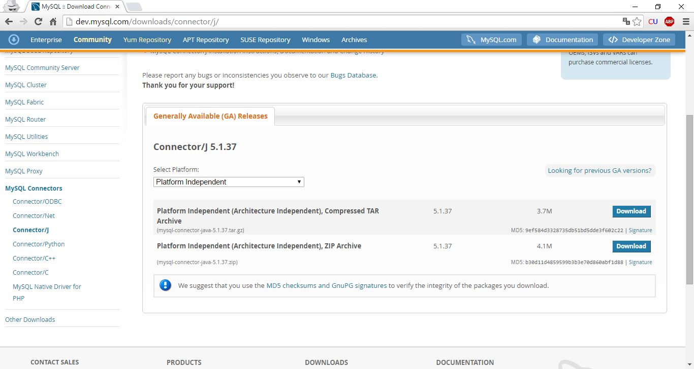


Figura 1: Página de descarga del driver.


Seleccionaremos la opción ”Platform Independent” para facilitarnos las cosas y posterior-
mente elegiremos una de las dos opciones de descarga que nos ofrecen. Es indiferente elegir
una u otra, lo que cambia es el método de compresión del driver.


4


<a id="tutorial-jdbc-eclipse-pagina-6"></a>
<a id="pagina-6"></a>
#### Página 6


Una vez escogida una de las dos opciones, nos saldrá la siguiente ventana:


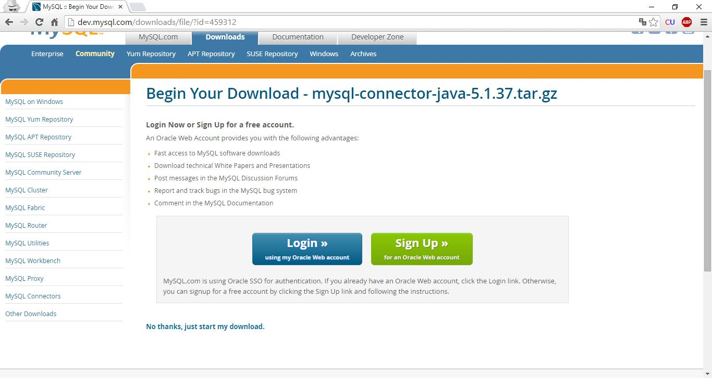


Figura 2: Continuar con la descarga.


Si no existen problemas, podremos pulsar sobre la opción ”No thanks, just start my
download.” y comenzará nuestra descarga automáticamente. Si por el contrario no pasa esto,
nos crearemos una cuenta o nos loguearemos y ya podremos proceder a dicha descarga.


5


<a id="tutorial-jdbc-eclipse-pagina-7"></a>
<a id="pagina-7"></a>
#### Página 7


2.
Añadir el conector a Eclipse


Una vez realizada la descarga, descomprimiremos el archivo en el directorio que deseemos.
Hecho esto, iremos a Eclipse a la ventana donde se encuentra nuestro proyecto.
Existen dos formas de llegar hasta la ventana desde donde añadir el conector:


Desde las propiedades del proyecto.


Pulsamos sobre el proyecto con click derecho, Properties.


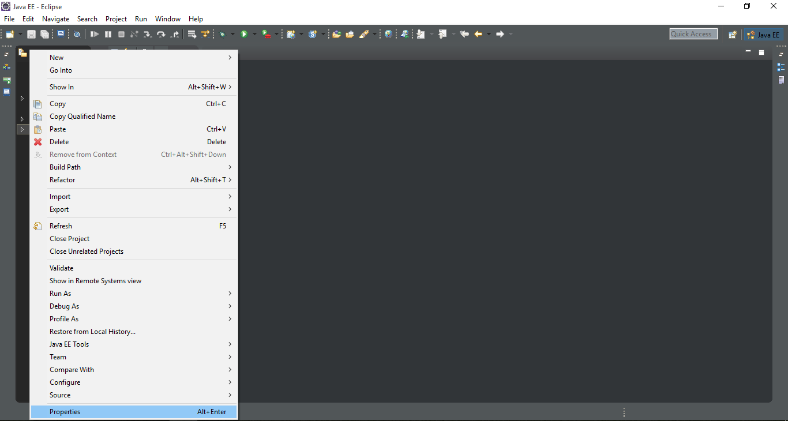


Figura 3: Escoger la opción Properties.


6


<a id="tutorial-jdbc-eclipse-pagina-8"></a>
<a id="pagina-8"></a>
#### Página 8


Una vez aquí, iremos a Java Build Path.


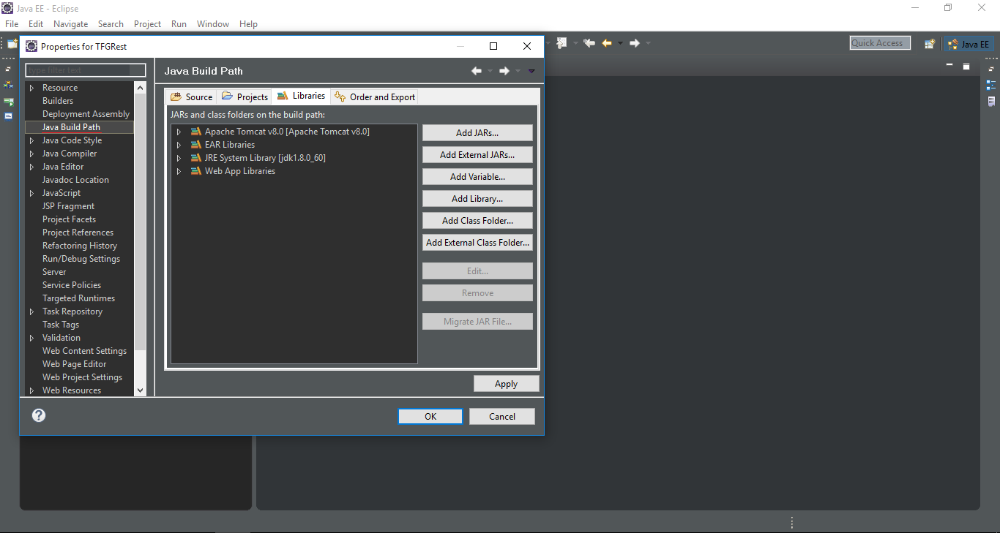


Figura 4: Menú de propiedades del proyecto.


Desde la opción Build Path del proyecto. Pulsamos sobre el proyecto con click derecho,
Build Path →Configure Build Path.


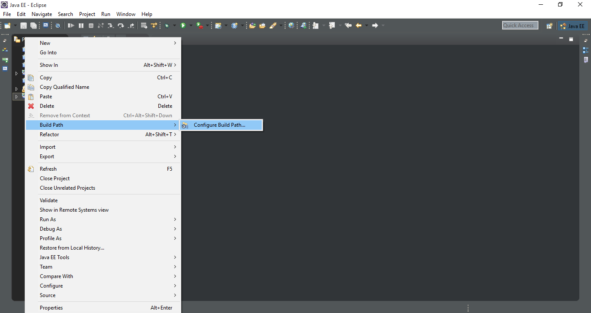


Figura 5: Escoger la opción Configure Build Path.


Ambos caminos nos llevarán a la ventana Java Build Path de Eclipse, donde deberemos
seleccionar la opción Add External JARs para añadir el archivo ”.jar” de nuestro conector.


7


<a id="tutorial-jdbc-eclipse-pagina-9"></a>
<a id="pagina-9"></a>
#### Página 9


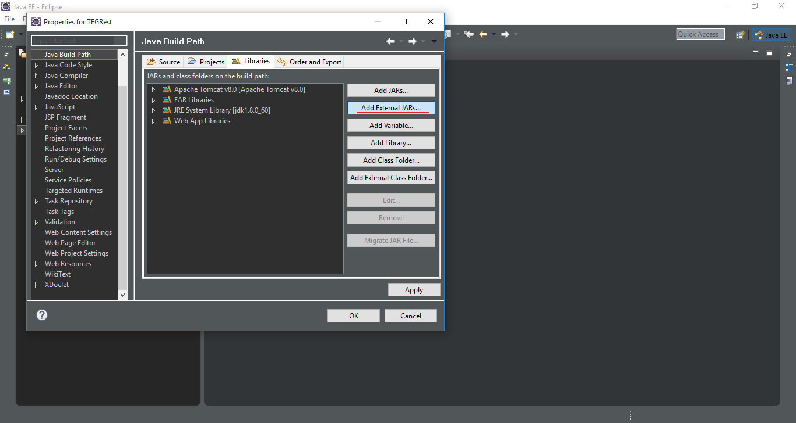


Figura 6: Ventana Java Build Path de Eclipse.


Escogeremos el archivo mysql-connector-java-version conector-bin.jar y pulsaremos
aceptar. Con esto ya tendremos añadido a nuestro proyecto el conector JDBC de MySQL.


8


<a id="tutorial-jdbc-eclipse-pagina-10"></a>
<a id="pagina-10"></a>
#### Página 10


9


<a id="tutorial-jdbc-eclipse-pagina-11"></a>
<a id="pagina-11"></a>
#### Página 11


3.
Creación de la clase en Java para usar el conector


Para crear un nuevo archivo java iremos al proyecto y pulsaremos mediante click derecho en
Java Resources New →Class. Le pondremos un nombre y pulsaremos sobre aceptar.


Usaremos el código que se expone a continuación para manipular la conexión a la base de
datos. En el código existen varios comentarios explicativos, con lo que nos ahorraremos la
explicación de cada uno de los pasos:


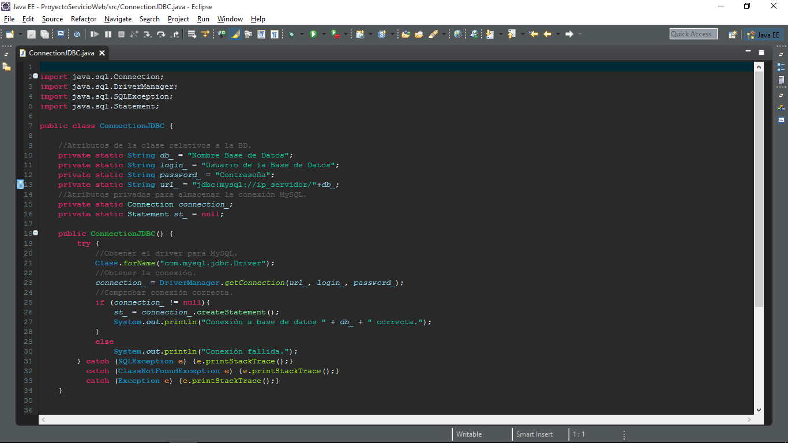


Figura 7: Código Java para la conexión mediante el driver.


Si todo ha ido bien y se ha hecho correctamente, podremos crear un objeto de nuestra clase
y realizar una conexión correcta a nuestra base de datos.


10


<a id="tutorial-jdbc-eclipse-pagina-12"></a>
<a id="pagina-12"></a>
#### Página 12


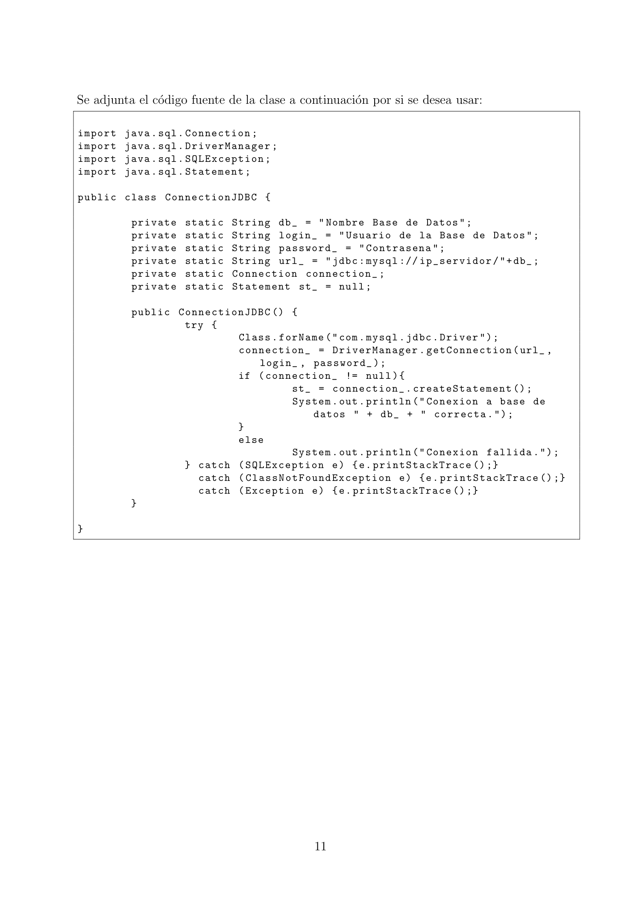


<a id="tutorial-jdbc-eclipse-extraccion-textual-del-codigo-sin-depurar"></a>
<a id="extraccion-textual-del-codigo-sin-depurar"></a>
##### Extracción textual del código (sin depurar)

```text
Se adjunta el código fuente de la clase a continuación por si se desea usar:

import   java . sql . Connection ;
import   java . sql . DriverManager ;
import   java . sql . SQLException ;
import   java . sql . Statement ;

public class ConnectionJDBC {

          private    static    String db_ = " Nombre Base de Datos " ;
          private    static    String login_ = " Usuario de la Base de Datos " ;
          private    static    String password_ = " Contrasena " ;
          private    static    String url_ = " jdbc : mysql :// ip_servidor / " + db_ ;
          private    static    Connection connection_ ;
          private    static    Statement st_ = null ;

          public ConnectionJDBC () {
                  try {
                          Class . forName ( " com . mysql . jdbc . Driver " ) ;
                          connection_ = DriverManager . getConnection ( url_ ,
                                login_ , password_ ) ;
                          if ( connection_ != null ) {
                                          st_ = connection_ . createStatement () ;
                                          System . out . println ( " Conexion a base de
                                                datos " + db_ + " correcta . " ) ;
                          }
                          else
                                          System . out . println ( " Conexion fallida . " ) ;
                  } catch ( SQLException e ) { e . printStackTrace () ;}
                    catch ( C l a s s N o t F o u n d E x c e p t i o n e ) { e . printStackTrace () ;}
                    catch ( Exception e ) { e . printStackTrace () ;}
          }

}


                                                 11
```


<a id="tutorial-jdbc-eclipse-pagina-13"></a>
<a id="pagina-13"></a>
#### Página 13


Referencias


[1] Foro de preguntas y respuestas, Stackoverflow http: // stackoverflow. com/


Fecha de último acceso: 28 de Noviembre de 2015


[2] MySQL Databases http: // www. mysql. com/


Fecha de último acceso: 28 de Noviembre de 2015


[3] Ayuda de Eclipse http: // help. eclipse. org/


Fecha de último acceso: 29 de Noviembre de 2015


12

<a id="7-jdbc-conexion-a-una-base-de-datos"></a>
## 7. JDBC Conexión a una base de datos.

La API **JDBC c**onsta de los paquetes **java.sql** (contiene las interfaces **core** de JDBC) y **javax.sql** (contiene interfaces **opcionales/avanzadas)**. [Consulta la documentación del paquete java.sql](https://docs.oracle.com/javase/8/docs/api/java/sql/package-summary.html) y [paquete javax.sql](https://docs.oracle.com/javase/8/docs/api/javax/sql/package-summary.html)

- **JDBC** aparte de algunas clases especificas, **mayoritariamente está compuesto de interfaces que el controlador (driver) implementa dándoles la funcionalidad adecuada.** El fabricante hace las implementaciones de las interfaces.
- Para asegurar la interoperabilidad (que nuestro código no dependa de la base de datos/Driver), las **aplicaciones** no referenciarán nunca las clases concretas de ningún controlador  sino las **interfaces estándares de la****API****JDBC.**Para ello, **la aplicación nunca podrá instanciar directamente los objetos JDBC** con una sentencia *new* , sino que se crearán indirectamente llamando algún método de alguna clase u objeto ya existente.

<a id="registrar-el-driver-en-el-ide"></a>
### Registrar el driver en el IDE

Para conectar programas Java a un gestor de base de datos es necesario que **configuremos el proyecto** para que utilice las librerías correspondientes al controlador del gestor de base de datos correspondiente:

**En Eclipse**:  
proyecto --&gt; botón derecho --&gt; Build Path --&gt; configure Build Path . Añade el driver adecuado para la BD que quieras utilizar.

<a id="descargar-drivers"></a>
### Descargar drivers

- **Oracle**: además del que puedes encontrar en la ruta: C:\oraclexe\app\oracle\product\11.2.0\server\jdbc\lib.   
  Puedes descargar drivers en la [pagina](https://www.oracle.com/database/technologies/jdbcdriver-ucp-downloads.html) :ojdbc8.jar, ojdbc14.jar
- **MySQL**:  El driver a utilizar es Conector/J que puedes descargar en la [pagina](https://www.mysql.com/products/connector/)

**Registrar un controlador y cerrarlo**  
La clase  **DriverManager** s**e encargan de gestionar la conexión y todas las comunicaciones con la BD, necesita conocer los controladores específicos para las BD que se vayan a utilizar.**

La interfaz `Connection`representa una conexión a la base de datos, una vía de comunicación entre la aplicación y el SGBD. **Los objetos****`Connection`mantendrán la capacidad de comunicarse con el sistema gestor mientras permanezcan abiertos. Esto es, desde que se crean hasta que se cierran utilizando el método `close`.**

El objeto `Connection s`e obtiene utilizando  el método `getConnection()`de la clase `DriverManager`. Este método recibe como parámetro la URL JDBC que identifica a la base de datos con la que queremos realizar la conexión. Está totalmente vinculado a una fuente de datos, por eso en pedir la conexión hay que especificar de qué fuente se trata siguiendo el protocolo JDBC e indicando la url de los datos, y en su caso el usuario y password .

```java
getConnection(String url)
```

```java
getConnection(String url, Properties info)
```

getConnection(String URL, String user, String password);

Cuando se presenta con una **URL específica,**`DriverManager` itera sobre la colección de drivers registrados hasta que uno de ellos reconoce la URL especificada. Si no se encuentra ningún conector adecuado, se lanza una `SQLException.`

 **Los controladores se identifican con un URL JDBC.** La forma más sencilla es una lista de tres valores separados mediante dos puntos de la forma jdbc:subprotocolo:localizadorBD:

- El primer valor de la lista representa el protocolo, que es siempre `jdbc` para los URL JDBC.
- El segundo valor es el **subprotocolo** .
- El tercer valor es el nombre de sistema para establecer la conexión con un sistema específico, dependerá del tipo de controlador utilizado, del *host* donde se aloje el SGBD, del puerto que este use para escuchar las peticiones y del nombre de la base de datos o esquema con el que queremos trabajar.  
  Existen dos valores especiales que pueden utilizarse para conectarse con la base de datos local. Son \*LOCAL y localhost (ambos son sensibles a mayúsculas y minúsculas).

Prueba el siguiente ejemplo en un nuevo proyecto, configurar tu proyecto para incluir las bibliotecas JDBC de Oracle en la construcción de su ruta.  `proyecto --> boton derecho --> Build Path --> configure Build Path . Añade ojdbcX.jar`

[Para obtener mas información de los drivers de Oracle disponibles](https://docs.oracle.com/cd/E11882_01/appdev.112/e13995/oracle/jdbc/OracleDriver.html)  y de la sintaxis de url correspondiente a cada uno de ellos.

Para conectarnos a una base de datos Oracle 11XE:

```java
import java.sql.Connection;
import java.sql.DriverManager;
import java.sql.SQLException;
public class PrimeraConexion {
public static void main(String[] args) throws SQLException {
		Connection conexion;
		//url oracle con formato jdbc:oracle:thin:@/<hostname>:<port>/<servicename>
                 String urljdbc = "jdbc:oracle:thin:@//localhost:1521/XE";
                //establecemos la conexion utilizando el metodo getConnection
                // damos url, nombre del usuario y contraseña
		conexion = DriverManager.getConnection(urljdbc, "ejemplo", "ejemplo");
                 System.out.println("conecta"); 
		 conexion.close(); 
            }
}
```

Para establecer la conexión con la BD MySQL, únicamente hay que utilizar el driver JDBC  correspondiente y configurar el proyecto para añadir el driver mysql-connector-java-8.0.22.jar

[Para obtener mas información de los drivers de mysql disponibles](https://dev.mysql.com/doc/connector-j/8.0/en/connector-j-reference-jdbc-url-format.html) y de la sintaxis de url correspondiente a cada uno de ellos.

La url para una BD local es***"jdbc:mysql://localhost/base datos".   
Si el servidor de base de datos MySQL no tiene establecido la zona horaria. Da un error que se resuelve cambiando la zona horaria en Mysql o bien estableciendo la zona horaria en la urljdbc***

***"jdbc:mysql://localhost/base datos?serverTimezone=UTC" UTC es la zona horaria .***

***Para cambiar zona horaria en MySQL consulta la [documentación de la DB](https://dev.mysql.com/doc/refman/8.0/en/time-zone-support.html#time-zone-variables)***

```java
import java.sql.Connection;
import java.sql.DriverManager;
import java.sql.SQLException;
public class PrimeraConexion {
	public static void main(String[] args) throws SQLException {
		// Establecemos la conexion con la BD
		Connection conexion = 
               DriverManager.getConnection("jdbc:mysql://localhost/ejemplo", "root", "system");
		// Cerrar conexión
		conexion.close();
	}
}
```

<a id="8-ejecucion-sentencias-sql-i"></a>
## 8. Ejecución sentencias SQL I

Para operar con una base de datos,  ejecutando las consultas necesarias, nuestra aplicación deberá:

1. **Cargar** el driver necesario .
2. **Establecer** una conexión con la base de datos.
3. **Enviar** sentencias SQL y procesar el resultado.
4. **Liberar** los recursos al terminar.
5. **Gestionar** los errores que se puedan producir.

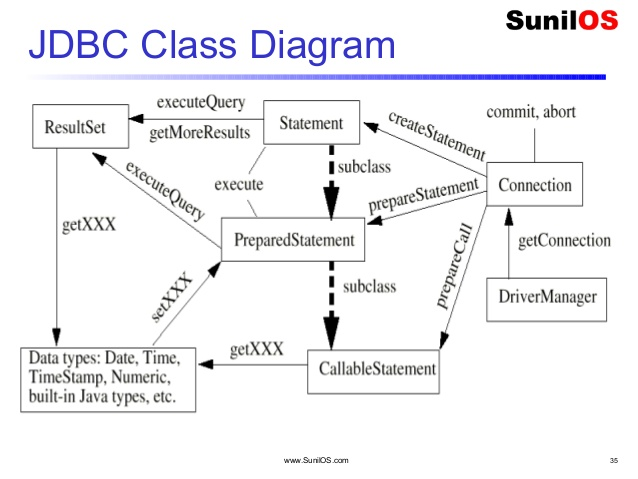

1.- Cargamos el driver correspondiente al SGBD que vayamos a utilizar (explicado en capítulos anteriores)

**2.- Establecemos una conexión** con la base de datos (explicado en el capítulo7) .   
**Creamos un objeto****Connection** utilizando  el método **getConnection()** de la clase **DriverManager**. Este método recibe como parámetro la URL JDBC que identifica a la base de datos con la que queremos realizar la conexión.

```java
conexion = DriverManager.getConnection("jdbc:mysql://localhost/ejemplo", "root", "system");
```

**3.- Creamos el objeto Statement** (o PrepareStatement): Para ello utilizamos el método createStatement() del objeto Connection. Esto nos permitirá ejecutar sentencias SQL en la base de datos.

```java
sentencia = conexion.createStatement(); 
```

4.- Para ejecutar la sentencia SQL, usamos el método exacuteQuery("sql") del objeto Statement que producira el objeto ResultSet

sql = "SELECT \* FROM dept";  
resul = sentencia.executeQuery(sql);

5.- A continuación  procesar el resultado, dependiendo de la sentencia puede ser un conjunto de filas (un ResultSet) o un entero correspondiente al numero de filas afectadas por la sentencia DML.

```java
while (resul.next()) {
	System.out.printf("%d, %s, %s %n", resul.getInt(1), resul.getString(2), resul.getString(3));
}
```

**Las interfaces relacionadas son**:

1. - **Statement**: Se utiliza para implementar sentencias SQL simples sin parámetros.
   - **PreparedStatement**: (derivada de Statement). Se utiliza para compilar previamente sentencias SQL que pueden contener parámetros de entrada.
   - **CallableStatement**:(derivada de PreparedStatement). Se utiliza para ejecutar procedimientos almacenados que pueden contener parámetros de entrada y salida.
   - DatabaseMetaData permite obtener Información  sobre la base de datos en su conjunto. Las veremos en el capitulo consultas al diccionario de datos.
2. Liberación de recursos  
   Debemos tener en cuenta siempre que las conexiones con una base de datos consumen muchos recursos en el sistema gestor, y por lo tanto en el sistema informático en general. Por ello, conviene cerrarlas con el método  

   close (de la clase Connection) siempre que vayan a dejar de ser utilizadas , en lugar de esperar a que el garbage collector de Java las elimine.

   También conviene cerrar la ejecución de procedimientos almacenados ( CallableStatement ),    las consultas (Statement y PreparedStatement) y los resultados (ResultSet) para liberar los recursos.

   Es recomendable liberar recursos en la parte Finally del try\_catch , para asegurarnos que aunque se produzca cualquier error, se liberen los recursos utilizados por nuestro programa.
3. Gestión de errores.  
   Se puede producir un error tanto en el controlador como en la base de datos. Se lanza una excepción y laa ejecución del programa actual se detiene y el control se redirige a la cláusula de captura (catch) más cercana. Si no existe, la ejecución del programa finaliza.  
   El manejo de excepciones de JDBC es muy similar al manejo de excepciones de Java, pero para JDBC, la excepción más común con la que tratará es java.sql.SQLException. Es obligatorio capturar esta excepción.   
   Cuando se produce un error, el objeto SQLException pasado,  tiene los siguientes métodos disponibles para recuperar información adicional sobre el error :

- getErrorCode () Código de error (entero) específico del vendedor
- getMessage () Mensaje de error de la excepción
- printStackTrace ()
- getSQLState()   Texto de SQLstate según la convención X/Open o SQL:2003

ejemplo:

```java
package EmpleDepart;
```

```java
import java.sql.*;
public class PrimeraConsulta {
	public static void main(String[] args) {
		Statement sentencia=null; 
		String sql=null;
		ResultSet resul=null; // ResultSet es una estructura de datos de tipo cursor que modela una tabla en memoria que se puede recorrer
		Connection conexion=null;
		
		try {
			// 2 Establecemos la conexion con la BD
			conexion = DriverManager.getConnection("jdbc:mysql://localhost/ejemplo", "root", "system");
			// 3 creamos el objeto Statement
			sentencia = conexion.createStatement(); 
			sql = "SELECT * FROM dept";
			resul = sentencia.executeQuery(sql);// ejecutamos la consulta
 
			// Recorremos el resultado para visualizar cada fila
			// Se hace un bucle mientras haya registros y se van visualizando
			while (resul.next()) {
				System.out.printf("%d, %s, %s %n", resul.getInt(1), resul.getString(2), resul.getString(3));
			}
			
		} catch (SQLException cn) {// 5 gestionamos de errores
			cn.printStackTrace();
		} finally {// 4 liberamos recursos
			try {
			
				if (resul != null) { // liberar los ResultSet
					resul.close();
				}
				if (sentencia != null) { // liberar los Statement
					sentencia.close();
				}
				if (conexion != null) { // liberar la conexión a la BD
					conexion.close();
				}
				} catch (Exception e) {
				e.printStackTrace();
			}
		}
	}
} 
```

<a id="9-ejecucion-de-sentencias-de-la-base-de-datos-ii"></a>
## 9. Ejecucion de sentencias de la base de datos II

Las sentencias que podemos ejecutar en la base de datos son:

- Consultas: 

  SELECT devuelven de ninguna o varias filas en un ResultSet.
- Sentencias DML (**Data Manipulation Language)**: Devuelve el número de filas afectadas (número de filas borradas, insertadas o actualizadas en cada caso).   
    

  INSERT, 

  UPDATE, 

  DELETE,
- Sentencias DDL **(Data Definition Language****)**:  devuelven 0

DROP, CREATE, etc.

- Ejecución de un procedimiento o función almacenada en la base de datos

Veremos las sentencias (interfaz Statement) y las sentencias precompiladas o preparadas (interfaz PreparedStatement).

Además veremos como gestionar transacciones de la BD, tiene relacion con las sentencias DDL

[Primeras consultas](https://youtu.be/TipyOAYGsdc)

<a id="9-1-sentencias-que-devuelven-varias-filas-consultas"></a>
### 9.1. Sentencias que devuelven varias filas (consultas)

**Veamos en primer lugar consultas que devuelven datos (SELECT).**

**Interfaz Statement**

Antes de poder ejecutar una sentencia SQL, es necesario obtener un objeto de tipo Statement. Una vez creado dicho objeto, podrá ser utilizado para ejecutar cualquier operación contra la base de datos.

El siguiente método crea un objeto Statement, que podemos utilizar para enviar instrucciones SQL a la base de datos a partir de la conexión a la base de datos.

Statement createStatement() throws SQLException  
  
conexion.createStatement()

La finalidad de un objeto Statement es ejecutar una instrucción SQL que puede o no devolver resultados. Para ello, la interfaz Statement dispone de los siguiente **métodos:**

- executeQuery(String query), para sentencias SQL que recuperen datos de un único objeto ResultSet.

- executeUpdate(String sentenciaDML), para realizar actualizaciones que no devuelvan un ResultSet. Por ejemplo, sentencias DML SQL (las veremos mas adelante)

La Interfaz ResultSet

**Al ejecutar la consulta con el método executeQuery ( String query ) obtenemos  un único objeto de esta interfaz.**

ResultSet rset= smt.executeQuery(*sentencia\_sql)*

El   objeto **ResultSet mantiene un cursor** , inicialmente el cursor esta apuntando antes de la primera fila.   
El **método next mueve el cursor a la siguiente fila**, devuelve true si hay una fila y false cuando no hay más filas en el objeto ResultSet. De esta forma, puede usarse en un bucle while para recorrer el conjunto de resultados.

Un  objeto ResultSet predeterminado no es actualizable y tiene un cursor que sólo se mueve hacia adelante**. Por lo tanto, puede recorrerlo solo una vez y solo desde la primera fila hasta la última fila.** Mas adelante se explicarán ResultSet para actualización 

**Métodos aplicables a un ResultSet**

- **Para** **pasar al siguiente registro se usa el método next().** Devuelve false cuando no hay más registros  
  rset.next()
- **Para obtener el valor de cada campo** hay que usar el **método getX**("campo") correspondiente al tipo del valor SQL:

| • getInt | ß INTEGER |
| --- | --- |
| • getLong | ß BIG INT |
| • getFloat | ß REAL |
| • getDouble | ß FLOAT |
| • getBignum | ß DECIMAL |
| • getBoolean | ß BIT |
| • getString | ß VARCHAR |
| • getString | ß CHAR |
| • getDate | ß DATE |
| • getTime | ß TIME |
| • getTimesstamp | ß TIME STAMP |

Todos estos métodos requieren el nombre de la columna (campo String ) o el índice de la columna (indice int) como argumento. La sintaxis para las dos variantes del método del método getString:

public String getString(int columnIndex) throws SQLException public String getString(String columnName) throws SQLException

Ejemplo: la consulta muestra los numero, nombre y oficio de los empleados ordenado por numero de empleado

```java
public void queryEmpleados() throws SQLException {
     String sqlString =
       "SELECT empno, apellido,oficio  +
       "FROM emple order by 1;
     Statement statement = connection.createStatement();
     ResultSet rs = statement.executeQuery(sqlString);
     while (rs.next()) {
         System.out.println(rs.getInt("empno") +
                            rs.getString("apellido") +
                            rs.getString("oficio"));
         //utilizando indices
         System.out.println("empleado numero " + rs.getInt(1) + 
                            " nombre " + rs.getString(2) +
                            " oficio "+ rs.getString(3));
     }     
}
```

**Interfaz ResultSetMetaData**

Si no tenemos muy claro qué campos nos devuelve una consulta, nos puede resultar de utilidad la interfaz ResultSetMetaData. ya que nos permite obtener información de los datos contenidos en un ResultSet  
Veamos un ejemplo:

```java
public class EjemploResultSetMetadata {
	public static void main(String[] args) throws SQLException {
		Connection conexion = DriverManager.getConnection("jdbc:mysql://localhost/ejemplo", "root", "system");
		Statement stm = conexion.createStatement();
		ResultSet resul = stm.executeQuery("select * from DEPART");
		ResultSetMetaData rsmd = resul.getMetaData();
		for (int i = 1; i <= rsmd.getColumnCount(); i++) {
			System.out.println("columna=" + rsmd.getTableName(i) + "." + rsmd.getColumnName(i) + " --> "
					+ rsmd.getColumnTypeName(i));
		}
		conexion.close();
	}
} 
```

El resultado seria el siguiente:

```java
columna=depart.DEPT_NO --> DECIMAL
columna=depart.DNOMBRE --> VARCHAR
columna=depart.LOC --> VARCHAR
```

**Haz el Ejercicio 1 - Recorrer una selección múltiple**

```java
Consulta la documentación   de esta Interfaz
```

<a id="9-2-consultas-al-diccionario-de-datos"></a>
### 9.2. Consultas al Diccionario de Datos

La Interfaz **DatabaseMetaData** (de la API java.sql) permite obtener Información  sobre la base de datos en su conjunto.

Algunos métodos de la interfaz DatabaseMetaData devuelven listas de información en forma de objetos  **ResultSet**, que se pueden recorrer en una repetitiva para obtener los metadatos. Para ello utilizaremos metodos**getString,  getInt**, etc. [Consulta la documentación de la API JDBC.](https://docs.oracle.com/javase/8/docs/api/java/sql/DatabaseMetaData.html)

Algunos métodos DatabaseMetaData tienen  argumentos que son patrones de cadena. Es posible usar patrones dentro de estas cadenas,  "%" representa  cualquier subcadena de 0 o más caracteres, y "\_" representa  un  carácter.

Algunos métodos útiles son:

- **getColumns(String catalog, String schemaPattern, String tableNamePattern, String columnNamePattern)**

Devuelve en un ResultSet  la descripción de las columnas de la tabla disponibles en el catálogo especificado.

- **getDriverName()**

Devuelve en un String, el nombre del controlador JDBC.

- **getDriverVersion()**

Devuelve en un String, el número de versión de este controlador JDBC como a String.

- **getExportedKeys(String catalog, String schema, String table)**

Devuelve en un ResultSet  la  descripción de las columnas de clave Foranea que hacen referencia a las columnas de clave principal de la tabla dada.

- **getFunctions(String catalog, String schemaPattern, String functionNamePattern)**

Devuelve en un ResultSet la descripción del sistema y las funciones de usuario disponibles en el catálogo dado.

- **getMaxConnections()**

Recupera el número máximo de conexiones simultáneas a esta base de datos que son posibles.

- **getPrimaryKeys(String catalog, String schema, String table)**

Devuelve en un ResultSet  una descripción de las columnas de clave primaria de la tabla dada.

- **getProcedures(String catalog, String schemaPattern, String procedureNamePattern)**

Recupera una descripción de los procedimientos almacenados disponibles en el catálogo dado.

- **getSchemas()**

Devuelve en un ResultSet los nombres de esquema disponibles en esta base de datos.

- **getSQLKeywords()**

Recupera una lista separada por comas de todas las palabras clave de SQL de esta base de datos que NO son también palabras clave de SQL: 2003.

- **getStringFunctions()**

Recupera una lista separada por comas de funciones de cadena disponibles con esta base de datos.

- **supportsAlterTableWithAddColumn()**

Recupera si esta base de datos admite ALTER TABLE con añadir columna. Devuelve un booleano

- **supportsAlterTableWithDropColumn()**

Recupera si esta base de datos es posible borrar una columna con  ALTER TABLE.  Devuelve un booleano.

- **supportsTransactions()**

Recupera si esta base de datos admite transacciones.

- **getTables****(String catalog, String schemaPattern, String tableNamePattern, String[] types) throws SQLException;**

Se utiliza para recuperar información sobre las tablas de la base de datos. Al llamar a este método, puedes obtener un ResultSet  que tiene informacion sobre las tablas que cumplen  criterios de filtrado.

- catalog : El nombre del catálogo (o base de datos) para el cual se desea obtener la información. Puede ser null para indicar que se utilizará el catálogo predeterminado.
- schemaPattern: El patrón para los nombres de los esquemas que se deben incluir. Puede ser null para indicar que se incluirán todos los esquemas.
- tableNamePattern : El patrón para los nombres de las tablas que se deben incluir. Puede ser null para indicar que se incluirán todas las tablas.
- types : Un array de tipos de tabla como filtro. Ejemplos comunes son {"TABLE"}, {"VIEW"}, {"SYNONYM"}, o null  para incluir todos los tipos.

Al llamar a getTables  , el ResultSet devuelto contendrá filas con información sobre las tablas que coinciden con los criterios especificados. Cada fila representará una tabla y contendrá información como:

- TABLE\_CAT  : Nombre del catálogo (base de datos).
- TABLE\_SCHEM: Nombre del esquema al que pertenece la tabla.
- TABLE\_NAME : Nombre de la tabla.
- TABLE\_TYPE : Tipo de tabla (ejemplo: "TABLE", "VIEW", "SYSTEM TABLE", etc.).
- REMARKS : Comentarios y descripciones de la tabla.

**Ejemplo:**

Obtener los siguientes datos de la BD: Catalogo, Esquema, Nombre y Tipo

```java
import java.sql.Connection;
import java.sql.DriverManager;
import java.sql.ResultSet;
import java.sql.SQLException;
import java.sql.DatabaseMetaData;
public class EjemploMetadata {
	public static void main(String[] args) throws SQLException  {
			Connection conexion = DriverManager.getConnection("jdbc:mysql://localhost/ejemplo", "ejemplo", "ejemplo");
			DatabaseMetaData dbmd = conexion.getMetaData();// Creamos objeto DatabaseMetaData
			ResultSet resul = null;
			String nombre = dbmd.getDatabaseProductName();
			String driver = dbmd.getDriverName();
			String url = dbmd.getURL();
			String usuario = dbmd.getUserName();
			System.out.println("INFORMACIÓN SOBRE LA BASE DE DATOS:");			
			System.out.printf("Nombre : %s %n", nombre);
			System.out.printf("Driver : %s %n", driver);
			System.out.printf("URL    : %s %n", url);
			System.out.printf("Usuario: %s %n", usuario);
			// Obtener información de las tablas y vistas que hay
			resul = dbmd.getTables(null, "ejemplo", null, null);
			while (resul.next()) {
				String catalogo = resul.getString(1);// columna 1
				String esquema = resul.getString(2); // columna 2
				String tabla = resul.getString(3); // columna 3
				String tipo = resul.getString(4); // columna 4
				System.out.printf("%s - Catalogo: %s, Esquema: %s, Nombre: %s %n", tipo, catalogo, esquema, tabla);
			}
			conexion.close(); // Cerrar conexion
		} 
}
```

**Haz el [Ejercicio 2 - Tablas de una base de datos (No evaluable)](../practicas/ejercicio-02-tablas-base-de-datos.md "Ejercicio 2 - Tablas de una base de datos (No evaluable)")**

<a id="9-3-sentencias-dml-actualizacion-borrado-e-insercion"></a>
### 9.3. Sentencias DML: actualizacion, borrado e insercion.

Veamos como ejecutar sentencias DML (UPDATE, DELETE, INSERT)

La ejecución de estas sentencias no devuelve un ResultSet.

Pese a que se trata de sentencias muy dispares, desde el punto de vista de la comunicación con el SGBD se comportan de manera muy similar, siguiendo el siguiente patrón:

1. A partir de una conexión activa, instanciamos un objeto **Statement**.
2. Ejecutamos la sentencia SQL, método executeUpdate.

El metodo executeUpdate devuelve un número entero que representa el número de filas afectadas por la instrucción SQL. 

Veamos el ejemplo siguiente, insertamos una linea y luego borramos todas las filas de la tabla jobs

```java
public class Actualizacion {
    public static void main(String[] args) {
    // establecemos la conexion
    Connection conexion;
    try {
        String urljdbc = "jdbc:oracle:thin:ejemplo/ejemplo@//localhost:1521/XE";
        conexion = DriverManager.getConnection(urljdbc, "scott", "tiger");
        // crea la sentencia
        Statement stm = conexion.createStatement();
        // ejecuta la actualizacion la ejecucion devuelve 1, numero de filas afectadas
        System.out.println(stm.executeUpdate("insert into jobs values ('ID TEACH', 'PROFESOR IT', 2500, 5000)"));
        // ejecuta el borrado, la ejecucion devuelve 19, numero de filas afectadas
        System.out.println(stm.executeUpdate("delete from jobs "));
        stm.close(); // Cerrar Statement
        conexion.close(); //cerrar conexion
        } catch (SQLException e) {
            e.printStackTrace();
        }
    }
}
```

**Ejemplo de actualización (UPDATE, INSERT, DELETE)**

En este caso se usa el método **`executeUpdate`**

```java
package conectaBD;
import java.sql.*;
public class ModificaBBDD {

    public static void main(String[] args) {

        try {
            // 1. Crear la conexión con la base de datos
            Connection miConexion = DriverManager.getConnection("jdbc:mysql://localhost:3306/pruebas", "root", "");

            // 2. Crear el objeto Statement
            Statement miStatement = miConexion.createStatement();

            // -------------------------------------------------------------------
            // OPCIÓN 1: INSERTAR UN REGISTRO (Insert Into)
            // -------------------------------------------------------------------
            String instruccionSql = "INSERT INTO PRODUCTOS (CÓDIGOARTÍCULO, NOMBREARTÍCULO, PRECIO) "
                                  + "VALUES ('AR77', 'PANTALÓN', 25.35)";

            /*
            // -------------------------------------------------------------------
            // OPCIÓN 2: ACTUALIZAR UN REGISTRO (Update)
            // -------------------------------------------------------------------
               String instruccionSql = "UPDATE PRODUCTOS SET PRECIO = PRECIO * 2 WHERE CÓDIGOARTÍCULO = 'AR77'";
            */

            /*
            // -------------------------------------------------------------------
            // OPCIÓN 3: ELIMINAR UN REGISTRO (Delete)
            // -------------------------------------------------------------------
            String instruccionSql = "DELETE FROM PRODUCTOS WHERE CÓDIGOARTÍCULO = 'AR77'";
            */

            // 3. Ejecutar la instrucción SQL de modificación
            miStatement.executeUpdate(instruccionSql);

            System.out.println("Datos modificados correctamente");

        } catch (Exception e) {
            System.out.println("No se ha podido conectar o ejecutar la instrucción.");
            e.printStackTrace();
        }
    }
}
```

**Haz el ejercición 3 - Sentencias DML**

<a id="9-4-sentencias-preparadas"></a>
### 9.4. Sentencias preparadas

<a id="sentencias-preparadas-preparedstatement"></a>
#### Sentencias"preparadas" PreparedStatement

Con este interfaz **podemos pasar parámetros a la sentencia SQL** que hemos preparado. Para ello usamos el objeto **PreparedStatement** para enviar sentencias de SQL a la base de datos. Este tipo especial de declaración se deriva de la interfaz  **Statement**.

Una Prepared Statement es una sentencia SQL de base de datos **precompilada (Cargada en memoria)**. Al estar precompilada su **ejecución será más rápida** que una SQL normal, por lo que es adecuada cuando vamos a **ejecutar la misma sentencia SQL (con distintos valores) muchas veces**.

**Veamos como se usa :**

- Simplemente **ponemos interrogantes donde irán los valores concretos que vayamos a necesitar en la sentencia**.
- Cada interrogante s**e identifica luego con un número**, de forma que el primer interrogante que aparece es el 1, el segundo el 2, etc.
- Después, con los métodos set() correspondientes rellenamos esos valores.
- El primer parámetro es el número del interrogante y el segundo el valor que queremos insertar.
- Finalmente **ejecutamos la sentencia, utilizando el método executeQuery() o  executeUpdate().**

Consulta no preparada:

`SELECT * FROM usuarios WHERE email = "hola@gmail" AND password = "123456"`  
  
Consulta preparada:

```sql
SELECT * FROM usuarios WHERE email = ? AND password = ?
```

Luego, con la misma PreparedStatement, ponemos otros valores volviendo a llamar a los métodos set() y volvemos a ejecutar la sentencia

Cuando ponemos los interrogantes no **indicamos comillas ni realizamos conversiones**, son las llamadas a **setInt(), setString()**, ya hacen todas las conversiones adecuadas para nosotros.

**SQL Inyecion:** PreparedStatement hace que sean especialmente útil para eviar el SQL Inyection. Ya que la precompilación hace que el motor de SQL esta esperando recibir **unos parámetros** no un SQL completo --&gt;[Explicación detallada](#laboratorio-sql-injection)

El siguiente ejemplo utiliza un único objeto PreparedStatement, dándole valores a los parámetros:

```java
public class actualizaSentenciaPreparada {
	public static void main(String[] args) throws SQLException {
		String urljdbc = "jdbc:oracle:thin:@localhost:1521:XE";
		Connection conexion = DriverManager.getConnection(urljdbc, "scott", "tiger");
		PreparedStatement pstmt = conexion.prepareStatement("UPDATE EMP " +
		"SET SAL = ? WHERE empno = ?");
		pstmt.setInt(1, 1);
		pstmt.setInt(2,7844 );
		pstmt.executeUpdate();
		pstmt.close();
		conexion.close();
	}
}
```

**Los métodos de la interfaz PreparedStatement que permiten pasar parámetros**a  la sentencia empiezan por set:

`void setBigDecimal(int parameterIndex, BigDecimal x)  
void setBinaryStream(int parameterIndex, InputStream x)  
void setDate(int parameterIndex, Date x)`  
`void setDouble(int parameterIndex, double x)  
void setInt(int parameterIndex, int x)`  
`void setString(int parameterIndex, String x)`  
etc...

**Para asignar un null de SQL al parámetro:**

`void setNull(int parameterIndex, int sqlType)`  
En caso de error se levanta la excepcion SQLExceptionSets   
ejemplo :  
 `prcProcedimientoAlmacenado.setNull(3, java.sql.Types.VARCHAR);`

Los tipos validos son los del [enlace](https://docs.oracle.com/javase/7/docs/api/java/sql/Types.html)

**Haz el ejercición 4 - Buscador de Ciudades - PreparedStatement**

<a id="laboratorio-sql-injection"></a>
<a id="laboratorio-visual-datos-que-no-se-convierten-en-codigo"></a>
#### Laboratorio visual · Datos que no se convierten en código

**Fuente del complemento:** [HTML local](../originales/UT02-manejo-de-conectores/215930-3A%20Manejo%20de%20conectores.%20Libro/recurso-0fbb1a1cde.html) · https://aulavirtual3.educa.madrid.org/ies.alonsodeavellan.alcala/pluginfile.php/290986/mod_book/chapter/36203/jdbc-sql-injection.html

> **Límite de recuperación:** copia estática del recurso HTML. Los controles interactivos y los campos generados por JavaScript no están disponibles sin conexión.

**JDBC / Laboratorio visual** · Java · Acceso a datos

<a id="laboratorio-sql-injection-una-entrada-debe-ser-un-dato-no-una-instruccion-sql"></a>
<a id="una-entrada-debe-ser-un-dato-no-una-instruccion-sql"></a>
##### Una entrada debe ser un dato. No una instrucción SQL.

Si concatenas una entrada en la consulta de un `Statement`, puede cambiar su significado. Con `PreparedStatement`, los valores enlazados a `?` se tratan como datos.

La salvaguarda es la **parametrización**: usar `?` y métodos como `setString()`.


01 / Comprueba la diferencia

<a id="laboratorio-sql-injection-la-misma-entrada-dos-consultas"></a>
##### La misma entrada. Dos consultas.

Buscamos usuarios por su nombre en una tabla ficticia de cuatro filas. Introduce un nombre o carga un ejemplo.

Nombre recibido por la aplicación

Simulación local en JavaScript: no conecta a una base de datos ni ejecuta Java. Los ejemplos se comparan automáticamente; tu propia entrada se compara al pulsar el botón.

ENTRADA CONCATENADA

<a id="laboratorio-sql-injection-statement"></a>
###### Statement

La entrada pasa a formar parte del texto SQL.

Texto SQL construido por la aplicación

Resultado simulado

VALOR PARAMETRIZADO

<a id="laboratorio-sql-injection-preparedstatement"></a>
###### PreparedStatement

La estructura SQL y el valor se mantienen separados.

Plantilla SQL fija

```sql
SELECT id, nombre, rol
FROM usuarios
WHERE nombre = ?
```

**Parámetro 1 · String**

Resultado simulado

<a id="laboratorio-sql-injection-como-cambia-la-consulta-or-1-1"></a>
###### ¿Cómo cambia la consulta `' OR 1=1 --` ?

`'`

**Cierra la cadena.**  
La comilla termina el valor que empezó después de `nombre =`.

`OR 1=1`

**Añade una condición verdadera.**  
Con `OR`, basta con que `1=1` sea verdadero para devolver cada fila.

`--` 

**Comenta el resto.**  
La comilla final añadida por la aplicación queda dentro del comentario.

Ver los cuatro usuarios ficticios

02 / Entiende el mecanismo

<a id="laboratorio-sql-injection-primero-la-consulta-despues-el-dato"></a>
##### Primero la consulta. Después el dato.

El valor puede cambiar. La estructura SQL permanece fija.

03 / Llévalo a Java

<a id="laboratorio-sql-injection-la-diferencia-esta-en-estas-lineas"></a>
##### La diferencia está en estas líneas

**Concatenación vulnerable.** La aplicación construye SQL con la entrada.

```java
// con: Connection abierta; entrada: String recibido
String sql = "SELECT id, nombre, rol "
    + "FROM usuarios WHERE nombre = '"
    + entrada + "'";

try (Statement st = con.createStatement();
     ResultSet rs = st.executeQuery(sql)) {
    while (rs.next()) {
        System.out.println(rs.getString("nombre"));
    }
}
```

**Consulta parametrizada.** El dato se asigna a un parámetro de tipo String.

```java
// con: Connection abierta; entrada: String recibido
String sql = "SELECT id, nombre, rol "
    + "FROM usuarios WHERE nombre = ?";

try (PreparedStatement ps = con.prepareStatement(sql)) {
    ps.setString(1, entrada);
    try (ResultSet rs = ps.executeQuery()) {
        while (rs.next()) {
            System.out.println(rs.getString("nombre"));
        }
    }
}
```

Los fragmentos van dentro de un método que gestione o declare `SQLException`, con `import java.sql.*;`. Los índices empiezan en **1**. El `?` va sin comillas; `executeQuery()` no recibe el texto SQL en el caso preparado. Concatenar dos cadenas constantes, como en el ejemplo seguro, no incorpora entradas externas.

Usar PreparedStatement correctamente

- **El nombre de la interfaz no basta.** Si concatenas la entrada antes de preparar, el problema permanece:

  ```java
  // Sigue siendo vulnerable:
  con.prepareStatement(
      "SELECT id, nombre, rol FROM usuarios WHERE nombre = '"
      + entrada + "'");
  ```
- **Los parámetros representan valores.** No sirven para elegir nombres de tablas, columnas ni `ASC / DESC`. Para estas partes dinámicas, selecciona entre opciones fijas permitidas por la aplicación.
- **No es un filtro de palabras.** `setString()` no elimina `OR`, comillas o comentarios: los conserva dentro del dato. El método también admite nombres legítimos con apóstrofos.
- **Statement puede ejecutar SQL fijo.** El riesgo de este ejemplo es concatenar datos externos. La protección mostrada cubre los valores enlazados; no sustituye la autorización ni los permisos mínimos de la base de datos.

**Alcance de la simulación.** El panel vulnerable interpreta solo comparaciones `=` entre cadenas, enteros y columnas de esta tabla, combinadas con `AND`, `OR`, paréntesis y comentarios `--` o `/* … */`. Respeta la precedencia de `AND` sobre `OR`. Usa cadenas con comillas simples y escape `''`, como SQLite; los detalles pueden variar según el motor. Una entrada fuera de este subconjunto se marca como error o no compatible, sin inventar un resultado. El panel preparado simula la igualdad exacta del nombre con el parámetro.

**Referencia oficial:**

[Oracle · Prepared Statements](https://docs.oracle.com/javase/tutorial/jdbc/basics/prepared.html)

[Java · API PreparedStatement](https://docs.oracle.com/en/java/javase/25/docs/api/java.sql/java/sql/PreparedStatement.html)

[OWASP · Prevención de inyección SQL](https://cheatsheetseries.owasp.org/cheatsheets/SQL_Injection_Prevention_Cheat_Sheet.html)

HTML + CSS + JavaScript · Sin dependencias · Funciona sin conexión
Activa JavaScript para ver las consultas y sus resultados. Los ejemplos Java y la explicación siguen disponibles.

<a id="laboratorio-sql-injection-representacion-visual-estatica"></a>
<a id="representacion-visual-estatica"></a>
##### Representación visual estática

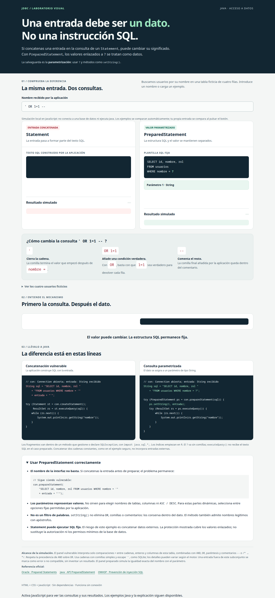

La transcripción textual se conserva en los apartados anteriores. No es una captura de la interacción original.

<a id="9-5-ejemplo-sentencias-de-creacion-de-tablas-y-de-insercion-de-filas"></a>
### 9.5. Ejemplo sentencias de creación de tablas y de inserción de filas

**En este ejemplo creamos una tabla alumnos, insertamos tres alumnos**

1. Creamos la clase Alumnos

```java
public class Alumno {
	String dni ;
	String nombre;
	String ape1;
	String ape2;
	public Alumno() {
		super();	
		}
	public Alumno(String dni, String nombre, String ape1, String ape2) {
		super();
		this.dni = dni;
		this.nombre = nombre;
		this.ape1 = ape1;
		this.ape2 = ape2;
	}
}
```

2.Programa que crea la tabla e inserta tres alumnos, utilizamos una sentencia(Statement) y una sentencia preparada (PreparedStatement)

```java
public class CreaTablaAlumnos {
	public static void main(String[] args) throw SQLException {
			// Establecemos la conexion con la BD
			Connection conexion = DriverManager.getConnection("jdbc:mysql://localhost/ejemplo", "root", "system");
			// sentencia sql de creacion de la tabla, devuelve un int
			Statement sentencia = conexion.createStatement();
			sentencia.executeUpdate("create table alumnos(dni varchar(10), nombre varchar(10),"
					+ "ape1 varchar(60)," + "ape2 varchar(60))");

                       // instancio un array de objetos de la clase Alumnos
                       Alumno[] alumnos = { new Alumno("1", "ana", "lopez", "blanco"), new Alumno("2", "pepe", "ruiz", "negro"),
                       new Alumno("3", "dani", "rey", "blnaco") };

                      //la sentencia preparada inserta una linea en la tabla alumnos
                       PreparedStatement pst = conexion.prepareStatement("insert into alumnos " + "	values (?,?,?,?)");
                     //recorro el array de Alumnos para ir asignando valores de dni, nombre etc... a la sentencia preparada

                       for (Alumno al : alumnos) {
				pst.setString(1, al.dni);
				pst.setString(2, al.nombre);
				pst.setString(3, al.ape1);
				pst.setString(4, al.ape2);
				pst.executeUpdate();//inserta una linea
			}
			pst.close();//Cerrar PreparedStatement
			sentencia.close(); // Cerrar Statement
			conexion.close(); // Cerrar conexión
	}
```

```java
}
```

<a id="10-ejecucion-de-procedimientos-almacenados-en-la-base-de-datos-oracle"></a>
## 10. Ejecución de procedimientos almacenados en la base de datos Oracle

Un procedimiento almacenado es un procedimiento o subprograma que está almacenado en la base de datos.

Muchos sistemas gestores de bases de datos los soportan, por ejemplo: MySQL, Oracle, etc.

Además, estos procedimientos suelen ser de dos clases:

- **Procedimientos** almacenados.
- **Funciones**, las cuales devuelven un valor que se puede emplear en otras sentencias SQL.

Un procedimiento almacenado típico tiene:

- Un nombre.
- Una lista de parámetros.
- Unas sentencias SQL.

**Interfaz CallableStatement**  
Se usa para ejecutar procedimientos y funciones almacenados en la base de datos. Esta interfaz se deriva de la interfaz *PreparedStatement.*

Los objetos *CallableStatement* se crean con el método *prepareCall* de la interfaz Connection:

```java
Connection conexion = DriverManager.getConnection();
CallableStatement callstem= conexion.prepareCall(string_llamada)
```

Los objetos *CallableStatement* proporcionan métodos para configurar parámetros IN y OUT y métodos para ejecutar la llamada a un procedimiento almacenado. Puede contener uno o mas ?, como parámetros, el uso es similar a las que se usan en las sentencias precompiladas.

Oracle Admite sintaxis para la ejecución de procedimientos y funciones:

```java
 CallableStatement cs1 = conexion.prepareCall
  ( "{call proc (?,?)}" ) ; // proc es el procedimiento almacenado

  CallableStatement cs2 = conexion.prepareCall
  ( "{? = call func (?,?)}" ) ; // func funcion almacenada

  // Bloque PL/SQL(*)
  CallableStatement cs3 = conexion.prepareCall
  ( "begin proc (?,?); end;" ) ; // llamada al procedimiento en el bloque plsql

  CallableStatement cs4 = conexion.prepareCall
  ( "begin ? := func(?,?); end;" ) ; // llamada a la funcionen el bloque plsql
```

**Metodos de CallableStatement:**

Los métodos de la interfaz PreparedStatement que permiten pasar parámetros a  la sentencia empiezan por set:

`void setBigDecimal(int parameterIndex, BigDecimal x)  
void setBinaryStream(int parameterIndex, InputStream x)  
void setDate(int parameterIndex, Date x)  
void setDouble(int parameterIndex, double x)  
void setInt(int parameterIndex, int x)``void setString(int parameterIndex, String x)`  
etc...

Para asignar un null de SQL al parámetro:

```java
void setNull(int parameterIndex, int sqlType)
```

**Para ejecutar la llamada**

```java
boolean execute​(String sql)
```

**cerrar el recurso**

```java
void close()
```

Veamos un ejemplo de sentencia para crear un procedimiento almacenado sencillo para Oracle, aunque sería similar en otros sistemas gestores:

```sql
CREATE OR REPLACE PROCEDURE remove_emp (employee_id NUMBER) AS
   tot_emps NUMBER;
   BEGIN
      DELETE FROM employees
      WHERE employees.employee_id = remove_emp.employee_id;
   tot_emps := tot_emps - 1;
   END;
/
```

Para ejecutar el procedimiento almacenado de arriba: 

```java
import java.sql.CallableStatement;
import java.sql.Connection;
import java.sql.DriverManager;
import java.sql.SQLException;

public class EjemploProcAlmacenado1 {

	public static void main(String[] args) {

		Connection cn = null;

		try {
			// Conecta con la base de datos XE con el usuario scott y la contraseña tiger
			cn = DriverManager.getConnection("jdbc:oracle:thin:@localhost:1521:XE", "scott", "tiger");

			// Llamada al procedimiento almacenado
			CallableStatement cst = cn.prepareCall("{call remove_emp (104)}");
			// Ejecuta el procedimiento almacenado
			cst.execute();
			System.out.println("borrado");
		        cst.close();
                } catch (SQLException ex) {
			System.out.println("Error: " + ex.getMessage());
		} finally {
			
			try {

				cn.close();
			} catch (SQLException ex) {
				System.out.println("Error: " + ex.getMessage());
			}
		}
	}
}
```

En el código:

- Las llamadas a los procedimientos almacenados al igual que las PreparedStatements y las consultas simples se hacen sobre la conexión, en este caso con el método prepareCall() que nos devuelve un CallableStatement.
- La llamada al procedimiento almacenado además de ir entre comillas por ser un string tiene que ir también entre llaves y tiene el siguiente formato “{call nombre\_procedimiento(params)}”, dando los  parámetros reales espera  el procedimiento almacenado.
- El procedimiento se ejecuta cuando llamamos al método execute, y como es lógico en el momento en el que se ejecute tienen que estar definidos todos los parámetros tanto de entrada como de salida.

> **(\*) PL/SQL vs Procedimiento almacenado**
>
> - **PL/SQL**: Es la extensión procedimental de SQL de Oracle. Es el **lenguaje** que permite escribir bloques de código con variables, bucles, condicionales y manejo de errores, combinando la potencia de SQL con la lógica de programación . Existen bloques PL/SQL anónimos (que se ejecutan una vez y no se guardan) y subprogramas (que sí se pueden guardar).
> - **Procedimiento Almacenado**: Es un **subprograma** (un tipo específico de objeto) escrito en PL/SQL, que se compila y se guarda de forma permanente en el esquema de la base de datos para poder ser invocado repetidamente por cualquier usuario o aplicación con los permisos adecuados .

<a id="11-ejecucion-de-procedimientos-almacenados-en-la-base-de-datos-de-mysql"></a>
## 11. Ejecución de procedimientos almacenados en la base de datos de MySQL.

<a id="realizar-estos-pasos-como-ejercicio"></a>
### Realizar estos pasos como Ejercicio

A continuación, vamos a realizar un procedimiento almacenado en MySQL, que simplemente insertará datos en la tabla clientes. Desde el programa Java que realizamos, llamaremos para ejecutar a ese procedimiento almacenado. Por tanto, ¿cuál sería la secuencia que seguiríamos para realizar esto?

- Si no tenemos creada la tabla de clientes, la creamos. Por simplicidad, en este ejemplo, trabajamos sobre la base de datos que viene por defecto en MySQL, el esquema denominado: test. Para crear la tabla de clientes, el script correspondiente es: 

  [Crear tabla en MySQL.](../originales/UT02-manejo-de-conectores/215930-3A%20Manejo%20de%20conectores.%20Libro/384559a59a-AD03_CONT_R28_CrearTabla.txt "Descargar código para crear tabla en MySQL. [.txt - 1 KB]")  (1 KB)
- Creamos el procedimiento almacenado en la base de datos. Sería tan fácil como lo que ves en el siguiente enlace: 

  [DDL rutina insertar cliente.](../originales/UT02-manejo-de-conectores/215930-3A%20Manejo%20de%20conectores.%20Libro/62663e1f31-AD03_CONT_R28_01_RutinainsertarCliente.txt "Descargar rutina insertar cliente. [txt - 1 KB]")  (1 KB)
- Crear la clase Java para desde aquí, llamar al procedimiento almacenado: 

  [https://aulavirtual3.educa.madrid.org/ies.alonsodeavellan.alcala/pluginfile.php/290986/mod\_book/chapter/36207/inserConProcAlma.java](../originales/UT02-manejo-de-conectores/215930-3A%20Manejo%20de%20conectores.%20Libro/1bd12e289c-inserConProcAlma.java)

Si hemos definido la tabla correctamente, con su clave primaria, y ejecutamos el programa, intentando insertar una fila igual que otra insertada, o sea, con la misma clave primaria, obtendremos un mensaje al capturar la excepción de este tipo:

```java
SQL Exception: 
```

```java
com.mysql.jdbc.exceptions.jdbc4.MySQLIntegrityConstraintViolationException: 
```

```java
Duplicate entry '765' for key 'PRIMARY'
```

**Recomendación**

Enlace a la [documentación de MySQL](http://www.mysqltutorial.org/getting-started-with-mysql-stored-procedures.aspx) donde se explica como se crean los procedimientos y las funciones   
y cómo se ejecutan desde línea de comando. **Para saber más**

<a id="ejemplo-crear-tabla-clientes"></a>
<a id="ejemplo-adjunto-crear-la-tabla-clientes"></a>
### Ejemplo adjunto · Crear la tabla clientes

**Fuente del complemento:** [Original](../originales/UT02-manejo-de-conectores/215930-3A%20Manejo%20de%20conectores.%20Libro/384559a59a-AD03_CONT_R28_CrearTabla.txt)

```sql
delimiter $$

CREATE TABLE `clientes` (
  `Cod_Cliente` int(3) NOT NULL DEFAULT '0',
  `Nombre` tinytext,
  `Telefono` tinytext,
  PRIMARY KEY (`Cod_Cliente`)
) ENGINE=InnoDB DEFAULT CHARSET=latin1$$
```

<a id="ejemplo-rutina-insertar-cliente"></a>
<a id="ejemplo-adjunto-rutina-insertar-cliente"></a>
### Ejemplo adjunto · Rutina insertar cliente

**Fuente del complemento:** [Original](../originales/UT02-manejo-de-conectores/215930-3A%20Manejo%20de%20conectores.%20Libro/62663e1f31-AD03_CONT_R28_01_RutinainsertarCliente.txt)

```sql
-- --------------------------------------------------------------------------------
-- Routine DDL
-- --------------------------------------------------------------------------------
DELIMITER $$

CREATE DEFINER=`root`@`localhost` PROCEDURE `insertaCliente`(IN Cod_Cliente INTEGER, IN Nombre TinyText,IN Telefono TinyText )
BEGIN
INSERT INTO clientes
	VALUES (Cod_Cliente,
		Nombre,
		Telefono);

END
```

<a id="ejemplo-java-procedimiento"></a>
<a id="ejemplo-adjunto-invocar-el-procedimiento-desde-java"></a>
### Ejemplo adjunto · Invocar el procedimiento desde Java

**Fuente del complemento:** [Original](../originales/UT02-manejo-de-conectores/215930-3A%20Manejo%20de%20conectores.%20Libro/1bd12e289c-inserConProcAlma.java)

```java


import java.sql.CallableStatement;
import java.sql.Connection;
import java.sql.DriverManager;
import java.sql.SQLException;


public class inserConProcAlma {

    /**
     * @param args the command line arguments
     */
    public static void main(String[] args) {
        try {
         
            // Cadena de conexión para conectar con MySQL en localhost,
            //seleccionar la base de datos llamada ‘test’
            // con usuario y contraseña del servidor de MySQL: root y admin
            String connectionUrl = "jdbc:mysql://localhost/test" ;
            
            // Obtener la conexión
            Connection con = DriverManager.getConnection(connectionUrl,"root", "system");

            // El procedimiento almacenado tendrá tres parámetros
            CallableStatement prcProcedimientoAlmacenado =
                    con.prepareCall("{ call insertaCliente(?, ?,?) }");

            // cargar parametros en el procedimiento almacenado
	    prcProcedimientoAlmacenado.setInt("Cod_Cliente", 765);
            prcProcedimientoAlmacenado.setString("Nombre", "Antonio Pérez") ;
            prcProcedimientoAlmacenado.setString("Telefono", "950121314") ;
	
            // ejecutar el procedimiento
	    prcProcedimientoAlmacenado.execute();
	
       } catch (SQLException e) {
            System.out.println("SQL Exception: "+ e.toString());
      

    }}}
```

<a id="12-transacciones"></a>
## 12. Transacciones

La propiedad Autocommit que se crea en la conexión esta definida por defecto a TRUE.

 El control de la **transacción** es realizado por el objeto de la **conexión**. Cuando se crea una conexión, por **defecto esta en el modo activado**. Esto significa que cada operación DML (`INSERT, UPDATE, DELETE` ) **es tratada como transacción** por sí misma que se valida **automáticamente** en cuanto se ejecute.

A veces **necesitamos agrupar varias sentencias SQL en una única transacción**, para ello:

1. modificamos el autocommit antes de ejecutar las consultas que deban estar en la misma transacccion:  `conexion.setAutoCommit(false)`
2. ejecutamos las sentencias
3. finalizaremos de forma manual la transacción. `conexion.Commit.`

**Ejemplo:**

El siguiente programa actualiza la tabla *COFFEES* con los datos de las ventas que se envían al programa como un objeto de tipo **HashMap** (colección que almacena datos asociando una clave a un valor ), **las actualizaciones se tratan como una única transacción** de forma que si se ha podido completar todas las actualizaciones, se validan y en caso de que falle alguna, el gestor de errores deshace los cambios (  `con.rollback()`).

Ejemplo de un `HashMap<String, Integer>`. 

| clave (String) | valor (Integer) |
| --- | --- |
| "Colombian" | 50 |
| "French\_Roast" | 30 |
| "Espresso" | 100 |

\_\_\_\_\_\_\_\_\_\_\_\_\_\_\_\_\_\_\_\_

```java
public void updateCoffeeSales(HashMap<String, Integer> salesForWeek)
    throws SQLException {

    PreparedStatement updateSales = null;
    PreparedStatement updateTotal = null;

    String updateString =
        "update " +  "COFFEES " +
        "set SALES = ? where COF_NAME = ?";

    String updateStatement =
        "update " +  "COFFEES " +
        "set TOTAL = TOTAL + ? " +
        "where COF_NAME = ?";

    try {
        con.setAutoCommit(false);
        updateSales = con.prepareStatement(updateString);
        updateTotal = con.prepareStatement(updateStatement);

        for (Map.Entry<String, Integer> e : salesForWeek.entrySet()) {
            updateSales.setInt(1, e.getValue().intValue());
            updateSales.setString(2, e.getKey());
            updateSales.executeUpdate();
            updateTotal.setInt(1, e.getValue().intValue());
            updateTotal.setString(2, e.getKey());
            updateTotal.executeUpdate();
        }
```

```java
        con.commit();

    } catch (SQLException e ) {
        JDBCTutorialUtilities.printSQLException(e);
        if (con != null) {
            try {
                System.err.print("Transaction is being rolled back");
                con.rollback();
            } catch(SQLException excep) {
                JDBCTutorialUtilities.printSQLException(excep);
            }
        }
```

```java
    } finally {
        if (updateSales != null) {
            updateSales.close();
        }
        if (updateTotal != null) {
            updateTotal.close();
        }
        con.setAutoCommit(true);
    }
}

________
```

```java
for ( Map.Entry<String, Integer>  e  :  salesForWeek.entrySet() ) {
      └────── tipo de cada elemento ──┘  └ variable ┘  └──── colección a recorrer ────┘
```

Esto se llama **for-each** (o "for mejorado"). Se lee así:

> *"Para cada elemento `e` de tipo `Map.Entry<String,Integer>` dentro de `salesForWeek.entrySet()`, ejecuta el cuerpo."*

Pista: [Recuperar datos de un Map](https://www.mkyong.com/java/java-how-to-get-keys-and-values-from-map/)

**Haz el [Ejercicio 5 - Transacciones JDBC](../practicas/ejercicio-05-transacciones-jdbc.md "Ejercicio 5 - Transacciones JDBC")**

<a id="13-recuperacion-y-modificacion-de-valores-de-resultset"></a>
## 13. Recuperación y modificación de valores de ResultSet

Un  objeto **ResultSet** es una tabla de datos que representa un conjunto de resultados de base de datos. Puede ser creado a través de cualquier objeto que implementa la   interfaz **Statement**, incluyendo **PreparedStatement**, **CallableStatement**.

Es necesario un bucle para iterar a través de todos los datos en el **ResultSet**, utilizando el método **ResultSet**.**next** se hace avanzar al cursor a la siguiente fila.  

Los  objeto **ResultSet** predeterminados no permiten la  actualización , ademas, sólo se puede mover el cursor hacia adelante. Sin embargo, puede crear   objetos **ResultSet** que se pueden desplazar hacia adelante y hacia atrás o moverse a una posición absoluta y actualizarse. 

**Sensibilidad del conjunto de resultados. Tipos de ResultSet**

| Tipo | Descripción |
| --- | --- |
| ResultSet.TYPE\_FORWARD\_ONLY | El cursor solo puede avanzar en el conjunto de resultados. |
| ResultSet.TYPE\_SCROLL\_INSENSITIVE | El cursor puede desplazarse hacia adelante y hacia atrás, y el conjunto de resultados no es sensible a los cambios realizados por otros en la base de datos que ocurren después de que se creó el conjunto de resultados. |
| ResultSet.TYPE\_SCROLL\_SENSITIVE. | El cursor puede desplazarse hacia adelante y hacia atrás, y el conjunto de resultados es sensible a los cambios realizados por otros en la base de datos que ocurren después de que se creó el conjunto de resultados. |

TYPE\_FORWARD\_ONLY: El conjunto de resultados no se puede desplazar hacia atrás; su cursor se mueve solo hacia adelante, desde antes de la primera fila hasta después de la última fila. Las filas contenidas en el conjunto de resultados dependen de cómo la base de datos subyacente genera los resultados. Es decir, contiene las filas que satisfacen la consulta en el momento en que se ejecuta la consulta o cuando se recuperan las filas.

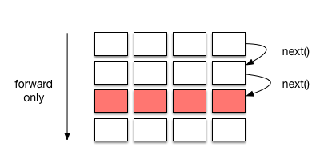

Imagen: https://www.arquitecturajava.com/

TYPE\_SCROLL\_INSENSITIVE: El resultado puede desplazarse; su cursor puede moverse hacia adelante y hacia atrás en relación con la posición actual, y puede moverse a una posición absoluta. El conjunto de resultados es insensible a los cambios realizados en el origen de datos subyacente mientras está abierto. Contiene las filas que satisfacen la consulta en el momento en que se ejecuta la consulta o cuando se recuperan las filas.

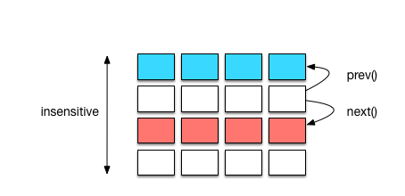

Imagen: https://www.arquitecturajava.com/

TYPE\_SCROLL\_SENSITIVE: El resultado puede desplazarse; su cursor puede moverse hacia adelante y hacia atrás en relación con la posición actual, y puede moverse a una posición absoluta. El conjunto de resultados refleja los cambios realizados en el origen de datos subyacente mientras el conjunto de resultados permanece abierto.

Esto quiere decir que si otras transacción desde otro cliente modifica la base de datos, esta modificación se reflejará en el resultado obtenido en la lectura actual.

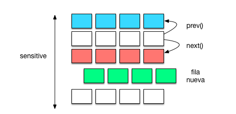

             Imagen: https://www.arquitecturajava.com/  
  
  
**Concurrencia de ResultSet**

| Concurrencia | Descripción |
| --- | --- |
| ResultSet.CONCUR\_READ\_ONLY | Crea un conjunto de resultados de solo lectura. Este es el predeterminado |
| ResultSet.CONCUR\_UPDATABLE | Crea un conjunto de resultados actualizable. |

Si no especifica ningún tipo de Concurrencia, automáticamente obtendrá uno que sea CONCUR\_READ\_ONLY.

Para poder utilizar el **ResultSet** para actualizaciones de tablas, tendremos que crear la consulta con la opción  **ResultSet.CONCUR\_UPDATABLE**, es un parámetro opcional de la creación de la sentencia:

***conexion*.createStatement(ResultSet.TYPE\_SCROLL\_SENSITIVE, ResultSet.CONCUR\_UPDATABLE);**

Además, es necesario  actualizar el dato en la fila actual del objeto **ResultSet**:

***resulSet*.updateFloat( "PRICE", f \* percentage);//recupera la columna con nombre "PRICE"**

***resulSet*.updateRow();**

**Los métodos de actualización se pueden usar de dos maneras:**

- **Modificar valores de campos de una fila.**Para actualizar un valor de columna en la fila actual. En un objeto  ResultSet desplazable , el cursor se puede mover hacia adelante y hacia atrás, a una posición absoluta o a una posición relativa a la fila actual. El siguiente fragmento de código actualiza la  columna NAME en la quinta fila del ResultSetobjeto rs y luego usa el método updateRow para actualizar la tabla de origen de datos de la que proviene el objeto rs.

```java
rs.absolute(5); // moves the cursor to the fifth row of rs
```

```java
rs.updateString("NAME", "AINSWORTH"); // updates the 
```

```java
// NAME column of row 5 to be AINSWORTH
```

```java
rs.updateRow(); // updates the row in the data source
```

El método updateRow () actualiza el contenido de la fila actual en la base de datos. Debes invocar este método para reflejar los cambios que ha realizado en la fila de la base de datos.

- **Para insertar una nueva fila.** Para insertar valores de columna en la fila de inserción. Un  objeto ResultSet actualizable tiene una fila especial asociada que sirve como área de preparación para construir una fila para insertar.

El siguiente fragmento de código mueve el cursor a la fila de inserción, crea una fila de tres columnas y la inserta en la tabla de origen de datos mediante el método insertRow.

```java
   rs.moveToInsertRow(); // moves cursor to the insert row
       rs.updateString(1, "AINSWORTH"); // updates the 
          // first column of the insert row to be AINSWORTH
       rs.updateInt(2,35); // updates the second column to be 35
       rs.updateBoolean(3, true); // updates the third column to true
```

java.sql.Date fecha =  new Date(0).valueOf("1994-11-12");

rs.updateDate("hire\_date", fecha);

```java
       rs.insertRow();
       rs.moveToCurrentRow();
```

- **Para borrar una fila** apuntada por el puntero de  ResultSet

```java
rs.last();
```

```java
rs.deleteRow();
```

**Un  objeto  ResultSet se cierra automáticamente cuando el objeto** **Statement que lo generó se cierra**, se vuelve a ejecutar o se utiliza para recuperar el siguiente resultado de una secuencia de resultados múltiples.

Veamos el  ejemplo  siguiente, el  método modifyPrices(float percentage) multiplica el precio del café por un porcentaje dentro de la repetitiva que recorre,  utilizando el objeto ResultSet, todas las filas de la tabla coffees utilizando el objeto ResultSet:

public void modifyPrices(float percentage) throws SQLException {

```java
    Statement stmt = null;
    try {
        stmt = con.createStatement();
        stmt = con.createStatement(ResultSet.TYPE_SCROLL_SENSITIVE,
                   ResultSet.CONCUR_UPDATABLE);
        ResultSet uprs = stmt.executeQuery(
            "SELECT * FROM  COFFEES");

        while (uprs.next()) {
            float f = uprs.getFloat("PRICE"); //recupera la columna con nombre "PRICE"
            uprs.updateFloat( "PRICE", f * percentage); //también se puede utilizar  updateFloat( 3, f * percentage)
            uprs.updateRow();
        }

    } catch (SQLException e ) {
        JDBCTutorialUtilities.printSQLException(e);
    } finally {
        if (stmt != null) { stmt.close(); }
    }
}
```

Cursores

Como se mencionó anteriormente, accede a los datos en un  objeto **ResultSet** a través de un cursor, que apunta a una fila en el 

ResultSetobjeto. Sin embargo, cuando se crea un objeto ResultSet, **el cursor se coloca antes de la primera fila.**El método 

[CoffeeTables.viewTable](https://docs.oracle.com/javase/tutorial/jdbc/basics/gettingstarted.html) mueve el cursor llamando al método  ResultSet.next. Hay otros métodos disponibles para mover el cursor:

- next: Mueve el cursor hacia adelante una fila. Devuelve 

  truesi el cursor ahora está posicionado en una fila y 

  falsesi el cursor está posicionado después de la última fila.
- previous: Mueve el cursor hacia atrás una fila. Devuelve 

  truesi el cursor ahora está posicionado en una fila y 

  falsesi el cursor está posicionado antes de la primera fila.
- first: Mueve el cursor a la primera fila del 

  ResultSetobjeto. Devuelve 

  truesi el cursor ahora está posicionado en la primera fila y 

  falsesi el 

  ResultSetobjeto no contiene ninguna fila.
- last:: Mueve el cursor a la última fila del 

  ResultSetobjeto. Devuelve 

  truesi el cursor ahora está posicionado en la última fila y 

  falsesi el 

  ResultSetobjeto no contiene ninguna fila.
- beforeFirst: Posiciona el cursor al comienzo del 

  ResultSetobjeto, antes de la primera fila. Si el 

  ResultSetobjeto no contiene ninguna fila, este método no tiene efecto.
- afterLast: Posiciona el cursor al final del 

  ResultSetobjeto, después de la última fila. Si el 

  ResultSetobjeto no contiene ninguna fila, este método no tiene efecto.
- relative(int rows): Mueve el cursor en relación con su posición actual.
- absolute(int row): Posiciona el cursor en la fila especificada por el parámetro 

  row.

```java
Para saber mas de los tipos de ResultSet que se pueden utilizar en Oracle 
```

<a id="14-ejemplo-completo-de-uso-resultset-para-actualizacion"></a>
## 14. Ejemplo completo de uso ResultSet para actualización

El siguiente programa utiliza un **ResultSet** para:

- Actualizar  fila a fila actualiza el salario de los empleados  de la tabla EMPLOYEES  que recupera el  **ResultSet**, en el ejemplo todos los de la tabla.
- Borra los datos de un empleado, aplicando el método **deleteRow()**,  se borra la fila apuntada por el cursor del ResultSet.
- Inserta una linea en la tabla, posicionando el cursor en el espacio reservado para una nueva linea utilizando el método **moveToInsertRow()**

```java
import java.sql.Connection;
import java.sql.DriverManager;
import java.sql.ResultSet;
import java.sql.SQLException;
import java.sql.Statement;
public class JDBCExample {
	// Establecer Driver JDBC
	// y URL de la conexion a la Base de Datos
	static final String DB_URL = "jdbc:oracle:thin:@localhost:1521:XE";
	// Usuario y contraseña de la BD
	// usamos scott/tiger
	static final String USER = "scott";
	static final String PASS = "tiger";
	public static void main(String[] args) {
		Connection conn = null;
		try {
			// CREAR LA CONEXION A LA BD
			System.out.println("Connecting to database...");
			conn = DriverManager.getConnection(DB_URL, USER, PASS);
			// ACTUALIZACION DE VALORES
			// creamos la sentencia de consulta
			// Los parametros del RS deben permitir la actualizacion
			// y mover el cursor .
			System.out.println("Creating statement...");
			Statement stmt = conn.createStatement(ResultSet.TYPE_SCROLL_INSENSITIVE, ResultSet.CONCUR_UPDATABLE);
			// Ejecutamos la consulta que devuelva las filas a actualizar
			String sql = "SELECT EMPLOYEE_ID, first_name, last_name, salary, email, hire_date " + " FROM Employees";
			ResultSet rs = stmt.executeQuery(sql);
			System.out.println("List result set for reference....");
			printRs(rs);
			// Repetitiva que recupera fila a fila el resultado de la ejecucion
			// posicionamos el puntero antes de la primera fila
			rs.beforeFirst();
			// Extraemos datos del RS
			while (rs.next()) {
				// Recuperamos utilizando los metodos correspondientes a los tipos
				// de datos de cada una de las columnas especificadas en la consulta
				// indexamos por el nombre de la columna ("salary")
				int newAge = rs.getInt("salary") + 5;
				rs.updateDouble("salary", newAge);
				rs.updateRow();// actualiza la fila de la tabla correspondiente a la fila apuntada por el
								// ResultSet
			}
			System.out.println("List result set showing new salarys...");// lista los datos una vez actualizado el
																			// salario
			printRs(rs);
			// INSERTAR FILAS
			// movemos el cursor al espacio dedicado para la creacion de lineas
			// y con el metodo update correspodiente damos valores a los campos de la nueva
			// linea
			System.out.println("Inserting a new record...");
			rs.moveToInsertRow();
			rs.updateInt("EMPLOYEE_ID", 300);
			rs.updateString("first_name", "John");
			rs.updateString("last_name", "Paul");
			rs.updateInt("salary", 40);
			rs.updateString("email", "ana@ana");
			rs.updateTimestamp("hire_date", null);
			// insertamos la linea
			rs.insertRow();
			System.out.println("List result set showing new set...");
			printRs(rs);
			// BORRAR FILAS
			// Borramos la segunda linea del ResultSet.
			// Posicionamos el cursor apuntando la fila que queremos borrar
			rs.absolute(2);
			// Listamos el contenido de la 2º fila del RS antes de borrarla
			System.out.println("List the record before deleting...");
			// recuperamos con el metodo correspondiente, indexando
			int EMPLOYEE_ID = rs.getInt(1);
			int age = rs.getInt(4);
			String first_name = rs.getString(2);
			String last_name = rs.getString(3);
			// Display values
			System.out.print("EMPLOYEE_ID: " + EMPLOYEE_ID);
			System.out.print(", salary: " + age);
			System.out.print(", first_name: " + first_name);
			System.out.println(", last_name: " + last_name);
			// borramos la fila apuntada por el RS
			rs.deleteRow();
			System.out.println("List result set after deleting one records...");
			printRs(rs);
			// LIBERAR RECURSOS
			rs.close();
			stmt.close();
			conn.close();
		} catch (SQLException se) {
			// Handle errors for JDBC
			se.printStackTrace();
		} catch (Exception e) {
			// Handle errors for Class.forName
			e.printStackTrace();
		} finally {
			// finally libera recursos
			try {
				if (conn != null)
					conn.close();
			} catch (SQLException se) {
				se.printStackTrace();
			} // end finally try
		} // end try
		System.out.println("Goodbye!");
	}// end main
	public static void printRs(ResultSet rs) throws SQLException {
		// Ensure we start with first_name row
		rs.beforeFirst();
		while (rs.next()) {
			// Retrieve by column name
			int EMPLOYEE_ID = rs.getInt("EMPLOYEE_ID");
			int age = rs.getInt("salary");
			String first_name = rs.getString("first_name");
			String last_name = rs.getString("last_name");
			// Display values
			System.out.print("EMPLOYEE_ID: " + EMPLOYEE_ID);
			System.out.print(", Salary: " + age);
			System.out.print(", first_name: " + first_name);
			System.out.println(", last_name: " + last_name);
		}
		System.out.println();
	}// end printRs()
}// end JDBCExample
```

<a id="fuentes-locales-y-adjuntos"></a>
## Fuentes locales y adjuntos

<details>
<summary>Consultar los HTML y archivos originales</summary>

- [contenido.html](../originales/UT02-manejo-de-conectores/215930-3A%20Manejo%20de%20conectores.%20Libro/contenido.html)
- [capitulo-fb0452e2d5.html](../originales/UT02-manejo-de-conectores/215930-3A%20Manejo%20de%20conectores.%20Libro/capitulo-fb0452e2d5.html)
- [capitulo-486232c797.html](../originales/UT02-manejo-de-conectores/215930-3A%20Manejo%20de%20conectores.%20Libro/capitulo-486232c797.html)
- [capitulo-854abbaf54.html](../originales/UT02-manejo-de-conectores/215930-3A%20Manejo%20de%20conectores.%20Libro/capitulo-854abbaf54.html)
- [capitulo-2213c2857e.html](../originales/UT02-manejo-de-conectores/215930-3A%20Manejo%20de%20conectores.%20Libro/capitulo-2213c2857e.html)
- [capitulo-f2afb53073.html](../originales/UT02-manejo-de-conectores/215930-3A%20Manejo%20de%20conectores.%20Libro/capitulo-f2afb53073.html)
- [capitulo-cf81f15f62.html](../originales/UT02-manejo-de-conectores/215930-3A%20Manejo%20de%20conectores.%20Libro/capitulo-cf81f15f62.html)
- [capitulo-7cf13b648a.html](../originales/UT02-manejo-de-conectores/215930-3A%20Manejo%20de%20conectores.%20Libro/capitulo-7cf13b648a.html)
- [capitulo-ddd18e26cf.html](../originales/UT02-manejo-de-conectores/215930-3A%20Manejo%20de%20conectores.%20Libro/capitulo-ddd18e26cf.html)
- [capitulo-5def3f9efb.html](../originales/UT02-manejo-de-conectores/215930-3A%20Manejo%20de%20conectores.%20Libro/capitulo-5def3f9efb.html)
- [capitulo-28d4212642.html](../originales/UT02-manejo-de-conectores/215930-3A%20Manejo%20de%20conectores.%20Libro/capitulo-28d4212642.html)
- [capitulo-e9e9be7cb2.html](../originales/UT02-manejo-de-conectores/215930-3A%20Manejo%20de%20conectores.%20Libro/capitulo-e9e9be7cb2.html)
- [capitulo-2889ac1e23.html](../originales/UT02-manejo-de-conectores/215930-3A%20Manejo%20de%20conectores.%20Libro/capitulo-2889ac1e23.html)
- [capitulo-3262cfe4c2.html](../originales/UT02-manejo-de-conectores/215930-3A%20Manejo%20de%20conectores.%20Libro/capitulo-3262cfe4c2.html)
- [capitulo-5fd4b50541.html](../originales/UT02-manejo-de-conectores/215930-3A%20Manejo%20de%20conectores.%20Libro/capitulo-5fd4b50541.html)
- [capitulo-a12edefeb8.html](../originales/UT02-manejo-de-conectores/215930-3A%20Manejo%20de%20conectores.%20Libro/capitulo-a12edefeb8.html)
- [capitulo-dd3a2e362a.html](../originales/UT02-manejo-de-conectores/215930-3A%20Manejo%20de%20conectores.%20Libro/capitulo-dd3a2e362a.html)
- [capitulo-dab76bc12e.html](../originales/UT02-manejo-de-conectores/215930-3A%20Manejo%20de%20conectores.%20Libro/capitulo-dab76bc12e.html)
- [capitulo-ebbf267c5c.html](../originales/UT02-manejo-de-conectores/215930-3A%20Manejo%20de%20conectores.%20Libro/capitulo-ebbf267c5c.html)
- [capitulo-c771787435.html](../originales/UT02-manejo-de-conectores/215930-3A%20Manejo%20de%20conectores.%20Libro/capitulo-c771787435.html)
- [capitulo-193caaa703.html](../originales/UT02-manejo-de-conectores/215930-3A%20Manejo%20de%20conectores.%20Libro/capitulo-193caaa703.html)
- [capitulo-2b285d39ed.html](../originales/UT02-manejo-de-conectores/215930-3A%20Manejo%20de%20conectores.%20Libro/capitulo-2b285d39ed.html)
- [capitulo-6869302c18.html](../originales/UT02-manejo-de-conectores/215930-3A%20Manejo%20de%20conectores.%20Libro/capitulo-6869302c18.html)
- [capitulo-b75f1c3eb5.html](../originales/UT02-manejo-de-conectores/215930-3A%20Manejo%20de%20conectores.%20Libro/capitulo-b75f1c3eb5.html)
- [fd5e5b5a2d-AD03_CONT_R09_drivertipo1.JPG](../originales/UT02-manejo-de-conectores/215930-3A%20Manejo%20de%20conectores.%20Libro/fd5e5b5a2d-AD03_CONT_R09_drivertipo1.JPG)
- [dbcecbd0e3-AD03_CONT_R10_drivertipo2.JPG](../originales/UT02-manejo-de-conectores/215930-3A%20Manejo%20de%20conectores.%20Libro/dbcecbd0e3-AD03_CONT_R10_drivertipo2.JPG)
- [e4bf098670-AD03_CONT_R11_drivertipo3.JPG](../originales/UT02-manejo-de-conectores/215930-3A%20Manejo%20de%20conectores.%20Libro/e4bf098670-AD03_CONT_R11_drivertipo3.JPG)
- [95dc694a8a-AD03_CONT_R12_drivertipo4.JPG](../originales/UT02-manejo-de-conectores/215930-3A%20Manejo%20de%20conectores.%20Libro/95dc694a8a-AD03_CONT_R12_drivertipo4.JPG)
- [recurso-0fbb1a1cde.html](../originales/UT02-manejo-de-conectores/215930-3A%20Manejo%20de%20conectores.%20Libro/recurso-0fbb1a1cde.html)
- [384559a59a-AD03_CONT_R28_CrearTabla.txt](../originales/UT02-manejo-de-conectores/215930-3A%20Manejo%20de%20conectores.%20Libro/384559a59a-AD03_CONT_R28_CrearTabla.txt)
- [62663e1f31-AD03_CONT_R28_01_RutinainsertarCliente.txt](../originales/UT02-manejo-de-conectores/215930-3A%20Manejo%20de%20conectores.%20Libro/62663e1f31-AD03_CONT_R28_01_RutinainsertarCliente.txt)
- [1bd12e289c-inserConProcAlma.java](../originales/UT02-manejo-de-conectores/215930-3A%20Manejo%20de%20conectores.%20Libro/1bd12e289c-inserConProcAlma.java)

</details>
