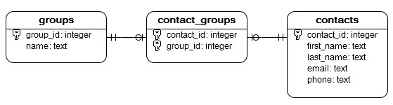
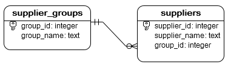
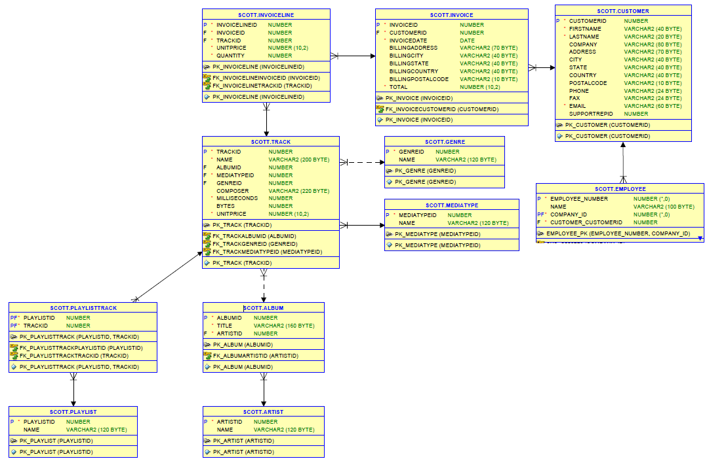

# 3B Bases de datos embebidas. SQLite

> **Esta es la transcripción de archivo, no la entrega final.** [Abrir 3B editado y revisado](../../entrega-final/UT02/contenidos/3B-sqlite.md) y [las consultas Chinook resueltas](../../entrega-final/UT02/ejercicios/08-chinook-sqlite.md).

[← UT02 · Índice de la unidad](../INDICE.md)

> **Unidad:** UT02 · Manejo de conectores  
> **Tipo de recurso:** Libro · 9 capítulos · conector original enlazado  
> **Fuente:** [Libro del aula](https://aulavirtual3.educa.madrid.org/ies.alonsodeavellan.alcala/mod/book/view.php?id=215931)

> **Criterio editorial:** contenido del aula sin resumir ni actualizar sus versiones. Se mejora la estructura y se normalizan los espacios de sangría del código; los archivos originales permanecen intactos.


## Índice

- [1. Introducción](#1-introduccion)
  - [Bases de datos cliente-servidor y bases de datos embebidas](#bases-de-datos-cliente-servidor-y-bases-de-datos-embebidas)
  - [Bases de Datos Cliente-Servidor](#bases-de-datos-cliente-servidor)
  - [Bases de Datos Embebidas](#bases-de-datos-embebidas)
  - [Diferencias Clave](#diferencias-clave)
  - [SQLite](#sqlite)
  - [1.1. Características SQLite](#1-1-caracteristicas-sqlite)
  - [1.2. Instalacion](#1-2-instalacion)
    - [Para instalar SQLite en Windows :](#para-instalar-sqlite-en-windows)
    - [DbBrower](#dbbrower)
  - [1.3. Comandos de SQLite](#1-3-comandos-de-sqlite)
  - [1.4. Sintaxis SQL de SQLite](#1-4-sintaxis-sql-de-sqlite)
    - [Deshacer cambios asociados a la transacción](#deshacer-cambios-asociados-a-la-transaccion)
  - [1.5. Empezando con SQLite](#1-5-empezando-con-sqlite)
    - [Crear la base de datos: El comando para crear una base de datos es sqlite3 . No es necesario tener ningún privilegio especial para ello:](#crear-la-base-de-datos-el-comando-para-crear-una-base-de-datos-es-sqlite3-no-es-necesario-tener-ningun-privilegio-especial-para-ello)
      - [ejemplo:](#ejemplo)
    - [Restricciones](#restricciones)
  - [1.6. Consultas SQLite](#1-6-consultas-sqlite)
  - [1.7. Ejercicios](#1-7-ejercicios)
  - [1.8. Conexion JDBC](#1-8-conexion-jdbc)
    - [Conector SQLite adjunto](#conector-sqlite-adjunto)
- [Fuentes locales y adjuntos](#fuentes-locales-y-adjuntos)

---

<a id="1-introduccion"></a>
## 1. Introducción

<a id="bases-de-datos-cliente-servidor-y-bases-de-datos-embebidas"></a>
### Bases de datos cliente-servidor y bases de datos embebidas

Las bases de datos cliente-servidor y las embebidas representan dos arquitecturas opuestas para gestionar datos. La primera se centra en un servidor centralizado que da servicio a múltiples clientes a través de una red, mientras que la segunda se integra directamente dentro de la aplicación y opera localmente, sin necesidad de un servidor independiente.

<a id="bases-de-datos-cliente-servidor"></a>
### Bases de Datos Cliente-Servidor

En este modelo, la base de datos y la aplicación están separadas en dos componentes: un **servidor** (back-end) que almacena y gestiona los datos, y uno o varios **clientes** (front-end) que solicitan y muestran la información . La comunicación se realiza a través de una red.

Sus características principales son:

- **Centralización y Multiusuario**: Los datos se almacenan en un servidor central, lo que permite que múltiples usuarios y aplicaciones accedan a la misma información de forma concurrente y controlada .
- **Escalabilidad**: Está diseñada para crecer. Se puede escalar verticalmente (mejorando el hardware del servidor) u horizontalmente (añadiendo más servidores) para manejar grandes volúmenes de usuarios y datos .
- **Administración Dedicada**: Requiere la figura de un administrador de bases de datos (DBA) para su configuración, mantenimiento, seguridad y optimización .
- **Casos de Uso**: Es el estándar para aplicaciones empresariales, sistemas web con muchos usuarios, ERP, CRM y cualquier escenario donde se necesite compartir datos de forma centralizada y segura.

<a id="bases-de-datos-embebidas"></a>
### Bases de Datos Embebidas

Una base de datos embebida es un sistema de gestión de bases de datos que está **estrechamente integrado con la aplicación** que la utiliza . El motor de la base de datos se ejecuta dentro del mismo proceso que la aplicación, por lo que no hay una comunicación de red de por medio .

Sus rasgos distintivos son:

- **Sin Servidor (Serverless)**: No necesita un proceso de servidor separado. La base de datos es parte del propio software de la aplicación, lo que simplifica enormemente su despliegue y instalación .
- **Rendimiento Local y Sin Conexión**: Al no haber latencia de red, las operaciones son muy rápidas. Además, funciona perfectamente sin conexión a internet, lo cual es ideal para dispositivos móviles o en ubicaciones remotas .
- **Bajo Mantenimiento**: Está diseñada para requerir "cero administración". No necesita un DBA, ya que la propia aplicación gestiona su ciclo de vida .
- **Casos de Uso**: Es perfecta para aplicaciones móviles (iOS/Android), software de escritorio, dispositivos IoT, sistemas de punto de venta (POS) y, en general, cualquier aplicación que necesite gestionar datos localmente de forma autónoma .

<a id="diferencias-clave"></a>
### Diferencias Clave

Para resumir, aquí tienes una comparación directa:

| Característica | Cliente-Servidor | Embebida |
| --- | --- | --- |
| **Arquitectura** | Proceso de servidor separado | Integrada en el proceso de la aplicación |
| **Comunicación** | A través de red (TCP/IP) | Llamadas a funciones locales (sin red) |
| **Escalabilidad** | Alta (horizontal y vertical) | Limitada al hardware del dispositivo local |
| **Administración** | Requiere DBA | Cero administración (gestionada por la app) |
| **Uso típico** | Aplicaciones empresariales, web multiusuario | Apps móviles, IoT, software de escritorio |

En resumen, eliges **cliente-servidor** cuando necesitas centralización, escalabilidad y colaboración entre muchos usuarios; eliges **embebida** cuando buscas simplicidad, rendimiento local y funcionamiento autónomo en un dispositivo.

**Cliente-servidor:**

- Microsoft SQL Server
- MySQL
- PostgreSQL
- Oracle Database
- IBM DB2

**Embebidas:**

- SQLite
- H2
- HSQLDB
- Apache Derby
- Berkeley DB
- Firebird Embedded
- Microsoft SQL Server Compact

<a id="sqlite"></a>
### SQLite

SQLite es un sistema de gestión de bases de datos relacional **compatible con ACID (\*),** contenida en una relativamente pequeña (~275 kiB)2​ biblioteca escrita en C. SQLite es un proyecto de dominio público1​ creado por D. Richard Hipp.

A diferencia de los sistema de gestión de bases de datos cliente-servidor, el motor de SQLite no es un proceso independiente con el que el programa principal se comunica. En lugar de eso, **la biblioteca SQLite se enlaza con el programa pasando a ser parte integral del mismo.** El programa utiliza la funcionalidad de SQLite a través de llamadas simples a subrutinas y funciones. Esto **reduce la latencia en el acceso a la base de datos**, debido a que las llamadas a funciones son más eficientes que la comunicación entre procesos. El conjunto de la base de datos (definiciones, tablas, índices, y los propios datos), son guardados como un solo fichero estándar en la máquina host. Este diseño simple se logra bloqueando todo el fichero de base de datos al principio de cada transacción.En su versión 3, SQLite permite bases de datos de hasta 2 Terabytes de tamaño, y también permite la inclusión de campos tipo BLOB.

(\*) ACID es un acrónimo de Atomicity, Consistency, Isolation and Durability: Atomicidad, Consistencia, Aislamiento y Durabilidad en español.

- **[Atomicidad](https://es.wikipedia.org/wiki/Atomicidad):** Si cuando una operación consiste en una serie de pasos, bien todos ellos se ejecutan o bien ninguno, es decir, las transacciones son completas.

- **[Consistencia](https://es.wikipedia.org/wiki/Consistencia_de_datos):** (*Integridad*). Es la propiedad que asegura que sólo se empieza aquello que se puede acabar. Por lo tanto se ejecutan aquellas operaciones que no van a romper las reglas y directrices de *Integridad* de la base de datos. La propiedad de consistencia sostiene que cualquier transacción llevará a la base de datos desde un estado válido a otro también válido. "La Integridad de la Base de Datos nos permite asegurar que los datos son exactos y consistentes, es decir que estén siempre intactos, sean siempre los esperados y que de ninguna manera cambian ni se deformen. De esta manera podemos garantizar que la información que se presenta al usuario será siempre la misma."

- **[Aislamiento](https://es.wikipedia.org/wiki/Aislamiento_(ACID)):** Esta propiedad asegura que una operación no puede afectar a otras. Esto asegura que la realización de dos transacciones sobre la misma información sean independientes y no generen ningún tipo de error. Esta propiedad define cómo y cuándo los cambios producidos por una operación se hacen visibles para las demás operaciones concurrentes. El aislamiento puede alcanzarse en distintos niveles, siendo el parámetro esencial a la hora de seleccionar SGBDs.

- **[Durabilidad](https://es.wikipedia.org/wiki/Datos_persistentes):** (*Persistencia*). Esta propiedad asegura que una vez realizada la operación, esta persistirá y no se podrá deshacer aunque falle el sistema y que de esta forma los datos sobrevivan de alguna manera.

<a id="1-1-caracteristicas-sqlite"></a>
### 1.1. Características SQLite

SQLite es un sistema de gestión de bases de datos que se diferencia de bases de datos convencionales como MySQL u Oracle en que esta lee y escribe archivos binarios independientes, un estilo similar al de las bases de datos hechas en Microsoft Acces s.

Fue escrita en lenguaje C y es de dominio público, por lo que puede ser utilizada en cualquier tipo de proyectos, sean libres o comerciales. Además tiene **características** muy interesantes:

- **Es pequeña.** Dependiendo de la plataforma, toda la biblioteca se maneja desde un único archivo (shell de comandos) de apenas 500KB.
- **SQL**. Se utiliza el mismo lenguaje de consulta SQL, por lo que de entrada es fácil usarlo.
- **Es multiplataforma,** incluso hay una gran cantidad de documentación para conectarlo con lenguajes como Java, PHP, Python, .NET, entre otros.
- Las bases de datos **se guardan en un fichero** con extensión «.db».
- Dada su presentación, **puede funcionar en dispositivos** y máquinas con características de **hardware limitadas** tales como tabletas o dispositivos móviles (es muy popular en Android).
- **SQLite  no se requiere configurar**, crear usuarios, etc después de  su instalación, a diferencia de otros gestores, bastará con bajarse «la shell de comandos» de SQLite para empezar a trabajar.
- Al no haber gestión de usuarios, como por ejemplo, en MySQL en donde teníamos que definir varios parámetros para conectarnos, en SQLite la **seguridad se basa en los permisos de ficheros establecidos en  el Sistema Operativo.**
- Si el usuario lo requiere, puede **descargarse aplicaciones para tener interfaz grafica** a la base de datos.

**Ventajas:**

- No requiere un proceso o sistema de servidor separado para funcionar (sin servidor).
- Viene con configuración cero, lo que significa que no se necesita configuración ni administración.
- Una base de datos SQLite completa se almacena en un solo archivo de disco multiplataforma.
- Es  muy pequeño.
- Es autónomo, lo que significa que no hay dependencias externas.
- Tiene transacciones.
- Admite la mayoría de las características del lenguaje de consulta que se encuentran en el estándar SQL92 (SQL2).
- Está escrito en ANSI-C y proporciona una API simple y fácil de usar.
- SQLite esta disponible para varios sistemas operativos.

**Desventajas:**

No tiene implementado el estándar SQL92 (SQL2):

- Solo esta implementado LEFT OUTER JOIN
- Las opciones de ALTER TABLE siguientes no estan disponibles:  DROP COLUMN, ALTER COLUMN, ADD CONSTRAINT.
- Solo es posible crear disparadores a nivel de fila.
- Las vistas en SQLite son de solo lectura.

<a id="1-2-instalacion"></a>
### 1.2. Instalacion

<a id="para-instalar-sqlite-en-windows"></a>
#### Para instalar SQLite en Windows :

- Paso 1 : vaya a la [página de descarga de SQLite](https://www.sqlite.org/download.html) y descargue los binarios precompilados de la sección de Windows.
- Paso 2 : descargue los archivos comprimidos sqlite-shell-win32 - \*. Zip y sqlite-dll-win32 - \*. Zip.
- Paso 3 : crea una carpeta C: \&gt; sqlite y descomprime sobre dos archivos comprimidos en esta carpeta, lo que te dará los archivos sqlite3.def, sqlite3.dll y sqlite3.exe.
- Paso 4 : agregue C: \&gt; sqlite en su variable de entorno PATH .Comprueba que funciona escribiendo sqlite3 en el simbolo del sistema de la consola de windows. Aparece sqlite&gt; como prompt

<a id="dbbrower"></a>
#### DbBrower

**DB Browser for SQLite:** es una herramienta de código abierto que ofrece una interfaz fácil de usar para trabajar con bases de datos SQLite. Permite realizar consultas SQL, administrar tablas y datos, y es útil para el desarrollo y la administración de bases de datos SQLite.

Puedes [descargarla en enlace](https://sqlitebrowser.org/dl/)

<a id="1-3-comandos-de-sqlite"></a>
### 1.3. Comandos de SQLite

**Los comandos siguientes son del entorno, empiezan por .**

- **.help** Lista los comandos del entorno
- **.databases**Lista de nombres y archivos de bases de datos adjuntas
- **.echo ON | OFF** Activa o desactiva el comando echo
- **.exit** Para salir de sqlite.
- **.import FILE TABLE**Import data from FILE into TABLE
- **.read FILENAME** Execute SQL in FILENAME
- **.tables ?PATTERN?** List names of tables matching a LIKE pattern

Para consultar todos los comandos de SQLite [sigue el enlace](https://www.sqlite.org/cli.html)  
**Ejemplo:**  
la siguiente secuencia de comandos formatean la salida  

```text
sqlite>.header on --lista con cabeceras
sqlite>.mode column-- muestra los resultados en columnas
sqlite>.timer on --tiempo en resolver la consulta
```

<a id="1-4-sintaxis-sql-de-sqlite"></a>
### 1.4. Sintaxis SQL de SQLite

**Case Sensitivity**

Sqlite es case insensitive, sin embargo , algunos de los parámetros son diferentes en mayúscula y minúscula

**Comentarios:**

Se pueden usar comodines  -- sirve para comentarios de una linea y /\* y \*/ para comentarios multilínea

Sentencias SQLite  
  
Todas las sentencias SQLite comienzan con cualquiera de las palabras reservadas: SELECT, INSERT, UPDATE, DELETE, ALTER, DROP, etc., y todas las sentencias terminan con un punto y coma (;).

**Tipos de datos**

SQLite admite varios tipos de datos que puedes usar para definir las columnas en las tablas de la base de datos. Aquí tienes una lista de algunos de los tipos de datos más comunes admitidos por SQLite:

1. **INTEGER:** Para almacenar valores enteros. Puede ser `INT`, `INTEGER`, `TINYINT`, `SMALLINT`, `MEDIUMINT`, `BIGINT`, entre otros.
2. **REAL:** Para almacenar valores numéricos de punto flotante.
3. **TEXT:** Para almacenar texto. Puede contener cadenas de caracteres de longitud variable.
4. **BLOB:** Para almacenar datos binarios, como archivos (imágenes, archivos de audio, etc.).
5. **NUMERIC:** Puede almacenar valores enteros o de punto flotante. Se utiliza como un tipo de datos genérico para valores numéricos.

  
SQLite no tiene una clase de almacenamiento booleana separada. En cambio, los valores booleanos se almacenan como enteros 0 (falso) y 1 (verdadero).

SQLite no tiene una clase de almacenamiento reservada para almacenar fechas y / u horas. En cambio, las funciones de fecha y hora integradas de SQLite son capaces de almacenar fechas y horas como valores TEXT, REAL o INTEGER:

**Transacciones**La base de datos funciona en modo autocommit, es decir que cada instrucción de inserción, borrado de lineas o actualización de valores en uno o varias columnas, produce un commit automático.  
Para trabajar con transacciones es necesario   

1. iniciar la transacción,
2. escribir a continuación las instrucciones que forman parte de la transacción
3. terminar la transacción validando los cambios (COMMIT) o deshaciéndolos hasta el principio de la transaccion (ROLLBACK)

Sintaxis asociada:


- inicio de transaccion

BEGIN [DEFERRED|INMEDIATE|EXCLUSIVE] [TRANSACTION]

```java
sentencias
```

```java
...
```

```java
validacion de la transaccion 
```

{COMMIT|END} Statement;

```java
SQLite ROLLBACK StatementROLLBACK;
```

<a id="java-deshacer-cambios-asociados-a-la-transaccion"></a>
<a id="deshacer-cambios-asociados-a-la-transaccion"></a>
#### Deshacer cambios asociados a la transacción

```java
ROLLBACK [TRANSACTION  TO [SAVEPOINT] punto_salvaguarda
```

```java
Establecer un punto de salvaguarda (punto de retorno)
```

```java
SAVEPOINT punto_salvaguarda
```

<a id="1-5-empezando-con-sqlite"></a>
### 1.5. Empezando con SQLite

<a id="crear-la-base-de-datos-el-comando-para-crear-una-base-de-datos-es-sqlite3-no-es-necesario-tener-ningun-privilegio-especial-para-ello"></a>
#### Crear la base de datos: El comando para crear una base de datos es sqlite3 . No es necesario tener ningún privilegio especial para ello:

<a id="promt-gt-sqlite3-rutadatabasename-db"></a>
<a id="promt-sqlite3-ruta-databasename-db"></a>
```text
promt> sqlite3 [ruta]DatabaseName.db
```

El nombre de la base de datos debe ser único para todo el sistema RDBMS. Sino existe la base de datos la crea y si existe la abre.

Crea un fichero con el nombre de la base de datos en el directorio actual si se omite la ruta, si se pone el símbolo es / ejemplo:  "c:/work/ex1.db"  
  
Este fichero sera el que use el motor de SQLite como base de datos.  
  
**Comprobar las bases de datos existentes**

El comando que lista las bases de datos creadas es .databases .

```text
sqlite>.databases  
sqlite> main /home/sqlite/testDB.db
```

**Abrir una base de datos existente**

Para abrir una base de datos existente utilizamos el comando .open

sqlite3&gt; .open  [ruta/]DatabaseName.db

ejemplo:

sqlite&gt; .open "E:/chinooK.db"  
sqlite&gt; .databases  

```java
main: E:\chinooK.db
```

En la consola podemos ejecutar SQLite abriendo una base de datos existente  
Ejemplo:  
  

```java
C:\Users\alumno>sqlite3 "E:/chinook.db"
```

  
**Listar las tablas creadas en la base de datos actual**

Utiliza el comando .tables

sqlite&gt; .tables

```java
albums          datetime_text   invoice_items   playlist_track
artists         employees       invoices        playlists
customers       genres          media_types     tracks
```

**Creacion de tablas**

```sql
CREATE TABLE [IF NOT EXISTS] [schema_name].table_name (
    column_1 data_type PRIMARY KEY,
       column_2 data_type NOT NULL,
    column_3 data_type DEFAULT 0,
    table_constraints
) [WITHOUT ROWID];
```

En esta sintaxis:

- Primero, especifique el nombre de la tabla que desea crear después de las  palabras clave CREATE TABLE. El nombre de la tabla no puede comenzar  sqlite\_porque está reservado para el uso interno de SQLite.

- Segundo, use la  opcion IF NOT EXISTS para crear una nueva tabla si no existe. Intentar crear una tabla que ya existe sin usar la  opcion IF NOT EXISTS dará como resultado un error.

- Tercero, opcionalmente especifique  el nombre del schema al que pertenece la nueva tabla.
- Cuarto, especifique la lista de columnas de la tabla. Cada columna tiene un nombre, tipo de datos y la restricción de la columna. Soportes SQLite  [PRIMARY KEY](https://www.sqlitetutorial.net/sqlite-primary-key/), [UNIQUE](https://www.sqlitetutorial.net/sqlite-unique-constraint/), [NOT NULL](https://www.sqlitetutorial.net/sqlite-not-null-constraint/), y  [CHECK](https://www.sqlitetutorial.net/sqlite-check-constraint/) las restricciones de columna.
- En quinto lugar, especificar las restricciones de tabla como :

```java
PRIMARY KEY: Se utiliza para identificar de manera única cada fila en una tabla. Implica que los valores de la columna no pueden ser nulos y deben ser únicos en la tabla.Ejemplo:CREATE TABLE Ejemplo (
    id INTEGER PRIMARY KEY,
    nombre TEXT
);
NOT NULL: Indica que los valores en la columna no pueden ser nulos.Ejemplo:
CREATE TABLE Ejemplo (
    id INTEGER NOT NULL,
    nombre TEXT NOT NULL
);
UNIQUE: Garantiza que los valores en la columna sean únicos en la tabla.Ejemplo:
CREATE TABLE Ejemplo (
    id INTEGER UNIQUE,
    nombre TEXT UNIQUE
);
FOREIGN KEY: Establece una relación entre columnas de diferentes tablas. La columna referenciada en la tabla secundaria debe existir en la tabla primaria.Ejemplo:CREATE TABLE Empleados (
    id INTEGER PRIMARY KEY,
    nombre TEXT
);

CREATE TABLE Tareas (
    tarea_id INTEGER PRIMARY KEY,
    empleado_id INTEGER,
    tarea_descripcion TEXT,
    FOREIGN KEY (empleado_id) REFERENCES Empleados(id)
);
CHECK: Define una condición que debe cumplirse para los valores en una columna.Ejemplo:CREATE TABLE Ejemplo (
    edad INTEGER CHECK (edad >= 18),
    nombre TEXT
);
```

- Finalmente, opcionalmente use la  opcion WITHOUT ROWID. Por defecto, una fila de una tabla tiene una columna implícita, que se conoce como el rowid, La columna rowidalmacena una clave de entero con signo de 64 bits que identifica de forma exclusiva la fila dentro de la tabla. Si no desea que SQLite cree la columna rowid, especifique la opcion WITHOUT ROWID.

<a id="ejemplo"></a>
##### ejemplo:

Suponga que tiene que administrar contactos usando SQLite.   
Cada contacto tiene la siguiente información:  

Nombre de pila  
Apellido  
Email  
 Teléfono

El requisito es que el correo electrónico y el teléfono deben ser únicos.  
 Además, cada contacto pertenece a uno o muchos grupos, y cada grupo puede tener cero o muchos contactos.En base a estos requisitos son necesarias tres tablas:  

- contacts que almacena la información de contacto.
- groups que almacena la información del grupo.
- contact\_groups que almacena la relación entre contactos y grupos.

El siguiente diagrama de base de datos ilustra tablas: contacts groups y contact\_groups.  
  



fuente: https://www.sqlitetutorial.net/

```sql
CREATE TABLE contacts (
    contact_id INTEGER PRIMARY KEY,
    first_name TEXT NOT NULL,
    last_name TEXT NOT NULL,
    email TEXT NOT NULL UNIQUE,
    phone TEXT NOT NULL UNIQUE
);
```

```sql
CREATE TABLE groups (
   group_id INTEGER PRIMARY KEY,
   name TEXT NOT NULL
);

CREATE TABLE contact_groups(
   contact_id INTEGER,
   group_id INTEGER,
   PRIMARY KEY (contact_id, group_id),
   FOREIGN KEY (contact_id) 
      REFERENCES contacts (contact_id) 
         ON DELETE CASCADE 
         ON UPDATE NO ACTION,
   FOREIGN KEY (group_id) 
      REFERENCES groups (group_id) 
         ON DELETE CASCADE 
         ON UPDATE NO ACTION
);
```

**Insertar filas****Para insertar una fila** utiliza la sintaxis de INSERT:  
  
  
```sql
INSERT INTO nombre_tabla [(column1,column2 ,..)]
VALUES( value1,    value2 ,...);
```

  
ejemplo: insertamos una linea en la tabla artists, (Chinook.db)  
  

```sql
INSERT INTO artists (name, artistid)
VALUES('Bud Powell', 400);
```

  
**Para insertar varias filas en una tabla**, SQLite tiene la sintaxis siguiente:  
  

```sql
INSERT INTO table1 (column1,column2 ,..)
VALUES
   (value1,value2 ,...),
   (value1,value2 ,...),
    ...
   (value1,value2 ,...);
```

  
<a id="restricciones"></a>
#### Restricciones

**Restricción de clave primaria. Valores autoincrementados.**  
Cuando se crea una tabla sin especificar la opción WITHOUT ROWID,  se crea una columna implícita llamada rowid, de tipo entero sin signo y que identifica cada fila de una tabla. Los valores de rowid que toma a medida que insertamos filas en la tabla empiezan en 1 y se van autoincrementando.

```text
sqlite> create table personas ( ape1 text, ape2 text, nombre text);
sqlite> insert into personas (nombre, ape1, ape2) 
...> values('ana','lopez','lopez');
sqlite> select rowid, ape1, ape2, nombre from personas;
1|lopez|lopez|ana
```

Si la tabla se crea con una columna de tipo INTEGER PRIMARY KEY, esta columna es el alias para la columna rowid.

Al insertar filas en la tabla sin dar valor a la clave primaria se incrementaran automaticamente

```text
sqlite> drop table personas;--borramos la tabla
sqlite> create table personas (dni integer primary key, ape1 text, ape2 text, nombre text);

sqlite> insert into personas (nombre, ape1, ape2) 
 ...> values('ana','lopez','lopez');

sqlite> insert into personas (nombre, ape1, ape2)   
...> values('lope','lopez','lopez');


sqlite> select * from personas;
1|lopez|lopez|ana
2|lopez|lopez|lope
```

Si damos un valor arbitrario a la clave primaria, este sera el valor del que parte para la siguiente vez que no demos valor y por tanto se auto incremente la clave primaria.  
Aunque en SQLite es posible definir una columna de tipo autoincrement, esta opción no se recomienda.

**Restricción de integridad referencial**

La sintaxis para especificar que una columna es clave foranea  a nivel de tabla es

FOREIGN KEY (FKcol)

       REFERENCES REFtabla(PKcol) [acciones\_restriccion]

Ejemplo para las tablas suppliers  y  supplier\_groups.



Fuente: https://www.sqlitetutorial.net/

CREATE TABLE supplier\_groups (

    group\_id integer PRIMARY KEY,

    group\_name text NOT NULL

);

CREATE TABLE suppliers (

    supplier\_id   INTEGER PRIMARY KEY,

    supplier\_name TEXT    NOT NULL,

    group\_id      INTEGER NOT NULL,

    FOREIGN KEY (group\_id)

       REFERENCES supplier\_groups (group\_id)

);

**Acciones de restricción de clave foránea de SQLite**

Para especificar cómo se comporta la restricción de clave externa cada vez que se elimina o actualiza la clave principal, utilice la acción ON DELETE, ON UPDATE  
con las siguientes acciones:

- Poner a nulos: SET NULL. Si elimina una fila de la tabla que tienen la clave primaria, los valores de la las claves foraneas se actualizaran a NULL.
- Establecer a un valor predeteminado: SET DEFAULT. Establece el valor de la clave externa en el valor predeterminado especificado en la definición de columna cuando crea la tabla .
- Restringir: RESTRICT o NO ACTION. No permite cambiar o eliminar valores en la clave principal de la tabla principal si hay filas de otras tablas que las referencian.
- Propagar : CASCADE. Propaga los cambios de la tabla primaria a la tabla secundaria cuando actualiza o elimina la clave primaria.

<a id="1-6-consultas-sqlite"></a>
### 1.6. Consultas SQLite

Puesto que SQLite sigue el estandar SQL92 (SQL2), la sintaxis para la realización de consultas es el utilizado en el modulo de Bases de Datos

La sintaxis SQL para esta base de datos SQLite, es la [siguiente](https://www.sqlite.org/lang.html).

<a id="1-7-ejercicios"></a>
### 1.7. Ejercicios

El esquema relacional de la base de datos chinook.db que vamos a utilizar es el siguiente:



La base de datos  chinook.db guarda informacion de artistas, albumes , caciones, clientes y facturacion, la puedes desacargar en recursos la base de datos y el script de creacion de las tablas.

1. Utiliza la base de datos bien al iniciar sqlite, bien con el comando .open
2. Crea la base de datos chinookdb utiliza el script que esta en la carpeta create tables. Utiliza el comando .read

En cualquier caso, el resultado es el mismo

Utiliza comandos siguientes   y anota qué información proporcionan:

1. .tables
2. .schema nombre\_tabla
3. .schema

Haz consultas a las tablas de la base de datos:

1. Haz consultas a las tablas para familiarizarte con el contenido de las tablas
2. Lista las los albumes en los que al menos una cancion es de jazz.
3. Por cada cliente(id, firstmname, lastname) lista el total facturado al cliente.

<a id="1-8-conexion-jdbc"></a>
### 1.8. Conexion JDBC

la conexion de una base de datos creada con SQLite se realiza utilizando el driver JDBC correspondiente, todo lo aprendido en la conexion a bases de datos Oracle o MySQL es aplicable a SQLite.

**Para conectarnos a una base de datos creada con sqlite3**

1. [Descarga el driver sqlite-jdbc-3.23.1](../originales/UT02-manejo-de-conectores/215931-3B%20%20BASES%20DE%20DATOS%20EMBEBIDAS.%20SQLite%20Libro/6df3d291f7-driver%20sqlite-3.23.1.jar "https://aulavirtual3.educa.madrid.org/ies.alonsodeavellan.alcala/pluginfile.php/290987/mod_book/chapter/36232/driver%20sqlite-3.23.1.jar")
2. La cadena de conexión de forma similar a las de otros gestores de bases de datos:   
    urljdbc = "jdbc:sqlite:E:\\chinook.db";

Ejemplo:

En este programa se utiliza la base de datos chinook.db. Se muestra  información del diccionario, y el nombre de las tablas que tiene la base de datos.

```java
public class main {
	public static void main(String[] args) {
		Connection conexion;
		try {
			String urljdbc = "jdbc:sqlite:E:\\chinook.db";
			conexion = DriverManager.getConnection(urljdbc);
			System.out.println("conecta");
			java.sql.DatabaseMetaData dbmd = conexion.getMetaData();// Creamos
			// objeto DatabaseMetaData
			ResultSet resul = null;
			String nombre = dbmd.getDatabaseProductName();
			String driver = dbmd.getDriverName();
			String url = dbmd.getURL();
			String usuario = dbmd.getUserName();
			System.out.println("INFORMACIÓN SOBRE LA BASE DE DATOS:");
			System.out.println("===================================");
			System.out.printf("Nombre : %s %n", nombre);
			System.out.printf("Driver : %s %n", driver);
			System.out.printf("URL    : %s %n", url);
			System.out.printf("Usuario: %s %n", usuario);
			// Obtener información de las tablas y vistas que hay
			resul = dbmd.getTables(null, null, "%", null);
			while (resul.next()) {
				String catalogo = resul.getString(1);// columna 1
				String esquema = resul.getString(2); // columna 2
				String tabla = resul.getString(3); // columna 3
				String tipo = resul.getString(4); // columna 4
				System.out.printf("%s - Catalogo: %s, Esquema: %s, Nombre: %s %n", tipo, catalogo, esquema, tabla);
			}
			//Obtener información de las tablas y vistas que hay 		       
			   
			conexion.close(); // Cerrar conexion
		} catch (SQLException e) {
			System.out.println(e.getMessage());
			System.out.println(e.getErrorCode());
			System.out.println(e.getSQLState());
		}
		
	}
}
```

<a id="conector-sqlite-adjunto"></a>
#### Conector SQLite adjunto

**Fuente del complemento:** [Original](../originales/UT02-manejo-de-conectores/215931-3B%20%20BASES%20DE%20DATOS%20EMBEBIDAS.%20SQLite%20Libro/6df3d291f7-driver%20sqlite-3.23.1.jar)

Conector JDBC de SQLite distribuido en el aula. Se conserva sin ejecutar ni modificar; no tiene transcripción textual equivalente.

- Tamaño: 6733696 bytes.
- SHA-256: `d570af636a2be99e20be9510fb615aa819b2059857b2dd625aecbff774766331`.

<a id="fuentes-locales-y-adjuntos"></a>
## Fuentes locales y adjuntos

<details>
<summary>Consultar los HTML y archivos originales</summary>

- [contenido.html](../originales/UT02-manejo-de-conectores/215931-3B%20%20BASES%20DE%20DATOS%20EMBEBIDAS.%20SQLite%20Libro/contenido.html)
- [capitulo-fa9fefe0de.html](../originales/UT02-manejo-de-conectores/215931-3B%20%20BASES%20DE%20DATOS%20EMBEBIDAS.%20SQLite%20Libro/capitulo-fa9fefe0de.html)
- [capitulo-2e7823421e.html](../originales/UT02-manejo-de-conectores/215931-3B%20%20BASES%20DE%20DATOS%20EMBEBIDAS.%20SQLite%20Libro/capitulo-2e7823421e.html)
- [capitulo-4f75606808.html](../originales/UT02-manejo-de-conectores/215931-3B%20%20BASES%20DE%20DATOS%20EMBEBIDAS.%20SQLite%20Libro/capitulo-4f75606808.html)
- [capitulo-0033b855cc.html](../originales/UT02-manejo-de-conectores/215931-3B%20%20BASES%20DE%20DATOS%20EMBEBIDAS.%20SQLite%20Libro/capitulo-0033b855cc.html)
- [capitulo-545915d413.html](../originales/UT02-manejo-de-conectores/215931-3B%20%20BASES%20DE%20DATOS%20EMBEBIDAS.%20SQLite%20Libro/capitulo-545915d413.html)
- [capitulo-c248373730.html](../originales/UT02-manejo-de-conectores/215931-3B%20%20BASES%20DE%20DATOS%20EMBEBIDAS.%20SQLite%20Libro/capitulo-c248373730.html)
- [capitulo-05cce36021.html](../originales/UT02-manejo-de-conectores/215931-3B%20%20BASES%20DE%20DATOS%20EMBEBIDAS.%20SQLite%20Libro/capitulo-05cce36021.html)
- [capitulo-1b5399c4e0.html](../originales/UT02-manejo-de-conectores/215931-3B%20%20BASES%20DE%20DATOS%20EMBEBIDAS.%20SQLite%20Libro/capitulo-1b5399c4e0.html)
- [6df3d291f7-driver sqlite-3.23.1.jar](../originales/UT02-manejo-de-conectores/215931-3B%20%20BASES%20DE%20DATOS%20EMBEBIDAS.%20SQLite%20Libro/6df3d291f7-driver%20sqlite-3.23.1.jar)

</details>
