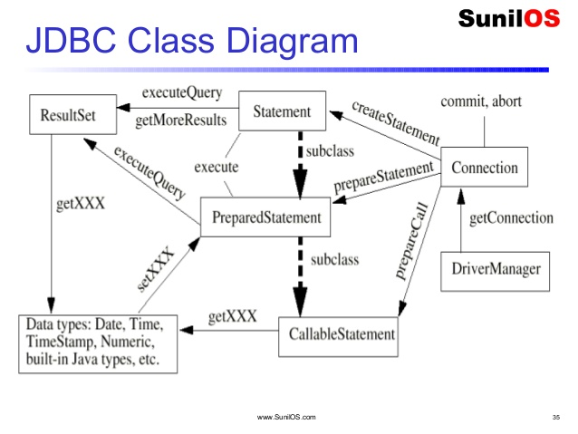

Fuente: https://aulavirtual3.educa.madrid.org/ies.alonsodeavellan.alcala/mod/book/view.php?id=215930&chapterid=36206

### 8. Ejecución sentencias SQL I

Para operar con una base de datos,  ejecutando las consultas necesarias, nuestra aplicación deberá:

1. **Cargar** el driver necesario .
2. **Establecer** una conexión con la base de datos.
3. **Enviar** sentencias SQL y procesar el resultado.
4. **Liberar** los recursos al terminar.
5. **Gestionar** los errores que se puedan producir.



1.- Cargamos el driver correspondiente al SGBD que vayamos a utilizar (explicado en capítulos anteriores)

**2.- Establecemos una conexión** con la base de datos (explicado en el capítulo7) .   
**Creamos un objeto****Connection** utilizando  el método **getConnection()** de la clase **DriverManager**. Este método recibe como parámetro la URL JDBC que identifica a la base de datos con la que queremos realizar la conexión.

```
conexion = DriverManager.getConnection("jdbc:mysql://localhost/ejemplo", "root", "system");
```

**3.- Creamos el objeto Statement** (o PrepareStatement): Para ello utilizamos el método createStatement() del objeto Connection. Esto nos permitirá ejecutar sentencias SQL en la base de datos.

```
sentencia = conexion.createStatement();
```

4.- Para ejecutar la sentencia SQL, usamos el método exacuteQuery("sql") del objeto Statement que producira el objeto ResultSet

sql = "SELECT \* FROM dept";  
resul = sentencia.executeQuery(sql);

```
 
```

5.- A continuación  procesar el resultado, dependiendo de la sentencia puede ser un conjunto de filas (un ResultSet) o un entero correspondiente al numero de filas afectadas por la sentencia DML.

```
while (resul.next()) {  
	System.out.printf("%d, %s, %s %n", resul.getInt(1), resul.getString(2), resul.getString(3));  
}
```

**Las interfaces relacionadas son**:

1. * **Statement**: Se utiliza para implementar sentencias SQL simples sin parámetros.
   * **PreparedStatement**: (derivada de Statement). Se utiliza para compilar previamente sentencias SQL que pueden contener parámetros de entrada.
   * **CallableStatement**:(derivada de PreparedStatement). Se utiliza para ejecutar procedimientos almacenados que pueden contener parámetros de entrada y salida.
   * DatabaseMetaData permite obtener Información  sobre la base de datos en su conjunto. Las veremos en el capitulo consultas al diccionario de datos.
2. Liberación de recursos  
   Debemos tener en cuenta siempre que las conexiones con una base de datos consumen muchos recursos en el sistema gestor, y por lo tanto en el sistema informático en general. Por ello, conviene cerrarlas con el método  

   close (de la clase Connection) siempre que vayan a dejar de ser utilizadas , en lugar de esperar a que el garbage collector de Java las elimine.

   También conviene cerrar la ejecución de procedimientos almacenados ( CallableStatement ),    las consultas (Statement y PreparedStatement) y los resultados (ResultSet) para liberar los recursos.

   Es recomendable liberar recursos en la parte Finally del try\_catch , para asegurarnos que aunque se produzca cualquier error, se liberen los recursos utilizados por nuestro programa.
3. Gestión de errores.  
   Se puede producir un error tanto en el controlador como en la base de datos. Se lanza una excepción y laa ejecución del programa actual se detiene y el control se redirige a la cláusula de captura (catch) más cercana. Si no existe, la ejecución del programa finaliza.  
   El manejo de excepciones de JDBC es muy similar al manejo de excepciones de Java, pero para JDBC, la excepción más común con la que tratará es java.sql.SQLException. Es obligatorio capturar esta excepción.   
   Cuando se produce un error, el objeto SQLException pasado,  tiene los siguientes métodos disponibles para recuperar información adicional sobre el error :

* getErrorCode () Código de error (entero) específico del vendedor
* getMessage () Mensaje de error de la excepción
* printStackTrace ()
* getSQLState()   Texto de SQLstate según la convención X/Open o SQL:2003

ejemplo:

```
package EmpleDepart;
```

```
import java.sql.*;  
public class PrimeraConsulta {  
	public static void main(String[] args) {  
		Statement sentencia=null;   
		String sql=null;  
		ResultSet resul=null; // ResultSet es una estructura de datos de tipo cursor que modela una tabla en memoria que se puede recorrer  
		Connection conexion=null;  
		  
		try {  
			// 2 Establecemos la conexion con la BD  
			conexion = DriverManager.getConnection("jdbc:mysql://localhost/ejemplo", "root", "system");  
			// 3 creamos el objeto Statement  
			sentencia = conexion.createStatement();   
			sql = "SELECT * FROM dept";  
			resul = sentencia.executeQuery(sql);// ejecutamos la consulta  
   
			// Recorremos el resultado para visualizar cada fila  
			// Se hace un bucle mientras haya registros y se van visualizando  
			while (resul.next()) {  
				System.out.printf("%d, %s, %s %n", resul.getInt(1), resul.getString(2), resul.getString(3));  
			}  
			  
		} catch (SQLException cn) {// 5 gestionamos de errores  
			cn.printStackTrace();  
		} finally {// 4 liberamos recursos  
			try {  
			  
				if (resul != null) { // liberar los ResultSet  
					resul.close();  
				}  
				if (sentencia != null) { // liberar los Statement  
					sentencia.close();  
				}  
				if (conexion != null) { // liberar la conexión a la BD  
					conexion.close();  
				}  
				} catch (Exception e) {  
				e.printStackTrace();  
			}  
		}  
	}  
} 
```