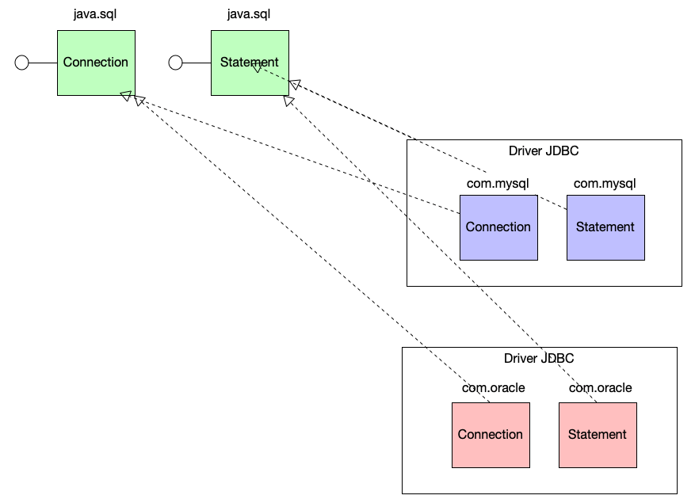

Fuente: https://aulavirtual3.educa.madrid.org/ies.alonsodeavellan.alcala/mod/book/view.php?id=215930&chapterid=36217

### 3. Conexión a bases de datos con API JDBC

**JDBC: Java DataBase Connectivity** (en español: Conectividad a bases de datos de Java), **es una API que permite la ejecución de operaciones sobre bases de datos desde el lenguaje de programación Java,** independientemente del sistema operativo donde se ejecute o de la base de datos a la cual se accede, utilizando el dialecto SQL del modelo de base de datos que se utilice.

Arquitectura de Conexión:

* **El API JDBC ( java.sql.\*) se presenta como una colección de interfaces Java y métodos de gestión de manejadores de conexión hacia la base de datos.** Es decir el lenguaje los incorpora como punto de extensibilidad en el sistema a la hora de conectarnos a una base datos
* **Un manejador (driver) de conexiones** hacia un modelo de base de datos en particular **es un conjunto de clases que implementan las interfaces Java** y que utilizan los métodos de registro para declarar los tipos de localizadores a base de datos (URL) que pueden manejar.

**Para utilizar una base de datos particular, el usuario ejecuta su programa junto con la biblioteca de conexión apropiada al modelo de su base de datos, y accede a ella estableciendo una conexión; para ello provee el localizador a la base de datos y los parámetros de conexión específicos.** A partir de allí puede realizar cualquier tipo de tarea con la base de datos a la que tenga permiso: consulta, actualización, creación, modificación y borrado de tablas, ejecución de procedimientos almacenados en la base de datos, etc.

