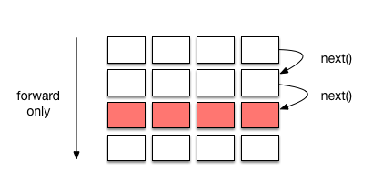
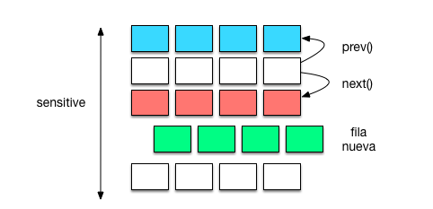

Fuente: https://aulavirtual3.educa.madrid.org/ies.alonsodeavellan.alcala/mod/book/view.php?id=215930&chapterid=36200

### 13. Recuperación y modificación de valores de ResultSet

Un  objeto **ResultSet** es una tabla de datos que representa un conjunto de resultados de base de datos. Puede ser creado a través de cualquier objeto que implementa la   interfaz **Statement**, incluyendo **PreparedStatement**, **CallableStatement**.

Es necesario un bucle para iterar a través de todos los datos en el **ResultSet**, utilizando el método **ResultSet**.**next** se hace avanzar al cursor a la siguiente fila.  

Los  objeto **ResultSet** predeterminados no permiten la  actualización , ademas, sólo se puede mover el cursor hacia adelante. Sin embargo, puede crear   objetos **ResultSet** que se pueden desplazar hacia adelante y hacia atrás o moverse a una posición absoluta y actualizarse. 

**Sensibilidad del conjunto de resultados. Tipos de ResultSet**

| Tipo | Descripción |
| --- | --- |
| ResultSet.TYPE\_FORWARD\_ONLY | El cursor solo puede avanzar en el conjunto de resultados. |
| ResultSet.TYPE\_SCROLL\_INSENSITIVE | El cursor puede desplazarse hacia adelante y hacia atrás, y el conjunto de resultados no es sensible a los cambios realizados por otros en la base de datos que ocurren después de que se creó el conjunto de resultados. |
| ResultSet.TYPE\_SCROLL\_SENSITIVE. | El cursor puede desplazarse hacia adelante y hacia atrás, y el conjunto de resultados es sensible a los cambios realizados por otros en la base de datos que ocurren después de que se creó el conjunto de resultados. |

TYPE\_FORWARD\_ONLY: El conjunto de resultados no se puede desplazar hacia atrás; su cursor se mueve solo hacia adelante, desde antes de la primera fila hasta después de la última fila. Las filas contenidas en el conjunto de resultados dependen de cómo la base de datos subyacente genera los resultados. Es decir, contiene las filas que satisfacen la consulta en el momento en que se ejecuta la consulta o cuando se recuperan las filas.



Imagen: https://www.arquitecturajava.com/

TYPE\_SCROLL\_INSENSITIVE: El resultado puede desplazarse; su cursor puede moverse hacia adelante y hacia atrás en relación con la posición actual, y puede moverse a una posición absoluta. El conjunto de resultados es insensible a los cambios realizados en el origen de datos subyacente mientras está abierto. Contiene las filas que satisfacen la consulta en el momento en que se ejecuta la consulta o cuando se recuperan las filas.

.png)

Imagen: https://www.arquitecturajava.com/

TYPE\_SCROLL\_SENSITIVE: El resultado puede desplazarse; su cursor puede moverse hacia adelante y hacia atrás en relación con la posición actual, y puede moverse a una posición absoluta. El conjunto de resultados refleja los cambios realizados en el origen de datos subyacente mientras el conjunto de resultados permanece abierto.

Esto quiere decir que si otras transacción desde otro cliente modifica la base de datos, esta modificación se reflejará en el resultado obtenido en la lectura actual.



             Imagen: https://www.arquitecturajava.com/  
  
  
  
**Concurrencia de ResultSet**

| Concurrencia | Descripción |
| --- | --- |
| ResultSet.CONCUR\_READ\_ONLY | Crea un conjunto de resultados de solo lectura. Este es el predeterminado |
| ResultSet.CONCUR\_UPDATABLE | Crea un conjunto de resultados actualizable. |

Si no especifica ningún tipo de Concurrencia, automáticamente obtendrá uno que sea CONCUR\_READ\_ONLY.

Para poder utilizar el **ResultSet** para actualizaciones de tablas, tendremos que crear la consulta con la opción  **ResultSet.CONCUR\_UPDATABLE**, es un parámetro opcional de la creación de la sentencia:

***conexion*.createStatement(ResultSet.TYPE\_SCROLL\_SENSITIVE, ResultSet.CONCUR\_UPDATABLE);**

Además, es necesario  actualizar el dato en la fila actual del objeto **ResultSet**:

***resulSet*.updateFloat( "PRICE", f \* percentage);//recupera la columna con nombre "PRICE"**

***resulSet*.updateRow();**

**Los métodos de actualización se pueden usar de dos maneras:**

* **Modificar valores de campos de una fila.**Para actualizar un valor de columna en la fila actual. En un objeto  ResultSet desplazable , el cursor se puede mover hacia adelante y hacia atrás, a una posición absoluta o a una posición relativa a la fila actual. El siguiente fragmento de código actualiza la  columna NAME en la quinta fila del ResultSetobjeto rs y luego usa el método updateRow para actualizar la tabla de origen de datos de la que proviene el objeto rs.

```
rs.absolute(5); // moves the cursor to the fifth row of rs
```

```
rs.updateString("NAME", "AINSWORTH"); // updates the 
```

```
// NAME column of row 5 to be AINSWORTH
```

```
rs.updateRow(); // updates the row in the data source
```

El método updateRow () actualiza el contenido de la fila actual en la base de datos. Debes invocar este método para reflejar los cambios que ha realizado en la fila de la base de datos.

* **Para insertar una nueva fila.** Para insertar valores de columna en la fila de inserción. Un  objeto ResultSet actualizable tiene una fila especial asociada que sirve como área de preparación para construir una fila para insertar.

El siguiente fragmento de código mueve el cursor a la fila de inserción, crea una fila de tres columnas y la inserta en la tabla de origen de datos mediante el método insertRow.

```
   rs.moveToInsertRow(); // moves cursor to the insert row  
       rs.updateString(1, "AINSWORTH"); // updates the   
          // first column of the insert row to be AINSWORTH  
       rs.updateInt(2,35); // updates the second column to be 35  
       rs.updateBoolean(3, true); // updates the third column to true
```

java.sql.Date fecha =  new Date(0).valueOf("1994-11-12");

rs.updateDate("hire\_date", fecha);

```
       rs.insertRow();  
       rs.moveToCurrentRow();
```

* **Para borrar una fila** apuntada por el puntero de  ResultSet

```
rs.last();
```

```
rs.deleteRow();
```

**Un  objeto  ResultSet se cierra automáticamente cuando el objeto** **Statement que lo generó se cierra**, se vuelve a ejecutar o se utiliza para recuperar el siguiente resultado de una secuencia de resultados múltiples.

Veamos el  ejemplo  siguiente, el  método modifyPrices(float percentage) multiplica el precio del café por un porcentaje dentro de la repetitiva que recorre,  utilizando el objeto ResultSet, todas las filas de la tabla coffees utilizando el objeto ResultSet:

public void modifyPrices(float percentage) throws SQLException {

```
    Statement stmt = null;
    try {
        stmt = con.createStatement();
        stmt = con.createStatement(ResultSet.TYPE_SCROLL_SENSITIVE,
                   ResultSet.CONCUR_UPDATABLE);
        ResultSet uprs = stmt.executeQuery(
            "SELECT * FROM  COFFEES");

        while (uprs.next()) {
            float f = uprs.getFloat("PRICE"); //recupera la columna con nombre "PRICE"
            uprs.updateFloat( "PRICE", f * percentage); //también se puede utilizar  updateFloat( 3, f * percentage)
            uprs.updateRow();
        }

    } catch (SQLException e ) {
        JDBCTutorialUtilities.printSQLException(e);
    } finally {
        if (stmt != null) { stmt.close(); }
    }
}
```

Cursores

Como se mencionó anteriormente, accede a los datos en un  objeto **ResultSet** a través de un cursor, que apunta a una fila en el 

ResultSetobjeto. Sin embargo, cuando se crea un objeto ResultSet, **el cursor se coloca antes de la primera fila.**El método 

[CoffeeTables.viewTable](https://docs.oracle.com/javase/tutorial/jdbc/basics/gettingstarted.html) mueve el cursor llamando al método  ResultSet.next. Hay otros métodos disponibles para mover el cursor:

* next: Mueve el cursor hacia adelante una fila. Devuelve 

  truesi el cursor ahora está posicionado en una fila y 

  falsesi el cursor está posicionado después de la última fila.
* previous: Mueve el cursor hacia atrás una fila. Devuelve 

  truesi el cursor ahora está posicionado en una fila y 

  falsesi el cursor está posicionado antes de la primera fila.
* first: Mueve el cursor a la primera fila del 

  ResultSetobjeto. Devuelve 

  truesi el cursor ahora está posicionado en la primera fila y 

  falsesi el 

  ResultSetobjeto no contiene ninguna fila.
* last:: Mueve el cursor a la última fila del 

  ResultSetobjeto. Devuelve 

  truesi el cursor ahora está posicionado en la última fila y 

  falsesi el 

  ResultSetobjeto no contiene ninguna fila.
* beforeFirst: Posiciona el cursor al comienzo del 

  ResultSetobjeto, antes de la primera fila. Si el 

  ResultSetobjeto no contiene ninguna fila, este método no tiene efecto.
* afterLast: Posiciona el cursor al final del 

  ResultSetobjeto, después de la última fila. Si el 

  ResultSetobjeto no contiene ninguna fila, este método no tiene efecto.
* relative(int rows): Mueve el cursor en relación con su posición actual.
* absolute(int row): Posiciona el cursor en la fila especificada por el parámetro 

  row.

```
 
```

```
Para saber mas de los tipos de ResultSet que se pueden utilizar en Oracle
```

###