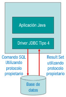

Fuente: https://aulavirtual3.educa.madrid.org/ies.alonsodeavellan.alcala/mod/book/view.php?id=215930&chapterid=36204

### 3. Conexión a bases de datos con API JDBC

#### 3.5. Conectores tipo 3 y tipo 4.

#### 

#### TIPO3: controlador Java puro para middleware de base de datos

# [Esquema donde se ven en la parte superior la aplicación java con un driver tipo3, más abajo la capa de middleware y más abajo la base de datos.](https://aulavirtual3.educa.madrid.org/ies.alonsodeavellan.alcala/pluginfile.php/290986/mod_book/chapter/36204/AD03_CONT_R11_drivertipo3.JPG "Ampliar imagen")

**Tipo 3: JDBC-Net pure Java driver.**

**Tiene una aproximación de tres capas**. Las peticiones JDBC a la base de datos se pasan a través de la red al servidor de la capa **intermedia**(middleware). Este servidor traduce este protocolo independiente del sistema gestor a protocolo específico del sistema gestor y se envía a la base de datos. Los resultados se mandan de vuelta al middleware y se enrutan al cliente.

Este driver está basado en servidor, por lo que **no se necesita ninguna librería de base de datos en las máquinas clientes**. Normalmente, un driver de tipo 3 proporciona soporte para **balanceo de carga,** funciones avanzadas de administrador de sistemas tales como auditoría, etc.

**Es útil para aplicaciones en Internet.**

Muy poco frecuente

#### TIPO4: controlador Java puro para directo a base de datos

 

##### ****Tipo 4: Protocolo nativo.****

En este caso se trata de **conectores que convierten directamente las llamadas JDBC al protocolo de red usando por el sistema gestor de la base de datos**. Esto permite una **llamada directa desde la máquina cliente al servidor del sistema gestor de base de datos** y es una solución excelente para acceso en **intranets**.

Como ventaja se tiene que no es necesaria traducción adicional o capa middleware, **lo que mejora el rendimiento,** siendo éste mejor que en el caso de los tipos 1 y 2.

Además, **no se necesita instalar ningún software especial en el cliente o en el servidor.**

Como **inconveniente**, de este tipo de conectores, el usuario necesita un **driver diferente** para cada base de datos.

**Es el más común.**

Unos ejemplos de este tipo de conector es **Oracle Thin y MySQL Conector/J**

 **Para saber más**

En la siguiente web puedes ver información sobre Oracle Thin y otros conectores de Oracle.

[Conectores Oracle](http://www.orafaq.com/wiki/JDBC)