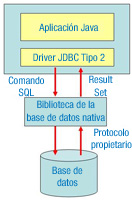

Fuente: https://aulavirtual3.educa.madrid.org/ies.alonsodeavellan.alcala/mod/book/view.php?id=215930&chapterid=36202

### 3. Conexión a bases de datos con API JDBC

#### 3.4. Conectores tipo 1 y tipo 2.

#### 

#### TIPO1: puente JDBC-ODBC

# [Esquema donde se ven en la parte superior la aplicación java con un puente JDBC-ODBC, más abajo el driver ODBC y más abajo la base de datos.](https://aulavirtual3.educa.madrid.org/ies.alonsodeavellan.alcala/pluginfile.php/290986/mod_book/chapter/36202/AD03_CONT_R09_drivertipo1.JPG "Ampliar imagen.")

**Los conectores tipo 1 se denominan también JDBC-ODBC Bridge (puente JDBC-ODBC).**

Proporcionan un puente entre el API JDBC y el API ODBC. El driver JDBC-ODBC Bridge **traduce las llamadas JDBC a llamadas ODBC** y las envía a la fuente de datos ODBC.

Como **ventajas** destacar:

* **No se necesita un driver específico de cada base de datos de tipo ODBC.**
* **Está soportado por muchos fabricantes**, por lo que tenemos acceso a muchas Bases de Datos.

Como **desventajas** señalar:

* Hay **plataformas que no lo tienen implementado**.
* El **rendimiento no es óptimo** ya que la llamada JDBC se realiza a través del puente hasta el conector ODBC y de ahí al interface de conectividad de la base de datos. El resultado recorre el camino inverso.
* Se tiene que **registrar manualmente en el gestor de ODBC** teniendo que configurar el DSN (Data Source Names, Nombres de fuentes de datos).

El puente se implementa como el paquete sun.jdbc.odbc y contiene una biblioteca nativa utilizada para acceder a ODBC.

**Eliminado desde Java 8**

#### TIPO2: controlador parcial de Java

**Los conectores tipo 2 se conocen también como: API nativa**

**Convierten las llamadas JDBC a llamadas específicas de la base de datos para bases de datos como SQL Server, Informix, Oracle, o Sybase.**

El conector tipo 2 se comunica directamente con el servidor de bases de datos, por lo que es **necesario que haya código en la máquina cliente**. Esto tiene el **inconveniente** que la librería de la bases de datos del vendedor necesita cargarse en cada máquina cliente. Por esta razón los drivers tipo 2 **no pueden usarse para Internet.**

**No es muy común.**

Los drivers Tipo  2 utilizan código nativo vía JNI, por lo que son más eficientes.

 **Para saber más**

En este enlace puede ver información sobre [JNI](http://es.wikipedia.org/wiki/Java_Native_Interface "Acceder a la definición de JNI.")

**Correcto.**  La afirmación es correcta, porque hay que cargar librerías de la base de datos en la máquina cliente.

**Incorrecto.**  La afirmación es correcta, porque hay que cargar librerías de la base de datos en la máquina cliente.

&amp;amp;amp;amp;amp;amp;amp;amp;amp;amp;amp;amp;lt;div class="feedback"&amp;amp;amp;amp;amp;amp;amp;amp;amp;amp;amp;amp;gt;&amp;amp;amp;amp;amp;amp;amp;amp;amp;amp;amp;amp;lt;strong&amp;amp;amp;amp;amp;amp;amp;amp;amp;amp;amp;amp;gt;Verdadero.&amp;amp;amp;amp;amp;amp;amp;amp;amp;amp;amp;amp;lt;/strong&amp;amp;amp;amp;amp;amp;amp;amp;amp;amp;amp;amp;gt; La afirmación es correcta, porque hay que cargar librerías de la base de datos en la máquina cliente.
&amp;amp;amp;amp;amp;amp;amp;amp;amp;amp;amp;amp;lt;/div&amp;amp;amp;amp;amp;amp;amp;amp;amp;amp;amp;amp;gt;