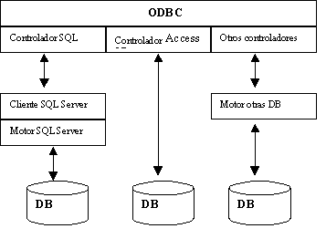
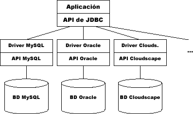

Fuente: https://aulavirtual3.educa.madrid.org/ies.alonsodeavellan.alcala/mod/book/view.php?id=215930&chapterid=36220

### 2. Protocolos de acceso a bases de datos.

**Inicialmente cada SGBD tiene su propia conexión y su propio API**

Cada empresa desarrolladora de un SGBD implementaba soluciones propietarias específicas para su sistema, pero pronto se dieron cuenta de que colaborando conjuntamente podían sacar mayor rendimiento y avanzar mucho más rápidamente. 

**Primer estándar de conectividad**

**ODBC** significa **Open Database Connectivity** (Conectividad de Base de Datos Abierta). Es un **estándar de interfaz** desarrollado por Microsoft que permite que las aplicaciones se conecten a diferentes sistemas de gestión de bases de datos (DBMS) de manera uniforme, sin importar el fabricante o el tipo de base de datos.

La llegada del **ODBC**representó un avance sin precedentes en el camino hacia la interoperabilidad entre bases de datos y lenguajes de programación. La mayoría de empresas desarrolladoras de **sistemas gestores de bases de datos incorporaron los drivers**de conectividad a las utilidades de sus sistemas y los lenguajes de programación más importantes desarrollaron bibliotecas específicas para soportar el **API ODBC**.

**Java no de adapta bien**

Aunque la industria aceptó **ODBC** como medio principal para acceso a bases de datos en Windows, la verdad es que no se introduce bien en el mundo Java, debido a la complejidad que presenta **ODBC**, y que entre otras cosas ha impedido su transición fuera del entorno Windows.

Sistema de conexión **ODBC** configurado usando diferentes controladores (drivers) y un API estándar.

**JDBC**  (**Java Database Connectivity**)

Se trata de un API bastante similar a **ODBC** en cuanto a funcionalidad,  **implementado específicamente para usar con el lenguaje Java**, adaptado a las especificidades de Java.

La **funcionalidad se encuentra capsulada en clases** (ya que Java es un lenguaje totalmente orientado a objetos) y además, **no depende de ninguna plataforma específica**, de acuerdo con la característica multiplataforma defendida por Java.

La idea en el desarrollo de JDBCera intentar ser tan **sencillo** como fuera posible, pero proporcionando a los desarrolladores la máxima **flexibilidad**.

Java, mediante**JDBC**, permite **simplificar el acceso a bases de datos relacionales**, proporcionando un lenguaje mediante el cual las aplicaciones pueden comunicarse con motores de bases de datos.

**Objetivos** - Sun desarrolló este API (java.sql.\*)para el acceso a bases de datos, con tres **objetivos** principales en mente:

* **Ser un API con soporte de SQL:** poder construir sentencias SQL e insertarlas dentro de llamadas al API de Java.
* Aprovechar la **experiencia de los API's** de bases de datos existentes.
* Ser lo más **sencillo** posible.

Los **fabricantes** de Los Sistemas Gestores de Bases de Datos **proporcionan la implementación de esa interfaz** (Drivers).

JDBC es similar en estructura a ODBC. Una aplicación JDBC está compuesta de varias capas, como se muestra en la figura

* Capa de Aplicación:

La **capa superior** en este modelo es la aplicación Java. Las aplicaciones Java son portátiles: puede ejecutar una aplicación Java sin modificaciones en cualquier sistema que tenga instalado una maquina virtual java  (Java runtime environment).

* API de JDBC

Una aplicación Java que utiliza **JDBC puede comunicarse con muchas bases de datos con pocas modificaciones,** si es que las hay. Al igual que ODBC, **JDBC proporciona una manera consistente de conectarse a una base de datos**, ejecutar comandos y recuperar los resultados.

Al igual que ODBC, **JDBC no impone un lenguaje de comando común:** puede usar la sintaxis específica de Oracle cuando está conectado a un servidor Oracle y la sintaxis específica de MySQL cuando está conectado a un servidor MySQL.

* Driver

**La Api  JDBC tiene la interfaz DriverManager,  responsable de localizar un controlador JDBC que necesita la aplicación**. Cuando una aplicación **cliente solicita una conexión de base de datos**, la solicitud se expresa en forma de una **URL (Uniform Resource Locator)**. Una URL de JDBC es similar a las URL que utiliza con un navegador web.  Para conectarnos a la base de datos Oracle,  por ejemplo: jdbc:oracle:thin:ejemplo/ejemplo@localhost:1521:XE

A medida que cada controlador se carga en una Máquina Virtual de Java (VM), se registra con el **DriverManager JDBC** .**Cuando una aplicación solicita una conexión, el DriverManager pregunta a cada Controlador si puede conectarse a la base de datos especificada en la URL dada.** Tan pronto como encuentra un controlador adecuado, la búsqueda se detiene y el controlador intenta establecer una conexión con la base de datos. Si el intento de conexión falla, el **Controlador**lanzará una **SQLException**a la aplicación. Si la conexión se completa con éxito, el controlador crea un objeto de conexión y lo devuelve a la aplicación.