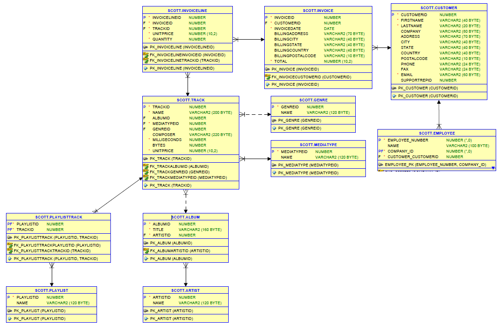

Fuente: https://aulavirtual3.educa.madrid.org/ies.alonsodeavellan.alcala/mod/book/view.php?id=215931&chapterid=36231

### 1. Introducción

#### 1.7. Ejercicios

El esquema relacional de la base de datos chinook.db que vamos a utilizar es el siguiente:

La base de datos  chinook.db guarda informacion de artistas, albumes , caciones, clientes y facturacion, la puedes desacargar en recursos la base de datos y el script de creacion de las tablas.

1. Utiliza la base de datos bien al iniciar sqlite, bien con el comando .open
2. Crea la base de datos chinookdb utiliza el script que esta en la carpeta create tables. Utiliza el comando .read

En cualquier caso, el resultado es el mismo

Utiliza comandos siguientes   y anota qué información proporcionan:

1. .tables
2. .schema nombre\_tabla
3. .schema

Haz consultas a las tablas de la base de datos:

1. Haz consultas a las tablas para familiarizarte con el contenido de las tablas
2. Lista las los albumes en los que al menos una cancion es de jazz.
3. Por cada cliente(id, firstmname, lastname) lista el total facturado al cliente.