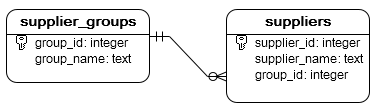

Fuente: https://aulavirtual3.educa.madrid.org/ies.alonsodeavellan.alcala/mod/book/view.php?id=215931&chapterid=36229

### 1. Introducción

#### 1.5. Empezando con SQLite

# **Crear la base de datos:** El comando para crear una base de datos es sqlite3 . No es necesario tener ningún privilegio especial para ello:

# promt> sqlite3 [ruta]DatabaseName.db

El nombre de la base de datos debe ser único para todo el sistema RDBMS. Sino existe la base de datos la crea y si existe la abre.

Crea un fichero con el nombre de la base de datos en el directorio actual si se omite la ruta, si se pone el símbolo es / ejemplo:  "c:/work/ex1.db"  
  
Este fichero sera el que use el motor de SQLite como base de datos.  
  
**Comprobar las bases de datos existentes**

El comando que lista las bases de datos creadas es .databases .

```
sqlite>.databases    
sqlite> main /home/sqlite/testDB.db
```

**Abrir una base de datos existente**

Para abrir una base de datos existente utilizamos el comando .open

sqlite3> .open  [ruta/]DatabaseName.db

ejemplo:

sqlite> .open "E:/chinooK.db"  
sqlite> .databases  

```
main: E:\chinooK.db
```

```

```

En la consola podemos ejecutar SQLite abriendo una base de datos existente  
Ejemplo:  
  

```
C:\Users\alumno>sqlite3 "E:/chinook.db"
```

  
**Listar las tablas creadas en la base de datos actual**

Utiliza el comando .tables

sqlite> .tables

```
albums          datetime_text   invoice_items   playlist_track  
artists         employees       invoices        playlists  
customers       genres          media_types     tracks
```

```

```

**Creacion de tablas**

```
CREATE TABLE [IF NOT EXISTS] [schema_name].table_name (  
    column_1 data_type PRIMARY KEY,  
       column_2 data_type NOT NULL,  
    column_3 data_type DEFAULT 0,  
    table_constraints  
) [WITHOUT ROWID];
```

En esta sintaxis:

* Primero, especifique el nombre de la tabla que desea crear después de las  palabras clave CREATE TABLE. El nombre de la tabla no puede comenzar  sqlite\_porque está reservado para el uso interno de SQLite.

* Segundo, use la  opcion IF NOT EXISTS para crear una nueva tabla si no existe. Intentar crear una tabla que ya existe sin usar la  opcion IF NOT EXISTS dará como resultado un error.

* Tercero, opcionalmente especifique  el nombre del schema al que pertenece la nueva tabla.
* Cuarto, especifique la lista de columnas de la tabla. Cada columna tiene un nombre, tipo de datos y la restricción de la columna. Soportes SQLite  [PRIMARY KEY](https://www.sqlitetutorial.net/sqlite-primary-key/), [UNIQUE](https://www.sqlitetutorial.net/sqlite-unique-constraint/), [NOT NULL](https://www.sqlitetutorial.net/sqlite-not-null-constraint/), y  [CHECK](https://www.sqlitetutorial.net/sqlite-check-constraint/) las restricciones de columna.
* En quinto lugar, especificar las restricciones de tabla como :

```
1. PRIMARY KEY: Se utiliza para identificar de manera única cada fila en una tabla. Implica que los valores de la columna no pueden ser nulos y deben ser únicos en la tabla.


   Ejemplo:


   ```
   CREATE TABLE Ejemplo (


   id INTEGER PRIMARY KEY,
       nombre TEXT
   );
   ```
2. NOT NULL: Indica que los valores en la columna no pueden ser nulos.


   Ejemplo:


   ```
   CREATE TABLE Ejemplo (
       id INTEGER NOT NULL,
       nombre TEXT NOT NULL
   );
   ```
3. UNIQUE: Garantiza que los valores en la columna sean únicos en la tabla.


   Ejemplo:


   ```
   CREATE TABLE Ejemplo (
       id INTEGER UNIQUE,
       nombre TEXT UNIQUE
   );
   ```
4. FOREIGN KEY: Establece una relación entre columnas de diferentes tablas. La columna referenciada en la tabla secundaria debe existir en la tabla primaria.


   Ejemplo:


   ```
   CREATE TABLE Empleados (


   id INTEGER PRIMARY KEY,
       nombre TEXT
   );

   CREATE TABLE Tareas (
       tarea_id INTEGER PRIMARY KEY,
       empleado_id INTEGER,
       tarea_descripcion TEXT,
       FOREIGN KEY (empleado_id) REFERENCES Empleados(id)
   );
   ```
5. CHECK: Define una condición que debe cumplirse para los valores en una columna.


   Ejemplo:


   ```
   CREATE TABLE Ejemplo (


   edad INTEGER CHECK (edad >= 18),
       nombre TEXT
   );
   ```
```

* Finalmente, opcionalmente use la  opcion WITHOUT ROWID. Por defecto, una fila de una tabla tiene una columna implícita, que se conoce como el rowid, La columna rowidalmacena una clave de entero con signo de 64 bits que identifica de forma exclusiva la fila dentro de la tabla. Si no desea que SQLite cree la columna rowid, especifique la opcion WITHOUT ROWID.

##### **ejemplo:**

Suponga que tiene que administrar contactos usando SQLite.   
Cada contacto tiene la siguiente información:  

Nombre de pila  
Apellido  
Email  
 Teléfono

El requisito es que el correo electrónico y el teléfono deben ser únicos.  
 Además, cada contacto pertenece a uno o muchos grupos, y cada grupo puede tener cero o muchos contactos.En base a estos requisitos son necesarias tres tablas:  

* contacts que almacena la información de contacto.
* groups que almacena la información del grupo.
* contact\_groups que almacena la relación entre contactos y grupos.

El siguiente diagrama de base de datos ilustra tablas: contacts groups y contact\_groups.  
  


fuente: https://www.sqlitetutorial.net/

```
CREATE TABLE contacts (  
    contact_id INTEGER PRIMARY KEY,  
    first_name TEXT NOT NULL,  
    last_name TEXT NOT NULL,  
    email TEXT NOT NULL UNIQUE,  
    phone TEXT NOT NULL UNIQUE  
);
```

```
```
CREATE TABLE groups (  
   group_id INTEGER PRIMARY KEY,  
   name TEXT NOT NULL  
);
```


```
CREATE TABLE contact_groups(  
   contact_id INTEGER,  
   group_id INTEGER,  
   PRIMARY KEY (contact_id, group_id),  
   FOREIGN KEY (contact_id)   
      REFERENCES contacts (contact_id)   
         ON DELETE CASCADE   
         ON UPDATE NO ACTION,  
   FOREIGN KEY (group_id)   
      REFERENCES groups (group_id)   
         ON DELETE CASCADE   
         ON UPDATE NO ACTION  
);
```
```

**Insertar filas****Para insertar una fila** utiliza la sintaxis de INSERT:  
  
  

```
INSERT INTO nombre_tabla [(column1,column2 ,..)]  
VALUES( value1,    value2 ,...);
```

  
ejemplo: insertamos una linea en la tabla artists, (Chinook.db)  
  

```
INSERT INTO artists (name, artistid)  
VALUES('Bud Powell', 400);
```

  
**Para insertar varias filas en una tabla**, SQLite tiene la sintaxis siguiente:  
  

```
INSERT INTO table1 (column1,column2 ,..)  
VALUES  
   (value1,value2 ,...),  
   (value1,value2 ,...),  
    ...  
   (value1,value2 ,...);
```

  

#### **Restricciones**

**Restricción de clave primaria. Valores autoincrementados.**  
Cuando se crea una tabla sin especificar la opción WITHOUT ROWID,  se crea una columna implícita llamada rowid, de tipo entero sin signo y que identifica cada fila de una tabla. Los valores de rowid que toma a medida que insertamos filas en la tabla empiezan en 1 y se van autoincrementando.

```
sqlite> create table personas ( ape1 text, ape2 text, nombre text);  
sqlite> insert into personas (nombre, ape1, ape2)   
...> values('ana','lopez','lopez');  
sqlite> select rowid, ape1, ape2, nombre from personas;  
1|lopez|lopez|ana
```

Si la tabla se crea con una columna de tipo INTEGER PRIMARY KEY, esta columna es el alias para la columna rowid.

Al insertar filas en la tabla sin dar valor a la clave primaria se incrementaran automaticamente

```
sqlite> drop table personas;--borramos la tabla  
sqlite> create table personas (dni integer primary key, ape1 text, ape2 text, nombre text);  
  
sqlite> insert into personas (nombre, ape1, ape2)   
 ...> values('ana','lopez','lopez');  
  
sqlite> insert into personas (nombre, ape1, ape2)     
...> values('lope','lopez','lopez');  
  
  
sqlite> select * from personas;  
1|lopez|lopez|ana  
2|lopez|lopez|lope
```

Si damos un valor arbitrario a la clave primaria, este sera el valor del que parte para la siguiente vez que no demos valor y por tanto se auto incremente la clave primaria.  
Aunque en SQLite es posible definir una columna de tipo autoincrement, esta opción no se recomienda.

**Restricción de integridad referencial**

La sintaxis para especificar que una columna es clave foranea  a nivel de tabla es

FOREIGN KEY (FKcol)

       REFERENCES REFtabla(PKcol) [acciones\_restriccion]

Ejemplo para las tablas suppliers  y  supplier\_groups.



Fuente: https://www.sqlitetutorial.net/

CREATE TABLE supplier\_groups (

    group\_id integer PRIMARY KEY,

    group\_name text NOT NULL

);

CREATE TABLE suppliers (

    supplier\_id   INTEGER PRIMARY KEY,

    supplier\_name TEXT    NOT NULL,

    group\_id      INTEGER NOT NULL,

    FOREIGN KEY (group\_id)

       REFERENCES supplier\_groups (group\_id)

);

**Acciones de restricción de clave foránea de SQLite**

Para especificar cómo se comporta la restricción de clave externa cada vez que se elimina o actualiza la clave principal, utilice la acción ON DELETE, ON UPDATE  
con las siguientes acciones:

+ Poner a nulos: SET NULL. Si elimina una fila de la tabla que tienen la clave primaria, los valores de la las claves foraneas se actualizaran a NULL.
+ Establecer a un valor predeteminado: SET DEFAULT. Establece el valor de la clave externa en el valor predeterminado especificado en la definición de columna cuando crea la tabla .
+ Restringir: RESTRICT o NO ACTION. No permite cambiar o eliminar valores en la clave principal de la tabla principal si hay filas de otras tablas que las referencian.
+ Propagar : CASCADE. Propaga los cambios de la tabla primaria a la tabla secundaria cuando actualiza o elimina la clave primaria.