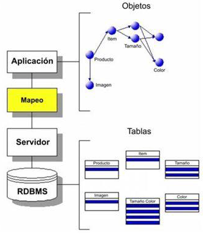
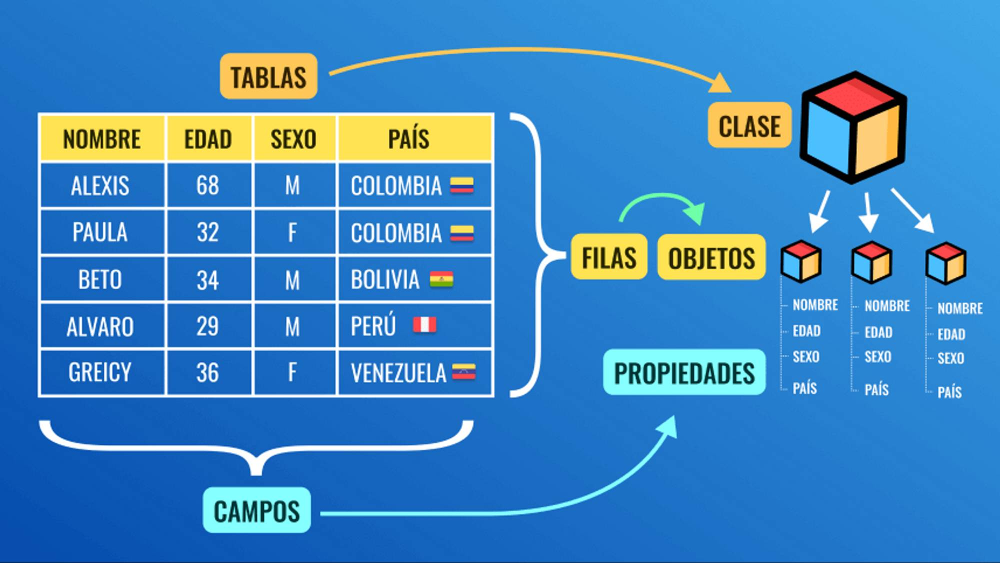
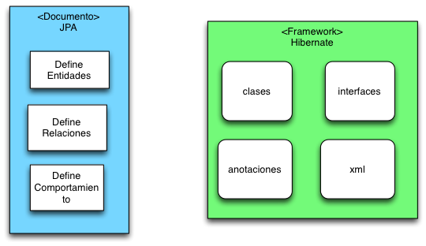
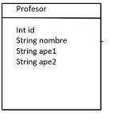
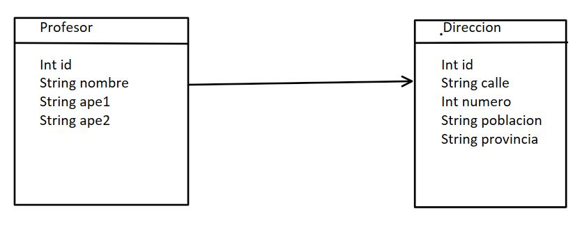
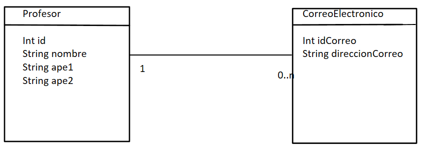
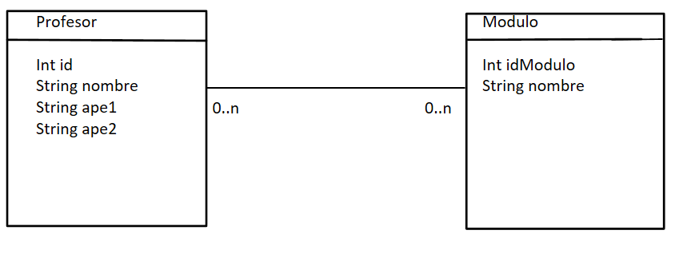
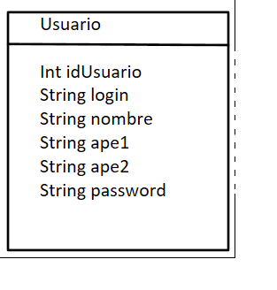
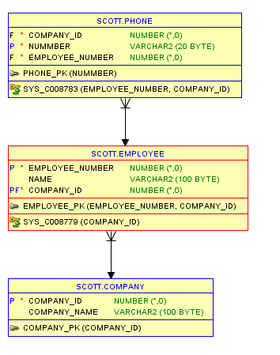
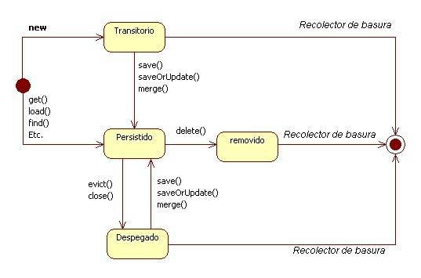

# 4A Mapeo Objeto Relacional ORM

> **Módulo:** Acceso a Datos — DAM 2
> **Procedencia:** [Aula virtual](https://aulavirtual3.educa.madrid.org/ies.alonsodeavellan.alcala/mod/book/view.php?id=221730)
> **Criterio:** transcripción del material docente, sin resumir ni actualizar sus versiones.

## Índice

- [1. Introducción](#1-introduccion)
- [2. Persistencia de Objetos](#2-persistencia-de-objetos)
- [3. Hibernate](#3-hibernate)
  - [Consideraciones Generales de Funcionamiento en Hibernate](#consideraciones-generales-de-funcionamiento-en-hibernate)
- [4. Anotaciones Java Persistence API (JPA) vs Hibernate](#4-anotaciones-java-persistence-api-jpa-vs-hibernate)
  - [1. JPA no es un framework, es una especificación](#1-jpa-no-es-un-framework-es-una-especificacion)
  - [2. Hibernate sí es real](#2-hibernate-si-es-real)
  - [3. Las anotaciones de Hibernate son las de JPA](#3-las-anotaciones-de-hibernate-son-las-de-jpa)
- [5. Clases anotadas](#5-clases-anotadas)
- [6. Mapeo de Entidades](#6-mapeo-de-entidades)
- [6.1. Configuración Hibernate](#6-1-configuracion-hibernate)
  - [1. Los dos modos de configuración](#1-los-dos-modos-de-configuracion)
  - [Modo A: Hibernate nativo (`hibernate.cfg.xml`)](#modo-a-hibernate-nativo-hibernate-cfg-xml)
  - [Modo B: JPA estándar (`persistence.xml`)](#modo-b-jpa-estandar-persistence-xml)
  - [2. Lo que ganas y lo que pierdes con cada modo](#2-lo-que-ganas-y-lo-que-pierdes-con-cada-modo)
  - [Con Hibernate nativo](#con-hibernate-nativo)
  - [Con JPA estándar](#con-jpa-estandar)
  - [3. ¿Cuál es el mejor método?](#3-cual-es-el-mejor-metodo)
- [7. Configurando](#7-configurando)
- [7.1. Maven](#7-1-maven)
  - [Introducción a Maven](#introduccion-a-maven)
- [7.2. Configuración completa](#7-2-configuracion-completa)
  - [Referencias:](#referencias)
  - [Ficheros a configurar](#ficheros-a-configurar)
  - [Configuración Resumida](#configuracion-resumida)
- [8. Mapeo de relaciones](#8-mapeo-de-relaciones)
- [8.1. Relaciones uno a uno (unidireccional)](#8-1-relaciones-uno-a-uno-unidireccional)
- [8.2. Relaciones uno a uno bidireccionales](#8-2-relaciones-uno-a-uno-bidireccionales)
  - [Código Java](#codigo-java)
- [8.3. Relaciones uno a muchos(desordenada)](#8-3-relaciones-uno-a-muchos-desordenada)
- [8.4. Relaciones uno a muchos (ordenada)](#8-4-relaciones-uno-a-muchos-ordenada)
- [8.5. Relaciones muchos a muchos](#8-5-relaciones-muchos-a-muchos)
- [8.6. Cascade](#8-6-cascade)
- [8.7. recomendaciones de uso cascadeType](#8-7-recomendaciones-de-uso-cascadetype)
  - [¿Qué significa CascadeType.ALL?](#que-significa-cascadetype-all)
  - [Es adecuado usar CascadeType.ALL cuando:](#es-adecuado-usar-cascadetype-all-cuando)
  - [No es recomendable usar CascadeType.ALL en las siguientes situaciones:](#no-es-recomendable-usar-cascadetype-all-en-las-siguientes-situaciones)
  - [Ejemplo:](#ejemplo)
  - [Resumen](#resumen)
- [8.8. Metodos equals y hashCode](#8-8-metodos-equals-y-hashcode)
- [8.9. Identificadores](#8-9-identificadores)
- [8.10. El identificador consta de un único atributo](#8-10-el-identificador-consta-de-un-unico-atributo)
- [8.11. El identificador consta de varios atributos](#8-11-el-identificador-consta-de-varios-atributos)
- [Contenido](#contenido)
- [9.1. Contextos de persistencia](#9-1-contextos-de-persistencia)
  - [Borrando un objeto](#borrando-un-objeto)
  - [Cargando un objeto](#cargando-un-objeto)
  - [Los métodos load() de Session le proporcionan una forma de recuperar una instancia persistente si ya conoce su identificador. load() toma un objeto clase y carga el estado dentro de una instancia recién instanciada de esa clase, en un estado persistente, pero tienen diferencias importantes:](#los-metodos-load-de-session-le-proporcionan-una-forma-de-recuperar-una-instancia-persistente-si-ya-conoce-su-identificador-load-toma-un-objeto-clase-y-carga-el-estado-dentro-de-una-instancia-recien-instanciada-de-esa-clase-en-un-estado-persistente-pero-tienen-diferencias-importantes)
    - [Load()](#load)
  - [Otros Métodos de Session](#otros-metodos-de-session)
- [9.2. Excepciones](#9-2-excepciones)
- [Fuentes locales y adjuntos](#fuentes-locales-y-adjuntos)

---

<a id="1-introduccion"></a>
## 1. Introducción

**El mapeo objeto-relacional** (más conocido por su nombre en inglés, Object-Relational mapping, o sus siglas O/RM, **ORM**, y O/R mapping) es una **técnica de programación** para convertir datos entre el sistema de tipos utilizado en **un lenguaje de programación orientado a objetos** y la utilización de una **base de datos relacional como motor de persistencia.**

En la práctica esto **crea una base de datos orientada a objetos virtual**, **sobre la base de datos relacional**. Esto posibilita el uso de las características propias de la orientación a objetos (básicamente herencia y polimorfismo). Hay paquetes comerciales y de uso libre disponibles que desarrollan el mapeo relacional de objetos, aunque algunos programadores prefieren crear sus propias herramientas ORM.



Fuente: Tesis Previa a la Obtención del Título de Ingeniera en Sistemas Computacionales. Tatiana Alexandra Freire Reyes

Para llevar a cabo la persistencia se produce un mapeo entre tablas y clases; filas y objetos; y campos y propiedades.



Fuente: EDTeam

<a id="2-persistencia-de-objetos"></a>
## 2. Persistencia de Objetos

**Introducción**

Cuando abordamos el desarrollo de una aplicación específicamente una orientada a objetos, uno de los primeros requerimientos que debemos resolver es la integración con una base de datos relacional para guardar, actualizar y recuperar la información que utiliza nuestra aplicación.

En esta unidad  se presenta los fundamentos, problema y la alternativa de solución común para la persistencia de Objetos en base de datos relacionales.

**¿Qué es Persistencia de Objetos?**

**La persistencia de objetos es la capacidad que tienen los objetos de sobrevivir al proceso que los creó; permitiendo al programador almacenar, transferir, y recuperar el estado de los objetos.**

La persistencia en Base de Datos relacionales se suele **implementar mediante frameworks que automatizan el proceso a partir de mapeos** (conocidos como Object Relational Mapping, ORM).

Estos framework ORM implementan un estándar ofrecido por Java llamado  
**JPA (Java Persistence API).**

**JPA es una especificación y no un Framework como tal ¿**Que quiere decir esto? Una especificación no es más que un documento en el cual se plasman las reglas que debe de cumplir cualquier proveedor que desee desarrollar una implementación de JPA, de tal forma que cualquier persona puede tomar la especificación y desarrollar su propia implementación de JPA.

Algunas implementaciones de JPA son:

- Hibernate
- EclipseLink
- TopLink
- OpenJPA

<a id="3-hibernate"></a>
## 3. Hibernate

**Hibernate** es una herramienta de mapeo objeto-relacional (ORM) para la plataforma Java (y disponible también para .Net con el nombre de NHibernate) **que facilita el mapeo de atributos entre una base de datos relacional tradicional y el modelo de objetos de una aplicación, mediante archivos declarativos (XML) o anotaciones en los beans de las entidades que permiten establecer estas relaciones.**

Como todas las herramientas de su tipo, Hibernate busca solucionar el problema de la diferencia entre los dos modelos de datos coexistentes en una aplicación:

- el usado en la memoria de la computadora (orientación a objetos) y
- el usado en las bases de datos (modelo relacional).

Para lograr esto **permite al desarrollador detallar cómo es su modelo de datos, qué relaciones existen y qué forma tienen**. Con esta información Hibernate le permite a la aplicación manipular los datos en la base de datos operando sobre objetos, con todas las características de la [POO](https://es.wikipedia.org/wiki/Programaci%C3%B3n_orientada_a_objetos "Programación orientada a objetos").

**Hibernate convertirá los datos entre los tipos utilizados por Java y los definidos por** **[SQL](https://es.wikipedia.org/wiki/SQL "SQL"). Hibernate genera las sentencias SQL y libera al desarrollador del manejo manual de los datos que resultan de la ejecución de dichas sentencias, manteniendo la portabilidad entre todos los motores de bases de datos con un ligero incremento en el tiempo de ejecución.**

**Hibernate** está diseñado para ser flexible en cuanto al esquema de tablas utilizado, **para poder adaptarse a su uso sobre una base de datos ya existente.** También **tiene la funcionalidad de crear la base de datos a partir de la información disponible.**

**Hibernate ofrece también un lenguaje de consulta de datos llamado HQL** (*Hibernate Query Language*), al mismo tiempo que una [API](https://es.wikipedia.org/wiki/Application_Programming_Interface "Application Programming Interface") para construir las consultas.

Hibernate para Java puede ser utilizado en aplicaciones Java independientes o en aplicaciones [Java EE](https://es.wikipedia.org/wiki/Java_EE "Java EE"), mediante el componente **Hibernate Annotations** que implementa el estándar [JPA](https://es.wikipedia.org/wiki/Java_Persistence_API "Java Persistence API"), que es parte de esta plataforma.

Hibernate es software libre, distribuido bajo los términos de la licencia GNU LGPL.

Fuente: es.wikipedia.org

<a id="consideraciones-generales-de-funcionamiento-en-hibernate"></a>
### Consideraciones Generales de Funcionamiento en Hibernate

Para almacenar y recuperar objetos de la base de datos, el desarrollador interactúa con el motor de Hibernate mediante un objeto esencial llamado **Session (clase Session)**. Este concepto es uno de los más importantes dentro de Hibernate y se puede comparar de forma general al concepto de conexión en JDBC, ya que cumple un papel similar.

La Session permite:

- **Delimitar operaciones relacionadas**: Agrupa acciones dentro de un proceso de negocio, lo que asegura que todas formen parte de un flujo coherente.
- **Manejar transacciones**: Proporciona métodos para iniciar, confirmar o revertir transacciones, garantizando integridad en las operaciones.
- **Servicios adicionales**: Ofrece funcionalidades como el manejo de caché, evitando interacciones innecesarias con la base de datos y mejorando el rendimiento.

Además, la clase Session incluye métodos clave como:

- persist(Object object): Guarda un objeto en la base de datos.
- createQuery(String queryString): Permite crear consultas dinámicas utilizando HQL (Hibernate Query Language).
- beginTransaction(): Inicia una nueva transacción.
- close(): Cierra la sesión y libera recursos asociados.

En resumen, el uso de la Session no solo facilita la interacción con la base de datos, sino que también permite un manejo eficiente de las operaciones relacionadas, asegurando consistencia, optimización y control en el acceso a los datos.

Hibernate **distingue entre objetos tipo transient y tipo persistent:**

- **transient**son **objetos que sólo existen en memoria y no en un almacén de datos**, en algunos casos no serán almacenados jamás en la base de datos y en otros es un estado en el que se encuentran hasta ser almacenados en ella.
- **Persistent se caracterizan por haber sido ya almacenados y ser por tanto objetos persistentes**.

Dicho de otra manera los objetos transient han sido instanciados por el desarrollador sin haberlos almacenado mediante una sesión, los objetos persistentes han sido creados y almacenados en una sesión o bien devueltos en una consulta realizada con la sesión.

**¿Por qué necesitamos Hibernate?**

Con Hibernate, **no es necesario preocuparse por cambios de base de datos,** como cambios manuales en los archivos de secuencia de comandos SQL que se evitan. Si alguna vez necesita cambiar la base de datos que utiliza su aplicación, puede ser fácilmente acomodado mediante la alteración de la propiedad dialect en el archivo de configuración. Hibernate te da el poder completo de SQL, algo que nunca fue ofrecido por los primeros frameworks ORM comerciales.

**Hibernate genera código JDBC basado en la base de datos subyacente elegida, por lo que le ahorra la molestia de escribir código JDBC.** También es compatible con la agrupación de conexiones. Las API que son usados por Hibernate son muy simples y fáciles de aprender. Los desarrolladores con muy poco conocimiento de SQL puede hacer uso de Hibernate, ya que disminuye la carga de la escritura de consultas SQL.

<a id="4-anotaciones-java-persistence-api-jpa-vs-hibernate"></a>
## 4. Anotaciones Java Persistence API (JPA) vs Hibernate

<a id="1-jpa-no-es-un-framework-es-una-especificacion"></a>
### 1. JPA no es un framework, es una especificación

**JPA (Java Persistence API)** es solo un **documento/estándar** que define *cómo debería funcionar* la persistencia en Java EE. Es decir:

- Define **qué** debe existir: anotaciones como `@Entity`, `@Table`, `@Id`, una interfaz `EntityManager`, etc.
- Define **cómo se deben comportar** esas cosas.
- Pero **no incluye código ejecutable**. No puedes "instalar JPA" y ponerte a trabajar con él.

Es parte de la especificación **EJB 3 (JSR 220)**, que es el documento oficial donde se describen esas reglas. Piensa en JPA como el "plano" o el "contrato".

<a id="2-hibernate-si-es-real"></a>
### 2. Hibernate sí es real

**Hibernate** es un **framework concreto**, con código de verdad, que **implementa** esa especificación. Es lo que realmente usas en tu aplicación para guardar/leer objetos de la base de datos.

- Puede configurarse mediante **ficheros XML** o mediante **anotaciones**.
- Cuando usas Hibernate, por debajo estás usando una implementación de JPA (Hibernate es la implementación de referencia más popular).

Analogía: JPA es como el "reglamento de construcción" y Hibernate es la "constructora" que realmente levanta el edificio siguiendo ese reglamento.

<a id="3-las-anotaciones-de-hibernate-son-las-de-jpa"></a>
### 3. Las anotaciones de Hibernate son las de JPA

- Hibernate **adoptó las anotaciones del estándar JPA** (`@Entity`, `@Id`, `@Column`...). Es decir, cuando escribes esas anotaciones en tus clases, estás usando el estándar JPA, no algo propio de Hibernate.
- No obstante, existe la posibilidad de configurar Hibernate mediante **ficheros XML**, en vez de anotaciones de JPA, en ese caso, ahí sí usas los **ficheros propietarios de Hibernate** (con su propio formato, sus etiquetas, etc.). Eso no es estándar JPA, es específico de Hibernate.

En la práctica, lo normal hoy es usar **Hibernate como implementación de JPA con anotaciones**, y los ficheros XML propios de Hibernate se ven más en proyectos antiguos o cuando necesitas funcionalidades que el estándar no cubre.



 Fuente: www.genbeta.com

<a id="5-clases-anotadas"></a>
## 5. Clases anotadas

Las anotaciones que mas frecuentes en Hibernate  son las siguientes. Puedes consultar todas las anotaciones en la documentación de la [API jakarta.persistence](https://docs.oracle.com/javaee/7/api/javax/persistence/package-summary.html)

| **Anotación** | **Paquete / Import statement** | **Descripción** | **Enlace a Documentación (Jakarta EE 8)** |
| --- | --- | --- | --- |
| **@Entity** | jakarta.persistence.Entity | Especifica que la clase es una entidad. | [Ver doc](https://jakarta.ee/specifications/platform/8/apidocs/javax/persistence/Entity.html) |
| **@Table** | jakarta.persistence.Table | Especifica la tabla principal para la entidad anotada. | [Ver doc](https://jakarta.ee/specifications/platform/8/apidocs/javax/persistence/Table.html) |
| **@Column** | jakarta.persistence.Column | Especifica la columna mapeada para una propiedad o campo persistente. | [Ver doc](https://jakarta.ee/specifications/platform/8/apidocs/javax/persistence/Column.html) |
| **@Id** | jakarta.persistence.Id | Especifica la clave primaria de una entidad. | [Ver doc](https://jakarta.ee/specifications/platform/8/apidocs/javax/persistence/Id.html) |
| **@GeneratedValue** | jakarta.persistence.GeneratedValue | Proporciona la especificación de estrategias de generación para los valores de las claves primarias. | [Ver doc](https://jakarta.ee/specifications/platform/8/apidocs/javax/persistence/GeneratedValue.html) |
| **@Version** | jakarta.persistence.Version | Especifica el campo o propiedad de versión de una clase de entidad que sirve como su valor de bloqueo optimista. | [Ver doc](https://jakarta.ee/specifications/platform/8/apidocs/javax/persistence/Version.html) |
| **@OrderBy** | jakarta.persistence.OrderBy | Especifica el orden de los elementos de una asociación valorada en colección en el punto en que se recupera. | [Ver doc](https://jakarta.ee/specifications/platform/8/apidocs/javax/persistence/OrderBy.html) |
| **@Transient** | jakarta.persistence.Transient | Especifica que la propiedad o el campo no es persistente. | [Ver doc](https://jakarta.ee/specifications/platform/8/apidocs/javax/persistence/Transient.html) |
| **@Lob** | jakarta.persistence.Lob | Especifica que una propiedad o campo persistente debe persistirse como un objeto grande (Large Object). | [Ver doc](https://jakarta.ee/specifications/platform/8/apidocs/javax/persistence/Lob.html) |
| **Hibernate Association Mapping Annotations** | | | |
| **@OneToOne** | jakarta.persistence.OneToOne | Especifica una asociación univaluada a otra entidad que tiene multiplicidad de uno a uno. | [Ver doc](https://jakarta.ee/specifications/platform/8/apidocs/javax/persistence/OneToOne.html) |
| **@ManyToOne** | jakarta.persistence.ManyToOne | Especifica una asociación univaluada a otra clase de entidad que tiene multiplicidad de muchos a uno. | [Ver doc](https://jakarta.ee/specifications/platform/8/apidocs/javax/persistence/ManyToOne.html) |
| **@OneToMany** | jakarta.persistence.OneToMany | Especifica una asociación multivaluada con multiplicidad de uno a muchos. | [Ver doc](https://jakarta.ee/specifications/platform/8/apidocs/javax/persistence/OneToMany.html) |
| **@ManyToMany** | jakarta.persistence.ManyToMany | Especifica una asociación multivaluada con multiplicidad de muchos a muchos. | [Ver doc](https://jakarta.ee/specifications/platform/8/apidocs/javax/persistence/ManyToMany.html) |
| **@PrimaryKeyJoinColumn** | jakarta.persistence.PrimaryKeyJoinColumn | Especifica una columna de clave primaria que se utiliza como clave externa para unirse a otra tabla. | [Ver doc](https://jakarta.ee/specifications/platform/8/apidocs/javax/persistence/PrimaryKeyJoinColumn.html) |
| **@JoinColumn** | jakarta.persistence.JoinColumn | Especifica una columna para unirse a una asociación de entidad o colección de elementos. | [Ver doc](https://jakarta.ee/specifications/platform/8/apidocs/javax/persistence/JoinColumn.html) |
| **@JoinTable** | jakarta.persistence.JoinTable | Especifica el mapeo de asociaciones. | [Ver doc](https://jakarta.ee/specifications/platform/8/apidocs/javax/persistence/JoinTable.html) |
| **@MapsId** | jakarta.persistence.MapsId | Designa un atributo de relación que proporciona el mapeo para una clave primaria EmbeddedId o una clave primaria simple. | [Ver doc](https://jakarta.ee/specifications/platform/8/apidocs/javax/persistence/MapsId.html) |
| **Hibernate Inheritance Mapping Annotations** | | | |
| **@Inheritance** | jakarta.persistence.Inheritance | Especifica la estrategia de herencia que se utilizará para una jerarquía de clases de entidad. | [Ver doc](https://jakarta.ee/specifications/platform/8/apidocs/javax/persistence/Inheritance.html) |
| **@DiscriminatorColumn** | jakarta.persistence.DiscriminatorColumn | Especifica la columna discriminadora para las estrategias de mapeo de herencia. | [Ver doc](https://jakarta.ee/specifications/platform/8/apidocs/javax/persistence/DiscriminatorColumn.html) |
| **@DiscriminatorValue** | jakarta.persistence.DiscriminatorValue | Especifica el valor de la columna discriminadora para entidades del tipo dado. | [Ver doc](https://jakarta.ee/specifications/platform/8/apidocs/javax/persistence/DiscriminatorValue.html) |

En los siguientes subcapítulos nos centraremos en utilizar anotaciones para mapear tablas de una base de datos relacional utilizando clases con anotaciones.

**Nota sobre la documentación:** Los enlaces apuntan a la documentación de **Jakarta EE 8**. Jakarta EE es el proyecto de código abierto que continúa el desarrollo de Java EE bajo la Eclipse Foundation.

<a id="6-mapeo-de-entidades"></a>
## 6. Mapeo de Entidades

**Una entidad es una clase que se desea hacer persistente, la persistencia se implementa con tablas  de bases de datos relacional., por ello, el concepto de Entidad se asocia a la de tabla.**

La tabla Profesor debe corresponder con la clase Profesor:



La tabla de persistencia que corresponde con esta clases:

Profesor( id, nombre, ape1, ape2)

 

**La clases Java deberán tener las siguientes características:**

- **Deben tener un constructor público sin ningún tipo de argumentos.**
- **Para cada propiedad que queramos persistir debe haber un método get/set asociado.**
- **Implementar el interfaz [`Serializable`](http://docs.oracle.com/javase/7/docs/api/java/io/Serializable.html)  (En mi ejemplo esto no ha sido necesario)**

En el siguiente apartado veremos que hay varias formas de mapear entidades, veamos un ejemplo de la clase `Profesor` pero mapeada con anotaciones.

```java
1: @Entity
 2: @Table(name="Profesor")
 3: public class Profesor implements Serializable  {
 4:
 5:     @Id
 6:     @Column(name="Id")
 7:     private int id;
 8:
 9:     @Column(name="nombre")
10:     private String nombre;
11:
12:     @Column(name="ape1")
13:     private String ape1;
14:
15:     @Column(name="ape2")
16:     private String ape2;
17:
18:
19:     public Profesor(){
20:     }
21:
22:     public Profesor(int id, String nombre, String ape1, String ape2) {
23:         this.id = id;
24:         this.nombre = nombre;
25:         this.ape1 = ape1;
26:         this.ape2 = ape2;
27:     }
28:
29:     public int getId() {
30:         return id;
31:     }
32:
33:     public void setId(int id) {
34:         this.id = id;
35:     }
36:
37:     public String getNombre() {
38:         return nombre;
39:     }
40:
41:     public void setNombre(String nombre) {
42:         this.nombre = nombre;
43:     }
44:
45:     public String getApe1() {
46:         return ape1;
47:     }
48:
49:     public void setApe1(String ape1) {
50:         this.ape1 = ape1;
51:     }
52:
53:     public String getApe2() {
54:         return ape2;
55:     }
56:
57:     public void setApe2(String ape2) {
58:         this.ape2 = ape2;
59:     }
60: }
```

Las anotaciones que se han usado son las siguientes:

- **`@Entity`**: Se aplica a la clase e indica que esta clase Java es una entidad a persistir. Es una anotación estándar de JPA. En nuestro ejemplo estamos indicando que la clase `Profesor` es una entidad que se puede persistir.
- **`@Table(name=“Profesor”)`**: Se aplica a la clase e indica el nombre de la tabla de la base de datos donde se persistirá la clase. Es opcional si el nombre de la clase coincide con el de la tabla. Es una anotación estándar de JPA. En nuestro ejemplo estamos indicando que la clase `Profesor` se persistirá en la tabla `Profesor` de la base de datos.
- **`@Id`**: Se aplica a una propiedad Java e indica que este atributo es la clave primaria. Es una anotación estándar de JPA. En nuestro ejemplo estamos indicando que la propiedad Java `id` es la clave primaria.
- **`@Column(name=“Id”)`**: Se aplica a una propiedad Java e indica el nombre de la columna de la base de datos en la que se persistirá la propiedad. Es opcional si el nombre de la propiedad Java coincide con el de la columna de la base de datos. Es una anotación estándar de JPA. En nuestro ejemplo estamos indicando que la propiedad Java `id` se persistirá en una columna llamada `Id`.
- **`@Column(name=“nombre”)`**: Se aplica a una propiedad Java e indica el nombre de la columna de la base de datos en la que se persistirá la propiedad. Es opcional si el nombre de la propiedad Java coincide con el de la columna de la base de datos. Es una anotación estándar de JPA. En nuestro ejemplo estamos indicando que la propiedad Java `nombre` se persistirá en una columna llamada `nombre`.
- **`@Column(name=“ape1”)`**: Es igual al caso anterior pero para la propiedad `ape1`.
- **`@Column(name=“ape2”)`**: Es igual al caso anterior pero para la propiedad `ape2`.

En el ejemplo anterior se han omitido los metodos geter y seter para simplificar. Usando anotaciones se persisten todas las propiedades que tengan los métodos `get/set`. Si no queremos que un atributo persista, lo anotaremos con **`@Transient.`**

<a id="6-1-configuracion-hibernate"></a>
## 6.1. Configuración Hibernate

Hibernate se puede configurar de dos maneras principales, y la elección entre ellas determina no solo el archivo de configuración, sino también las clases y métodos que usarás en tu código Java. La diferencia esencial es: **¿trabajas directamente con la API propietaria de Hibernate, o a través del estándar JPA?**

---

<a id="1-los-dos-modos-de-configuracion"></a>
### 1. Los dos modos de configuración

<a id="modo-a-hibernate-nativo-hibernate-cfg-xml"></a>
### Modo A: Hibernate nativo (`hibernate.cfg.xml`)

Aquí usas la API original de Hibernate. El archivo `hibernate.cfg.xml` se coloca normalmente en la raíz del classpath (por ejemplo, `src/main/resources`) y contiene toda la configuración de conexión y las referencias a las entidades .

**A grandes rasgos, la configuración incluye:**

- Propiedades de conexión JDBC (driver, URL, usuario, contraseña).
- Dialecto de la base de datos.
- Listado de clases entidad mediante `<mapping class="..."/>`.
- Opciones específicas de Hibernate como `hbm2ddl.auto` o configuración de caché de segundo nivel .

En el código Java, arrancas Hibernate así:

java

```java
SessionFactory sf = new Configuration().configure().buildSessionFactory();
```

Y luego trabajas con `Session` y métodos como `session.save(entidad)`.

<a id="modo-b-jpa-estandar-persistence-xml"></a>
### Modo B: JPA estándar (`persistence.xml`)

Aquí usas la especificación JPA, y Hibernate actúa simplemente como el proveedor que la implementa. El archivo **debe** llamarse `persistence.xml` y ubicarse en `META-INF/` dentro del classpath (por ejemplo, `src/main/resources/META-INF/persistence.xml`).

**A grandes rasgos, la configuración incluye:**

- Un `<persistence-unit>` con un nombre.
- El `<provider>` que indica qué implementación de JPA se usa (Hibernate, EclipseLink, etc.).
- Las clases entidad (o el modo de descubrimiento automático).
- Las propiedades de conexión, que en JPA suelen usar prefijos estándar como `javax.persistence.jdbc.*` o `jakarta.persistence.jdbc.*`, aunque también puedes pasar propiedades específicas de Hibernate .

En el código Java, arrancas JPA así:

java

```java
EntityManagerFactory emf = Persistence.createEntityManagerFactory("nombreDeLaUnidad");
```

Y luego trabajas con `EntityManager` y métodos como `em.persist(entidad)`.

> **Nota importante sobre el `pom.xml`:** El `pom.xml` de Maven no configura la persistencia. Solo declara las dependencias (Hibernate, el driver JDBC, etc.). La configuración real de la conexión va siempre en `hibernate.cfg.xml` o en `persistence.xml`, según el modo elegido.

---

<a id="2-lo-que-ganas-y-lo-que-pierdes-con-cada-modo"></a>
### 2. Lo que ganas y lo que pierdes con cada modo

<a id="con-hibernate-nativo"></a>
### Con Hibernate nativo

**Lo que ganas:**

- **Acceso a características avanzadas de Hibernate** que no están cubiertas por el estándar JPA, como ciertos detalles de la gestión de caché de segundo nivel o configuraciones muy específicas del proveedor .
- **Control más directo** sobre el comportamiento del ORM en escenarios que requieren ajustes finos.

**Lo que pierdes:**

- **Portabilidad.** Tu código queda atado a Hibernate. Si algún día quisieras cambiar a otro ORM (EclipseLink, por ejemplo), tendrías que reescribir toda la capa de persistencia: cambiar `Session` por `EntityManager`, `save` por `persist`, etc. .
- **Estandarización.** El código no sigue un estándar de Java, lo que puede dificultar la incorporación de nuevos desarrolladores familiarizados con JPA.

<a id="con-jpa-estandar"></a>
### Con JPA estándar

**Lo que ganas:**

- **Portabilidad.** Tu código Java solo depende de `javax.persistence.*` (o `jakarta.persistence.*`). Cambiar de proveedor es, en teoría, tan simple como cambiar el `<provider>` en `persistence.xml` y ajustar dependencias, sin tocar el código de negocio .
- **Estandarización y familiaridad.** JPA es el estándar de facto en el ecosistema Java (especialmente con Spring Boot), por lo que hay más documentación, más desarrolladores que lo conocen y mejor integración con frameworks modernos .

**Lo que pierdes:**

- **Acceso inmediato a lo específico de Hibernate.** Si necesitas una característica que Hibernate ofrece pero JPA no expone, tendrías que salirte del estándar (usar la API nativa subyacente o configuración específica), lo que rompe parcialmente la portabilidad .
- **Una capa adicional de abstracción** que, en casos muy concretos de rendimiento extremo, puede limitar el control directo sobre la implementación.

---

<a id="3-cual-es-el-mejor-metodo"></a>
### 3. ¿Cuál es el mejor método?

Para la mayoría de proyectos modernos, **JPA es la opción recomendada**. La razón principal es el desacoplamiento: escribes tu lógica de persistencia contra un estándar y no contra un proveedor concreto. Esto facilita el mantenimiento, las pruebas y una eventual migración .

Hibernate nativo tiene sentido si:

- Necesitas alguna funcionalidad muy específica de Hibernate que JPA no cubre.
- Estás manteniendo un proyecto legacy que ya está construido sobre la API nativa y migrarlo no es rentable.

Si empiezas un proyecto nuevo, **usa JPA con `persistence.xml`** (o, mejor aún, con Spring Boot, que abstrae casi toda esa configuración XML).

No obstante en los ejemplos de este tema **utilizaremos Hibernate Nativo**

<a id="7-configurando"></a>
## 7. Configurando

Como con cualquier otro framework es necesario configurarlo para su correcto funcionamiento.

La instalación del plugin para Hibernate la puedes encontrar en esta unidad en un fichero aparte

 Sin embargo, aún quedan aspectos que debemos configurar como:

- Datos de conexión a la base de datos
- Ubicación de las clases a persistir.
- Nivel de Log

La forma de configurar hibernate es usando el fichero XML de configuración llamado **hibernate.cfg.xml.** Este fichero deberemos guardarlo en el paquete raíz de nuestras clases Java, es decir fuera de cualquier paquete.Si estamos usando NetBeans deberá ser en la carpeta src de nuestro proyecto.

La información que contiene es la siguiente:

- Propiedades de configuración.
- Las clases que se quieren mapear.

El fichero tiene la siguiente estructura:

```java
 1: <?xml version="1.0" encoding="UTF-8"?>
 2: <!DOCTYPE hibernate-configuration PUBLIC "-//Hibernate/Hibernate Configuration DTD 3.0//EN" "http://www.hibernate.org/dtd/hibernate-configuration-3.0.dtd">
 3: <hibernate-configuration>
 4:   <session-factory>
 5:     <property name="connection.driver_class">nombre_driver</property>
 6:     <property name="connection.url">url_base_datos</property>
 7:     <property name="connection.username">usuario</property>
 8:     <property name="connection.password">contraseña</property>
 9:     <property name="dialect">dialecto</property>
10:     
11:
12:     <mapping resource="fichero_mapeo.hbm.xml"/>
13:     <mapping class="clase_anotada"/>
14:
15:   </session-factory>
16: </hibernate-configuration>
```

El tag  &lt;session-factory&gt;  contiene la configuración de hibernate, no debe tener ninguna propiedad.  
El resto de las etiquetas son: &lt;/property&gt;, para especificar las propiedades JDBC de Hibernate y &lt;mapping&gt;, con el atributo class si utilizamos clases anotadas o  resource si el mapeo se realiza con ficheros de mapeo hbm.xml

Propiedades JDBC de Hibernate

| Nombre de propiedad | Propósito |
| --- | --- |
| hibernate.connection.driver\_class | *clase del driver jdbc* |
| hibernate.connection.url | *URL de jdbc* |
| hibernate.connection.username | *usuario de base de datos* |
| hibernate.connection.password | *contraseña del usuario de base de datos* |
| hibernate.connection.pool\_size | *número máximo de conexiones manejadas por pooling* |

<a id="7-1-maven"></a>
## 7.1. Maven

<a id="introduccion-a-maven"></a>
### Introducción a Maven

Una de las herramientas más útiles a la hora de utilizar librerías de terceros (como JPA e Hibernate) es Maven.

Maven es una herramienta capaz de **gestionar un proyecto software Java completo**, desde la etapa en la que se comprueba que el código es correcto, hasta que se despliega la aplicación, pasando por la ejecución de pruebas y generación de informes y documentación.

Y por otro lado, Maven es un **sistema de gestion de dependencias (o librerías)** muy potente que nos permite indicar qué librerías utiliza el software que estamos desarrollando en un **fichero de configuración POM**, sin necesidad de descargarlas manualmente gracias a su repositorio remoto (Maven central).

<a id="7-2-configuracion-completa"></a>
## 7.2. Configuración completa

Vamos a ver los pasos para realizar una configuración completa de Hibernate en Eclipse con la una BBDD MySQL, con la configuración de Hibernate Nativo. (hibernate.cfg.xml)

<a id="referencias"></a>
### Referencias:

[watch](https://www.youtube.com/watch?v=_F_-wNCahL0)

[watch](https://www.youtube.com/watch?v=BJY4966Z3KY&list=PLkVpKYNT_U9eTicIIaqR9YUoIZ5V4ZXpS)

- [4B creación de un proyecto de mapeo con hibernate. Base de datos Oracle. MavenLibro](4B-proyecto-hibernate-oracle-maven.md)

Documentación

<https://hibernate.org/orm/documentation/>

<https://jakarta.ee/specifications/platform/8/>

<https://jakarta.ee/specifications/platform/8/apidocs/>

Obsoleto: <https://docs.hibernate.org/stable/orm/javadocs/>

<a id="ficheros-a-configurar"></a>
### Ficheros a configurar

Para la confuguración vamos a necesitar 5 ficheros:

pom.xml → Incluir las dependencias de Hibernate y del conector SQL  
hibernate.cfg.xml → Conexión a la base de datos y definición de las entidades  
Usuario.java → Clase que va a ser mapeada con sus anotaciones  
HibertanteUtil.java → Clase para obtener la sesión  
Pruebas.java → Clase con el main para utilizar las herramientas de hibernate para hacer operaciones CRUD con las clases

<a id="configuracion-resumida"></a>
### Configuración Resumida

1. Agregar dependencias maven en el fichero pom.xml:
   - hibernate-core
   - Driver de base de datos: mysql, postgresql, etc, el que se quiera.
2. Crear fichero 'hibernate.cfg.xml' en la carpeta src/main/resources y configurarlo
   - Conexión a la BBDD
   - Dialecto de la BBDD
   - Mostrar y formatear el SQL generado (útil en desarrollo)
   - Gestión automática del esquema (depende del entorno)
   - Importante: Registro de clases entidad
3. Crear objeto SessionFactory desde java
   - Usuario.java → Clase que va a ser mapeada con sus anotaciones
   - HibertanteUtil.java → Clase para obtener la sesión
   - Pruebas.java → Clase con el main para utilizar las herramientas de hibernate para hacer operaciones CRUD con las clases

<a id="8-mapeo-de-relaciones"></a>
## 8. Mapeo de relaciones

Esta unidad llamada “Relaciones” explica como realizar las
distintas relaciones entre entidades de Hibernate.

Se estudiaran las relaciones:

- Uno a uno (unidireccional)
- Uno a uno (bidireccional)
- Uno a muchos (desordenada)
- Uno a muchos (ordenada)
- Muchos a mucho

<a id="8-1-relaciones-uno-a-uno-unidireccional"></a>
## 8.1. Relaciones uno a uno (unidireccional)

La relación uno a uno en Hibernate consiste simplemente en que un objeto tenga una referencia a otro objeto de forma que al persistirse el primer objeto también se persista el segundo.

En esta lección la relación va a ser unidireccional es decir que que la relación *uno a uno* va a ser en un único sentido.

En el ejemplo siguiente, cada profesor tiene un domicilio. El diagrama de clases y el esquema relacional es el siguiente:

                



Profesor(id, nombre, ape1, ape2)

Direccion(id, calle, numero, poblacion, provincia, Idprofesor)

fk:Direccion ------Idprofesor---------&gt; Profesor

El código fuente de la clase `Profesor` queda de la siguiente forma:

```java
 1: import java.io.Serializable;
 2: import javax.persistence.*;
 3:
 4:
 5: @Entity
 6: @Table(name="Profesor")
 7: public class Profesor implements Serializable  {
 8:
 9:     @Id
10:     @Column(name="Id")
11:     private int id;
12:
13:     @Column(name="nombre")
14:     private String nombre;
15:
16:     @Column(name="ape1")
17:     private String ape1;
18:
19:     @Column(name="ape2")
20:     private String ape2;
21:
22:     @OneToOne(cascade=CascadeType.ALL)
23:     @PrimaryKeyJoinColumn
24:     private Direccion direccion;
25: }
```

Clase Profesor anotada

A la propiedad `direccion` (línea 24) se han añadido dos anotaciones para indicar la relación *uno a uno* y que ésta relación se implemente mediante la clave primaria.

- **@OneToOne(cascade=CascadeType.ALL)**: Esta anotación indica la relación *uno a uno* de las 2 tablas. Tambien indicamos el valor de `cascade`

  El significado de CascadeType.ALL es que la persistencia propagará (en cascada) todas las operaciones de EntityManager (PERSIST, REMOVE, REFRESH, MERGE, DETACH) a las entidades relacionadas.
- **@PrimaryKeyJoinColumn**: Indicamos que la relación entre las dos tablas se realiza mediante la clave primaria. En caso de no incluir esta anotación `@PrimaryKeyJoinColumn` se producirá un error indicando que falta la columna `direccion_Id` en la tabla `Profesor`.

En código de `Direccion` no es necesario indicar nada sobre la relación, ya que es unidireccional.

- `Profesor.Id` es **PK de Profesor** y **FK que referencia a `Direccion.id`**.
- El valor de `Id` en `Profesor` debe coincidir con el `id` de la `Direccion` asociada (Hibernate lo sincroniza al persistir, ya que `@PrimaryKeyJoinColumn` sin argumentos usa la PK de la entidad propietaria).

```java
 1: import java.io.Serializable;
 2: import javax.persistence.Column;
 3: import javax.persistence.Entity;
 4: import javax.persistence.Id;
 5: import javax.persistence.Table;
 6:
 7:
 8: @Entity
 9: @Table(name="Direccion")
10: public class Direccion implements Serializable  {
11:
12:     @Id
13:     @Column(name="Id")
14:     private int id;
15:
16:     @Column(name="calle")
17:     private String calle;
18:
19:     @Column(name="numero")
20:     private int numero;
21:
22:     @Column(name="poblacion")
23:     private String poblacion;
24:
25:     @Column(name="provincia")
26:     private String provincia;
27: }
```

**Código Java**

Ahora que ya tenemos preparadas las clase Java para que puedan persistirse veamos el código necesario para persistirlas.

```java
 1:         Direccion direccion=new Direccion(1, "Plaza del ayuntamiento", 8, "Xativa", "Valencia");
 2:         Profesor profesor=new Profesor(1, "Juan", "Perez", "García");
 3:         profesor.setDireccion(direccion);
 4:
 5:         Session session=sessionFactory.openSession();
 6:         session.beginTransaction();
 7:
 8:         session.save(profesor);
 9:
10:         session.getTransaction().commit();
11:         session.close();
```

Como podemos ver no hay **nada** nuevo en el código Java para persistir una relación *uno a uno*, simplemente creamos las 2 clases (Líneas 1 y 2) y establecemos la relación entre ambas asignando al objeto `Profesor` la referencia al objeto `Direccion` (Línea 3). Por último, simplemente persistimos la clase `Profesor` tal y como se ha explicado anteriormente.

Al ejecutar el ejemplo Hibernate vemos cómo se han creado las filas en las tablas `Profesor` y `Direccion` mientras que desde Java solo se ha persistido la clase `Profesor`.

<a id="8-2-relaciones-uno-a-uno-bidireccionales"></a>
## 8.2. Relaciones uno a uno bidireccionales

Esta lección es muy similar a la anterior , pero en éste caso la relación entre las clases `Profesor`y `Direccion` va a ser bidireccional.

El código fuente de la clase `Profesor` queda de la siguiente forma:

```java
 1: import java.io.Serializable;
 2: import javax.persistence.*;
 3:
 4:
 5: @Entity
 6: @Table(name="Profesor")
 7: public class Profesor implements Serializable  {
 8:
 9:     @Id
10:     @Column(name="Id")
11:     private int id;
12:
13:     @Column(name="nombre")
14:     private String nombre;
15:
16:     @Column(name="ape1")
17:     private String ape1;
18:
19:     @Column(name="ape2")
20:     private String ape2;
21:
22:     @OneToOne(cascade=CascadeType.ALL)
23:     @PrimaryKeyJoinColumn
24:     private Direccion direccion;
25: }
```

Clase Profesor anotada

la "columna que hace la relación entre tablas" es la **columna `Id` de la tabla `Profesor`**, que hace doble función: clave primaria de `Profesor` y clave foránea hacia `Direccion`.

A la propiedad `direccion` (línea 24) se han añadido dos anotaciones para indicar la relación *uno a uno* y que esta relación se implementa mediante la clave primaria.

- **@OneToOne(cascade=CascadeType.ALL)**: Esta anotación indica la relación *uno a uno* de las 2 tablas. También indicamos el valor de `cascade` al igual que en el fichero de hibernate.
- **@PrimaryKeyJoinColumn**: Indicamos que la relación entre las dos tablas se realiza mediante la clave primaria.

En caso de no incluir la anotación `@PrimaryKeyJoinColumn` se producirá un error indicando que falta la columna `direccion_Id` en la tabla `Profesor`.

Notar que si utilizamos anotaciones es necesario usar `@PrimaryKeyJoinColumn` mientras que usando el fichero `.hbm.xml` no es necesario indicarlo.

Más información sobre el atributo `cascade` en [Cascade](http://cursohibernate.es/doku.php?id=unidades:03_relaciones:06_cascade "unidades:03_relaciones:06_cascade")

El código de `Direccion` es similar al anterior.

```java
 1: import java.io.Serializable;
 2: import javax.persistence.Column;
 3: import javax.persistence.Entity;
 4: import javax.persistence.Id;
 5: import javax.persistence.Table;
 6:
 7:
 8: @Entity
 9: @Table(name="Direccion")
10: public class Direccion implements Serializable  {
11:
12:     @Id
13:     @Column(name="Id")
14:     private int id;
15:
16:     @Column(name="calle")
17:     private String calle;
18:
19:     @Column(name="numero")
20:     private int numero;
21:
22:     @Column(name="poblacion")
23:     private String poblacion;
24:
25:     @Column(name="provincia")
26:     private String provincia;
27:
28:     @OneToOne(cascade=CascadeType.ALL)
29:     @PrimaryKeyJoinColumn
30:     private Profesor profesor;
31: }
```

Clase Direccion anotada

Como en el caso anterior vemos cómo debemos incluir los tags `@OneToOne` y `@PrimaryKeyJoinColumn` (Líneas 22 y 23) para establecer la relación entre `Direccion` y `Profesor`.

<a id="codigo-java"></a>
### Código Java

Ahora que ya tenemos preparadas las clase Java para que puedan persistirse veamos el código necesario para persistirlas.

```java
 1: Direccion direccion1=new Direccion(3, "Calle de la sarten", 23, "Manises", "Valencia");
 2: Profesor profesor1=new Profesor(3, "Sergio", "Mateo", "Ramis");
 3: profesor1.setDireccion(direccion1);
 4: direccion1.setProfesor(profesor1);
 5:
 6: Direccion direccion2=new Direccion(4, "Calle Luis lamarca", 45, "Torrente", "Valencia");
 7: Profesor profesor2=new Profesor(4, "Paco", "Moreno", "Díaz");
 8: profesor2.setDireccion(direccion2);
 9: direccion2.setProfesor(profesor2);
10:
11:
12: Session session=sessionFactory.openSession();
13: session.beginTransaction();
14:
15: session.save(profesor1);
16: session.save(direccion2);
17:
18: session.getTransaction().commit();
19: session.close();
```

Persistiendo la clase Profesor

El ejemplo incluye dos casos:

- Crear un objeto `direccion1` y otro `profesor1` (líneas 1 y 2), crear las relaciones (líneas 3 y 4) y finalmente en la línea 16 guardar el objeto `profesor1`.
- Crear un objeto `direccion2` y otro `profesor2` (líneas 6 y 7), crear las relaciones (líneas 8 y 9) y finalmente en la línea 17 guardar el objeto `direccion2`.

En ambos casos el resultado aparente es el mismo , se guarda tanto el objeto `Direccion`como el objeto `Profesor` al ser la relación bidireccional aunque realmente los 2 casos **no** son iguales; veamos ahora el porqué.

En el primer caso, si persistimos un objeto `Profesor` se inserta directamente dicho objeto en la base de datos por lo que **no** puede existir ya la fila pero sí que se permite que la `Direccion` ya exista, actualizándose en dicho caso. Pero en el segundo caso si persistimos el objeto `Direccion` lo que ocurre es lo contrario, no podrá existir la fila de la dirección pero sí podrá existir la fila del `Profesor`.

<a id="8-3-relaciones-uno-a-muchos-desordenada"></a>
## 8.3. Relaciones uno a muchos(desordenada)

La relación uno a muchos consiste simplemente en que un objeto *padre* tenga una lista **sin ordenar** de otros objetos *hijo* de forma que al persistirse el objeto principal también se persista la lista de objetos *hijo*. Esta relación también suele llamarse *maestro-detalle* o *padre-hijo*.

En el siguiente diagrama UML se ve que la relación desde `Profesor` hacía `CorreoElectronico` y viceversa, y el esquema relacional correpondiente.



**Las tablas de la base de datos:**

```java
Profesor(id, nombre, ape1,ape2)
CorreoElectronico( idCorreo, direccionCorreo, Idprofesor)
```

```java
                         IdProfesor
fk CorreoElectronico-----------------------------> Profesor
```

  

Podemos ver cómo la tabla `CorreoElectronico` contiene como clave ajena la clave primaria de la tabla `Profesor` y de esa forma se establece la relación uno a muchos.

El código fuente de la clase `Profesor` queda de la siguiente forma:

```java
 1: @Entity
 2: @Table(name="Profesor")
 3: public class Profesor implements Serializable  {
 4:
 5:     @Id
 6:     @Column(name="Id")
 7:     private int id;
 8:
 9:     @Column(name="nombre")
10:     private String nombre;
11:
12:     @Column(name="ape1")
13:     private String ape1;
14:
15:     @Column(name="ape2")
16:     private String ape2;
17:
18:     @OneToMany(mappedBy="profesor",cascade= CascadeType.ALL)
19:     private Set<CorreoElectronico> correosElectronicos;
20:
21:
22:     public Profesor(){
23:     }
24:
25:     public Profesor(int id, String nombre, String ape1, String ape2) {
26:         this.id = id;
27:         this.nombre = nombre;
28:         this.ape1 = ape1;
29:         this.ape2 = ape2;
30:     }
31: }
```

Clase Profesor anotada

A la propiedad `correosElectronicos` se ha añadido una anotación para indicar la relación *uno a muchos*.

- **OneToMany**:Como su nombre indica le dice a Hibernate que esta propiedad contendrá la lista de *hijos*.

  - **mappedBy**: Este atributo contendrá el nombre de la propiedad Java de la clase *hija* que enlaza con la clase *padre*. En nuestro ejemplo es el nombre de la propiedad `profesor` que se encuentra en la clase `CorreoElectronico`.
  - **cascade**: Este atributo tiene el mismo significado que el del fichero de mapeo de Hibernate. Mas información en Cascade.

El código de la clase CorreoElectronico es el siguiente:

```java
 1: @Entity
 2: @Table(name="CorreoElectronico")
 3: public class CorreoElectronico implements Serializable {
 4:
 5:     @Id
 6:     @Column(name="IdCorreo")
 7:     private int idCorreo;
 8:
 9:     @Column(name="DireccionCorreo")
10:     private String direccionCorreo;
11:
12:     @ManyToOne
13:     @JoinColumn(name="IdProfesor")
14:     private Profesor profesor;
15:
16:     public CorreoElectronico() {
17:
18:     }
19:
20:     public CorreoElectronico(int idCorreo,String direccionCorreo,Profesor profesor) {
21:         this.idCorreo=idCorreo;
22:         this.direccionCorreo=direccionCorreo;
23:         this.profesor=profesor;
24:     }
25: }
```

Clase CorreoElectronico anotada

A la propiedad `profesor` se han añadido dos anotaciones para indicar la relación:

- **ManyToOne**:Al ser el otro lado de la relación indicamos que desde este lado es una relación *muchos a uno*.
- **JoinColumn**: Indicaremos el nombre de la columna que en la tabla *hija* contiene la clave ajena a la tabla *padre*. En nuestro ejemplo es la columna de la base de datos `IdProfesor` que se encuentra en la tabla `CorreoElectronico` la cual enlaza con la tabla `Profesor`.

**Código Java**

Ahora que ya tenemos preparadas las clase Java para que puedan persistirse veamos el código necesario para persistirlas.

```java
 1: Profesor profesor=new Profesor(7, "Sara", "Barrrera", "Salas");
 2: Set<CorreoElectronico> correosElectronicos=new HashSet<>();
 3: correosElectronicos.add(new CorreoElectronico(3, "sara@yahoo.com",profesor));
 4: correosElectronicos.add(new CorreoElectronico(2, "sara@hotmail.com",profesor));
 5: correosElectronicos.add(new CorreoElectronico(1, "sara@gmail.com",profesor));
 6:
 7: profesor.setCorreosElectronicos(correosElectronicos);
 8:
 9: Session session=sessionFactory.openSession();
10: session.beginTransaction();
11:
12: session.save(profesor);
13:
14:
15: session.getTransaction().commit();
16: session.close();
```

Persistiendo la clase Profesor

La explicación del código es la siguiente:

- En la línea 1 se crea el objeto `Profesor`
- En la segunda línea se crea el objeto `HashSet` que implementa el interfaz [`Set`](http://docs.oracle.com/javase/7/docs/api/java/util/Set.html) el cual contendrá la lista de hijos.
- Desde las líneas 3 a la 5 se crean los objetos `CorreoElectronico` y se añaden al [`Set`](http://docs.oracle.com/javase/7/docs/api/java/util/Set.html).
- En la línea 7 se establece la relación entre la lista de hijos (`CorreoElectronico`) y el padre (`Profesor`).
- En la línea 12 se guarda el objeto `Profesor` y automáticamente se guardan también sus hijos.

<a id="8-4-relaciones-uno-a-muchos-ordenada"></a>
## 8.4. Relaciones uno a muchos (ordenada)

La relación uno a muchos consiste simplemente en que un objeto *padre* tenga una lista ordenada de objetos *hijo* de forma que al persistirse el objeto principal también se persista la lista de objetos *hijo*. Esta relación también suele llamarse *maestro-detalle* o *padre-hijo*.

El diagrama UML y el esquema relacional no difieren del de las relaciones uno a muchas desordenada.

El código fuente de la clase `Profesor` queda de la siguiente forma:

```java
 1: @Entity
 2: @Table(name="Profesor")
 3: public class Profesor implements Serializable  {
 4:
 5:     @Id
 6:     @Column(name="Id")
 7:     private int id;
 8:
 9:     @Column(name="nombre")
10:     private String nombre;
11:
12:     @Column(name="ape1")
13:     private String ape1;
14:
15:     @Column(name="ape2")
16:     private String ape2;
17:
18:     @OneToMany(cascade= CascadeType.ALL, mappedBy="profesor")
19:     
20:     @IndexColumn(name="idx")
21:     private List<CorreoElectronico> correosElectronicos;
22:
23:
24:     public Profesor(){
25:     }
26:
27:     public Profesor(int id, String nombre, String ape1, String ape2) {
28:         this.id = id;
29:         this.nombre = nombre;
30:         this.ape1 = ape1;
31:         this.ape2 = ape2;
32:     }
33: }
```

Clase profesor anotada

A la propiedad `correosElectronicos` se ha añadido una anotación para indicar la relación *uno a muchos*.

- **OneToMany**:Como su nombre indica le dice a Hibernate que esta propiedad contendrá la lista de *hijos*.

  - **cascade**: Este atributo tiene el mismo significado que el del fichero de mapeo de Hibernate. Mas información en [Cascade](https://docs.jboss.org/hibernate/orm/5.2/userguide/html_single/Hibernate_User_Guide.html#basic).
- **JoinColumn**: Indicaremos el nombre de la columna que en la tabla *hija* contiene la clave ajena a la tabla *padre*. En nuestro ejemplo es la columna de la base de datos `IdProfesor` que se encuentra en la tabla `CorreoElectronico` la cual enlaza con la tabla `Profesor`.
- **IndexColumn**: Indicaremos el nombre de la columna que en la tabla *hija* contiene el orden dentro de la lista de *hijos*. En nuestro ejemplo es la columna de la base de datos `idx` que se encuentra en la tabla `CorreoElectronico`.

El código de la clase CorreoElectronico es el siguiente:

```java
 1: @Entity
 2: @Table(name="CorreoElectronico")
 3: public class CorreoElectronico implements Serializable {
 4:
 5:     @Id
 6:     @Column(name="IdCorreo")
 7:     private int idCorreo;
 8:
 9:     @Column(name="DireccionCorreo")
10:     private String direccionCorreo;
11:
12:     @ManyToOne
13:     @JoinColumn(name="IdProfesor")
14:     private Profesor profesor;
15:
16:     public CorreoElectronico() {
17:
18:     }
19:
20:     public CorreoElectronico(int idCorreo,String direccionCorreo,Profesor profesor) {
21:         this.idCorreo=idCorreo;
22:         this.direccionCorreo=direccionCorreo;
23:         this.profesor=profesor;
24:     }
25: }
```

Clase CorreoElectronico anotada

A la propiedad `profesor` se han añadido dos anotaciones para indicar la relación:

- **ManyToOne**:Al ser el otro lado de la relación indicamos que desde este lado es una relación *mucho a uno*.
- **JoinColumn**: Indicaremos el nombre de la columna que en la tabla *hija* contiene la clave ajena a la tabla *padre*. En nuestro ejemplo es la columna de la base de datos `IdProfesor` que se encuentra en la tabla `CorreoElectronico` la cual enlaza con la tabla `Profesor`.

Código Java

Ahora que ya tenemos preparadas las clase Java para que puedan persistirse veamos el código necesario para persistirlas.

```java
 1: Profesor profesor=new Profesor(9, "Rosa", "Díaz", "Del Toro");
 2: List<CorreoElectronico> correosElectronicos=new ArrayList<>();
 3: correosElectronicos.add(new CorreoElectronico(3, "rosa@yahoo.com",profesor));
 4: correosElectronicos.add(new CorreoElectronico(2, "rosa@hotmail.com",profesor));
 5: correosElectronicos.add(new CorreoElectronico(1, "rosa@gmail.com",profesor));
 6:
 7: profesor.setCorreosElectronicos(correosElectronicos);
 8:
 9: Session session=sessionFactory.openSession();
10: session.beginTransaction();
11:
12: session.save(profesor);
13:
14: session.getTransaction().commit();
15: session.close();
```

Persistiendo la clase Profesor

La explicación del código es la siguiente:

- En la línea 1 se crea el objeto `Profesor`
- En la segunda línea se crea el objeto [`ArrayList`](http://docs.oracle.com/javase/7/docs/api/java/util/ArrayList.html) que implementa el interfaz [`List`](http://docs.oracle.com/javase/7/docs/api/java/util/List.html) el cual contendrá la lista de hijos.
- Desde las líneas 3 a la 5 se crean los objetos `CorreoElectronico` y se añaden al [`List`](http://docs.oracle.com/javase/7/docs/api/java/util/List.html).
- En la línea 7 se establece la relación entre la lista de hijos (`CorreoElectronico`) y el padre (`Profesor`).
- En la línea 12 se guarda el objeto `Profesor` y automáticamente se guardan también sus hijos.

<a id="8-5-relaciones-muchos-a-muchos"></a>
## 8.5. Relaciones muchos a muchos

La relación muchos a muchos consiste en que un objeto *A* tenga una lista de otros objetos *B* y también que el objeto *B* a su vez tenga la lista de objetos *A*.De forma que al persistirse cualquier objeto también se persista la lista de objetos que posee.

En el siguiente diagrama UML se ve la relación entre `Profesor` y `Modulo`. El esquema relacional vemos que para poder relacional los profesores con los modulos que imparte y viceversa, hay una tabla ProfesorModulo que referencia tanto a la tabla Profesores como a la tabla Modulos



**Las tablas de persistencia son:**

```java
Profesor (id, nombre, ap1, ape2)
Modulo (idModulo, nombre)
ProfesorModulo ( idProfesor, idModulo)
```

```java
fk: ProfesorModulo --------------idProfesor--------------> Profesor
fk: Profesor Modulo -------------idModulo ----------------> Modulo
```

**Anotaciones**

El código fuente de la clase `Profesor` queda de la siguiente forma:

```java
 1: @Entity
 2: @Table(name="Profesor")
 3: public class Profesor implements Serializable  {
 4:
 5:     @Id
 6:     @Column(name="Id")
 7:     private int id;
 8:
 9:     @Column(name="nombre")
10:     private String nombre;
11:
12:     @Column(name="ape1")
13:     private String ape1;
14:
15:     @Column(name="ape2")
16:     private String ape2;
17:
18:     @ManyToMany(cascade = {CascadeType.ALL})
19:     @JoinTable(name="ProfesorModulo", joinColumns={@JoinColumn(name="IdProfesor")}, inverseJoinColumns={@JoinColumn(name="IdModulo")})
20:     private Set<Modulo> modulos=new HashSet();
21:
22:
23:     public Profesor(){
24:     }
25:
26:     public Profesor(int id, String nombre, String ape1, String ape2) {
27:         this.id = id;
28:         this.nombre = nombre;
29:         this.ape1 = ape1;
30:         this.ape2 = ape2;
31:     }
32: }
```

Clase Profesor anotada

A la propiedad `módulos` (línea 20) se han añadido dos anotaciones para indicar la relación *muchos a muchos*.

- **ManyToMany**:Como su nombre indica le dice a Hibernate que la propiedad contendrá una lista de objetos que participa en una relación *muchos a muchos*.

  - **cascade**: Este atributo tiene el mismo significado que el del fichero de mapeo de Hibernate. Más información en Cascade.
- **JoinTable**: Esta anotación contiene la información sobre la tabla que realiza la relación *muchos a muchos*

  - **name**: Nombre de la tabla que realiza la relación *muchos a muchos*. En nuestro ejemplo es `ProfesorModulo`.
  - **joinColumns**: Contiene cada una de las columnas que forman la clave primaria de esta clase que estamos definiendo. Cada columna se indica mediante una anotación `@JoinColumn` y en el atributo `name` contiene el nombre de la columna.
  - **inverseJoinColumns**: Contiene cada una de las columnas que forman la clave primaria de la clase clase con la que tenemos la relación. Cada columna se indica mediante una anotación `@JoinColumn` y en el atributo `name` contiene el nombre de la columna.

El código de la clase Modulo es el siguiente:

```java
 1: @Entity
 2: @Table(name="Modulo")
 3: public class Modulo implements Serializable {
 4:
 5:     @Id
 6:     @Column(name="IdModulo")
 7:     private int idModulo;
 8:
 9:     @Column(name="nombre")
10:     private String nombre;
11:
12:     @ManyToMany(cascade = {CascadeType.ALL},mappedBy="modulos")
13:     private Set<Profesor> profesores=new HashSet();
14:
15:     public Modulo() {
16:
17:     }
18:
19:     public Modulo(int idModulo, String nombre) {
20:         this.idModulo = idModulo;
21:         this.nombre = nombre;
22:
23:     }
24: }
```

Clase Modulo anotada

A la propiedad `profesores` (línea 13) se han añadido dos anotaciones para indicar la relación *muchos a muchos*.

- **ManyToMany**:Indica que la propiedad contiene una lista de objetos que participan en una relación *muchos a muchos*.

  - **cascade**: Este atributo tiene el mismo significado que el del fichero de mapeo de Hibernate. Mas información en [Cascade](http://cursohibernate.es/doku.php?id=unidades:03_relaciones:06_cascade "unidades:03_relaciones:06_cascade").
  - **mappedBy**: Contiene el nombre de la propiedad Java de la otra clase desde la cual se relaciona con ésta. En nuestro ejemplo es la propiedad `modulos`.

Al poner el atributo `mappedBy` ya no es necesario incluir la anotación `@JoinTable` ya que dicha información ya se indica en el otro lado de la relación.

**Código Java**

Ahora que ya tenemos preparadas las clase Java para que puedan persistirse veamos el código necesario para persistirlas.

```java
 1: Profesor profesor1=new Profesor(11, "Isabel", "Fuertes", "Gascón");
 2: Profesor profesor2=new Profesor(12, "Jose", "Valenciano", "Gimeno");
 3:
 4: Modulo modulo1=new Modulo(1, "Sistemas Operativos en Red");
 5: Modulo modulo2=new Modulo(2, "Entornos de desarrollo");
 6: Modulo modulo3=new Modulo(3, "Sistemas Informáticos");
 7:
 8: profesor1.getModulos().add(modulo1);
 9: profesor1.getModulos().add(modulo2);
10: profesor2.getModulos().add(modulo3);
11:
12: modulo1.getProfesores().add(profesor1);
13: modulo2.getProfesores().add(profesor1);
14: modulo3.getProfesores().add(profesor2);
15:
16:
17: Session session=sessionFactory.openSession();
18: session.beginTransaction();
19:
20: session.save(profesor1);
21: session.save(profesor2);
22:
23: session.getTransaction().commit();
24: session.close();
```

Persistiendo la clase Profesor

La explicación del código es la siguiente:

- En las líneas 1 y 2 se crean dos objetos `Profesor`
- En las líneas 4, 5 y 6 se crean tres objetos `Modulo`.
- De las líneas 8 a 10 se añaden los módulos a los profesores.
- De las líneas 12 a 14 se añaden los profesores a los módulos.
- En las líneas 20 y 21 se guardan los dos objetos `Profesor` y automáticamente se guardan también los módulos.

<a id="8-6-cascade"></a>
## 8.6. Cascade

**Introducción.**

**Hibernate**traduce las modificaciones de los objetos a sentencias DML de base de datos.  

La anotación **cascade**se utiliza en JPA (Java Persistence API) para especificar operaciones en cascada que deben propagarse desde la entidad propietaria hacia las entidades asociadas. La anotación cascade se aplica generalmente a las relaciones entre entidades (como relaciones @OneToOne, @OneToMany, @ManyToOne, @ManyToMany). La anotación cascade se puede usar en combinación con otras anotaciones, y su propósito es controlar cómo se gestionan las operaciones de persistencia, actualización y eliminación en las entidades asociadas.

Aquí hay algunas de las anotaciones comunes que se utilizan con el parámetro cascade:

```java
@OneToOne(cascade = CascadeType.ALL)
```

```java
@OneToMany(cascade = CascadeType.ALL)
```

```java
@OneToMany(cascade = CascadeType.ALL)
```

```java
@ManyToMany(cascade = CascadeType.ALL)
```

```java
@ManyToOne(cascade = CascadeType.ALL)
```

  

Veamos ahora cada uno de los posibles valores del atributo `cascade` para Hibernate

| Valor | Descripción |
| --- | --- |
| `none` | No se realiza ninguna acción en los objetos relacionados al hacerlo sobre el principal |
| `save-update` | Si se inserta o actualiza el objeto principal también se realizará la inserción o actualización en los objetos relacionados. |
| `delete` | Si se borra el objeto principal también se realizará el borrado en los objetos relacionados. |
| `evict` | Si se llama al método [`Session.evict(Object objeto)`](http://docs.jboss.org/hibernate/core/4.1/javadocs/org/hibernate/Session.html#evict(java.lang.Object)) para el objeto principal también se llamará para los objetos relacionados. |
| `lock` | Si se llama al método [`LockRequest.lock(Object objeto)`](http://docs.jboss.org/hibernate/core/4.1/javadocs/org/hibernate/Session.LockRequest.html#lock(java.lang.Object)) [10)](http://cursohibernate.es/doku.php?id=unidades:03_relaciones:06_cascade#fn__10) para el objeto principal también se llamará para los objetos relacionados. |
| `merge` | Si se llama al método [`Session.merge(Object objeto)`](http://docs.jboss.org/hibernate/core/4.1/javadocs/org/hibernate/Session.html#merge(java.lang.Object)) con el objeto principal también se llamará para los objetos relacionados. |
| `refresh` | Si se llama al método [`Session.refresh(Object objeto)`](http://docs.jboss.org/hibernate/core/4.1/javadocs/org/hibernate/Session.html#refresh(java.lang.Object)) para el objeto principal también se llamará para los objetos relacionados. |
| `replicate` | Si se llama al método [`Session.replicate(Object objeto,ReplicationMode replicationMode)`](http://docs.jboss.org/hibernate/core/4.1/javadocs/org/hibernate/Session.html#replicate(java.lang.Object,%20org.hibernate.ReplicationMode)) para el objeto principal también se llamará para los objetos relacionados. |
| `all` | Si se realiza cualquiera de las **anteriores** acciones sobre el objeto principal también se realizará sobre los objetos relacionados. |
| `delete-orphan` | Este atributo sólo se usa si el objeto relacionado es una colección. Indica que si en la colección del objeto principal eliminamos un elemento , al persistir el objeto principal deberemos borrar de la base de datos el elemento de la colección que habíamos eliminado. |
| `all-delete-orphan` | Es la unión de los atributos `all` y `delete-orphan` [11)](http://cursohibernate.es/doku.php?id=unidades:03_relaciones:06_cascade#fn__11) |

De todos los valores los realmente importantes, ya que incluyen la funcionalidad de trabajar con los objetos relacionados, son los 4 siguientes:

- `none`
- `save-update`
- `delete`
- `delete-orphan`

Los siguientes 5 valores generalmente querremos incluirlos ya que *no son peligrosos si los inclumos* aunque al hacerlo se podrían lanzar más SQL contra la base
de datos:

- `evict`
- `lock`
- `merge`
- `refresh`
- `replicate`

Los siguientes 2 valores son agrupaciones de los 9 anteriores:

- `all`
- `all-delete-orphan`

Así que lo *normal* es que el atributo `cascade` tome alguno de los siguientes valores:

- `none`
- `all`
- `all-delete-orphan`
- `save-update,evict,lock,merge,refresh,replicate`

Las opciones para esta propiedad en Hibernate amplian las de las especificaciones de JPA. Solo Hibernate admite para la propiedad *CascadeType*r las opciones *REPLICATE*y *SAVE\_UPDATE*. Si bien la replicación es útil para algunos escenarios muy específicos (cuando el estado exacto de la entidad se debe reflejar entre dos Fuentes de datos distintas), el combo de persistencia y combinación siempre es una mejor alternativa que la operación nativa saveOrUpdate.

```java
Para saber mas de las comparación entre hibernate y JPA en este punto sigue el enlace.
```

**Ejemplos:**

**https://www.mkyong.com/hibernate/hibernate-cascade-example-save-update-delete-and-delete-orphan/**

**http://www.mkyong.com/hibernate/different-between-cascade-and-inverse/**

<a id="8-7-recomendaciones-de-uso-cascadetype"></a>
## 8.7. recomendaciones de uso cascadeType

El uso de CascadeType.ALL en Hibernate 5.4 y JPA puede ser útil, pero debes aplicarlo con cuidado, dependiendo de los requisitos de tu modelo de datos y las operaciones que planeas realizar. A continuación, te explico los detalles y las mejores prácticas relacionadas con el uso de CascadeType.ALL.

<a id="que-significa-cascadetype-all"></a>
### ¿Qué significa CascadeType.ALL?

CascadeType.ALL significa que todas las operaciones de cascada posibles (PERSIST, MERGE, REMOVE, REFRESH, DETACH) se aplicarán automáticamente desde la entidad propietaria hacia sus entidades relacionadas. Es decir, cualquier operación que realices en una entidad principal (la entidad propietaria) también se aplicará automáticamente a las entidades relacionadas.

<a id="es-adecuado-usar-cascadetype-all-cuando"></a>
### Es adecuado usar CascadeType.ALL cuando:

Relación de dependencia fuerte: Las entidades relacionadas no tienen sentido fuera del contexto de la entidad propietaria. Por ejemplo, una relación entre una Factura y sus LineasDeFactura. Si eliminas la factura, también deseas eliminar automáticamente todas sus líneas.  
Consistencia de operaciones: Quieres asegurarte de que cualquier cambio en la entidad principal también se refleje automáticamente en sus dependientes.  
Ejemplo:

```java
@Entity
public class Factura {
    @OneToMany(mappedBy = "factura", cascade = CascadeType.ALL, orphanRemoval = true)
    private List<LineaFactura> lineas;
}
```

En este ejemplo, si eliminas una Factura, todas las LineaFactura asociadas también se eliminarán automáticamente.

<a id="no-es-recomendable-usar-cascadetype-all-en-las-siguientes-situaciones"></a>
### No es recomendable usar CascadeType.ALL en las siguientes situaciones:

Entidades independientes: Si las entidades relacionadas pueden existir independientemente de la entidad propietaria. Por ejemplo, si tienes una relación entre Usuario y Rol, es probable que no quieras eliminar los roles al eliminar un usuario.  
Gran cantidad de relaciones: Cuando tienes muchas relaciones en cascada, el uso de CascadeType.ALL puede generar operaciones innecesarias y costosas.  
Control explícito: Si prefieres tener un control más fino sobre qué operaciones deben aplicarse en cascada.  
Alternativas y Mejores Prácticas  
Usar cascadas específicas: En lugar de usar CascadeType.ALL, selecciona los tipos de cascada que necesitas. Por ejemplo:

PERSIST para guardar entidades relacionadas automáticamente.  
MERGE para sincronizar entidades relacionadas con los cambios en la entidad principal.  
REMOVE para eliminar entidades relacionadas automáticamente.

<a id="ejemplo"></a>
### Ejemplo:

```java
@OneToMany(mappedBy = "factura", cascade = {CascadeType.PERSIST, CascadeType.REMOVE}, orphanRemoval = true)
private List<LineaFactura> lineas;
```

Orphan Removal: Considera usar orphanRemoval = true junto con cascadas para garantizar que las entidades huérfanas se eliminen automáticamente.

<a id="resumen"></a>
### Resumen

Usa CascadeType.ALL únicamente cuando las entidades relacionadas dependan completamente de la entidad propietaria y no deban existir por separado.  
Para mayor control y eficiencia, selecciona los tipos de cascada específicos según las necesidades de tu aplicación.  
Siempre revisa el impacto en el rendimiento y la coherencia de los datos antes de aplicar cascadas a relaciones complejas o de gran tamaño.

<a id="8-8-metodos-equals-y-hashcode"></a>
## 8.8. Metodos equals y hashCode

**Problema:** Si lees la misma fila desde dos sesiones distintas de Hibernate, cada sesión puede tener su propio objeto `Usuario` con los datos de esa fila. Si comparamos estos objetos con el método [`equals(Object)`](http://docs.oracle.com/javase/7/docs/api/java/lang/Object.html#equals(java.lang.Object)) el resultado será que son distintos, porque **la fila está en la base de datos, pero los objetos están en la memoria de Java**.

El método [`equals(Object)`](http://docs.oracle.com/javase/7/docs/api/java/lang/Object.html#equals(java.lang.Object)) es de gran importancia al usar las colecciones en Java. En la mayoría de las clases de colecciones Java es importante decidir si dos objetos son iguales y para ello se usa el método [`equals(Object)`](http://docs.oracle.com/javase/7/docs/api/java/lang/Object.html#equals(java.lang.Object)). 

Realmente sólo hay un caso en que es obligatorio implementar estos métodos: una clase que actúa como un identificador debe implementar equals / hashCode en función de los valores de id. En general, esto es pertinente para las clases de usuario utilizadas como identificadores compuestos. 

**En Hibernate** tiene aún más importancia debido a que realmente **dos objetos son iguales si hacen referencia a las misma fila de la base de datos aunque los objetos sean distintos**.

En este tema veremos cómo implementar correctamente el método [`equals(Object)`](http://docs.oracle.com/javase/7/docs/api/java/lang/Object.html#equals(java.lang.Object)) y el método [`hashCode()`](http://docs.oracle.com/javase/7/docs/api/java/lang/Object.html#hashCode()), ya que éste último está íntimamente relacionado con [`equals(Object)`](http://docs.oracle.com/javase/7/docs/api/java/lang/Object.html#equals(java.lang.Object)).

**Datos a comparar**

Como ya hemos comentado , **al implementar los dos métodos debemos tener en cuenta que para Hibernate dos objetos serán iguales si hacen referencia a la misma fila de la base de datos.** Esto va a hacer que no haya una solución fácil para implementar ambos métodos. Veamos algunas soluciones y sus problemas.

**Claves primarias**

Una solución fácil sería comparan las claves primarias de los 2 objetos.

En el siguiente capítulo está el tema dedicado a las [Claves primarias](http://cursohibernate.es/doku.php?id=unidades:04_claves_primarias_y_tipos_datos:02_claves_primarias "unidades:04_claves_primarias_y_tipos_datos:02_claves_primarias"), ahí veremos cómo hacer que se generen automáticamente, pero con el problema de qué se hace cuando se va a guardar el objeto, así que la solución de comparar las claves primarias no es buena ya que para nuevos objetos no podríamos compararlos aunque realmente hicieran referencia a la misma fila.

**Claves primarias naturales**

En el tema [Claves primarias](http://cursohibernate.es/doku.php?id=unidades:04_claves_primarias_y_tipos_datos:02_claves_primarias "unidades:04_claves_primarias_y_tipos_datos:02_claves_primarias") también hablaremos de las claves primarias naturales, también llamadas claves de negocio, como son el DNI, el login o el [Código Cuenta Cliente](http://es.wikipedia.org/wiki/C%C3%B3digo_cuenta_cliente "http://es.wikipedia.org/wiki/Código_cuenta_cliente"). Aunque estas claves no son adecuadas para ser claves primarias si que nos resultarán útiles para ser usadas en los métodos [`equals(Object)`](http://docs.oracle.com/javase/7/docs/api/java/lang/Object.html#equals(java.lang.Object)) y [`hashCode()`](http://docs.oracle.com/javase/7/docs/api/java/lang/Object.html#hashCode()).

Las claves primarias naturales tienen la característica de que hacen referencia a una única fila de la base de datos y por regla general se sabe su valor antes de crear la fila en la base de datos por lo que dos objetos que hagan referencia a los mismos datos nunca serán iguales.

¿Cúal es el problema de las claves primarias naturales? Que quizás la entidad de Hibernate no posea una clave primaria natural con lo que esta técnica no funcionará, aun así es la mejor opción que tenemos

**No hacer nada**

Una última opción es simplemente no hacer nada. Si nuestra aplicación va a tener el cuidado de no añadir el mismo objeto dos veces a una colección o nunca va a hacer un `equals` sino que es suficiene con `==` , etc, etc, entonces no es necesario hacer nada.

**Ejemplo: clase Usuario**

Para implementar los métodos `equals` y `hashCode` vamos a usar como ejemplo la clase `Usuario`. Esta clase tiene el siguiente código Java:

```java
 1: public class Usuario implements Serializable {
 2:
 3:     private int idUsuario;
 4:     private String login;
 5:     private String nombre;
 6:     private String ape1;
 7:     private String ape2;
 8:     private String password;
 9:
10:     public Usuario() {
11:     }
12:
13:     public Usuario(String login, String nombre, String ape1, String ape2, String password) {
14:         this.login = login;
15:         this.nombre = nombre;
16:         this.ape1 = ape1;
17:         this.ape2 = ape2;
18:         this.password = password;
19:     }
20:
21:     @Override
22:     public String toString() {
23:         return getLogin() + "-" + getNombre() + " " + getApe1() + " " + getApe2();
24:     }
25:  }
```

Usuario.java

En la clase Java `Usuario` no se han incluido los métodos get/set de cada propiedad para facilitar la lectura, pero deben estar en la clase Java.

El diagrama UML es el siguiente:



La clase `Usuario` tiene la característica de que la propiedad `login` es una clave primaria natural y tiene valor antes de guardarse en la base de datos y cada valor de `login` hace referencia una única fila de la base de datos, por lo tanto es una opción correcta para usarlo en los métodos `equals` y `hashCode`.

Veamos ahora como se implementan ambos métodos:

```java
 1: @Override
 2: public boolean equals(Object obj) {
 3:     if (this == obj) {
 4:         return true;
 5:     }
 6:     if (obj == null) {
 7:         return false;
 8:     }
 9:     if (Hibernate.getClass(this) != Hibernate.getClass(obj)) {
10:         return false;
11:     }
12:
13:     Usuario usuario = (Usuario) obj;
14:     Object dato1=getLogin() ;
15:     Object dato2=usuario.getLogin();
16:
17:     if (dato1 == null) {
18:         if (dato2==null) {
19:             return true;
20:         } else {
21:             return false;
22:         }
23:     } else if (dato1.equals(dato2) == true) {
24:         return true;
25:     } else {
26:         return false;
27:     }
28: }
```

Implementación de equals

Pasemos ahora a explicar como funciona el método:

- Líneas 3-5: Si los objetos son exactamente el mismo porque sus *punteros* coinciden, entonces retornamos `true`.
- Líneas 6-8: Si el otro objeto es `null`, nunca serán iguales ya que éste no lo es, entonces retornamos `false`.
- Línea 9-11: Vemos si ambos son del mismo tipo porque si no lo son es que no serán iguales, entonces retornamos `false`.
- Líneas 13-15: Obtenemos el valor de ambos objetos para la propiedad que es la clave primaria natural ,en nuestro caso la propiedad `login`.
- Líneas 17-27: Si ambos datos son iguales o ambos son `null` los objetos serán iguales y retornamos `true` en otro caso es que son distintos y entonces retornamos `false`.

**HashCode**

El código de este método es bastante sencillo aunque el porqué de ello es mas complejo y no entraremos a explicarlo sin embargo en el libro [Effective Java (2nd Edition)](http://www.oracle.com/technetwork/articles/javase/bloch-effective-08-qa-140880.html "http://www.oracle.com/technetwork/articles/javase/bloch-effective-08-qa-140880.html") hay una explicación de ello.

```java
1: @Override
 2: public int hashCode() {
 3:     Object dato1=getLogin() ;
 4:     int resultado;
 5:
 6:     resultado = 31 * resultado + (dato1 == null ? 0 : dato1.hashCode());
 7:
 8:     return resultado;
 9: }
```

Implementación de hashCode

- Línea 3: Obtenemos el valor de la clave primaria natural, que en nuestro caso es `login`.
- Línea 4: Elegimos un número arbitrario que debería ser distinto del de otras clases que diseñemos.
- Línea 6: Multiplicamos el valor anterior por 31 y le sumamos el hash de la clave primaria natural.

Con toda esta explicación no debería ser difícil crear nuevas funciones `equals` y `hashCode` para otras clases que se usen en Hibernate.

<a id="8-9-identificadores"></a>
## 8.9. Identificadores

**Todas las clases de entidad persistentes necesitarán un identificador que puede ser un una atributo identificador o un objeto de una clase de identificación.** De hecho, la mayoría de las aplicaciones (en especial las aplicaciones web) necesitan distinguir los objetos por identificador.

 

El atributo de identificador no necesariamente debe asignarse a columnas que definen físicamente la clave principal. Sin embargo, debe asignarse columnas que puedan identificar forma única cada fila.

Como norma general utilizaremos como identificador  la  clave primaria de la base de datos. El atributo  puede llamarse como sea, y su tipo puede ser cualquiera de los tipos de dato primitivos, cualquier clase  "envoltorio" (wrapper), java.lang.String, o java.util.Date.

(1) wapper classes proporcionan una manera de utilizar los tipos de datos primitivos ( int, boolean , etc ..) como objetos. Consulta este [enlace](https://www.w3schools.com/java/java_wrapper_classes.asp)

<a id="8-10-el-identificador-consta-de-un-unico-atributo"></a>
## 8.10. El identificador consta de un único atributo

Se utiliza @Id para anotar la propiedad de la clase que identifica a los objetos de la clase, que va a corresponder con la clave primaria de la tabla que mapea.

En el siguiente diagrama UML muestra la clase `Profesor`y representación de la tabla`Profesor`


la tabla correspondiente:

Profesor (id, nombre, ape1, ape2)

El código fuente de la clase `Profesor` queda de la siguiente forma:

```java
 1: @Entity
 2: @Table(name="Profesor")
 3: public class Profesor implements Serializable  {
 4:
 5:     @Id
 6:     @Column(name="Id")
 7:     @GeneratedValue(strategy=GenerationType.IDENTITY)
 8:     private int id;
 9:
10:     @Column(name="nombre")
11:     private String nombre;
12:
13:     @Column(name="ape1")
14:     private String ape1;
15:
16:     @Column(name="ape2")
17:     private String ape2;
18:
19:     public Profesor(){
20:     }
21:
22:     public Profesor(String nombre, String ape1, String ape2) {
23:         this.nombre = nombre;
24:         this.ape1 = ape1;
25:         this.ape2 = ape2;
26:     }
27: }
```

Clase Profesor anotada

**Identificadores generados**

Podemos ver cómo se ha añadido la anotación `@GeneratedValue` para la generación de la clave primaria.

- **@GeneratedValue**: Esta anotación indica que Hibernate deberá generar el valor de la clave primaria.

  - **strategy**: Este atributo nos indica el método en el que Hibernate debe generar la clave primaria.En nuestro ejemplo el valor es `GenerationType.IDENTITY`.Los valores más usados para este atributo son
    los siguientes:

| Estrategia | Descripción |
| --- | --- |
| `GenerationType.AUTO` | Hibernate usará alguno de los siguientes métodos dependiendo de la base de datos. De esta forma, si cambiamos de base de datos, se seguirá usando la mejor forma de generar la clave primaria. Es la opción por defecto si se omite la estrategia. |
| `GenerationType.IDENTITY` | Hibernate usará el valor de la columna de tipo autoincremento. Es decir que al insertar la fila la base de datos le asignará el valor. La columna de base de datos debe ser de tipo autonumérico |
| `GenerationType.SEQUENCE` | Se utiliza una secuencia como las que existen en Oracle o PostgreSQL . No es compatible con MySQL. La columna de base de datos debe ser de tipo numérico |
| `GenerationType.TABLE` | Hibernate utiliza una tabla de base de datos para simular una secuencia, es una mala estrategia. Requiere peticiones JDBC adicionales |

Al usar el método `GenerationType.SEQUENCE` es necesario indicar el nombre de la secuencia que va a usar Hibernate para obtener el valor. En ese caso el código fuente de la clase profesor habría que modificarlo de la siguiente
forma.

```java
5: @Id
6: @Column(name="Id")
7: @GeneratedValue(strategy=GenerationType.SEQUENCE,generator="secuencia_idProfesor")
8: private int id;
```

Vemos que en la línea 7 se ha añadido el atributo `generator` para indicar el nombre de la secuencia a usar. En el ejemplo el nombre de la secuencia a usar es `secuencia_idProfesor`.

<a id="8-11-el-identificador-consta-de-varios-atributos"></a>
## 8.11. El identificador consta de varios atributos

Una clave de base de datos relacional compuesta contiene dos o más columnas que juntas para la clave primaria de una tabla dada.  
Para este capitulo vamos a utilizar las siguientes tablas:  



En el diagrama anterior, la tabla employee tiene una clave primaria compuesta, que consta de dos columnas: company\_id y  employee\_number. 

Para mapear la tabla employee creamos una nueva clase de identificacion con la anotacion "Embbedable" que tiene como atributos las columnas que forman parte de la clave primaria.   
Las clases con anotacion @Embeddable  deben ser Serializable  y  debemos implementar los métodos  equals y hashCode.  
  
**Clase Employee id**

> ```java
> @Embeddable
> public class EmployeeId implements Serializable {
>  
>     @Column(name = "company_id")
>     private Long companyId;
>  
>     @Column(name = "employee_number")
>     private Long employeeNumber;
>  
>     public EmployeeId() {
>     }
>  
>     public EmployeeId(Long companyId, Long employeeId) {
>         this.companyId = companyId;
>         this.employeeNumber = employeeId;
>     }
>  
>     public Long getCompanyId() {
>         return companyId;
>     }
>  
>     public Long getEmployeeNumber() {
>         return employeeNumber;
>     }
>  
>     @Override
>     public boolean equals(Object o) {
>         if (this == o) return true;
>         if (!(o instanceof EmployeeId)) return false;
>         EmployeeId that = (EmployeeId) o;
>         return Objects.equals(getCompanyId(), that.getCompanyId()) &&
>                 Objects.equals(getEmployeeNumber(), that.getEmployeeNumber());
>     }
>  
>     @Override
>     public int hashCode() {
>         return Objects.hash(getCompanyId(), getEmployeeNumber());
>     }
> }
> ```

El mapeo de la clase Employee debera incluir un atributo de esta clase de identificacion EmployeeId, con la anotación   @EmbeddedId. La anotación @EmbeddedId se utiliza para indicar a Hibernate que el identificador es compuesto.

```java
@Entity(name = "Employee")
@Table(name = "employee")
public class Employee implements serializable {
 
    @EmbeddedId
    private EmployeeId id; 
    ...}
```

Para implementar la relación entre las entidades phone y employee utilizamos mas mismas anotaciones @ManyToOne cambia la anotación @JoinColumn

Veamos la implementacion de  la entidad phone

```java
@Entity(name = "Phone")
@Table(name = "phone")
public class Phone implements Serializable{
 
   ...
    @ManyToOne
    @JoinColumns({
        @JoinColumn(
            name = "company_id",
            referencedColumnName = "company_id"),
        @JoinColumn(
            name = "employee_number",
            referencedColumnName = "employee_number")
    })
   ...
}
```

El mapeo de la clase Employee tendra una anotacion @OneToMany para relacionarlo con la clase Phone

```java
@Entity(name = "Employee")
@Table(name = "employee")
public class Employee implements serializable
```

```java
{
```

```java
    ...
```

```java
   @OneToMany(mappedBy =employee)
```

```java
   Set <Phone> phones;
```

```java
   ...
}
```

  

**Mapeo de relaciones usando la clave compuesta**

**La primera opción es  relacionar las entidades Employee y Company  anotando las entidades:**

En este ejemplo en particular, company\_id referencia a la entidad Company, que queda:

```java
@Entity(name = "Company")
@Table(name = "company")
public class Company implements serializable{
 
    @Id
    private Long id;
 
    private String name;
```

```java
 @OneToMany(mappedBy =company)   Set <Employees> lisEmployees;...
```

```java
}
```

La entidad Employee tiene la anotacion @ManyToOne que la relacione con la entidad Company.

```java
@Entity(name = "Employee")
@Table(name = "employee")
public class Employee implements serializable {
 
  ...
 
    @ManyToOne
    @JoinColumn(name = "company_id",insertable = false, updatable = false)
    private Company company;
 
  ...
}
```

**El conjunto de las clases completas :**

clase EmployeeId

```java
@Embeddable
public class EmployeeId implements Serializable {
 
    public EmployeeId(int companyId, int employeeNumber) {
		super();
		this.companyId = companyId;
		this.employeeNumber = employeeNumber;
	}
	@Column(name = "company_id")
    private int companyId;
 
    @Column(name = "employee_number")
    private int employeeNumber;
 
    public EmployeeId() {
    }
 
    
 
    public int getCompanyId() {
        return companyId;
    }
 
    public int getEmployeeNumber() {
        return employeeNumber;
    }
 
    @Override
    public boolean equals(Object o) {
        if (this == o) return true;
        if (!(o instanceof EmployeeId)) return false;
        EmployeeId that = (EmployeeId) o;
        return Objects.equals(getCompanyId(), that.getCompanyId()) &&
                Objects.equals(getEmployeeNumber(), that.getEmployeeNumber());
    }
 
    @Override
    public int hashCode() {
        return Objects.hash(getCompanyId(), getEmployeeNumber());
    }
}
```

clase Employee

```java
@Entity(name = "Employee")
@Table(name = "employee")
public class Employee implements Serializable {
 
    public Employee(EmployeeId id, String name, Company company) {
		super();
		this.id = id;
		this.name = name;
		this.company = company;
	}
	@EmbeddedId
    private EmployeeId id;
 
    private String name;
 
    @ManyToOne
    @JoinColumn(name = "company_id",insertable = false, updatable = false)
    private Company company;
 
    public EmployeeId getId() {
        return id;
    }
 
    public void setId(EmployeeId id) {
        this.id = id;
    }
 
    public String getName() {
        return name;
    }
 
    public void setName(String name) {
        this.name = name;
    }
}
```

clase Company

```java
@Entity(name = "Company")
@Table(name = "company")
public class Company implements Serializable {
	public Company(int id, String name, Set<Employee> lisEmployees) {
		super();
		this.id = id;
		this.name = name;
		this.lisEmployees = lisEmployees;
	}
	public Company(int id, String name) {
		super();
		this.id = id;
		this.name = name;
	}
	public Set<Employee> getLisEmployees() {
		return lisEmployees;
	}
	public void setLisEmployees(Set<Employee> lisEmployees) {
		this.lisEmployees = lisEmployees;
	}
	@Id
	@Column(name = "company_id")
	private int id;
	@Column(name = "company_name")
	private String name;
	@OneToMany(mappedBy = "company", cascade = CascadeType.ALL)
	Set<Employee> lisEmployees;
	public int getId() {
		return id;
	}
	public void setId(int id) {
		this.id = id;
	}
	public String getName() {
		return name;
	}
	public void setName(String name) {
		this.name = name;
	}
	@Override
	public boolean equals(Object o) {
		if (this == o)
			return true;
		if (!(o instanceof Company))
			return false;
		Company company = (Company) o;
		return Objects.equals(getName(), company.getName());
	}
	@Override
	public int hashCode() {
		return Objects.hash(getName());
	}
}
```

clase Phone

```java
@Entity(name = "Phone")
@Table(name = "phone")
public class Phone implements Serializable{
 
    @Id
    @Column(name = "number")
    private String number;
 
    @ManyToOne
    @JoinColumns({
        @JoinColumn(
            name = "company_id",
            referencedColumnName = "company_id"),
        @JoinColumn(
            name = "employee_number",
            referencedColumnName = "employee_number")
    })
    private Employee employee;
 
    public Employee getEmployee() {
        return employee;
    }
 
    public void setEmployee(Employee employee) {
        this.employee = employee;
    }
 
    public String getNumber() {
        return number;
    }
 
    public void setNumber(String number) {
        this.number = number;
    }
}
```

El siguiente programa inserta crea un objeto de la clase Company que al hacer persistente, inserta dos lineas una en la tabla company y otra en la tabla employee.

```java
public class Main {
	/**
	 * @param args
	 */
	public static void main(String[] args) {
		SessionFactory sesion = HibernateUtils.getSessionFactory();
		Session session = sesion.openSession(); // TODO Auto-generated constructor stub
		session.beginTransaction();
		Company c1 = new Company(1, "Almacenes Lamarca");
		Set<Employee> lis1 = new HashSet<>();
		lis1.add(new Employee(new EmployeeId(1, 1), "Lopez", null));
		c1.setLisEmployees(lis1);
		session.save(c1);
		session.getTransaction().commit();
		session.close();
	}
}
```

**Otra opción es  relacionar las entidades Employee y Company  anotando la clase @Embeddable:**

 podemos mover el @ManyToOnea la clase EmployeeId de esta forma las clases de mapeo y las entidades quedarian:

```java
@Embeddable
public class EmployeeId implements Serializable {
	@ManyToOne
	@JoinColumn(name = "company_id")
	private Company company;
	@Column(name = "employee_number")
	private int employeeNumber;
	public EmployeeId() {
	}
	public int getEmployeeNumber() {
		return employeeNumber;
	}
	public Company getCompany() {
		return company;
	}
	public void setCompany(Company company) {
		this.company = company;
	}
	public void setEmployeeNumber(int employeeNumber) {
		this.employeeNumber = employeeNumber;
	}
	public EmployeeId(Company company, int employeeNumber) {
		super();
		this.company = company;
		this.employeeNumber = employeeNumber;
	}
	
	@Override
	public int hashCode() {
		final int prime = 31;
		int result = 1;
		result = prime * result + ((company == null) ? 0 : company.hashCode());
		result = prime * result + employeeNumber;
		return result;
	}
	@Override
	public boolean equals(Object obj) {
		if (this == obj)
			return true;
		if (obj == null)
			return false;
		if (getClass() != obj.getClass())
			return false;
		EmployeeId other = (EmployeeId) obj;
		if (company == null) {
			if (other.company != null)
				return false;
		} else if (!company.equals(other.company))
			return false;
		if (employeeNumber != other.employeeNumber)
			return false;
		return true;
	}
}
```

Ahora, la entidad Employee no tiene la anotacion @ManyToOne

```java
@Entity(name = "Employee")
@Table(name = "employee")
public class Employee implements Serializable {
 
    public Employee(EmployeeId id, String name) {
		super();
		this.id = id;
		this.name = name;
    }
     @EmbeddedId
    private EmployeeId id;
 
    private String name;
 
    public EmployeeId getId() {
        return id;
    }
 
    public void setId(EmployeeId id) {
        this.id = id;
    }
 
    public String getName() {
        return name;
    }
 
    public void setName(String name) {
        this.name = name;
    }
}
```

y la clase Company tiene anotación "OneToMany con EmployeeId  

```java
@Entity(name = "Company")
@Table(name = "company")
public class Company implements Serializable {
	public Company(int id, String name, Set<EmployeeId> lisEmployeesId) {
		super();
		this.id = id;
		this.name = name;
		this.lisEmployeesId = lisEmployeesId;
	}
	public Company(int id, String name) {
		super();
		this.id = id;
		this.name = name;
	}
	public Set<EmployeeId> getlisEmployeesId() {
		return lisEmployeesId;
	}
	public void setlisEmployeesId(Set<EmployeeId> lisEmployeesId) {
		this.lisEmployeesId = lisEmployeesId;
	}
	@Id
	@Column(name = "company_id")
	private int id;
	@Column(name = "company_name")
	private String name;
	@OneToMany(mappedBy = "company", cascade = CascadeType.ALL)
	Set<EmployeeId> lisEmployeesId;
	public int getId() {
		return id;
	}
	public void setId(int id) {
		this.id = id;
	}
	public String getName() {
		return name;
	}
	public void setName(String name) {
		this.name = name;
	}
	@Override
	public boolean equals(Object o) {
		if (this == o)
			return true;
		if (!(o instanceof Company))
			return false;
		Company company = (Company) o;
		return Objects.equals(getName(), company.getName());
	}
	@Override
	public int hashCode() {
		return Objects.hash(getName());
	}
}
```

El ejecutable que crea una compañia y un empleado que trabaja en esta compañia:

```java
public class Main {
	
	public static void main(String[] args) {
		SessionFactory sesion = HibernateUtils.getSessionFactory();
		Session session = sesion.openSession(); // TODO Auto-generated constructor stub
		session.beginTransaction();
		Company c1 = new Company(1, "Almacenes Lamarca");
		Set<EmployeeId> lis1 = new HashSet<>();
		
		EmployeeId ei1 =new EmployeeId(c1, 1);
		Employee e1 =new Employee ( ei1, "Lopez");
		lis1.add(ei1);
		session.save(c1);
		session.getTransaction().commit();
		session.close();
	}
}
```

<a id="contenido"></a>
## Contenido

Los objetos que persistimos con Hibernate tienen un estado. Aparentemente no tiene mucho sentido ya que no hay ninguna propiedad *estado* en nuestras clases.Sin embargo el siguiente diagrama muestra los estados un objeto al respecto de Hibernate:



Fuente: Curso de
Hibernate con Spring. Lorenzo González

Veamos ahora en qué consisten cada uno de los 4 estados:

- **Transitorio** (Transient): Un objeto estará en estado Transitorio cuando acabe de ser creado en Java mediante el operador *new.* Es decir cuando esté recién creado por nosotros. Este estado tiene la característica de que hibernate no sabe nada de nuestro objeto. Quizás el objeto ya este guardado en base de datos  o sea nuevo y tengamos que insertarlo.
- **Persistente** (Persistent): Un objeto estará en estado Persistido cuando ya está guardado en la base de datos y además Hibernate también es consciente de ello. Fíjese la diferencia con el estado anterior en el que el objeto podía estar persistido pero Hibernate lo desconocía. Hibernate en ese caso guarda el objeto en la cache interna que posee. También es importante destacar que para una misma fila de la base de datos sólo puede haber un único objeto en estado Persistido.
- **Despegado** (Detached): Este estado es similar al estado Transitorio sólo que se produce cuando cerramos la sesión mediante [`Session.close()`](http://docs.jboss.org/hibernate/core/4.1/javadocs/org/hibernate/Session.html#close) o llamamos al método [`Session.evict(Object objeto)`](http://docs.jboss.org/hibernate/core/4.1/javadocs/org/hibernate/Session.html#evict(java.lang.Object)) para el objeto que queremos pasar a este estado. En ese caso Hibernate vuelve a *olvidar* en qué estado se encontraban los objetos borrándolo de su cache interna.
- **Removido** (Removed): A este estado pasan los objetos que se han borrado de la base de datos mediante el método *delete().*

<a id="9-1-contextos-de-persistencia"></a>
## 9.1. Contextos de persistencia

Persistiendo un objeto

Las objetos recién instanciadas de una clase persistente, Hibernate las considera comotransitorias. Podemos hacer una instancia transitoriapersistente asociándola con una sesión:

Company c1 = new Company(1, "Almacenes Lamarca");

Set&lt;Employee&gt; lis1 = new HashSet&lt;&gt;();

lis1.add(new Employee(new EmployeeId(1, 1), "Lopez", null));

c1.setLisEmployees(lis1);

*//Aquí, c1 es una entidad transitoria porque no está vinculada al contexto de persistencia.*

*...*

session.save(c1);*// Ahora c1 es persistente.*

session.evict(c1); *// Ahora c1 está desvinculado.*

Si company tiene un identificador generado, el identificador es generado y asignado al c1cuando se llama asave(). Si Companytiene un identificadorassigned, o una clave compuesta, el identificador debe ser asignado a la instancia de companyantes de llamar asave(). También puede utilizarpersist() en vez desave()

- persist() hace que una instancia transitoria sea persistente. Sin embargo, no garantiza que el valor identificador sea asignado a la instancia persistente inmediatamente.

  persist() también garantiza que no ejecutará una declaraciónINSERT si se llama por fuera de los límites de una transacción. Esto es útil en conversaciones largas con un contexto extendido sesión/persistencia.
- save() sí garantiza el retorno de un identificador. Si se tiene que ejecutar un INSERT para obtener el identificador ( por ejemplo, generador "identidad", no "secuencia"), este INSERT tiene lugar inmediatamente sin importar si se encuentra dentro o fuera de una transacción. Esto es problemático en una conversación larga con un contexto extendido sesión/persistencia.

<a id="borrando-un-objeto"></a>
### Borrando un objeto

```java
1: Session session = sessionFactory.openSession();
2: Profesor profesor =(Profesor) session.get(Profesor.class,1001);
3: session.delete(profesor);
```

<a id="cargando-un-objeto"></a>
### Cargando un objeto

<a id="los-metodos-load-de-session-le-proporcionan-una-forma-de-recuperar-una-instancia-persistente-si-ya-conoce-su-identificador-load-toma-un-objeto-clase-y-carga-el-estado-dentro-de-una-instancia-recien-instanciada-de-esa-clase-en-un-estado-persistente-pero-tienen-diferencias-importantes"></a>
### Los métodos load() de Session le proporcionan una forma de recuperar una instancia persistente si ya conoce su identificador. load() toma un objeto clase y carga el estado dentro de una instancia recién instanciada de esa clase, en un estado persistente, pero tienen diferencias importantes:

<a id="load"></a>
#### Load()

Retorna una instancia proxy de la entidad. Hibernate carga los datos solo cuando son necesarios.

Lanza una excepción irrecuperable si no hay una fila correspondiente en la ba. 

```java
1: Session session = sessionFactory.openSession();
2: Profesor profesor =(Profesor)session.get(Profesor.class,1001);
```

Si no tenemos la certeza de que existe una fila correspondiente, debemos utilizar el método get(), que llama a la base de datos inmediatamente y devuelve nulo si no existe una fila correspondiente.

```java
1: Session session = sessionFactory.openSession();
2: Profesor profesor =(Profesor)session.get(Profesor.class,1001);
```

 

<a id="otros-metodos-de-session"></a>
### Otros Métodos de Session

En el tema Cascade ya se habló de varios métodos que tiene la clase  [org.hibernate.Session](http://docs.jboss.org/hibernate/core/4.1/javadocs/org/hibernate/Session.html). Pasemos ahora a explicarlos desde el punto de vista de los estados internos de Hibernate.

Session.evict(Object objeto)

El método [Session.evict(Object objeto)](http://docs.jboss.org/hibernate/core/4.1/javadocs/org/hibernate/Session.html#evict(java.lang.Object)) hace que un objeto en estado Persistido pase al estado Despegado y lo borre de su cache.

```java
1: Session session = sessionFactory.openSession();
2: Profesor profesor =(Profesor)session.get(Profesor.class,1001);
3: session.evict(profesor);
4: session.close();
```

  

Session.merge(Object objeto)

El método  [Session.merge(Object objeto)](http://docs.jboss.org/hibernate/core/4.1/javadocs/org/hibernate/Session.html#merge(java.lang.Object)) hace que cualquier objeto pase a estar en el estado Persistido. En caso de que el objeto está en la base de datos , lo leerá de ella. Si el objeto es nuevo , lo marcará como pendiente de guardar en la base de datos.

Este método se suele usar cuando tenemos un objeto que no estaba  controlado por Hibernate para que vuelva a estar bajo su control.

Es importante destacar que el objeto que le pasamos como parámetro no tendrá el estado Persistido sino que es el objeto que nos devuelve el que estará en estado Persistido.

```java
1: Session session = sessionFactory.openSession();
 2: Profesor profesor = new Profesor(1001,"LLUIS", "GOMIS", "MARTINEZ");
 3:
 4: Profesor profesor2 = (Profesor) session.merge(profesor);
 5: System.out.println("¿Son iguales los objeto profesor y profesor2? " + (profesor == profesor2));
 6:
 7: Profesor profesor3 = (Profesor) session.merge(profesor2);
 8: System.out.println("¿Son iguales los objeto profesor2 y profesor3? " + (profesor2 == profesor3));
 9:
10: session.close();
```

  
 

- En la línea 2 creamos el objeto  profesor en estado Transitorio, aunque dicho profesor sí que existe en la base de datos.
- La línea 4 hace que se retorne una nueva referencia a un objeto de la clase Profesor cuyo Id=1001 y cuyo estado será Persistido.
- La línea 5 muestra si son iguales los objetos profesor y profesor2 siendo el resultado false, ya que profesor era desconocido para Hibernate, 

  por lo que ha tenido que crear un nuevo objeto y leerlo de la base de datos.
- En la línea 7 volvemos a hacer un merge del objeto profesor3 que ya se encuentra en estado Persistido.
- El resultado de la línea 8 ahora es true ya que si hacemos un 

  merge de un objeto que ya está en estado Persistido se retorna el mismo objeto.

Session.refresh(Object objeto)

El método [Session.refresh(Object objeto)](http://docs.jboss.org/hibernate/core/4.1/javadocs/org/hibernate/Session.html#refresh(java.lang.Object)) es similar a [Session.merge(Object objeto)](http://docs.jboss.org/hibernate/core/4.1/javadocs/org/hibernate/Session.html#merge(java.lang.Object)) pero sólo se puede usar si el objeto ya existe en la base de datos.

Se suele usar para recargar el estado del objeto porque ha sido modificado en la base de datos por algún trigger o similar.

```java
1: Session session = sessionFactory.openSession();
2: Profesor profesor = new Profesor(1001,"LLUIS", "GOMIS", "MARTINEZ");
3: session.refresh(profesor);
4: session.close();
```

  

Si el objeto no existe en la base de datos se producirá la excepción

org.hibernate.UnresolvableObjectException: No row with the given identifier exists: [ejemplo01.Profesor#-1]

LockRequest.lock(Object objeto)

El método [LockRequest.lock(Object objeto)](http://docs.jboss.org/hibernate/core/4.1/javadocs/org/hibernate/Session.LockRequest.html#lock(java.lang.Object)) no modifica el estado interno del objeto pero sí que permite hacer un SELECT ... FOR UPDATE contra la base de datos.

Veamos un ejemplo.

 

```java
1: Session session = sessionFactory.openSession();
2: Profesor profesor =(Profesor)session.get(Profesor.class,1001);
3: session.buildLockRequest(LockOptions.UPGRADE).lock(profesor);
4: session.close();
```

  

- En la línea 2 leemos el objeto
- En la línea 3 lo bloqueamos en la base de datos.

Las SQL que se generan son las siguientes:

select profesor0\_.Id as Id3\_1\_, profesor0\_.nombre as nombre3\_1\_, profesor0\_.ape1 as ape3\_3\_1\_, profesor0\_.ape2 as ape4\_3\_1\_, direccion1\_.Id as Id1\_0\_, direccion1\_.calle as calle1\_0\_, direccion1\_.numero as numero1\_0\_, direccion1\_.idMunicipio as idMunici4\_1\_0\_, direccion1\_.provincia as provincia1\_0\_ from Profesor profesor0\_ left outer join Direccion direccion1\_ on profesor0\_.Id=direccion1\_.Id where profesor0\_.Id=? 

select Id from Profesor where Id =? for update

Vemos la segunda 

SQL que es un SELECT ... FOR UPDATE.

Cuando se dice que un método como load() en Hibernate retorna una instancia proxy de la entidad, significa que Hibernate no carga inmediatamente los datos reales de la entidad desde la base de datos. En cambio:

Proxy: Hibernate genera una clase dinámica que actúa como un "sustituto" (proxy) de la entidad real. Esta clase proxy se comporta como si fuera la entidad, pero no contiene los datos reales hasta que se accede a uno de sus campos o métodos.  
Carga diferida (Lazy Loading): El proxy permite diferir la consulta a la base de datos hasta que realmente se necesite la información. Por ejemplo:

Si accedes a una propiedad de la entidad proxy, Hibernate ejecutará automáticamente una consulta SQL para recuperar los datos desde la base de datos.  
Si nunca accedes a las propiedades, Hibernate nunca ejecutará esa consulta.  
Optimización: Este comportamiento ayuda a mejorar el rendimiento y reducir la carga sobre la base de datos cuando no necesitas todos los datos de inmediato.  
   
Ejemplo práctico de proxy en Hibernate  
Supongamos que tienes una clase Profesor y llamas a load() para obtener un objeto Profesor con id = 1001:

java  
Copiar código  
Session session = sessionFactory.openSession();  
Profesor profesor = session.load(Profesor.class, 1001);

Hibernate no ejecutará una consulta inmediata para traer los datos de la base de datos. En cambio, retornará un proxy del objeto Profesor.  
El proxy tiene el identificador (id = 1001) almacenado y sabe cómo recuperar los datos del objeto real si es necesario.  
Si accedes a una propiedad del objeto, como profesor.getNombre(), Hibernate ejecutará una consulta SQL en ese momento para recuperar los datos desde la base de datos.

Beneficio del proxy  
El principal beneficio del proxy es que permite diferir las operaciones de base de datos hasta el último momento posible. Esto puede ser útil cuando:

No necesitas todos los datos de una entidad de inmediato.  
Tienes relaciones complejas y solo deseas cargar partes específicas de los datos.  
   
Limitaciones del proxy  
Acceso fuera del contexto de sesión: Si cierras la sesión de Hibernate antes de acceder a las propiedades del proxy, obtendrás una excepción LazyInitializationException porque Hibernate ya no puede cargar los datos de la base de datos.  
Uso con datos críticos: Si necesitas los datos reales inmediatamente (no solo el identificador), es mejor usar get() en lugar de load(). get() carga todos los datos de la entidad directamente.  
   
Resumen  
Un proxy es un objeto "falso" que representa la entidad real, pero no contiene sus datos reales hasta que son solicitados.  
Hibernate usa proxies para implementar la carga diferida (Lazy Loading), ayudando a optimizar el rendimiento.  
Utiliza load() si deseas aprovechar esta carga diferida, pero asegúrate de que el contexto de sesión esté abierto mientras trabajas con el proxy.

<a id="9-2-excepciones"></a>
## 9.2. Excepciones

LazyInitializationException

Veamos ahora un típico error que se puede dar en Hibernate, la excepción [org.hibernate.LazyInitializationException](http://docs.jboss.org/hibernate/core/4.1/javadocs/org/hibernate/LazyInitializationException.html). Esta excepción se produce cuando se intenta cargar un objeto en memoria pero la sesión ya se ha cerrado.

En la anterior sesión hablamos del [Lazy Loading](http://cursohibernate.es/doku.php?id=unidades:05_hibernate_query_language:05_optimizacion#solucion_con_lazy_loading) ( o carga perezosa). Vimos que puede ser muy útil para no cargar excesivos objetos en memoria.

Supongamos el siguiente código:

1: Session session = sessionFactory.openSession();  
2:  
3: Profesor profesor = (Profesor) session.get(Profesor.class, 1065);  
4: System.out.println("Leido el profesor");  
5: System.out.println("Calle="+profesor.getDireccion().getMunicipio().getNombre());  
6:  
7: session.close();

- En la línea 3 se lee el objeto profesor desde la base de datos
- La línea 4 muestra el mensaje el objeto profesor ha sido leído
- En la línea 5 se muestra el nombre del municipio donde vive el profesor.

Aparentemente tras la línea 3 ya no se deberían hacer accesos a la base de datos ya que ya hemos hecho el [Session.get(Class clazz,Serializable id)](http://docs.jboss.org/hibernate/core/4.1/javadocs/org/hibernate/Session.html#get(java.lang.Class,%20java.io.Serializable)) para cargar el  profesor.Sin embargo la salida por consola es la siguiente:

```java
Hibernate: select profesor0_.Id as Id3_1_, profesor0_.nombre as nombre3_1_, profesor0_.ape1 as ape3_3_1_, profesor0_.ape2 as ape4_3_1_, direccion1_.Id as Id1_0_, direccion1_.calle as calle1_0_, direccion1_.numero as numero1_0_, direccion1_.idMunicipio as idMunici4_1_0_, direccion1_.provincia as provincia1_0_ from 
Profesor profesor0_ left outer join Direccion direccion1_ on profesor0_.Id=direccion1_.Id where profesor0_.Id=?
Leido el profesor
Hibernate: select municipio0_.idMunicipio as idMunici1_2_0_, municipio0_.codProvincia as codProvi2_2_0_, municipio0_.codMunicipio as codMunic3_2_0_, municipio0_.NombreMunicipio as NombreMu4_2_0_ from Municipios municipio0_ where municipio0_.idMunicipio=?
Municipio=Llaurí
```

Tras leer el profesor para acceder a los datos de Municipio se realiza otra SELECT contra la base de datos.Si cambiamos el código de la siguiente manera:

```java
1: Session session = sessionFactory.openSession();
2:
3: Profesor profesor = (Profesor) session.get(Profesor.class, 1065);
4: System.out.println("Leido el profesor");
5:
6: session.close();
7:
8: System.out.println("Municipio="+profesor.getDireccion().getMunicipio().getNombre());
```

hemos modificado que el objeto profesor pase del estado Persistido al estado Despegado ya que hemos cerrado la sesión en la línea 6. Si ejecutamos el código se producirá la siguiente excepción en la línea 8:

```java
Exception in thread "main" org.hibernate.LazyInitializationException: could not initialize proxy - no Session
```

NonUniqueObjectException

Veamos ahora otro típico error que se puede dar en Hibernate, la excepción 

[org.hibernate.NonUniqueObjectException](http://docs.jboss.org/hibernate/core/4.1/javadocs/org/hibernate/NonUniqueObjectException.html). Esta excepción se produce cuando se intenta que haya más de un objeto en estado Persistido para la misma fila de la base de datos.

Veamos el siguiente código:

```java
 1: Session session = sessionFactory.openSession();
 2: session.beginTransaction();
 3:
 4: Profesor profesor = new Profesor(1001, "LLUIS", "GOMIS", "MARTINEZ");
 5: Profesor profesor2 = (Profesor) session.get(Profesor.class, 1001);
 6:
 7: profesor.setNombre("JUAN");
 8: session.update(profesor);
 9:
10: session.getTransaction().commit();
11: session.close();
```

En la línea 4 se crea el objeto  profesor con el Id=1001, pero en la línea 5 se crea otro objeto a partir de la base de datos con el mismo  Id=1001. Cuando en la línea 8 intentamos actualizar el objeto se produce la excepción:

```java
Exception in thread "main" org.hibernate.NonUniqueObjectException: a different object with the same identifier value was already associated with the session: [ejemplo01.Profesor#1001]
```

¿Cuál ha sido el problema? Volvamos a explicar lo que ha ocurrido usando los estados.

- En la línea 4 se crea el objeto profesor con el estado Transitorio, es decir que Hibernate no sabe nada de él.
- En la línea 5 se crea mediante el método  [get(Class clazz,Serializable id)](http://docs.jboss.org/hibernate/core/4.1/javadocs/org/hibernate/Session.html#get(java.lang.Class,%20java.io.Serializable)) el objeto 

  profesor2 con el estado Persistido e Hibernate sí que sabe de este objeto.

¿Qué ocurre en la línea 8? Que mediante el método update queremos persistir el objeto profesor pero Hibernate sabe que el autentico objeto de la clase Profesor con Id=1001 es el objeto profesor2, así que se lanza la excepción  [NonUniqueObjectException](http://docs.jboss.org/hibernate/core/4.1/javadocs/org/hibernate/NonUniqueObjectException.html) porque hay más de un objeto con  Id=1001 e Hibernate no sabe cómo tratar 2 objetos referidos a la misma fila ya que podrían tener distintos valores y quedar el estado de la fila  Id=1001 en un estado erróneo.

<a id="fuentes-locales-y-adjuntos"></a>
## Fuentes locales y adjuntos

- [contenido.html](../originales/UT03-mapeo-objeto-relacional/221730-4A%20Mapeo%20Objeto%20Relacional%20ORM%20Libro/contenido.html)
- [capitulo-a905106765.html](../originales/UT03-mapeo-objeto-relacional/221730-4A%20Mapeo%20Objeto%20Relacional%20ORM%20Libro/capitulo-a905106765.html)
- [capitulo-ab20a1a987.html](../originales/UT03-mapeo-objeto-relacional/221730-4A%20Mapeo%20Objeto%20Relacional%20ORM%20Libro/capitulo-ab20a1a987.html)
- [capitulo-3bde580e21.html](../originales/UT03-mapeo-objeto-relacional/221730-4A%20Mapeo%20Objeto%20Relacional%20ORM%20Libro/capitulo-3bde580e21.html)
- [capitulo-e699f51311.html](../originales/UT03-mapeo-objeto-relacional/221730-4A%20Mapeo%20Objeto%20Relacional%20ORM%20Libro/capitulo-e699f51311.html)
- [capitulo-8b2b7b3655.html](../originales/UT03-mapeo-objeto-relacional/221730-4A%20Mapeo%20Objeto%20Relacional%20ORM%20Libro/capitulo-8b2b7b3655.html)
- [capitulo-47a4fcca6e.html](../originales/UT03-mapeo-objeto-relacional/221730-4A%20Mapeo%20Objeto%20Relacional%20ORM%20Libro/capitulo-47a4fcca6e.html)
- [capitulo-57a189b4d2.html](../originales/UT03-mapeo-objeto-relacional/221730-4A%20Mapeo%20Objeto%20Relacional%20ORM%20Libro/capitulo-57a189b4d2.html)
- [capitulo-31fde74ba9.html](../originales/UT03-mapeo-objeto-relacional/221730-4A%20Mapeo%20Objeto%20Relacional%20ORM%20Libro/capitulo-31fde74ba9.html)
- [capitulo-e8bcb3365d.html](../originales/UT03-mapeo-objeto-relacional/221730-4A%20Mapeo%20Objeto%20Relacional%20ORM%20Libro/capitulo-e8bcb3365d.html)
- [capitulo-3330224211.html](../originales/UT03-mapeo-objeto-relacional/221730-4A%20Mapeo%20Objeto%20Relacional%20ORM%20Libro/capitulo-3330224211.html)
- [capitulo-8c5de500e7.html](../originales/UT03-mapeo-objeto-relacional/221730-4A%20Mapeo%20Objeto%20Relacional%20ORM%20Libro/capitulo-8c5de500e7.html)
- [capitulo-bdea67dfee.html](../originales/UT03-mapeo-objeto-relacional/221730-4A%20Mapeo%20Objeto%20Relacional%20ORM%20Libro/capitulo-bdea67dfee.html)
- [capitulo-bc3c1a500c.html](../originales/UT03-mapeo-objeto-relacional/221730-4A%20Mapeo%20Objeto%20Relacional%20ORM%20Libro/capitulo-bc3c1a500c.html)
- [capitulo-f4ff18139f.html](../originales/UT03-mapeo-objeto-relacional/221730-4A%20Mapeo%20Objeto%20Relacional%20ORM%20Libro/capitulo-f4ff18139f.html)
- [capitulo-0664d82004.html](../originales/UT03-mapeo-objeto-relacional/221730-4A%20Mapeo%20Objeto%20Relacional%20ORM%20Libro/capitulo-0664d82004.html)
- [capitulo-20b4c47aaf.html](../originales/UT03-mapeo-objeto-relacional/221730-4A%20Mapeo%20Objeto%20Relacional%20ORM%20Libro/capitulo-20b4c47aaf.html)
- [capitulo-e8d7a4d8c3.html](../originales/UT03-mapeo-objeto-relacional/221730-4A%20Mapeo%20Objeto%20Relacional%20ORM%20Libro/capitulo-e8d7a4d8c3.html)
- [capitulo-c412ac09e6.html](../originales/UT03-mapeo-objeto-relacional/221730-4A%20Mapeo%20Objeto%20Relacional%20ORM%20Libro/capitulo-c412ac09e6.html)
- [capitulo-78d074bbe1.html](../originales/UT03-mapeo-objeto-relacional/221730-4A%20Mapeo%20Objeto%20Relacional%20ORM%20Libro/capitulo-78d074bbe1.html)
- [capitulo-85a8795cc1.html](../originales/UT03-mapeo-objeto-relacional/221730-4A%20Mapeo%20Objeto%20Relacional%20ORM%20Libro/capitulo-85a8795cc1.html)
- [capitulo-7c4ecbd0f4.html](../originales/UT03-mapeo-objeto-relacional/221730-4A%20Mapeo%20Objeto%20Relacional%20ORM%20Libro/capitulo-7c4ecbd0f4.html)
- [capitulo-32f8f67702.html](../originales/UT03-mapeo-objeto-relacional/221730-4A%20Mapeo%20Objeto%20Relacional%20ORM%20Libro/capitulo-32f8f67702.html)
- [capitulo-5c18225bdb.html](../originales/UT03-mapeo-objeto-relacional/221730-4A%20Mapeo%20Objeto%20Relacional%20ORM%20Libro/capitulo-5c18225bdb.html)
- [capitulo-ade0f657b2.html](../originales/UT03-mapeo-objeto-relacional/221730-4A%20Mapeo%20Objeto%20Relacional%20ORM%20Libro/capitulo-ade0f657b2.html)
