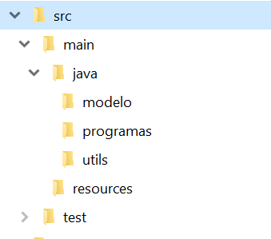

# 4B creación de un proyecto de mapeo con hibernate. Base de datos Oracle. Maven

> **Módulo:** Acceso a Datos — DAM 2
> **Procedencia:** [Aula virtual](https://aulavirtual3.educa.madrid.org/ies.alonsodeavellan.alcala/mod/book/view.php?id=221731)
> **Criterio:** transcripción del material docente, sin resumir ni actualizar sus versiones.

## Índice

- [1. nuevo proyecto Maven](#1-nuevo-proyecto-maven)
  - [**Paso 1: Crear un Proyecto Maven en Eclipse**](#paso-1-crear-un-proyecto-maven-en-eclipse)
  - [**Paso 2: Agregar Dependencias de Hibernate en el archivo pom.xml**](#paso-2-agregar-dependencias-de-hibernate-en-el-archivo-pom-xml)
  - [**Paso 3: Configurar Archivo de Configuración de Hibernate**](#paso-3-configurar-archivo-de-configuracion-de-hibernate)
  - [**Paso 4: Crear Entidades**](#paso-4-crear-entidades)
  - [**Paso 5: Crea paquetes para organizar proyecto**](#paso-5-crea-paquetes-para-organizar-proyecto)
  - [**Paso 6: Crear la session**](#paso-6-crear-la-session)
  - [**Paso 7: En el paquete "programas" creamos la clase que tiene un método main:**](#paso-7-en-el-paquete-programas-creamos-la-clase-que-tiene-un-metodo-main)
  - [**Paso 8: Completamos el fichero hibernate.cfg.xml:**](#paso-8-completamos-el-fichero-hibernate-cfg-xml)
- [2. proyecto completo](#2-proyecto-completo)
- [Fuentes locales y adjuntos](#fuentes-locales-y-adjuntos)

---

<a id="1-nuevo-proyecto-maven"></a>
## 1. nuevo proyecto Maven

<a id="paso-1-crear-un-proyecto-maven-en-eclipse"></a>
### **Paso 1: Crear un Proyecto Maven en Eclipse**

Abre Eclipse y ve a File (Archivo) -&gt; New (Nuevo) -&gt; Project (Proyecto).

Selecciona Maven -&gt; Maven Project y haz clic en Next.

Marca la opción Create a simple project (Crear un proyecto simple) y haz clic en Next.

Ingresa el Group Id (ID del Grupo) y el Artifact Id (ID del Artefacto) para tu proyecto Maven. Luego, haz clic en Finish.

<a id="paso-2-agregar-dependencias-de-hibernate-en-el-archivo-pom-xml"></a>
### **Paso 2: Agregar Dependencias de Hibernate en el archivo pom.xml**

En el archivo pom.xml del proyecto Maven, agrega las dependencias de Hibernate. Asegúrate de incluir las dependencias necesarias para Hibernate Core, así como cualquier las del driver de la base de datos que se vaya a utilizar En el ejemplo que se os proporciona:

```xml
<dependency>

 <groupId>com.oracle.database.jdbc</groupId>

 <artifactId>ojdbc10</artifactId>

 <version>19.12.0.0</version>

</dependency>

<dependency>

 <groupId>org.hibernate</groupId>

 <artifactId>hibernate-testing</artifactId>

 <version>5.4.33.Final</version>

</dependency>
```

<a id="paso-3-configurar-archivo-de-configuracion-de-hibernate"></a>
### **Paso 3: Configurar Archivo de Configuración de Hibernate**

Crea el archivo hibernate.cfg.xml donde configurarás la conexión a la base de datos. Puedes colocarlo en la carpeta src/main/resources del proyecto Maven.

Define las propiedades de conexión a la base de datos en este archivo. En el ejemplo que se os proporciona:

```xml
 <?xml version="1.0" encoding="UTF-8"?>

<!DOCTYPE hibernate-configuration PUBLIC

"-//Hibernate/Hibernate Configuration DTD 3.0//EN"

"http://www.hibernate.org/dtd/hibernate-configuration-3.0.dtd">

<hibernate-configuration>

 <session-factory>

 <property name="hibernate.connection.driver_class">oracle.jdbc.driver.OracleDriver</property>

 <property name="hibernate.connection.password">tiger</property>

 <property name="hibernate.connection.url">jdbc:oracle:thin:@localhost:1521/xe</property>

 <property name="hibernate.connection.username">scott</property>

 <property name="hibernate.dialect">org.hibernate.dialect.Oracle10gDialect</property>

 </session-factory>

</hibernate-configuration>
```

<a id="paso-4-crear-entidades"></a>
### **Paso 4: Crear Entidades**

Crea las clases de entidad utilizando anotaciones de Hibernate En el ejemplo que se os proporciona:

```java
@Entity

@Table

public class Usuario implements Serializable {

@Id

@Column

private int seq;

@Column

private String userNombre;

@Column

private String password;

@Column

private Date creacionFecha;

@Column

private String creacionUsuario;

@Column

private Date modificaFecha;

@Column

private String modificaUsuario;
```

<a id="paso-5-crea-paquetes-para-organizar-proyecto"></a>
### **Paso 5: Crea paquetes para organizar proyecto**



La estructura de ficheros la determina Maven.

En modelo situamos las clases entidad

En programas tendremos los programas.

En utils la clase que genera objetos de la clase SessionFactory

<a id="paso-6-crear-la-session"></a>
### **Paso 6: Crear la session**

En el paquete utils creamos la utilidad para gestionar la sesión de Hibernate mediante un patrón Singleton, lo que asegura que se utiliza una única instancia de SessionFactory en toda la aplicación.

La clase de utilidad llamada HibernateUtils se diseña para gestionar la conexión con Hibernate mediante el patrón Singleton. Este patrón garantiza que se utilice una única instancia de SessionFactory en toda la aplicación, optimizando el uso de recursos, ya que SessionFactory es un objeto pesado cuya creación puede ser costosa. La instancia de SessionFactory se inicializa de forma segura en un bloque estático, leyendo la configuración desde el archivo hibernate.cfg.xml. El método estático getSessionFactory permite acceder a esta instancia de manera centralizada, facilitando su reutilización en cualquier parte de la aplicación, asegurando además que se maneje de forma eficiente

Nota de formato: la tabla original se presenta por celdas, en orden de lectura, para conservar los bloques de código. La disposición original puede consultarse en el HTML local.

**Clase HibernateUtils (utiliza un patron Singleton)**  
Esta clase sirve como una herramienta para inicializar y proporcionar acceso a una instancia única de SessionFactory, que es un componente central de Hibernate para manejar las conexiones con la base de datos.

```java
public class HibernateUtils {

private static SessionFactory sessionFactory;

static {

sessionFactory = new Configuration().configure("hibernate.cfg.xml").buildSessionFactory();

}

 public static SessionFactory getSessionFactory() {

return sessionFactory;

}

}
```

**private static SessionFactory sessionFactory;**  
Declara una variable estática y privada sessionFactory de tipo SessionFactory. Pertenece a la clase y no a una instancia, lo que permite que todas las partes de la aplicación accedan al mismo objeto SessionFactory.(static). Y restringe el acceso directo para garantizar el control sobre cómo se crea y utiliza la instancia.(private)

 Este bloque estático se ejecuta una vez cuando la clase HibernateUtils se carga en memoria:  
static {  
    sessionFactory = new Configuration().configure("hibernate.cfg.xml").buildSessionFactory();  
}

**new Configuration():** Crea una nueva instancia de Configuration, que es responsable de cargar la configuración de Hibernate.  
.configure("hibernate.cfg.xml"): Busca y carga el archivo de configuración hibernate.cfg.xml desde el directorio raíz del proyecto o src/main/resources (en caso de usar Maven). Este archivo contiene información como la URL de la base de datos, el dialecto de Hibernate, el usuario y la contraseña, etc.  
**.buildSessionFactory():** Construye el objeto SessionFactory basado en la configuración cargada.  
   
**Método getSessionFactory:**Proporciona acceso público a la instancia de SessionFactory.  
  
public static SessionFactory getSessionFactory() {  
    return sessionFactory;  
}

Es un método static, lo que significa que puedes llamarlo directamente usando la clase, sin necesidad de crear una instancia de HibernateUtils. Retorna la instancia única de SessionFactory.  
   
**¿Qué es un SessionFactory?**  
Es un objeto que se crea una vez y se reutiliza durante toda la aplicación.  
Encargado de proveer conexiones con la base de datos (a través de Session) y gestionar la configuración de Hibernate.  
  
 Funcionamiento Completo  
Cuando la clase HibernateUtils se carga en memoria, el bloque estático inicializa la variable sessionFactory leyendo la configuración desde el archivo hibernate.cfg.xml.  
Cada vez que necesitas interactuar con la base de datos, llamas al método HibernateUtils.getSessionFactory() para obtener la instancia de SessionFactory.  
Usas esa instancia para abrir una nueva Session, que se utiliza para ejecutar operaciones de CRUD (crear, leer, actualizar, eliminar) en la base de datos.  
   
La ventaja de usar el patrón Singleton es que solo hay una instancia de SessionFactory en toda la aplicación.  
Se evita crear múltiples instancias costosas de SessionFactory.

Centraliza la configuración de Hibernate en un único lugar (hibernate.cfg.xml y esta clase).  
Cualquier parte de la aplicación puede acceder al SessionFactory mediante el método estático getSessionFactory.

<a id="paso-7-en-el-paquete-programas-creamos-la-clase-que-tiene-un-metodo-main"></a>
### **Paso 7: En el paquete "programas" creamos la clase que tiene un método main:**

En conveniente al finalizar este punto, ejecutar el programa para ver que la parte de la conexión se ha realizado correctamente

```java
public class Main {

public static void main(String[] args) {

SessionFactory sesion = HibernateUtils.getSessionFactory();

Session session = sesion.openSession(); // TODO Auto-generated constructor stub

try {

//aquí pondremos el programa, transacciones, instanciar objetos, guardar, recuperar, etc..

} catch (Exception e) { 

 e.printStackTrace();

// acciones para restaurar el estado bd( rollback)
```

}finally {

```java
session.close();

}

}

}
```

<a id="paso-8-completamos-el-fichero-hibernate-cfg-xml"></a>
### **Paso 8: Completamos el fichero hibernate.cfg.xml:**

**incluimos las clases entidad.** En el ejemplo que se os proporciona:

&lt;mapping class="modelo.Usuario"&gt;&lt;/mapping&gt;

**Especificamos la forma en que deseamos interactuar con la base de datos:**

&lt;property name="hibernate.hbm2ddl.auto"&gt;create&lt;/property&gt;

**Especificamos otras propiedades:**

&lt;property name="show\_sql"&gt;true&lt;/property&gt;

**Paso 9: Completamos el el programa.** En el ejemplo que se os proporciona:

Instanciamos un objeto de la clase Entidad y lo hacemos persistente:

```java
import java.util.Date;

import org.hibernate.Session;
import org.hibernate.HibernateException;
import org.hibernate.SessionFactory;

import maven.MySQL.Usuario;
import utils.HibernateUtils;

public class Main {
 public static void main(String[] args) {


 SessionFactory sesion = HibernateUtils.getSessionFactory();
 Session session = sesion.openSession(); // TODO Auto-generated constructor stub
 Usuario p = new Usuario();
 p.setSeq(1);
 p.setCreacionUsuario("Manolo");
 p.setCreacionFecha(new Date());
 p.setPassword("Manolo");
 try {

 session.beginTransaction();

 session.save(p);
 session.getTransaction().commit();
 

}catch (HibernateException e) {

 if(session.getTransaction()!=null) { session.getTransaction().rollback();  }
 
 }finally { 

session.close();

 }
 

}


}
```

Ejecuta tu aplicación desde Eclipse y prueba el código de Hibernate que has escrito para asegurarte de que interactúe correctamente con la base de datos.

**Paso 10: Comprobamos que se ha creado una tabla con las mismas columnas que atributos anotados tiene la clase entidad y que se haya insertado la línea correspondiente al objeto que se ha hecho persistente**:

<a id="2-proyecto-completo"></a>
## 2. proyecto completo

descarga el fichero e importa el proyecto

> **Incidencia del aula:** el capítulo «proyecto completo» indica que se descargue un fichero, pero no contiene ningún enlace ni adjunto. No se ha inventado ni sustituido ese proyecto.


<a id="fuentes-locales-y-adjuntos"></a>
## Fuentes locales y adjuntos

- [contenido.html](../originales/UT03-mapeo-objeto-relacional/221731-4B%20creaci%C3%B3n%20de%20un%20proyecto%20de%20mapeo%20con%20hibernate.%20Base%20de%20datos%20Oracle.%20Maven%20Libro/contenido.html)
- [capitulo-f4d963fcf7.html](../originales/UT03-mapeo-objeto-relacional/221731-4B%20creaci%C3%B3n%20de%20un%20proyecto%20de%20mapeo%20con%20hibernate.%20Base%20de%20datos%20Oracle.%20Maven%20Libro/capitulo-f4d963fcf7.html)
