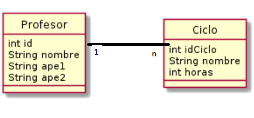

# 4C Lenguaje de consultas de Hibernate (HQL)

> **Módulo:** Acceso a Datos — DAM 2
> **Procedencia:** [Aula virtual](https://aulavirtual3.educa.madrid.org/ies.alonsodeavellan.alcala/mod/book/view.php?id=221732)
> **Criterio:** transcripción del material docente, sin resumir ni actualizar sus versiones.

## Índice

- [Modelo de Java](#modelo-de-java)
    - [Modelo](#modelo)
      - [Modelo de Tablas](#modelo-de-tablas)
      - [Sentencias consulta (SELECT)](#sentencias-consulta-select)
    - [Mayusculas](#mayusculas)
    - [Filtrando](#filtrando)
      - [Literales](#literales)
      - [Texto](#texto)
      - [Integer](#integer)
      - [Long](#long)
      - [double](#double)
      - [float](#float)
      - [Fecha](#fecha)
      - [Hora](#hora)
      - [Fecha y hora](#fecha-y-hora)
      - [Operadores de comparación](#operadores-de-comparacion)
      - [Operadores Lógicos](#operadores-logicos)
      - [Operadores Aritméticos](#operadores-aritmeticos)
      - [Funciones de agregación](#funciones-de-agregacion)
      - [Funciones sobre escalares](#funciones-sobre-escalares)
    - [Ordenación](#ordenacion)
    - [Agrupaciones](#agrupaciones)
  - [Subconsultas](#subconsultas)
    - [Combinaciones (JOIN)](#combinaciones-join)
    - [Parametros nombrados](#parametros-nombrados)
    - [Sentencias de actualizacion (UPDATE)](#sentencias-de-actualizacion-update)
    - [Sentencias de borrado (DELETE)](#sentencias-de-borrado-delete)
    - [Sentencias de inserción (INSERT)](#sentencias-de-insercion-insert)
- [List()](#list)
  - [**Query**](#query)
    - [**uniqueResult()**](#uniqueresult)
    - [**Paginación**](#paginacion)
    - [**Consultas con nombre**](#consultas-con-nombre)
- [Fuentes locales y adjuntos](#fuentes-locales-y-adjuntos)

---

<a id="modelo-de-java"></a>
## Modelo de Java

El Hibernate Query Languaje (HQL) es el lenguaje de consultas que usa Hibernate para obtener los objetos desde la base de datos. Su principal particularidad es que las consultas se realizan sobre los objetos java que forman nuestro modelo de negocio, es decir, las entidades que se persisten en Hibernate. Ésto hace que HQL tenga las siguientes características:

- Los tipos de datos son los de Java.
- Las consultas son independientes del lenguaje de SQL específico de la base de datos
- Las consultas son independientes del modelo de tablas de la base de datos.
- Es posible tratar con las colecciones de Java.
- Es posible navegar entre los distintos objetos en la propia consulta.

En Hibernate las consultas HQL se lanzan (o se ejecutan) sobre el modelo de entidades que hemos definido en Hibernate, esto es, sobre nuestras clases de negocio.

Las sentencias que se estudian en este capitulo son del lenguaje HQL de Hibernate, en gran parte son compatibles con JPQL (Java Pesistance Query Language), lenguaje de consulta de persistencia de Java.  

De forma poco ortodoxa se podría ver cómo que nuestro *modelo de tablas* en HQL son las clases Java y **NO** las tablas de la base de datos. Es decir que cuando hagamos ”`SELECT columna FROM nombreTabla`” , el ”`nombreTabla`” será una clase Java y ”`columna`” será una propiedad Java de dicha clase y **nunca** una tabla de la base de datos ni una columna de una tabla.

<a id="modelo"></a>
#### Modelo

En los ejemplos que vamos a realizar van a usarse las siguientes clases Java y tablas, que sólo mostraremos en formato UML. No vamos a poner el código fuente ni los ficheros de hibernate de mapeo ya que aún no han sido explicadas todas la características que usan en lecciones anteriores.

El modelo de clases Java es el siguiente:



<a id="modelo-de-tablas"></a>
##### Modelo de Tablas

El modelo de tablas es el siguiente:

CiclosFormativos(nombreCiclo, idCiclo, horas, profesor)

Profesores(id, ape1, ape2)

fk: CiclosFormativos ---- profesor ----&gt; Profesor

Podemos ver cómo hay un par de diferencias entre el modelo en Java y el modelo de tablas.

- Para la clase `Ciclo` su tabla se llama `CiclosFormativos`
- En la clase `Ciclo` su propiedad `nombre` se almacena en la columna llamada `nombreCiclo`

<a id="sentencias-consulta-select"></a>
##### Sentencias consulta (SELECT)

La sintaxis HQL para las sentencias de consultas es la siguiente:

```java
    [select_clause]
    from_clause
    [where_clause]
    [groupby_clause]
    [having_clause]
    [orderby_clause]
```

Vemos en la sintaxis que la única clausula obligatoria es *from\_clause.*

No obstante, Hibernate recomienda incluir  select\_clause , por portabilidad con JPQL (java persistence query languagge). 

Veamos ahora un sencillo ejemplo de consulta en HQL

```sql
SELECT c FROM Ciclo c ORDER BY nombre
```

¿Qué diferencias podemos ver entre HQL y SQL?

- `Ciclo` hace referencia a la clase Java`ejemplo02.Ciclo` y **NO** a la tabla `CicloFormativo`.Nótese que la clase Java y la tabla tienen distinto nombre .
- Es necesario definir el alias `c` de la clase Java `Ciclo`.
- Tras la palabra `SELECT` se usa el alias en vez del ”`*`”.
- Al ordenar los objetos se usa la propiedad `nombre` de la clase `Ciclo` en vez de la columna `nombreCiclo` de la tabla `CicloFormativo`.

Recuerda incluir el alias en la consulta HQL. Si no se hace y se deja la consulta de la siguiente forma:

```sql
SELECT Ciclo FROM Ciclo
```

se producirá la siguiente excepción:

```java
java.lang.NullPointerException
```

Hibernate soporta **no** incluir la parte del `SELECT` en la consulta HQL, quedando entonces la consulta de la siguiente forma:

```sql
  FROM Ciclo
```

pero en la propia documentación se recomienda no hacerlo [1)](http://cursohibernate.es/doku.php?id=unidades:05_hibernate_query_language:02_hql#fn__1) ya que de esa forma se mejora la portabilidad en caso de usar el lenguaje de consultas de JPA [2)](http://cursohibernate.es/doku.php?id=unidades:05_hibernate_query_language:02_hql#fn__2).

Se ha hecho mención de esta característica ya que en muchos tutoriales que se encuentran por Internet se hace uso de ella.

<a id="mayusculas"></a>
#### Mayusculas

Respecto a la sensibilidad de las mayúsculas y minúsculas , el lenguaje HQL sí que lo es, pero con matices.

- Las palabras clave del lenguaje **NO** son sensibles a las mayúsculas o minúsculas.

  - Las siguientes 2 consultas son equivalentes.

    ```sql
    select count(*) from Ciclo
    ```

    ```sql
    SELECT COUNT(*) FROM Ciclo
    ```
- El nombre de las clases Java y sus propiedades **SI** son sensibles a las mayúsculas o minúsculas.

  - La siguiente consulta HQL es correcta

    ```sql
    SELECT c.nombre FROM Ciclo c WHERE nombre='Desarrollo de aplicaciones Web'
    ```
  - La siguiente consulta HQL es **errónea** ya que la propiedad `nombre` está escrita con la “N” en mayúsculas.

    ```sql
    SELECT c.Nombre FROM Ciclo c WHERE Nombre='Desarrollo de aplicaciones Web'
    ```
  - La siguiente consulta HQL es **errónea** ya que el nombre de la clase Java `Ciclo` está escrita con la “c” en minúsculas.

    ```sql
    SELECT c.nombre FROM ciclo c WHERE nombre='Desarrollo de aplicaciones Web'
    ```
- Al realizar comparaciones con los valores de las propiedades, éstas **NO** son sensibles a las mayúsculas o minúsculas.

  - Las siguientes 2 consultas retornan los mismos objetos

    ```sql
    SELECT c.nombre FROM Ciclo c WHERE nombre='Desarrollo de aplicaciones Web'
    ```

    ```sql
    SELECT c.nombre FROM Ciclo c WHERE nombre='DESARROLLO DE APLICACIONES WEB'
    ```

<a id="filtrando"></a>
#### Filtrando

Al igual que en SQL en HQL también podemos filtrar los resultados mediante la cláusula `WHERE`. La forma de usarla es muy parecida a SQL.

```sql
SELECT p FROM Profesor p WHERE nombre='ISABEL' AND ape1<>'ORELLANA'
```

Al igual que con el nombre de la clase, el nombre de los campos del `WHERE` siempre hace referencia a las propiedades Java y nunca a los nombres de las columnas.De esa forma seguimos independizando nuestro código Java de la estructura de la base de datos.

<a id="literales"></a>
##### Literales

<a id="texto"></a>
##### Texto

El carácter para indicar un literal de texto es la comilla simple no pudiéndose usar la doble comilla.

```sql
SELECT p FROM Profesor p WHERE nombre='juan'
```

Si se quiere usar la comilla dentro de un literal deberemos duplicarla.

```sql
SELECT p FROM Profesor p WHERE ape1='perez l''andreu'
```

<a id="integer"></a>
##### Integer

Para incluir un número del tipo `integer` simplemente se escribe dicho número.

```sql
SELECT tb FROM TiposBasicos tb WHERE inte=4
```

<a id="long"></a>
##### Long

Para incluir un número del tipo `long` se escribe dicho número y se añade una `L` mayúscula al final.

```sql
SELECT tb FROM TiposBasicos tb WHERE long1=4L
```

<a id="double"></a>
##### double

Para representar un `double` se escribe el número separarando la parte decimal con un punto o se puede usar la notación científica.

```sql
SELECT tb FROM TiposBasicos tb WHERE double1=1.45
```

```sql
SELECT tb FROM TiposBasicos tb WHERE double1=1.7976931348623157E308
```

<a id="float"></a>
##### float

Para representar un `float` se escribe el número separarando la parte decimal con un punto o se puede usar la notación científica pero se le añade el carácter `F` en mayúscula al final.

```sql
SELECT tb FROM TiposBasicos tb WHERE float1=1.45F
```

```sql
SELECT tb FROM TiposBasicos tb WHERE float1=3.4028235E38F
```

<a id="fecha"></a>
##### Fecha

Para indicar una fecha la incluiremos entre comillas simples con el formato `yyyy-mm-dd`

```sql
SELECT tb FROM TiposBasicos tb WHERE dateDate='2012-07-25'
```

<a id="hora"></a>
##### Hora

Para indicar una hora la incluiremos entre comillas simples con el formato `hh:mm:ss`

```sql
SELECT tb FROM TiposBasicos tb WHERE dateTime='02:05:10'
```

<a id="fecha-y-hora"></a>
##### Fecha y hora

Para indicar una fecha y hora la incluiremos entre comillas simples con el formato `yyyy-mm-dd hh:mm:ss.millis`,siendo optativos el último punto y los milisegundos .

```sql
SELECT tb FROM TiposBasicos tb WHERE dateTime='2012-07-25 02:05:10'
```

<a id="operadores-de-comparacion"></a>
##### Operadores de comparación

Para comparar los datos en una expresión se pueden usar las siguientes Operadores:

- Signo igual ”`=`”: La expresión será verdadera si los dos datos son iguales. En caso de comparar texto, la comparación **no** es sensible a mayúsculas o minúsculas.
- Signo mayor que ”`>`”: La expresión será verdadera si el dato de la izquierda es mayor que el de la derecha.
- Signo mayor que ”`>=`”: La expresión será verdadera si el dato de la izquierda es mayor o igual que el de la derecha.
- Signo mayor que ”`<`”: La expresión será verdadera si el dato de la izquierda es menor que el de la derecha.
- Signo mayor que ”`<=`”: La expresión será verdadera si el dato de la izquierda es menor o igual que el de la derecha.
- Signo desigual ”`<>`”: La expresión será verdadera si el dato de la izquierda es distinto al de la derecha.
- Signo desigual ”`!=`”: La expresión será verdadera si el dato de la izquierda es distinto al de la derecha.
- Operador ”`between`”: La expresión será verdadera si el dato de la izquierda está dentro del rango de la derecha.

  ```sql
  SELECT tb FROM TiposBasicos tb WHERE inte BETWEEN 1 AND 10
  ```
- Operador ”`in`”: La expresión será verdadera si el dato de la izquierda está dentro de la lista de valores de la derecha.

  ```sql
  SELECT tb FROM TiposBasicos tb WHERE inte IN (1,3,5,7)
  ```
- Operador ”`like`”: La expresión será verdadera si el dato de la izquierda coincide con el patrón de la derecha.Se utilizan los mismos signos que en SQL ”`%`” y ”`_`”.

  ```sql
  SELECT tb FROM TiposBasicos tb WHERE stri LIKE 'H_la%'
  ```
- Operador ”`not`”: Niega el resultado de una expresión.
- expresión ”`is null`”: Comprueba si el dato de la izquierda es `null`.

  ```sql
  SELECT tb FROM TiposBasicos tb WHERE dataDate IS NULL
  ```

<a id="operadores-logicos"></a>
##### Operadores Lógicos

Se puede hacer uso de los típicos operadores lógicos como en SQL:

- AND
- OR
- NOT

  ```sql
  SELECT p FROM Profesor p WHERE nombre='ANTONIO' AND (ape1='LARA' OR ape2='RUBIO')
  ```

<a id="operadores-aritmeticos"></a>
##### Operadores Aritméticos

Se puede hacer uso de los típicos operadores aritméticos:

- suma +
- resta -
- multiplicación \*
- division /

  ```sql
  SELECT tb FROM TiposBasicos tb WHERE (((inte+1)*4)-10)/2=1
  ```

<a id="funciones-de-agregacion"></a>
##### Funciones de agregación

Las funciones de agregación que soporta HQL son:

- `AVG()`: Calcula el valor medio de todos los datos.
- `SUM()`: Calcula la suma de todos los datos.
- `MIN()`: Calcula el valor mínimo de todos los datos.
- `MAX()`: Calcula el valor máximo de todos los datos.
- `COUNT()`: Cuanta el nº de datos.

  ```sql
  SELECT AVG(c.horas),SUM(c.horas),MIN(c.horas),MAX(c.horas),COUNT(*) FROM Ciclo c
  ```

<a id="funciones-sobre-escalares"></a>
##### Funciones sobre escalares

Algunas de las funciones que soporta HQL sobre datos escalares son:

- `UPPER(s)`: Transforma un texto a mayúsculas.
- `LOWER(s)`: Transforma un texto a minúsculas.
- `CONCAT(s1, s2)`: Concatena dos textos
- `TRIM(s)`:Elimina los espacio iniciales y finales de un texto.
- `SUBSTRING(s, offset, length)`: Retorna un substring de un texto.El `offset` empieza a contar desde 1 y no desde 0.
- `LENGTH(s)`: Calcula la longitud de un texto.
- `ABS(n)`: Calcula el valor absoluto de un número.
- `SQRT(n)`: Calcula la raíz cuadrada del número
- Operador ”`||`” : Permite concatenar texto.

  ```sql
  SELECT p.nombre || ' ' || p.ape1 || ' ' || p.ape2 FROM Profesor p WHERE Id=1001
  ```

<a id="ordenacion"></a>
#### Ordenación

Como en SQL también es posible ordenar los resultados usando `ORDER BY`. Su funcionamiento es como en SQL.

```sql
SELECT p FROM Profesor p ORDER BY nombre ASC,ape1 DESC
```

Las palabras `ASC` y `DESC` son opcionales al igual que en SQL.

El uso de funciones escalares y funciones de agrupamiento en la cláusula `ORDER BY` sólo es soportado por Hibernate si es soportado por el lenguaje de SQL de la base de datos sobre la que se está ejecutando.

No se permite el uso de expresiones aritméticas en la cláusula `ORDER BY`.

<a id="agrupaciones"></a>
#### Agrupaciones

Al igual que en SQL se pueden realizar agrupaciones mediante las palabras claves `GROUP BY` y `HAVING`

```sql
SELECT nombre,count(nombre) FROM Profesor p GROUP BY nombre HAVING count(nombre)>1 ORDER BY count(nombre)
```

Los nombres de profesores que se repiten mas de una vez

El uso de funciones escalares y funciones de agrupamiento en la cláusula `HAVING` sólo es soportado por Hibernate si es soportado por el lenguaje de SQL de la base de datos sobre la que se está ejecutando.

No se permite el uso de expresiones aritméticas en la cláusula `GROUP BY`.

<a id="subconsultas"></a>
### Subconsultas

HQL también soporta subconsultas como en SQL.

```sql
SELECT c.nombre,c.horas FROM Ciclo c WHERE c.horas >  (SELECT  AVG(c2.horas) FROM Ciclo c2)
```

Ciclos que duran más horas que la media de duración de todos los ciclos

<a id="combinaciones-join"></a>
#### Combinaciones (JOIN)

En la clausula from podemos incluir múltiples clases, lo que causa un producto cartesiano o una unión "cruzada" (cross join).

```sql
from Profesor as profesor, Ciclo as ciclo
```

Para poder relacionar los profesores con los ciclos que imparten tenemos la opción de especificar la condición de combinación, de forma similar a como se hace en SQL

```sql
from Profesores as profesor, Ciclo as ciclo
where profesor = ciclo.profesor
```

También podemos utilizar la clausula JOIN

```sql
from Profesor as profesor INNER JOIN profesor.ciclo as  ciclo
```

La palabra reservada INNER e opcional, también es posible incluir la clausula *on condición.*

Ejemplo:

```sql
from Profesor as profesor INNER JOIN Ciclo as ciclo on 
```

Los tipos de uniones soportadas se tomaron prestados de ANSI SQL

- inner join
- left outer join
- right outer join
- full join.

<a id="parametros-nombrados"></a>
#### Parametros nombrados

En ejemplos anteriores  incluíamos directamente el valor de los parámetros del `WHERE`. Ëso nos llevaría desde Java a tener un código similar al siguiente:

```java
 1: String nombre="ISIDRO";
 2: String ape1="CORTINA";
 3: String ape2="GARCIA";
 4:
 5: Query query = session.createQuery("SELECT p FROM Profesor p where nombre='" + nombre +
 "' AND  ape1='" + ape1 + "' AND  ape2='" + ape2 + "' ");
 6: List<Profesor> profesores = query.list();
 7: for (Profesor profesor : profesores) {
 8:     System.out.println(profesor.toString());
 9: }
```

Hibernate
soporta parámetros nombrados en sus consultas HQL. Esto facilita la
escritura de consultas HQL que aceptan la entrada del usuario. A
continuación se muestra la sintaxis simple de usar parámetros
nombrados:

```java
 1: String nombre="ISIDRO";
 2: String ape1="CORTINA";
 3: String ape2="GARCIA";
 4:
 5: Query query = session.createQuery("SELECT p FROM Profesor p where nombre=:nombre +
 "' AND  ape1=:ape1 + "' AND  ape2=:ape2 ");
 6: List<Profesor> profesores = query.setParameter(1,nombre).setParameter(2,ape1).setParameter(3,ape2).list();
 7: for (Profesor profesor : profesores) {
 8:     System.out.println(profesor.toString());
 9: }
```

La asignacion de valores a los parametros se realiza con el metodo setParameter., los metodos setString, setByte, etc. estan obsoletos. También
podemos utilizar parámetros con ?.

  

<a id="sentencias-de-actualizacion-update"></a>
#### Sentencias de actualizacion (UPDATE)

La sintaxis de la sentencia de actualización es la siguiente

```java
update_statement ::=
    update_clause [where_clause]

update_clause ::=
    UPDATE entity_name [[AS] identification_variable]
    SET update_item {, update_item}*

update_item ::=
    [identification_variable.]{state_field | single_valued_object_field} = new_value

new_value ::=
    scalar_expression | simple_entity_expression | NULL
```

Una sentencia UPDATE se ejecuta utilizando el metodo executeUpdate () de org.hibernate.query.Query o javax.persistence.Query. Similar al metodo executeUpdate () al de JDBC .  
El valor int devuelto por el método executeUpdate () indica el número de entidades efectuadas por la operación. Esto puede o no correlacionarse con el número de filas actualizadas en la base de datos. Una operación masiva HQL puede dar como resultado que se ejecuten varias sentencias de SQL reales (por ejemplo, para la subclase unida). El número devuelto indica el número de entidades reales afectadas por la declaración. 

Ejemplo:

```sql
    update Profesor set nombre= :newName  
    where nombre = :oldName
```

El codigo dentro de un programa java seria:

```java
int updatedEntities = session.createQuery(
    "update Profesor" +
    "set nombre= :newName " +
    "where nombre= :oldName" )
.setParameter( "oldName", "Pepe")
.setParameter( "newName", "Jose")
.executeUpdate();
```

  

<a id="sentencias-de-borrado-delete"></a>
#### Sentencias de borrado (DELETE)

```java
La sintaxis para el borrado es la siguiente:
```

```java
delete_statement ::=
    delete_clause [where_clause]

delete_clause ::=
    DELETE FROM entity_name [[AS] identification_variable]Ejemplo:
```

```sql
DELETE FROM Profesor e WHERE e.nombre= ?
```

Dentro de un programa JAVA la operacion de borrado se ejecuta con el metodo executeUpdate() de org.hibernate.Query o javax.persistence.Query

Ejemplo:

```java
int deletedEntities = session.createQuery(
    "delete Profesor p " +
    "where p.nombre= :name" )
.setParameter( "name", name )
.executeUpdate();
```

<a id="sentencias-de-insercion-insert"></a>
#### Sentencias de inserción (INSERT)

La sentencia de insercion de HQL tiene la sintaxis:

```java
insert_statement ::=
    insert_clause select_statement

insert_clause ::=
    INSERT INTO entity_name (attribute_list)

attribute_list ::=
    state_field[, state_field ]*
```

  
La lista de atributos es análoga a la especificación de columna en la instrucción INSERT de SQL.   

*select\_statement* puede ser cualquier consulta de selección HQL válida, los tipos de retorno de esta consulta  deben coincidir con los tipos de la entidad en la que se realiza la insercion.

Ejemplo:

```java
int insertedEntities = session.createQuery(
    "insert into profesor (id, nombre,ape1,ape2) " +
    "select persona.id, persona.nombre, persona.ape1, persona.ape2 " +
    "from Person p ")
.executeUpdate();
```

<a id="list"></a>
## List()

- Hibernate tiene el objeto [`Query`](http://docs.jboss.org/hibernate/core/4.1/javadocs/org/hibernate/Query.html) que nos da acceso a todas las funcionalidades para poder leer objetos desde la base de datos. Veamos ahora un sencillo ejemplo de cómo funciona y posteriormente explicaremos más funcionalidades de la clase [`Query`](http://docs.jboss.org/hibernate/core/4.1/javadocs/org/hibernate/Query.html).

```java
1: Query query = session.createQuery("SELECT p FROM Profesor p");
2: List<Profesor> profesores = query.list();
3: for (Profesor profesor : profesores) {
4:     System.out.println(profesor.toString());
5: }
```

Lanzar una consulta con Hibernate es bastante simple. Usando la `session` llamamos al método `createQuery(String queryString)` con la consulta en formato HQL y nos retorna un objeto `Query` (Línea 1). Después, sobre el objeto `Query` llamamos al método `list()` que nos retorna una lista de los objetos que ha retornado (Línea 2).

Por último en las líneas de la 4 a la 6 podemos ver cómo usar la lista de objetos `Profesor` aunque este código ya es simplemente el uso de la clase `java.util.List` que no tiene nada que ver con Hibernate.

**Modelo**

En los ejemplos que vamos a realizar van a usarse las siguientes clases Java y tablas, que solo mostraremos en formato UML. No vamos a poner el código fuente ni los ficheros de hibernate de mapeo ya que no todas la características que usan han sido explicadas en lecciones anteriores.

El modelo de clases Java es el siguiente:

  

[[Imagen original no disponible (HTTP 404)](http://cursohibernate.es/lib/plugins/plantuml/img.php?width=0&height=0&title=PlantUML%20Graph&align=&version=2011-07-16&md5=e542bd1307d761deebcc1ac2c6cfcbff)](http://cursohibernate.es/lib/plugins/plantuml/img.php?width=0&height=0&title=PlantUML%20Graph&align=&version=2011-07-16&md5=e542bd1307d761deebcc1ac2c6cfcbff "PlantUML Graph")

  

El modelo de tablas es el siguiente:

[[Imagen original no disponible (HTTP 404)](http://cursohibernate.es/lib/plugins/plantuml/img.php?width=0&height=0&title=PlantUML%20Graph&align=&version=2011-07-16&md5=fe80cbe0c98fc98badb4ba85abbc412c)](http://cursohibernate.es/lib/plugins/plantuml/img.php?width=0&height=0&title=PlantUML%20Graph&align=&version=2011-07-16&md5=fe80cbe0c98fc98badb4ba85abbc412c "PlantUML Graph")

<a id="query"></a>
### **Query**

Pasemos ahora a ver las funcionalidades de la clase`Query`

- Lista de Objetos  
  El método [`list()`](http://docs.jboss.org/hibernate/core/4.1/javadocs/org/hibernate/Query.html#list()) nos retorna una lista con todos los objetos que ha retornado la consulta. En caso de que no se encuentre ningún resultado se retornará una lista sin ningún elemento.

```java
1: Query query = session.createQuery("SELECT p FROM Profesor p");
2: List<Profesor> profesores = query.list();
3: for (Profesor profesor : profesores) {
4:     System.out.println(profesor.toString());
5: }
```

- Lista de Array de Objetos:Las consultas pueden devolver datos escalares en vez de clases completas.  
  ej: SELECT p.id,p.nombre FROM Profesor p  
  En la consulta podemos ver cómo en vez de retornar un objeto `Profesor` se retorna únicamente el código del profesor y su nombre.  
  En estos casos el método [`list()`](http://docs.jboss.org/hibernate/core/4.1/javadocs/org/hibernate/Query.html#list()) retorna una lista con una Array de objetos con tantos elementos como propiedades hayamos puesto en la `SELECT`.  
  Veamos ahora un ejemplo.

```java
1: Query query = session.createQuery("SELECT p.id,p.nombre FROM Profesor p");
2: List<Object[]> listDatos = query.list();
3: for (Object[] datos : listDatos) {
4:     System.out.println(datos[0] + "--" + datos[1]);
5: }
```

En la línea 1 vemos cómo se crea el objeto [`Query`](http://docs.jboss.org/hibernate/core/4.1/javadocs/org/hibernate/Query.html) con la consulta de datos escalares.

En la línea 2 se ve que el método [`list()`](http://docs.jboss.org/hibernate/core/4.1/javadocs/org/hibernate/Query.html#list()) retorna una lista de array de Objetos.Es decir 'List&lt;Object[]&gt;'.

En la línea 4 se inicia el bucle para recorrer cada una de las filas de datos escalares.

En la línea 5 finalmente se accede a los 2 datos de cada fila mediante `datos[0]` y `datos[1]`.

- Lista de Objeto

Hay otro caso cuando hay una única columna en el `SELECT` de datos escalares. Es ese caso, como el array a retornar dentro de la lista solo tendría un elemento , no se retorna una lista de arrays `List<Object[]>` sino únicamente una lista de elementos `List<Object>`.

Si modificamos la anterior consulta de forma que sólo se retorne el nombre, el código quedará de la siguiente forma:

```java
1: Query query = session.createQuery("SELECT p.nombre FROM Profesor p");
2: List<Object> listDatos = query.list();
3: for (Object datos : listDatos) {
4:     System.out.println(datos);
5: }
```

En la línea 1 ahora la consulta sólo tiene un único dato escalar.

En la línea 2 el método [`list()`](http://docs.jboss.org/hibernate/core/4.1/javadocs/org/hibernate/Query.html#list()) ya no retorna un `List<Object[]` sino un `List<Object>`.

En la línea 4 se inicia el bucle para recorrer cada una de las filas de datos escalares pero ahora el tipo es `Object`en vez de `Object[]`.

En la línea 5 finalmente se accede al dato sin el índice del array ya que ha dejado de serlo.

<a id="uniqueresult"></a>
#### **uniqueResult()**

En muchas ocasiones una consulta únicamente retornará cero o un resultado. En ese caso es poco práctico que nos retorne una lista con un único elemento. Para facilitarnos dicha tarea Hibernate dispone del método [`uniqueResult()`](http://docs.jboss.org/hibernate/core/4.1/javadocs/org/hibernate/Query.html#uniqueResult()).

Este método retornará directamente el único objeto que ha obtenido la consulta. En caso de que no encuentre ninguno se retornará `null`.

```java
1: Profesor profesor = (Profesor) session.createQuery("SELECT p FROM Profesor p WHERE id=1001").uniqueResult();
2: System.out.println("Profesor con Id 1001=" + profesor.getNombre());
```

Vemos cómo, gracias al método [`uniqueResult()`](http://docs.jboss.org/hibernate/core/4.1/javadocs/org/hibernate/Query.html#uniqueResult()) , se simplifica el código aunque siempre se debe comprobar si ha retornado o no `null`.

Al igual que ocurre con [`list()`](http://docs.jboss.org/hibernate/core/4.1/javadocs/org/hibernate/Query.html#list()) el método [`uniqueResult()`](http://docs.jboss.org/hibernate/core/4.1/javadocs/org/hibernate/Query.html#uniqueResult()) puede retornar tanto un objeto de una entidad , un array de objetos escalares `Object[]` o un único objeto escalar `Object`.

Si el método [`uniqueResult()`](http://docs.jboss.org/hibernate/core/4.1/javadocs/org/hibernate/Query.html#uniqueResult()) retorna más de un resultado se producirá la excepción:

```java
org.hibernate.NonUniqueResultException: query did not return a unique result
```

<a id="paginacion"></a>
#### **Paginación**

La paginación es parte fundamental de cualquier aplicación ya que una consulta puede tener miles de resultados y no queremos mostrarlos todos a la vez.

Para conseguir paginar el resultado de una consulta la clase [`Query`](http://docs.jboss.org/hibernate/core/4.1/javadocs/org/hibernate/Query.html) dispone de los siguientes métodos:

- [`setMaxResults(int maxResults)`](http://docs.jboss.org/hibernate/core/4.1/javadocs/org/hibernate/Query.html#setMaxResults(int)): Establece el nº máximo de objetos que van a retornarse.
- [`setFirstResult(int firstResult)`](http://docs.jboss.org/hibernate/core/4.1/javadocs/org/hibernate/Query.html#setFirstResult(int)): Establece el primer de los objetos que se van a retornar.

Al realizar la paginación son necesarios al menos 2 valores:

- El tamaño de la página
- El nº de la página a mostrar

Con esos 2 valores hemos creado el siguiente código Java que muestra una única página en función del `tamanyoPagina` y `paginaAMostrar`.

```java
 1: int tamanyoPagina = 10;
 2: int paginaAMostrar = 7;
 3:
 4: Query query = session.createQuery("SELECT p FROM Profesor p Order By p.id");
 5: query.setMaxResults(tamanyoPagina);
 6: query.setFirstResult(paginaAMostrar * tamanyoPagina);
 7: List<Profesor> profesores = query.list();
 8:
 9: for (Profesor profesor : profesores) {
10:     System.out.println(profesor.toString());
11: }
```

Las líneas 1 y 2 establecen los valores necesarios para poder mostrar la página, que son el tamaño de la página y el nº de la página a mostrar.

En la línea 4 se crea la `Query`.

En la línea 5 se llama al método `setMaxResults(int maxResults)` para indicar que sólo se retornen como máximo tantos objetos como tamaño tiene la página.

En la línea 6 se llama al método `setFirstResult(int firstResult)` para indicarle cuál es el primer objeto a retornar. Este valor coincidirá con el primer objeto de la página que se quiere mostrar. Para calcular dicho valor se multiplica el nº de la página a mostrar por el tamaño de página. Para que esta formula funcione el número de página debe empezar por 0,es decir,que la primera página deberá ser la nº 0, la segunda la nº 1, y así sucesivamente.

Por fín, en la línea 7 se obtienen únicamente los resultados de la página solicitada.

Por último en las líneas 9,10 y 11 se muestran los datos.

El mayor problema que tiene la paginación es determinar el nº de páginas para poder mostrárselo al usuario, para saber el nº de páginas es necesario conocer el nº de objetos que retorna la consulta y la forma mas rápida y sencilla es mediante una consulta que las cuente.

El siguiente código Java calcula el nº de páginas de la consulta.

```java
1: long numTotalObjetos = (Long) session.createQuery("SELECT count(*) FROM Profesor p").uniqueResult();
2: int numPaginas =(int) Math.ceil((double)numTotalObjetos / (double)tamanyoPagina);
```

En la línea 1 realizamos la consulta de `count(*^)` para obtener el nº de objetos que retorna la consulta

En la línea 2 de divide el nº total de objetos entre el tamaño de la página obteniéndose el nº total de páginas.

Al hacer la división para calcular el nº de páginas es necesario hacer el cast de los 2 valores a `double` ya que si no Java automáticamente redondea el resultado a un valor entero con lo que el valor que se le pasa a `ceil` ya no será el correcto.

<a id="consultas-con-nombre"></a>
#### **Consultas con nombre**

En cualquier libro sobre arquitectura del software siempre se indica que las consultas a la base de datos no deberían escribirse directamente en el código sino que deberían estar en un fichero externo para que puedan modificarse fácilmente.

Hibernate provee una funcionalidad para hacer ésto mismo de una forma sencilla. En cualquier fichero de mapeo de Hibernate se puede incluir el anotaciones @NamedQuery and @NamedQueries Annotations con las consultas HQL que deseamos lanzar.

En el siguiente ejemplo  se ha definido una query nombrada para la clase Profesor:

```java
@NamedQuery(name="Profesores.findAll", query="SELECT p FROM Profesor p")
```

La anotación @NamedQuery contiene cuatro parametros, dos de los cuales son obligatorios y dos opcionales. Los dos parametros requeridos, *name*y *query*definen el nombre de la consulta y la propia cadena de consulta y se muestran arriba. Los dos elementos opcionales, *lockMode* y *hints*, proporcionan un reemplazo estático para los métodos **setLockMode** y **setHint**.

La entidad Profesor quedaría:

```java
@Entity
@NamedQuery(name="Profesores.findAll", query="SELECT p FROM Profesor p") 
public class Profesor {
  ...
}
```

Para añadir varias consultas nombradas , tiene que haber una consulta nombrada por cada una de ellas y estas dentro de una anotación envoltorio [@NamedQueries](https://www.objectdb.com/api/java/jpa/NamedQueries)

```java
@Entity
@NamedQueries({
```

```java
@NamedQuery(name="Profesores.findAll", query="SELECT p FROM Profesor p") 
@NamedQuery(name="Profesores.ByName", query="SELECT p FROM Profesor p where p.nombre =:nombre and p.ape1=:ape1 and p.ape2=:ape2")
```

```java
})
```

```java
public class Profesor {
  ...
}
```

Estas anotaciones tienen los siguientes datos:

- `name`:Este atributo define el nombre de la consulta.Es el nombre que posteriormente usaremos desde el código Java para acceder a la consulta.
- `query` es la consulta en formato HQL que ejecutará Hibernate.
- :nombre, :ape1, :ape2 son parametros nombrados, tambien se podrian especificar con parametros posicionales ? como en JDBC:

  ```java
  "SELECT p FROM Profesor p where p.nombre =? and p.ape1=? and p.ape2=?"
  ```

**Código Java**

Para hacer uso de una consulta con nombre usaremos el método [`getNamedQuery(String queryString)`](http://docs.jboss.org/hibernate/core/4.1/javadocs/org/hibernate/SharedSessionContract.html#getNamedQuery(java.lang.String)) en vez de [`createQuery(String queryString)`](http://docs.jboss.org/hibernate/core/4.1/javadocs/org/hibernate/SharedSessionContract.html#createQuery(java.lang.String)) para obtener el objeto [`Query`](http://docs.jboss.org/hibernate/core/4.1/javadocs/org/hibernate/Query.html). Por lo tanto sólo se ha modificado la línea 1 y el resto del código queda exactamente igual.

```java
1: Query query = session.getNamedQuery("Profesores.findAll");
2: List<Profesor> profesores = query.list();
3: for (Profesor profesor : profesores) {
4:     System.out.println(profesor.toString());
5: }
```

Como podemos ver el uso de consultas con nombre es muy sencillo al usar Hibernate.

```java
1: String nombre="ISIDRO";
 2: String ape1="CORTINA";
 3: String ape2="GARCIA";
 4:
 5: Query query = session.getNamedQuery(Profesores.ByName)
 6: query.setString("nombre",nombre);
 7: query.setString("ape1",ape1);
 8: query.setString("ape2",ape2);
 9:
10: List<Profesor> profesores = query.list();
11: for (Profesor profesor : profesores) {
12:     System.out.println(profesor.toString());
13: }
```

<a id="fuentes-locales-y-adjuntos"></a>
## Fuentes locales y adjuntos

- [contenido.html](../originales/UT03-mapeo-objeto-relacional/221732-4C%20Lenguaje%20de%20consultas%20de%20Hibernate%20%28HQL%29%20Libro/contenido.html)
- [capitulo-4b844b3a39.html](../originales/UT03-mapeo-objeto-relacional/221732-4C%20Lenguaje%20de%20consultas%20de%20Hibernate%20%28HQL%29%20Libro/capitulo-4b844b3a39.html)
