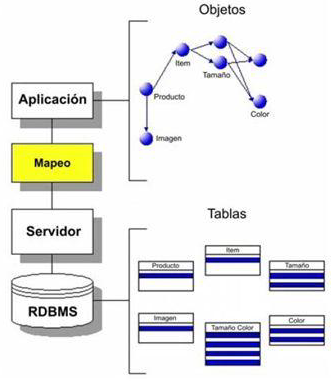
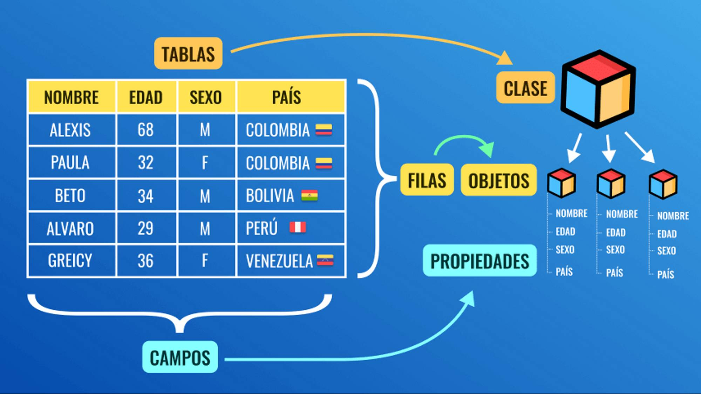

Fuente: https://aulavirtual3.educa.madrid.org/ies.alonsodeavellan.alcala/mod/book/view.php?id=221730&chapterid=36558

### 1. Introducción

**El mapeo objeto-relacional** (más conocido por su nombre en inglés, Object-Relational mapping, o sus siglas O/RM, **ORM**, y O/R mapping) es una **técnica de programación** para convertir datos entre el sistema de tipos utilizado en **un lenguaje de programación orientado a objetos** y la utilización de una **base de datos relacional como motor de persistencia.**

En la práctica esto **crea una base de datos orientada a objetos virtual**, **sobre la base de datos relacional**. Esto posibilita el uso de las características propias de la orientación a objetos (básicamente herencia y polimorfismo). Hay paquetes comerciales y de uso libre disponibles que desarrollan el mapeo relacional de objetos, aunque algunos programadores prefieren crear sus propias herramientas ORM.

Fuente: Tesis Previa a la Obtención del Título de Ingeniera en Sistemas Computacionales. Tatiana Alexandra Freire Reyes

Para llevar a cabo la persistencia se produce un mapeo entre tablas y clases; filas y objetos; y campos y propiedades.

Fuente: EDTeam