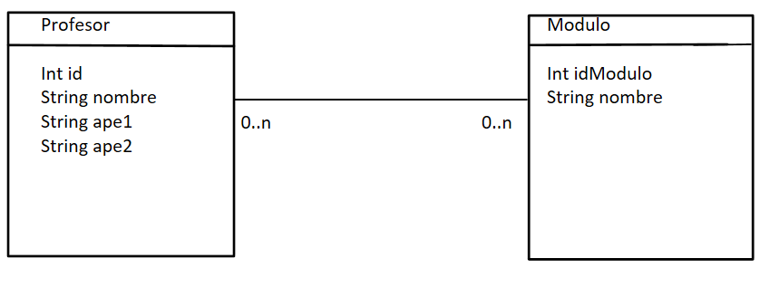

Fuente: https://aulavirtual3.educa.madrid.org/ies.alonsodeavellan.alcala/mod/book/view.php?id=221730&chapterid=36550

### 8. Mapeo de relaciones

#### 8.5. Relaciones muchos a muchos

La relación muchos a muchos consiste en que un objeto *A* tenga una lista de otros objetos *B* y también que el objeto *B* a su vez tenga la lista de objetos *A*.De forma que al persistirse cualquier objeto también se persista la lista de objetos que posee.

En el siguiente diagrama UML se ve la relación entre `Profesor` y `Modulo`. El esquema relacional vemos que para poder relacional los profesores con los modulos que imparte y viceversa, hay una tabla ProfesorModulo que referencia tanto a la tabla Profesores como a la tabla Modulos



**Las tablas de persistencia son:**

```
Profesor (id, nombre, ap1, ape2)  
Modulo (idModulo, nombre)  
ProfesorModulo ( idProfesor, idModulo)
```

```
fk: ProfesorModulo --------------idProfesor--------------> Profesor  
fk: Profesor Modulo -------------idModulo ----------------> Modulo
```

**Anotaciones**

El código fuente de la clase `Profesor` queda de la siguiente forma:

```
 1: @Entity
 2: @Table(name="Profesor")
 3: public class Profesor implements Serializable  {
 4:
 5:     @Id
 6:     @Column(name="Id")
 7:     private int id;
 8:
 9:     @Column(name="nombre")
10:     private String nombre;
11:
12:     @Column(name="ape1")
13:     private String ape1;
14:
15:     @Column(name="ape2")
16:     private String ape2;
17:
18:     @ManyToMany(cascade = {CascadeType.ALL})
19:     @JoinTable(name="ProfesorModulo", joinColumns={@JoinColumn(name="IdProfesor")}, inverseJoinColumns={@JoinColumn(name="IdModulo")})
20:     private Set<Modulo> modulos=new HashSet();
21:
22:
23:     public Profesor(){
24:     }
25:
26:     public Profesor(int id, String nombre, String ape1, String ape2) {
27:         this.id = id;
28:         this.nombre = nombre;
29:         this.ape1 = ape1;
30:         this.ape2 = ape2;
31:     }
32: }
```

Clase Profesor anotada

A la propiedad `módulos` (línea 20) se han añadido dos anotaciones para indicar la relación *muchos a muchos*.

* **ManyToMany**:Como su nombre indica le dice a Hibernate que la propiedad contendrá una lista de objetos que participa en una relación *muchos a muchos*.

  + **cascade**: Este atributo tiene el mismo significado que el del fichero de mapeo de Hibernate. Más información en Cascade.
* **JoinTable**: Esta anotación contiene la información sobre la tabla que realiza la relación *muchos a muchos*

  + **name**: Nombre de la tabla que realiza la relación *muchos a muchos*. En nuestro ejemplo es `ProfesorModulo`.
  + **joinColumns**: Contiene cada una de las columnas que forman la clave primaria de esta clase que estamos definiendo. Cada columna se indica mediante una anotación `@JoinColumn` y en el atributo `name` contiene el nombre de la columna.
  + **inverseJoinColumns**: Contiene cada una de las columnas que forman la clave primaria de la clase clase con la que tenemos la relación. Cada columna se indica mediante una anotación `@JoinColumn` y en el atributo `name` contiene el nombre de la columna.

El código de la clase Modulo es el siguiente:

```
 1: @Entity
 2: @Table(name="Modulo")
 3: public class Modulo implements Serializable {
 4:
 5:     @Id
 6:     @Column(name="IdModulo")
 7:     private int idModulo;
 8:
 9:     @Column(name="nombre")
10:     private String nombre;
11:
12:     @ManyToMany(cascade = {CascadeType.ALL},mappedBy="modulos")
13:     private Set<Profesor> profesores=new HashSet();
14:
15:     public Modulo() {
16:
17:     }
18:
19:     public Modulo(int idModulo, String nombre) {
20:         this.idModulo = idModulo;
21:         this.nombre = nombre;
22:
23:     }
24: }
```

Clase Modulo anotada

A la propiedad `profesores` (línea 13) se han añadido dos anotaciones para indicar la relación *muchos a muchos*.

* **ManyToMany**:Indica que la propiedad contiene una lista de objetos que participan en una relación *muchos a muchos*.

  + **cascade**: Este atributo tiene el mismo significado que el del fichero de mapeo de Hibernate. Mas información en [Cascade](http://cursohibernate.es/doku.php?id=unidades:03_relaciones:06_cascade "unidades:03_relaciones:06_cascade").
  + **mappedBy**: Contiene el nombre de la propiedad Java de la otra clase desde la cual se relaciona con ésta. En nuestro ejemplo es la propiedad `modulos`.

Al poner el atributo `mappedBy` ya no es necesario incluir la anotación `@JoinTable` ya que dicha información ya se indica en el otro lado de la relación.

**Código Java**

Ahora que ya tenemos preparadas las clase Java para que puedan persistirse veamos el código necesario para persistirlas.

```
 1: Profesor profesor1=new Profesor(11, "Isabel", "Fuertes", "Gascón");
 2: Profesor profesor2=new Profesor(12, "Jose", "Valenciano", "Gimeno");
 3:
 4: Modulo modulo1=new Modulo(1, "Sistemas Operativos en Red");
 5: Modulo modulo2=new Modulo(2, "Entornos de desarrollo");
 6: Modulo modulo3=new Modulo(3, "Sistemas Informáticos");
 7:
 8: profesor1.getModulos().add(modulo1);
 9: profesor1.getModulos().add(modulo2);
10: profesor2.getModulos().add(modulo3);
11:
12: modulo1.getProfesores().add(profesor1);
13: modulo2.getProfesores().add(profesor1);
14: modulo3.getProfesores().add(profesor2);
15:
16:
17: Session session=sessionFactory.openSession();
18: session.beginTransaction();
19:
20: session.save(profesor1);
21: session.save(profesor2);
22:
23: session.getTransaction().commit();
24: session.close();
```

Persistiendo la clase Profesor

La explicación del código es la siguiente:

* En las líneas 1 y 2 se crean dos objetos `Profesor`
* En las líneas 4, 5 y 6 se crean tres objetos `Modulo`.
* De las líneas 8 a 10 se añaden los módulos a los profesores.
* De las líneas 12 a 14 se añaden los profesores a los módulos.
* En las líneas 20 y 21 se guardan los dos objetos `Profesor` y automáticamente se guardan también los módulos.