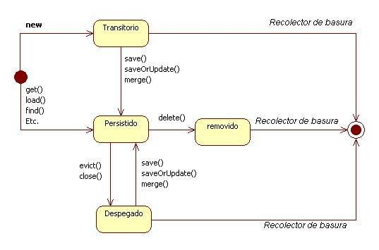

Fuente: https://aulavirtual3.educa.madrid.org/ies.alonsodeavellan.alcala/mod/book/view.php?id=221730&chapterid=36539

### 9. Trabajando con objetos

Los objetos que persistimos con Hibernate tienen un estado. Aparentemente no tiene mucho sentido ya que no hay ninguna propiedad *estado* en nuestras clases.Sin embargo el siguiente diagrama muestra los estados un objeto al respecto de Hibernate:

Fuente: Curso de
Hibernate con Spring. Lorenzo González

Veamos ahora en qué consisten cada uno de los 4 estados:

* **Transitorio** (Transient): Un objeto estará en estado Transitorio cuando acabe de ser creado en Java mediante el operador *new.* Es decir cuando esté recién creado por nosotros. Este estado tiene la característica de que hibernate no sabe nada de nuestro objeto. Quizás el objeto ya este guardado en base de datos  o sea nuevo y tengamos que insertarlo.
* **Persistente** (Persistent): Un objeto estará en estado Persistido cuando ya está guardado en la base de datos y además Hibernate también es consciente de ello. Fíjese la diferencia con el estado anterior en el que el objeto podía estar persistido pero Hibernate lo desconocía. Hibernate en ese caso guarda el objeto en la cache interna que posee. También es importante destacar que para una misma fila de la base de datos sólo puede haber un único objeto en estado Persistido.
* **Despegado** (Detached): Este estado es similar al estado Transitorio sólo que se produce cuando cerramos la sesión mediante [`Session.close()`](http://docs.jboss.org/hibernate/core/4.1/javadocs/org/hibernate/Session.html#close) o llamamos al método [`Session.evict(Object objeto)`](http://docs.jboss.org/hibernate/core/4.1/javadocs/org/hibernate/Session.html#evict(java.lang.Object)) para el objeto que queremos pasar a este estado. En ese caso Hibernate vuelve a *olvidar* en qué estado se encontraban los objetos borrándolo de su cache interna.
* **Removido** (Removed): A este estado pasan los objetos que se han borrado de la base de datos mediante el método *delete().*

####