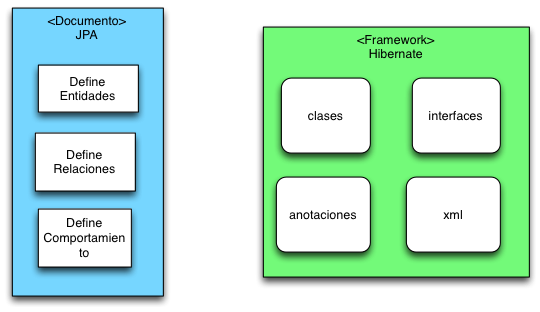

Fuente: https://aulavirtual3.educa.madrid.org/ies.alonsodeavellan.alcala/mod/book/view.php?id=221730&chapterid=36557

### 4. Anotaciones Java Persistence API (JPA) vs Hibernate

##### 1. JPA no es un framework, es una especificación

**JPA (Java Persistence API)** es solo un **documento/estándar** que define *cómo debería funcionar* la persistencia en Java EE. Es decir:

* Define **qué** debe existir: anotaciones como `@Entity`, `@Table`, `@Id`, una interfaz `EntityManager`, etc.
* Define **cómo se deben comportar** esas cosas.
* Pero **no incluye código ejecutable**. No puedes "instalar JPA" y ponerte a trabajar con él.

Es parte de la especificación **EJB 3 (JSR 220)**, que es el documento oficial donde se describen esas reglas. Piensa en JPA como el "plano" o el "contrato".

##### 2. Hibernate sí es real

**Hibernate** es un **framework concreto**, con código de verdad, que **implementa** esa especificación. Es lo que realmente usas en tu aplicación para guardar/leer objetos de la base de datos.

* Puede configurarse mediante **ficheros XML** o mediante **anotaciones**.
* Cuando usas Hibernate, por debajo estás usando una implementación de JPA (Hibernate es la implementación de referencia más popular).

Analogía: JPA es como el "reglamento de construcción" y Hibernate es la "constructora" que realmente levanta el edificio siguiendo ese reglamento.

##### 3. Las anotaciones de Hibernate son las de JPA

* Hibernate **adoptó las anotaciones del estándar JPA** (`@Entity`, `@Id`, `@Column`...). Es decir, cuando escribes esas anotaciones en tus clases, estás usando el estándar JPA, no algo propio de Hibernate.
* No obstante, existe la posibilidad de configurar Hibernate mediante **ficheros XML**, en vez de anotaciones de JPA, en ese caso, ahí sí usas los **ficheros propietarios de Hibernate** (con su propio formato, sus etiquetas, etc.). Eso no es estándar JPA, es específico de Hibernate.

En la práctica, lo normal hoy es usar **Hibernate como implementación de JPA con anotaciones**, y los ficheros XML propios de Hibernate se ven más en proyectos antiguos o cuando necesitas funcionalidades que el estándar no cubre.

 Fuente: www.genbeta.com