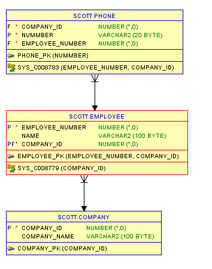

Fuente: https://aulavirtual3.educa.madrid.org/ies.alonsodeavellan.alcala/mod/book/view.php?id=221730&chapterid=36536

### 8. Mapeo de relaciones

#### 8.11. El identificador consta de varios atributos

Una clave de base de datos relacional compuesta contiene dos o más columnas que juntas para la clave primaria de una tabla dada.  
Para este capitulo vamos a utilizar las siguientes tablas:  



En el diagrama anterior, la tabla employee tiene una clave primaria compuesta, que consta de dos columnas: company\_id y  employee\_number. 

Para mapear la tabla employee creamos una nueva clase de identificacion con la anotacion "Embbedable" que tiene como atributos las columnas que forman parte de la clave primaria.   
Las clases con anotacion @Embeddable  deben ser Serializable  y  debemos implementar los métodos  equals y hashCode.  
  
**Clase Employee id**

> ```
> @Embeddable  
> public class EmployeeId implements Serializable {  
>    
>     @Column(name = "company_id")  
>     private Long companyId;  
>    
>     @Column(name = "employee_number")  
>     private Long employeeNumber;  
>    
>     public EmployeeId() {  
>     }  
>    
>     public EmployeeId(Long companyId, Long employeeId) {  
>         this.companyId = companyId;  
>         this.employeeNumber = employeeId;  
>     }  
>    
>     public Long getCompanyId() {  
>         return companyId;  
>     }  
>    
>     public Long getEmployeeNumber() {  
>         return employeeNumber;  
>     }  
>    
>     @Override  
>     public boolean equals(Object o) {  
>         if (this == o) return true;  
>         if (!(o instanceof EmployeeId)) return false;  
>         EmployeeId that = (EmployeeId) o;  
>         return Objects.equals(getCompanyId(), that.getCompanyId()) &&  
>                 Objects.equals(getEmployeeNumber(), that.getEmployeeNumber());  
>     }  
>    
>     @Override  
>     public int hashCode() {  
>         return Objects.hash(getCompanyId(), getEmployeeNumber());  
>     }  
> }
> ```

El mapeo de la clase Employee debera incluir un atributo de esta clase de identificacion EmployeeId, con la anotación   @EmbeddedId. La anotación @EmbeddedId se utiliza para indicar a Hibernate que el identificador es compuesto.

```
@Entity(name = "Employee")  


```
@Table(name = "employee")  
public class Employee implements serializable {  
   
    @EmbeddedId  
    private EmployeeId id; 
    ...
```


```
}
```
```

Para implementar la relación entre las entidades phone y employee utilizamos mas mismas anotaciones @ManyToOne cambia la anotación @JoinColumn

Veamos la implementacion de  la entidad phone

```
@Entity(name = "Phone")  
@Table(name = "phone")  
public class Phone implements Serializable{  
   
   ...  
    @ManyToOne  
    @JoinColumns({  
        @JoinColumn(  
            name = "company_id",  
            referencedColumnName = "company_id"),  
        @JoinColumn(  
            name = "employee_number",  
            referencedColumnName = "employee_number")  
    })  
   ...  
}
```

El mapeo de la clase Employee tendra una anotacion @OneToMany para relacionarlo con la clase Phone

```
@Entity(name = "Employee")  
@Table(name = "employee")  
public class Employee implements serializable
```

```
{
```

```
    ...
```

```
   @OneToMany(mappedBy =employee)
```

```
   Set <Phone> phones;
```

```
   ...  
}
```

  

**Mapeo de relaciones usando la clave compuesta**

**La primera opción es  relacionar las entidades Employee y Company  anotando las entidades:**

En este ejemplo en particular, company\_id referencia a la entidad Company, que queda:

```
@Entity(name = "Company")  
@Table(name = "company")  
public class Company implements serializable{  
   
    @Id  
    private Long id;  
   
    private String name;
```

```
```
 @OneToMany(mappedBy =company)
```


```
   Set <Employees> lisEmployees;
```

...
```

```
}
```

La entidad Employee tiene la anotacion @ManyToOne que la relacione con la entidad Company.

```
@Entity(name = "Employee")  
@Table(name = "employee")  
public class Employee implements serializable {  
   
  ...  
   
    @ManyToOne  
    @JoinColumn(name = "company_id",insertable = false, updatable = false)  
    private Company company;  
   
  ...  
}
```

**El conjunto de las clases completas :**

clase EmployeeId

```
```
@Embeddable  
public class EmployeeId implements Serializable {  
   
    public EmployeeId(int companyId, int employeeNumber) {  
		super();  
		this.companyId = companyId;  
		this.employeeNumber = employeeNumber;  
	}  
	@Column(name = "company_id")  
    private int companyId;  
   
    @Column(name = "employee_number")  
    private int employeeNumber;  
   
    public EmployeeId() {  
    }  
   
      
   
    public int getCompanyId() {  
        return companyId;  
    }  
   
    public int getEmployeeNumber() {  
        return employeeNumber;  
    }  
   
    @Override  
    public boolean equals(Object o) {  
        if (this == o) return true;  
        if (!(o instanceof EmployeeId)) return false;  
        EmployeeId that = (EmployeeId) o;  
        return Objects.equals(getCompanyId(), that.getCompanyId()) &&  
                Objects.equals(getEmployeeNumber(), that.getEmployeeNumber());  
    }  
   
    @Override  
    public int hashCode() {  
        return Objects.hash(getCompanyId(), getEmployeeNumber());  
    }  
}
```
```

clase Employee

```
@Entity(name = "Employee")  
@Table(name = "employee")  
public class Employee implements Serializable {  
   
    public Employee(EmployeeId id, String name, Company company) {  
		super();  
		this.id = id;  
		this.name = name;  
		this.company = company;  
	}  
	@EmbeddedId  
    private EmployeeId id;  
   
    private String name;  
   
    @ManyToOne  
    @JoinColumn(name = "company_id",insertable = false, updatable = false)  
    private Company company;  
   
    public EmployeeId getId() {  
        return id;  
    }  
   
    public void setId(EmployeeId id) {  
        this.id = id;  
    }  
   
    public String getName() {  
        return name;  
    }  
   
    public void setName(String name) {  
        this.name = name;  
    }  
}
```

clase Company

```
@Entity(name = "Company")  
@Table(name = "company")  
public class Company implements Serializable {  
	public Company(int id, String name, Set<Employee> lisEmployees) {  
		super();  
		this.id = id;  
		this.name = name;  
		this.lisEmployees = lisEmployees;  
	}  
	public Company(int id, String name) {  
		super();  
		this.id = id;  
		this.name = name;  
	}  
	public Set<Employee> getLisEmployees() {  
		return lisEmployees;  
	}  
	public void setLisEmployees(Set<Employee> lisEmployees) {  
		this.lisEmployees = lisEmployees;  
	}  
	@Id  
	@Column(name = "company_id")  
	private int id;  
	@Column(name = "company_name")  
	private String name;  
	@OneToMany(mappedBy = "company", cascade = CascadeType.ALL)  
	Set<Employee> lisEmployees;  
	public int getId() {  
		return id;  
	}  
	public void setId(int id) {  
		this.id = id;  
	}  
	public String getName() {  
		return name;  
	}  
	public void setName(String name) {  
		this.name = name;  
	}  
	@Override  
	public boolean equals(Object o) {  
		if (this == o)  
			return true;  
		if (!(o instanceof Company))  
			return false;  
		Company company = (Company) o;  
		return Objects.equals(getName(), company.getName());  
	}  
	@Override  
	public int hashCode() {  
		return Objects.hash(getName());  
	}  
}
```

clase Phone

```
@Entity(name = "Phone")  
@Table(name = "phone")  
public class Phone implements Serializable{  
   
    @Id  
    @Column(name = "number")  
    private String number;  
   
    @ManyToOne  
    @JoinColumns({  
        @JoinColumn(  
            name = "company_id",  
            referencedColumnName = "company_id"),  
        @JoinColumn(  
            name = "employee_number",  
            referencedColumnName = "employee_number")  
    })  
    private Employee employee;  
   
    public Employee getEmployee() {  
        return employee;  
    }  
   
    public void setEmployee(Employee employee) {  
        this.employee = employee;  
    }  
   
    public String getNumber() {  
        return number;  
    }  
   
    public void setNumber(String number) {  
        this.number = number;  
    }  
}
```

El siguiente programa inserta crea un objeto de la clase Company que al hacer persistente, inserta dos lineas una en la tabla company y otra en la tabla employee.

```
public class Main {  
	/**  
	 * @param args  
	 */  
	public static void main(String[] args) {  
		SessionFactory sesion = HibernateUtils.getSessionFactory();  
		Session session = sesion.openSession(); // TODO Auto-generated constructor stub  
		session.beginTransaction();  
		Company c1 = new Company(1, "Almacenes Lamarca");  
		Set<Employee> lis1 = new HashSet<>();  
		lis1.add(new Employee(new EmployeeId(1, 1), "Lopez", null));  
		c1.setLisEmployees(lis1);  
		session.save(c1);  
		session.getTransaction().commit();  
		session.close();  
	}  
}
```

**Otra opción es  relacionar las entidades Employee y Company  anotando la clase @Embeddable:**

 podemos mover el @ManyToOnea la clase EmployeeId de esta forma las clases de mapeo y las entidades quedarian:

```
```
@Embeddable  
public class EmployeeId implements Serializable {  
	@ManyToOne  
	@JoinColumn(name = "company_id")  
	private Company company;  
	@Column(name = "employee_number")  
	private int employeeNumber;  
	public EmployeeId() {  
	}  
	public int getEmployeeNumber() {  
		return employeeNumber;  
	}  
	public Company getCompany() {  
		return company;  
	}  
	public void setCompany(Company company) {  
		this.company = company;  
	}  
	public void setEmployeeNumber(int employeeNumber) {  
		this.employeeNumber = employeeNumber;  
	}  
	public EmployeeId(Company company, int employeeNumber) {  
		super();  
		this.company = company;  
		this.employeeNumber = employeeNumber;  
	}  
	  
	@Override  
	public int hashCode() {  
		final int prime = 31;  
		int result = 1;  
		result = prime * result + ((company == null) ? 0 : company.hashCode());  
		result = prime * result + employeeNumber;  
		return result;  
	}  
	@Override  
	public boolean equals(Object obj) {  
		if (this == obj)  
			return true;  
		if (obj == null)  
			return false;  
		if (getClass() != obj.getClass())  
			return false;  
		EmployeeId other = (EmployeeId) obj;  
		if (company == null) {  
			if (other.company != null)  
				return false;  
		} else if (!company.equals(other.company))  
			return false;  
		if (employeeNumber != other.employeeNumber)  
			return false;  
		return true;  
	}  
}
```
```

Ahora, la entidad Employee no tiene la anotacion @ManyToOne

```
```
@Entity(name = "Employee")  
@Table(name = "employee")  
public class Employee implements Serializable {  
   
    public Employee(EmployeeId id, String name) {  
		super();  
		this.id = id;  
		this.name = name;  
    }  
     @EmbeddedId  
    private EmployeeId id;  
   
    private String name;  
   
    public EmployeeId getId() {  
        return id;  
    }  
   
    public void setId(EmployeeId id) {  
        this.id = id;  
    }  
   
    public String getName() {  
        return name;  
    }  
   
    public void setName(String name) {  
        this.name = name;  
    }  
}
```
```

y la clase Company tiene anotación "OneToMany con EmployeeId  

```
@Entity(name = "Company")  
@Table(name = "company")  
public class Company implements Serializable {  
	public Company(int id, String name, Set<EmployeeId> lisEmployeesId) {  
		super();  
		this.id = id;  
		this.name = name;  
		this.lisEmployeesId = lisEmployeesId;  
	}  
	public Company(int id, String name) {  
		super();  
		this.id = id;  
		this.name = name;  
	}  
	public Set<EmployeeId> getlisEmployeesId() {  
		return lisEmployeesId;  
	}  
	public void setlisEmployeesId(Set<EmployeeId> lisEmployeesId) {  
		this.lisEmployeesId = lisEmployeesId;  
	}  
	@Id  
	@Column(name = "company_id")  
	private int id;  
	@Column(name = "company_name")  
	private String name;  
	@OneToMany(mappedBy = "company", cascade = CascadeType.ALL)  
	Set<EmployeeId> lisEmployeesId;  
	public int getId() {  
		return id;  
	}  
	public void setId(int id) {  
		this.id = id;  
	}  
	public String getName() {  
		return name;  
	}  
	public void setName(String name) {  
		this.name = name;  
	}  
	@Override  
	public boolean equals(Object o) {  
		if (this == o)  
			return true;  
		if (!(o instanceof Company))  
			return false;  
		Company company = (Company) o;  
		return Objects.equals(getName(), company.getName());  
	}  
	@Override  
	public int hashCode() {  
		return Objects.hash(getName());  
	}  
}
```

El ejecutable que crea una compañia y un empleado que trabaja en esta compañia:

```
public class Main {  
	  
	public static void main(String[] args) {  
		SessionFactory sesion = HibernateUtils.getSessionFactory();  
		Session session = sesion.openSession(); // TODO Auto-generated constructor stub  
		session.beginTransaction();  
		Company c1 = new Company(1, "Almacenes Lamarca");  
		Set<EmployeeId> lis1 = new HashSet<>();  
		  
		EmployeeId ei1 =new EmployeeId(c1, 1);  
		Employee e1 =new Employee ( ei1, "Lopez");  
		lis1.add(ei1);  
		session.save(c1);  
		session.getTransaction().commit();  
		session.close();  
	}  
}
```