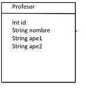

Fuente: https://aulavirtual3.educa.madrid.org/ies.alonsodeavellan.alcala/mod/book/view.php?id=221730&chapterid=36543

### 8. Mapeo de relaciones

#### 8.10. El identificador consta de un único atributo

Se utiliza @Id para anotar la propiedad de la clase que identifica a los objetos de la clase, que va a corresponder con la clave primaria de la tabla que mapea.

En el siguiente diagrama UML muestra la clase `Profesor`y representación de la tabla`Profesor`



la tabla correspondiente:

Profesor (id, nombre, ape1, ape2)

El código fuente de la clase `Profesor` queda de la siguiente forma:

```
 1: @Entity
 2: @Table(name="Profesor")
 3: public class Profesor implements Serializable  {
 4:
 5:     @Id
 6:     @Column(name="Id")
 7:     @GeneratedValue(strategy=GenerationType.IDENTITY)
 8:     private int id;
 9:
10:     @Column(name="nombre")
11:     private String nombre;
12:
13:     @Column(name="ape1")
14:     private String ape1;
15:
16:     @Column(name="ape2")
17:     private String ape2;
18:
19:     public Profesor(){
20:     }
21:
22:     public Profesor(String nombre, String ape1, String ape2) {
23:         this.nombre = nombre;
24:         this.ape1 = ape1;
25:         this.ape2 = ape2;
26:     }
27: }
```

Clase Profesor anotada

**Identificadores generados**

Podemos ver cómo se ha añadido la anotación `@GeneratedValue` para la generación de la clave primaria.

* **@GeneratedValue**: Esta anotación indica que Hibernate deberá generar el valor de la clave primaria.

  + **strategy**: Este atributo nos indica el método en el que Hibernate debe generar la clave primaria.En nuestro ejemplo el valor es `GenerationType.IDENTITY`.Los valores más usados para este atributo son
    los siguientes:

| Estrategia | Descripción |
| --- | --- |
| `GenerationType.AUTO` | Hibernate usará alguno de los siguientes métodos dependiendo de la base de datos. De esta forma, si cambiamos de base de datos, se seguirá usando la mejor forma de generar la clave primaria. Es la opción por defecto si se omite la estrategia. |
| `GenerationType.IDENTITY` | Hibernate usará el valor de la columna de tipo autoincremento. Es decir que al insertar la fila la base de datos le asignará el valor. La columna de base de datos debe ser de tipo autonumérico |
| `GenerationType.SEQUENCE` | Se utiliza una secuencia como las que existen en Oracle o PostgreSQL . No es compatible con MySQL. La columna de base de datos debe ser de tipo numérico |
| `GenerationType.TABLE` | Hibernate utiliza una tabla de base de datos para simular una secuencia, es una mala estrategia. Requiere peticiones JDBC adicionales |

Al usar el método `GenerationType.SEQUENCE` es necesario indicar el nombre de la secuencia que va a usar Hibernate para obtener el valor. En ese caso el código fuente de la clase profesor habría que modificarlo de la siguiente
forma.

```
5: @Id
6: @Column(name="Id")
7: @GeneratedValue(strategy=GenerationType.SEQUENCE,generator="secuencia_idProfesor")
8: private int id;
```

Vemos que en la línea 7 se ha añadido el atributo `generator` para indicar el nombre de la secuencia a usar. En el ejemplo el nombre de la secuencia a usar es `secuencia_idProfesor`.