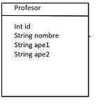

Fuente: https://aulavirtual3.educa.madrid.org/ies.alonsodeavellan.alcala/mod/book/view.php?id=221730&chapterid=36544

### 6. Mapeo de Entidades

**Una entidad es una clase que se desea hacer persistente, la persistencia se implementa con tablas  de bases de datos relacional., por ello, el concepto de Entidad se asocia a la de tabla.**

La tabla Profesor debe corresponder con la clase Profesor:



La tabla de persistencia que corresponde con esta clases:

Profesor( id, nombre, ape1, ape2)

 

**La clases Java deberán tener las siguientes características:**

* **Deben tener un constructor público sin ningún tipo de argumentos.**
* **Para cada propiedad que queramos persistir debe haber un método get/set asociado.**
* **Implementar el interfaz [`Serializable`](http://docs.oracle.com/javase/7/docs/api/java/io/Serializable.html)  (En mi ejemplo esto no ha sido necesario)**

En el siguiente apartado veremos que hay varias formas de mapear entidades, veamos un ejemplo de la clase `Profesor` pero mapeada con anotaciones.

```
1: @Entity
 2: @Table(name="Profesor")
 3: public class Profesor implements Serializable  {
 4:
 5:     @Id
 6:     @Column(name="Id")
 7:     private int id;
 8:
 9:     @Column(name="nombre")
10:     private String nombre;
11:
12:     @Column(name="ape1")
13:     private String ape1;
14:
15:     @Column(name="ape2")
16:     private String ape2;
17:
18:
19:     public Profesor(){
20:     }
21:
22:     public Profesor(int id, String nombre, String ape1, String ape2) {
23:         this.id = id;
24:         this.nombre = nombre;
25:         this.ape1 = ape1;
26:         this.ape2 = ape2;
27:     }
28:
29:     public int getId() {
30:         return id;
31:     }
32:
33:     public void setId(int id) {
34:         this.id = id;
35:     }
36:
37:     public String getNombre() {
38:         return nombre;
39:     }
40:
41:     public void setNombre(String nombre) {
42:         this.nombre = nombre;
43:     }
44:
45:     public String getApe1() {
46:         return ape1;
47:     }
48:
49:     public void setApe1(String ape1) {
50:         this.ape1 = ape1;
51:     }
52:
53:     public String getApe2() {
54:         return ape2;
55:     }
56:
57:     public void setApe2(String ape2) {
58:         this.ape2 = ape2;
59:     }
60: }
```

Las anotaciones que se han usado son las siguientes:

* **`@Entity`**: Se aplica a la clase e indica que esta clase Java es una entidad a persistir. Es una anotación estándar de JPA. En nuestro ejemplo estamos indicando que la clase `Profesor` es una entidad que se puede persistir.
* **`@Table(name=“Profesor”)`**: Se aplica a la clase e indica el nombre de la tabla de la base de datos donde se persistirá la clase. Es opcional si el nombre de la clase coincide con el de la tabla. Es una anotación estándar de JPA. En nuestro ejemplo estamos indicando que la clase `Profesor` se persistirá en la tabla `Profesor` de la base de datos.
* **`@Id`**: Se aplica a una propiedad Java e indica que este atributo es la clave primaria. Es una anotación estándar de JPA. En nuestro ejemplo estamos indicando que la propiedad Java `id` es la clave primaria.
* **`@Column(name=“Id”)`**: Se aplica a una propiedad Java e indica el nombre de la columna de la base de datos en la que se persistirá la propiedad. Es opcional si el nombre de la propiedad Java coincide con el de la columna de la base de datos. Es una anotación estándar de JPA. En nuestro ejemplo estamos indicando que la propiedad Java `id` se persistirá en una columna llamada `Id`.
* **`@Column(name=“nombre”)`**: Se aplica a una propiedad Java e indica el nombre de la columna de la base de datos en la que se persistirá la propiedad. Es opcional si el nombre de la propiedad Java coincide con el de la columna de la base de datos. Es una anotación estándar de JPA. En nuestro ejemplo estamos indicando que la propiedad Java `nombre` se persistirá en una columna llamada `nombre`.
* **`@Column(name=“ape1”)`**: Es igual al caso anterior pero para la propiedad `ape1`.
* **`@Column(name=“ape2”)`**: Es igual al caso anterior pero para la propiedad `ape2`.

En el ejemplo anterior se han omitido los metodos geter y seter para simplificar. Usando anotaciones se persisten todas las propiedades que tengan los métodos `get/set`. Si no queremos que un atributo persista, lo anotaremos con **`@Transient.`**