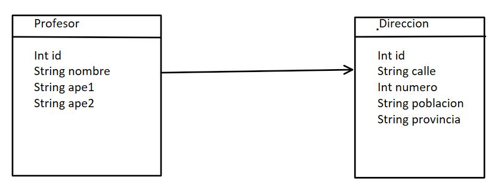

Fuente: https://aulavirtual3.educa.madrid.org/ies.alonsodeavellan.alcala/mod/book/view.php?id=221730&chapterid=36552

### 8. Mapeo de relaciones

#### 8.1. Relaciones uno a uno (unidireccional)

La relación uno a uno en Hibernate consiste simplemente en que un objeto tenga una referencia a otro objeto de forma que al persistirse el primer objeto también se persista el segundo.

En esta lección la relación va a ser unidireccional es decir que que la relación *uno a uno* va a ser en un único sentido.

En el ejemplo siguiente, cada profesor tiene un domicilio. El diagrama de clases y el esquema relacional es el siguiente:

                



Profesor(id, nombre, ape1, ape2)

Direccion(id, calle, numero, poblacion, provincia, Idprofesor)

fk:Direccion ------Idprofesor---------> Profesor

El código fuente de la clase `Profesor` queda de la siguiente forma:

```
 1: import java.io.Serializable;
 2: import javax.persistence.*;
 3:
 4:
 5: @Entity
 6: @Table(name="Profesor")
 7: public class Profesor implements Serializable  {
 8:
 9:     @Id
10:     @Column(name="Id")
11:     private int id;
12:
13:     @Column(name="nombre")
14:     private String nombre;
15:
16:     @Column(name="ape1")
17:     private String ape1;
18:
19:     @Column(name="ape2")
20:     private String ape2;
21:
22:     @OneToOne(cascade=CascadeType.ALL)
23:     @PrimaryKeyJoinColumn
24:     private Direccion direccion;
25: }
```

Clase Profesor anotada

A la propiedad `direccion` (línea 24) se han añadido dos anotaciones para indicar la relación *uno a uno* y que ésta relación se implemente mediante la clave primaria.

* **@OneToOne(cascade=CascadeType.ALL)**: Esta anotación indica la relación *uno a uno* de las 2 tablas. Tambien indicamos el valor de `cascade`

  El significado de CascadeType.ALL es que la persistencia propagará (en cascada) todas las operaciones de EntityManager (PERSIST, REMOVE, REFRESH, MERGE, DETACH) a las entidades relacionadas.
* **@PrimaryKeyJoinColumn**: Indicamos que la relación entre las dos tablas se realiza mediante la clave primaria. En caso de no incluir esta anotación `@PrimaryKeyJoinColumn` se producirá un error indicando que falta la columna `direccion_Id` en la tabla `Profesor`.

En código de `Direccion` no es necesario indicar nada sobre la relación, ya que es unidireccional.

* `Profesor.Id` es **PK de Profesor** y **FK que referencia a `Direccion.id`**.
* El valor de `Id` en `Profesor` debe coincidir con el `id` de la `Direccion` asociada (Hibernate lo sincroniza al persistir, ya que `@PrimaryKeyJoinColumn` sin argumentos usa la PK de la entidad propietaria).

```
 1: import java.io.Serializable;
 2: import javax.persistence.Column;
 3: import javax.persistence.Entity;
 4: import javax.persistence.Id;
 5: import javax.persistence.Table;
 6:
 7:
 8: @Entity
 9: @Table(name="Direccion")
10: public class Direccion implements Serializable  {
11:
12:     @Id
13:     @Column(name="Id")
14:     private int id;
15:
16:     @Column(name="calle")
17:     private String calle;
18:
19:     @Column(name="numero")
20:     private int numero;
21:
22:     @Column(name="poblacion")
23:     private String poblacion;
24:
25:     @Column(name="provincia")
26:     private String provincia;
27: }
```

```
 
```

**Código Java**

Ahora que ya tenemos preparadas las clase Java para que puedan persistirse veamos el código necesario para persistirlas.

```
 1:         Direccion direccion=new Direccion(1, "Plaza del ayuntamiento", 8, "Xativa", "Valencia");
 2:         Profesor profesor=new Profesor(1, "Juan", "Perez", "García");
 3:         profesor.setDireccion(direccion);
 4:
 5:         Session session=sessionFactory.openSession();
 6:         session.beginTransaction();
 7:
 8:         session.save(profesor);
 9:
10:         session.getTransaction().commit();
11:         session.close();
```

Como podemos ver no hay **nada** nuevo en el código Java para persistir una relación *uno a uno*, simplemente creamos las 2 clases (Líneas 1 y 2) y establecemos la relación entre ambas asignando al objeto `Profesor` la referencia al objeto `Direccion` (Línea 3). Por último, simplemente persistimos la clase `Profesor` tal y como se ha explicado anteriormente.

Al ejecutar el ejemplo Hibernate vemos cómo se han creado las filas en las tablas `Profesor` y `Direccion` mientras que desde Java solo se ha persistido la clase `Profesor`.