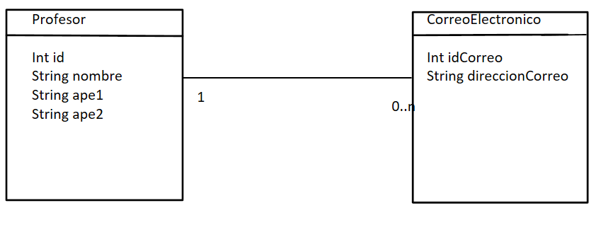

Fuente: https://aulavirtual3.educa.madrid.org/ies.alonsodeavellan.alcala/mod/book/view.php?id=221730&chapterid=36542

### 8. Mapeo de relaciones

#### 8.3. Relaciones uno a muchos(desordenada)

La relación uno a muchos consiste simplemente en que un objeto *padre* tenga una lista **sin ordenar** de otros objetos *hijo* de forma que al persistirse el objeto principal también se persista la lista de objetos *hijo*. Esta relación también suele llamarse *maestro-detalle* o *padre-hijo*.

En el siguiente diagrama UML se ve que la relación desde `Profesor` hacía `CorreoElectronico` y viceversa, y el esquema relacional correpondiente.



**Las tablas de la base de datos:**

```
Profesor(id, nombre, ape1,ape2)  
CorreoElectronico( idCorreo, direccionCorreo, Idprofesor)
```

```
                         IdProfesor  
fk CorreoElectronico-----------------------------> Profesor
```

  

Podemos ver cómo la tabla `CorreoElectronico` contiene como clave ajena la clave primaria de la tabla `Profesor` y de esa forma se establece la relación uno a muchos.

El código fuente de la clase `Profesor` queda de la siguiente forma:

```
 1: @Entity
 2: @Table(name="Profesor")
 3: public class Profesor implements Serializable  {
 4:
 5:     @Id
 6:     @Column(name="Id")
 7:     private int id;
 8:
 9:     @Column(name="nombre")
10:     private String nombre;
11:
12:     @Column(name="ape1")
13:     private String ape1;
14:
15:     @Column(name="ape2")
16:     private String ape2;
17:
18:     @OneToMany(mappedBy="profesor",cascade= CascadeType.ALL)
19:     private Set<CorreoElectronico> correosElectronicos;
20:
21:
22:     public Profesor(){
23:     }
24:
25:     public Profesor(int id, String nombre, String ape1, String ape2) {
26:         this.id = id;
27:         this.nombre = nombre;
28:         this.ape1 = ape1;
29:         this.ape2 = ape2;
30:     }
31: }
```

Clase Profesor anotada

A la propiedad `correosElectronicos` se ha añadido una anotación para indicar la relación *uno a muchos*.

* **OneToMany**:Como su nombre indica le dice a Hibernate que esta propiedad contendrá la lista de *hijos*.

  + **mappedBy**: Este atributo contendrá el nombre de la propiedad Java de la clase *hija* que enlaza con la clase *padre*. En nuestro ejemplo es el nombre de la propiedad `profesor` que se encuentra en la clase `CorreoElectronico`.
  + **cascade**: Este atributo tiene el mismo significado que el del fichero de mapeo de Hibernate. Mas información en Cascade.

El código de la clase CorreoElectronico es el siguiente:

```
 1: @Entity
 2: @Table(name="CorreoElectronico")
 3: public class CorreoElectronico implements Serializable {
 4:
 5:     @Id
 6:     @Column(name="IdCorreo")
 7:     private int idCorreo;
 8:
 9:     @Column(name="DireccionCorreo")
10:     private String direccionCorreo;
11:
12:     @ManyToOne
13:     @JoinColumn(name="IdProfesor")
14:     private Profesor profesor;
15:
16:     public CorreoElectronico() {
17:
18:     }
19:
20:     public CorreoElectronico(int idCorreo,String direccionCorreo,Profesor profesor) {
21:         this.idCorreo=idCorreo;
22:         this.direccionCorreo=direccionCorreo;
23:         this.profesor=profesor;
24:     }
25: }
```

Clase CorreoElectronico anotada

A la propiedad `profesor` se han añadido dos anotaciones para indicar la relación:

* **ManyToOne**:Al ser el otro lado de la relación indicamos que desde este lado es una relación *muchos a uno*.
* **JoinColumn**: Indicaremos el nombre de la columna que en la tabla *hija* contiene la clave ajena a la tabla *padre*. En nuestro ejemplo es la columna de la base de datos `IdProfesor` que se encuentra en la tabla `CorreoElectronico` la cual enlaza con la tabla `Profesor`.

**Código Java**

Ahora que ya tenemos preparadas las clase Java para que puedan persistirse veamos el código necesario para persistirlas.

```
 1: Profesor profesor=new Profesor(7, "Sara", "Barrrera", "Salas");
 2: Set<CorreoElectronico> correosElectronicos=new HashSet<>();
 3: correosElectronicos.add(new CorreoElectronico(3, "sara@yahoo.com",profesor));
 4: correosElectronicos.add(new CorreoElectronico(2, "sara@hotmail.com",profesor));
 5: correosElectronicos.add(new CorreoElectronico(1, "sara@gmail.com",profesor));
 6:
 7: profesor.setCorreosElectronicos(correosElectronicos);
 8:
 9: Session session=sessionFactory.openSession();
10: session.beginTransaction();
11:
12: session.save(profesor);
13:
14:
15: session.getTransaction().commit();
16: session.close();
```

Persistiendo la clase Profesor

La explicación del código es la siguiente:

* En la línea 1 se crea el objeto `Profesor`
* En la segunda línea se crea el objeto `HashSet` que implementa el interfaz [`Set`](http://docs.oracle.com/javase/7/docs/api/java/util/Set.html) el cual contendrá la lista de hijos.
* Desde las líneas 3 a la 5 se crean los objetos `CorreoElectronico` y se añaden al [`Set`](http://docs.oracle.com/javase/7/docs/api/java/util/Set.html).
* En la línea 7 se establece la relación entre la lista de hijos (`CorreoElectronico`) y el padre (`Profesor`).
* En la línea 12 se guarda el objeto `Profesor` y automáticamente se guardan también sus hijos.