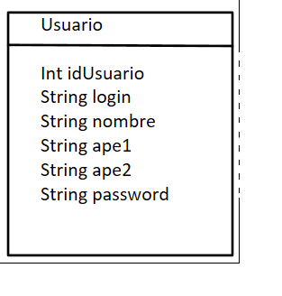

Fuente: https://aulavirtual3.educa.madrid.org/ies.alonsodeavellan.alcala/mod/book/view.php?id=221730&chapterid=36554

### 8. Mapeo de relaciones

#### 8.8. Metodos equals y hashCode

**Problema:** Si lees la misma fila desde dos sesiones distintas de Hibernate, cada sesión puede tener su propio objeto `Usuario` con los datos de esa fila. Si comparamos estos objetos con el método [`equals(Object)`](http://docs.oracle.com/javase/7/docs/api/java/lang/Object.html#equals(java.lang.Object)) el resultado será que son distintos, porque **la fila está en la base de datos, pero los objetos están en la memoria de Java**.

El método [`equals(Object)`](http://docs.oracle.com/javase/7/docs/api/java/lang/Object.html#equals(java.lang.Object)) es de gran importancia al usar las colecciones en Java. En la mayoría de las clases de colecciones Java es importante decidir si dos objetos son iguales y para ello se usa el método [`equals(Object)`](http://docs.oracle.com/javase/7/docs/api/java/lang/Object.html#equals(java.lang.Object)). 

Realmente sólo hay un caso en que es obligatorio implementar estos métodos: una clase que actúa como un identificador debe implementar equals / hashCode en función de los valores de id. En general, esto es pertinente para las clases de usuario utilizadas como identificadores compuestos. 

**En Hibernate** tiene aún más importancia debido a que realmente **dos objetos son iguales si hacen referencia a las misma fila de la base de datos aunque los objetos sean distintos**.

En este tema veremos cómo implementar correctamente el método [`equals(Object)`](http://docs.oracle.com/javase/7/docs/api/java/lang/Object.html#equals(java.lang.Object)) y el método [`hashCode()`](http://docs.oracle.com/javase/7/docs/api/java/lang/Object.html#hashCode()), ya que éste último está íntimamente relacionado con [`equals(Object)`](http://docs.oracle.com/javase/7/docs/api/java/lang/Object.html#equals(java.lang.Object)).

**Datos a comparar**

Como ya hemos comentado , **al implementar los dos métodos debemos tener en cuenta que para Hibernate dos objetos serán iguales si hacen referencia a la misma fila de la base de datos.** Esto va a hacer que no haya una solución fácil para implementar ambos métodos. Veamos algunas soluciones y sus problemas.

**Claves primarias**

Una solución fácil sería comparan las claves primarias de los 2 objetos.

En el siguiente capítulo está el tema dedicado a las [Claves primarias](http://cursohibernate.es/doku.php?id=unidades:04_claves_primarias_y_tipos_datos:02_claves_primarias "unidades:04_claves_primarias_y_tipos_datos:02_claves_primarias"), ahí veremos cómo hacer que se generen automáticamente, pero con el problema de qué se hace cuando se va a guardar el objeto, así que la solución de comparar las claves primarias no es buena ya que para nuevos objetos no podríamos compararlos aunque realmente hicieran referencia a la misma fila.

**Claves primarias naturales**

En el tema [Claves primarias](http://cursohibernate.es/doku.php?id=unidades:04_claves_primarias_y_tipos_datos:02_claves_primarias "unidades:04_claves_primarias_y_tipos_datos:02_claves_primarias") también hablaremos de las claves primarias naturales, también llamadas claves de negocio, como son el DNI, el login o el [Código Cuenta Cliente](http://es.wikipedia.org/wiki/C%C3%B3digo_cuenta_cliente "http://es.wikipedia.org/wiki/Código_cuenta_cliente"). Aunque estas claves no son adecuadas para ser claves primarias si que nos resultarán útiles para ser usadas en los métodos [`equals(Object)`](http://docs.oracle.com/javase/7/docs/api/java/lang/Object.html#equals(java.lang.Object)) y [`hashCode()`](http://docs.oracle.com/javase/7/docs/api/java/lang/Object.html#hashCode()).

Las claves primarias naturales tienen la característica de que hacen referencia a una única fila de la base de datos y por regla general se sabe su valor antes de crear la fila en la base de datos por lo que dos objetos que hagan referencia a los mismos datos nunca serán iguales.

¿Cúal es el problema de las claves primarias naturales? Que quizás la entidad de Hibernate no posea una clave primaria natural con lo que esta técnica no funcionará, aun así es la mejor opción que tenemos

**No hacer nada**

Una última opción es simplemente no hacer nada. Si nuestra aplicación va a tener el cuidado de no añadir el mismo objeto dos veces a una colección o nunca va a hacer un `equals` sino que es suficiene con `==` , etc, etc, entonces no es necesario hacer nada.

**Ejemplo: clase Usuario**

Para implementar los métodos `equals` y `hashCode` vamos a usar como ejemplo la clase `Usuario`. Esta clase tiene el siguiente código Java:

```
 1: public class Usuario implements Serializable {
 2:
 3:     private int idUsuario;
 4:     private String login;
 5:     private String nombre;
 6:     private String ape1;
 7:     private String ape2;
 8:     private String password;
 9:
10:     public Usuario() {
11:     }
12:
13:     public Usuario(String login, String nombre, String ape1, String ape2, String password) {
14:         this.login = login;
15:         this.nombre = nombre;
16:         this.ape1 = ape1;
17:         this.ape2 = ape2;
18:         this.password = password;
19:     }
20:
21:     @Override
22:     public String toString() {
23:         return getLogin() + "-" + getNombre() + " " + getApe1() + " " + getApe2();
24:     }
25:  }
```

Usuario.java

En la clase Java `Usuario` no se han incluido los métodos get/set de cada propiedad para facilitar la lectura, pero deben estar en la clase Java.

El diagrama UML es el siguiente:



La clase `Usuario` tiene la característica de que la propiedad `login` es una clave primaria natural y tiene valor antes de guardarse en la base de datos y cada valor de `login` hace referencia una única fila de la base de datos, por lo tanto es una opción correcta para usarlo en los métodos `equals` y `hashCode`.

Veamos ahora como se implementan ambos métodos:

```
 1: @Override
 2: public boolean equals(Object obj) {
 3:     if (this == obj) {
 4:         return true;
 5:     }
 6:     if (obj == null) {
 7:         return false;
 8:     }
 9:     if (Hibernate.getClass(this) != Hibernate.getClass(obj)) {
10:         return false;
11:     }
12:
13:     Usuario usuario = (Usuario) obj;
14:     Object dato1=getLogin() ;
15:     Object dato2=usuario.getLogin();
16:
17:     if (dato1 == null) {
18:         if (dato2==null) {
19:             return true;
20:         } else {
21:             return false;
22:         }
23:     } else if (dato1.equals(dato2) == true) {
24:         return true;
25:     } else {
26:         return false;
27:     }
28: }
```

Implementación de equals

Pasemos ahora a explicar como funciona el método:

* Líneas 3-5: Si los objetos son exactamente el mismo porque sus *punteros* coinciden, entonces retornamos `true`.
* Líneas 6-8: Si el otro objeto es `null`, nunca serán iguales ya que éste no lo es, entonces retornamos `false`.
* Línea 9-11: Vemos si ambos son del mismo tipo porque si no lo son es que no serán iguales, entonces retornamos `false`.
* Líneas 13-15: Obtenemos el valor de ambos objetos para la propiedad que es la clave primaria natural ,en nuestro caso la propiedad `login`.
* Líneas 17-27: Si ambos datos son iguales o ambos son `null` los objetos serán iguales y retornamos `true` en otro caso es que son distintos y entonces retornamos `false`.

**HashCode**

El código de este método es bastante sencillo aunque el porqué de ello es mas complejo y no entraremos a explicarlo sin embargo en el libro [Effective Java (2nd Edition)](http://www.oracle.com/technetwork/articles/javase/bloch-effective-08-qa-140880.html "http://www.oracle.com/technetwork/articles/javase/bloch-effective-08-qa-140880.html") hay una explicación de ello.

```
1: @Override
 2: public int hashCode() {
 3:     Object dato1=getLogin() ;
 4:     int resultado;
 5:
 6:     resultado = 31 * resultado + (dato1 == null ? 0 : dato1.hashCode());
 7:
 8:     return resultado;
 9: }
```

Implementación de hashCode

* Línea 3: Obtenemos el valor de la clave primaria natural, que en nuestro caso es `login`.
* Línea 4: Elegimos un número arbitrario que debería ser distinto del de otras clases que diseñemos.
* Línea 6: Multiplicamos el valor anterior por 31 y le sumamos el hash de la clave primaria natural.

Con toda esta explicación no debería ser difícil crear nuevas funciones `equals` y `hashCode` para otras clases que se usen en Hibernate.