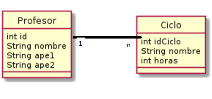

Fuente: https://aulavirtual3.educa.madrid.org/ies.alonsodeavellan.alcala/mod/book/view.php?id=221732

### 1. Sintáxis HQL

El Hibernate Query Languaje (HQL) es el lenguaje de consultas que usa Hibernate para obtener los objetos desde la base de datos. Su principal particularidad es que las consultas se realizan sobre los objetos java que forman nuestro modelo de negocio, es decir, las entidades que se persisten en Hibernate. Ésto hace que HQL tenga las siguientes características:

* Los tipos de datos son los de Java.
* Las consultas son independientes del lenguaje de SQL específico de la base de datos
* Las consultas son independientes del modelo de tablas de la base de datos.
* Es posible tratar con las colecciones de Java.
* Es posible navegar entre los distintos objetos en la propia consulta.

En Hibernate las consultas HQL se lanzan (o se ejecutan) sobre el modelo de entidades que hemos definido en Hibernate, esto es, sobre nuestras clases de negocio.

Las sentencias que se estudian en este capitulo son del lenguaje HQL de Hibernate, en gran parte son compatibles con JPQL (Java Pesistance Query Language), lenguaje de consulta de persistencia de Java.  

De forma poco ortodoxa se podría ver cómo que nuestro *modelo de tablas* en HQL son las clases Java y **NO** las tablas de la base de datos. Es decir que cuando hagamos ”`SELECT columna FROM nombreTabla`” , el ”`nombreTabla`” será una clase Java y ”`columna`” será una propiedad Java de dicha clase y **nunca** una tabla de la base de datos ni una columna de una tabla.

### Modelo

En los ejemplos que vamos a realizar van a usarse las siguientes clases Java y tablas, que sólo mostraremos en formato UML. No vamos a poner el código fuente ni los ficheros de hibernate de mapeo ya que aún no han sido explicadas todas la características que usan en lecciones anteriores.

#### Modelo de Java

El modelo de clases Java es el siguiente:



#### Modelo de Tablas

El modelo de tablas es el siguiente:

CiclosFormativos(nombreCiclo, idCiclo, horas, profesor)

Profesores(id, ape1, ape2)

fk: CiclosFormativos ---- profesor ----> Profesor

Podemos ver cómo hay un par de diferencias entre el modelo en Java y el modelo de tablas.

* Para la clase `Ciclo` su tabla se llama `CiclosFormativos`
* En la clase `Ciclo` su propiedad `nombre` se almacena en la columna llamada `nombreCiclo`

#### Sentencias consulta (SELECT)

La sintaxis HQL para las sentencias de consultas es la siguiente:

```
    [select_clause]
    from_clause
    [where_clause]
    [groupby_clause]
    [having_clause]
    [orderby_clause]
```

Vemos en la sintaxis que la única clausula obligatoria es *from\_clause.*

No obstante, Hibernate recomienda incluir  select\_clause , por portabilidad con JPQL (java persistence query languagge). 

Veamos ahora un sencillo ejemplo de consulta en HQL

```
SELECT c FROM Ciclo c ORDER BY nombre
```

¿Qué diferencias podemos ver entre HQL y SQL?

* `Ciclo` hace referencia a la clase Java`ejemplo02.Ciclo` y **NO** a la tabla `CicloFormativo`.Nótese que la clase Java y la tabla tienen distinto nombre .
* Es necesario definir el alias `c` de la clase Java `Ciclo`.
* Tras la palabra `SELECT` se usa el alias en vez del ”`*`”.
* Al ordenar los objetos se usa la propiedad `nombre` de la clase `Ciclo` en vez de la columna `nombreCiclo` de la tabla `CicloFormativo`.

Recuerda incluir el alias en la consulta HQL. Si no se hace y se deja la consulta de la siguiente forma:

```
SELECT Ciclo FROM Ciclo
```

se producirá la siguiente excepción:

```
java.lang.NullPointerException
```

Hibernate soporta **no** incluir la parte del `SELECT` en la consulta HQL, quedando entonces la consulta de la siguiente forma:

```
  FROM Ciclo
```

pero en la propia documentación se recomienda no hacerlo [1)](http://cursohibernate.es/doku.php?id=unidades:05_hibernate_query_language:02_hql#fn__1) ya que de esa forma se mejora la portabilidad en caso de usar el lenguaje de consultas de JPA [2)](http://cursohibernate.es/doku.php?id=unidades:05_hibernate_query_language:02_hql#fn__2).

Se ha hecho mención de esta característica ya que en muchos tutoriales que se encuentran por Internet se hace uso de ella.

### Mayusculas

Respecto a la sensibilidad de las mayúsculas y minúsculas , el lenguaje HQL sí que lo es, pero con matices.

* Las palabras clave del lenguaje **NO** son sensibles a las mayúsculas o minúsculas.

  + Las siguientes 2 consultas son equivalentes.

    ```
    select count(*) from Ciclo
    ```

    ```
    SELECT COUNT(*) FROM Ciclo
    ```
* El nombre de las clases Java y sus propiedades **SI** son sensibles a las mayúsculas o minúsculas.

  + La siguiente consulta HQL es correcta

    ```
    SELECT c.nombre FROM Ciclo c WHERE nombre='Desarrollo de aplicaciones Web'
    ```
  + La siguiente consulta HQL es **errónea** ya que la propiedad `nombre` está escrita con la “N” en mayúsculas.

    ```
    SELECT c.Nombre FROM Ciclo c WHERE Nombre='Desarrollo de aplicaciones Web'
    ```
  + La siguiente consulta HQL es **errónea** ya que el nombre de la clase Java `Ciclo` está escrita con la “c” en minúsculas.

    ```
    SELECT c.nombre FROM ciclo c WHERE nombre='Desarrollo de aplicaciones Web'
    ```
* Al realizar comparaciones con los valores de las propiedades, éstas **NO** son sensibles a las mayúsculas o minúsculas.

  + Las siguientes 2 consultas retornan los mismos objetos

    ```
    SELECT c.nombre FROM Ciclo c WHERE nombre='Desarrollo de aplicaciones Web'
    ```

    ```
    SELECT c.nombre FROM Ciclo c WHERE nombre='DESARROLLO DE APLICACIONES WEB'
    ```

### Filtrando

Al igual que en SQL en HQL también podemos filtrar los resultados mediante la cláusula `WHERE`. La forma de usarla es muy parecida a SQL.

```
SELECT p FROM Profesor p WHERE nombre='ISABEL' AND ape1<>'ORELLANA'
```

Al igual que con el nombre de la clase, el nombre de los campos del `WHERE` siempre hace referencia a las propiedades Java y nunca a los nombres de las columnas.De esa forma seguimos independizando nuestro código Java de la estructura de la base de datos.

#### Literales

##### Texto

El carácter para indicar un literal de texto es la comilla simple no pudiéndose usar la doble comilla.

```
SELECT p FROM Profesor p WHERE nombre='juan'
```

Si se quiere usar la comilla dentro de un literal deberemos duplicarla.

```
SELECT p FROM Profesor p WHERE ape1='perez l''andreu'
```

##### Integer

Para incluir un número del tipo `integer` simplemente se escribe dicho número.

```
SELECT tb FROM TiposBasicos tb WHERE inte=4
```

##### Long

Para incluir un número del tipo `long` se escribe dicho número y se añade una `L` mayúscula al final.

```
SELECT tb FROM TiposBasicos tb WHERE long1=4L
```

##### double

Para representar un `double` se escribe el número separarando la parte decimal con un punto o se puede usar la notación científica.

```
SELECT tb FROM TiposBasicos tb WHERE double1=1.45
```

```
SELECT tb FROM TiposBasicos tb WHERE double1=1.7976931348623157E308
```

##### float

Para representar un `float` se escribe el número separarando la parte decimal con un punto o se puede usar la notación científica pero se le añade el carácter `F` en mayúscula al final.

```
SELECT tb FROM TiposBasicos tb WHERE float1=1.45F
```

```
SELECT tb FROM TiposBasicos tb WHERE float1=3.4028235E38F
```

##### Fecha

Para indicar una fecha la incluiremos entre comillas simples con el formato `yyyy-mm-dd`

```
SELECT tb FROM TiposBasicos tb WHERE dateDate='2012-07-25'
```

##### Hora

Para indicar una hora la incluiremos entre comillas simples con el formato `hh:mm:ss`

```
SELECT tb FROM TiposBasicos tb WHERE dateTime='02:05:10'
```

##### Fecha y hora

Para indicar una fecha y hora la incluiremos entre comillas simples con el formato `yyyy-mm-dd hh:mm:ss.millis`,siendo optativos el último punto y los milisegundos .

```
SELECT tb FROM TiposBasicos tb WHERE dateTime='2012-07-25 02:05:10'
```

##### Operadores de comparación

Para comparar los datos en una expresión se pueden usar las siguientes Operadores:

* Signo igual ”`=`”: La expresión será verdadera si los dos datos son iguales. En caso de comparar texto, la comparación **no** es sensible a mayúsculas o minúsculas.
* Signo mayor que ”`>`”: La expresión será verdadera si el dato de la izquierda es mayor que el de la derecha.
* Signo mayor que ”`>=`”: La expresión será verdadera si el dato de la izquierda es mayor o igual que el de la derecha.
* Signo mayor que ”`<`”: La expresión será verdadera si el dato de la izquierda es menor que el de la derecha.
* Signo mayor que ”`<=`”: La expresión será verdadera si el dato de la izquierda es menor o igual que el de la derecha.
* Signo desigual ”`<>`”: La expresión será verdadera si el dato de la izquierda es distinto al de la derecha.
* Signo desigual ”`!=`”: La expresión será verdadera si el dato de la izquierda es distinto al de la derecha.
* Operador ”`between`”: La expresión será verdadera si el dato de la izquierda está dentro del rango de la derecha.

  ```
  SELECT tb FROM TiposBasicos tb WHERE inte BETWEEN 1 AND 10
  ```
* Operador ”`in`”: La expresión será verdadera si el dato de la izquierda está dentro de la lista de valores de la derecha.

  ```
  SELECT tb FROM TiposBasicos tb WHERE inte IN (1,3,5,7)
  ```
* Operador ”`like`”: La expresión será verdadera si el dato de la izquierda coincide con el patrón de la derecha.Se utilizan los mismos signos que en SQL ”`%`” y ”`_`”.

  ```
  SELECT tb FROM TiposBasicos tb WHERE stri LIKE 'H_la%'
  ```
* Operador ”`not`”: Niega el resultado de una expresión.
* expresión ”`is null`”: Comprueba si el dato de la izquierda es `null`.

  ```
  SELECT tb FROM TiposBasicos tb WHERE dataDate IS NULL
  ```

##### Operadores Lógicos

Se puede hacer uso de los típicos operadores lógicos como en SQL:

* AND
* OR
* NOT

  ```
  SELECT p FROM Profesor p WHERE nombre='ANTONIO' AND (ape1='LARA' OR ape2='RUBIO')
  ```

##### Operadores Aritméticos

Se puede hacer uso de los típicos operadores aritméticos:

* suma +
* resta -
* multiplicación \*
* division /

  ```
  SELECT tb FROM TiposBasicos tb WHERE (((inte+1)*4)-10)/2=1
  ```

##### Funciones de agregación

Las funciones de agregación que soporta HQL son:

* `AVG()`: Calcula el valor medio de todos los datos.
* `SUM()`: Calcula la suma de todos los datos.
* `MIN()`: Calcula el valor mínimo de todos los datos.
* `MAX()`: Calcula el valor máximo de todos los datos.
* `COUNT()`: Cuanta el nº de datos.

  ```
  SELECT AVG(c.horas),SUM(c.horas),MIN(c.horas),MAX(c.horas),COUNT(*) FROM Ciclo c
  ```

##### Funciones sobre escalares

Algunas de las funciones que soporta HQL sobre datos escalares son:

* `UPPER(s)`: Transforma un texto a mayúsculas.
* `LOWER(s)`: Transforma un texto a minúsculas.
* `CONCAT(s1, s2)`: Concatena dos textos
* `TRIM(s)`:Elimina los espacio iniciales y finales de un texto.
* `SUBSTRING(s, offset, length)`: Retorna un substring de un texto.El `offset` empieza a contar desde 1 y no desde 0.
* `LENGTH(s)`: Calcula la longitud de un texto.
* `ABS(n)`: Calcula el valor absoluto de un número.
* `SQRT(n)`: Calcula la raíz cuadrada del número
* Operador ”`||`” : Permite concatenar texto.

  ```
  SELECT p.nombre || ' ' || p.ape1 || ' ' || p.ape2 FROM Profesor p WHERE Id=1001
  ```

### Ordenación

Como en SQL también es posible ordenar los resultados usando `ORDER BY`. Su funcionamiento es como en SQL.

```
SELECT p FROM Profesor p ORDER BY nombre ASC,ape1 DESC
```

Las palabras `ASC` y `DESC` son opcionales al igual que en SQL.

El uso de funciones escalares y funciones de agrupamiento en la cláusula `ORDER BY` sólo es soportado por Hibernate si es soportado por el lenguaje de SQL de la base de datos sobre la que se está ejecutando.

No se permite el uso de expresiones aritméticas en la cláusula `ORDER BY`.

### Agrupaciones

Al igual que en SQL se pueden realizar agrupaciones mediante las palabras claves `GROUP BY` y `HAVING`

```
SELECT nombre,count(nombre) FROM Profesor p GROUP BY nombre HAVING count(nombre)>1 ORDER BY count(nombre)
```

Los nombres de profesores que se repiten mas de una vez

El uso de funciones escalares y funciones de agrupamiento en la cláusula `HAVING` sólo es soportado por Hibernate si es soportado por el lenguaje de SQL de la base de datos sobre la que se está ejecutando.

No se permite el uso de expresiones aritméticas en la cláusula `GROUP BY`.

## Subconsultas

HQL también soporta subconsultas como en SQL.

```
SELECT c.nombre,c.horas FROM Ciclo c WHERE c.horas >  (SELECT  AVG(c2.horas) FROM Ciclo c2)
```

Ciclos que duran más horas que la media de duración de todos los ciclos

### Combinaciones (JOIN)

En la clausula from podemos incluir múltiples clases, lo que causa un producto cartesiano o una unión "cruzada" (cross join).

```
from Profesor as profesor, Ciclo as ciclo
```

Para poder relacionar los profesores con los ciclos que imparten tenemos la opción de especificar la condición de combinación, de forma similar a como se hace en SQL

```
from Profesores as profesor, Ciclo as ciclo  
where profesor = ciclo.profesor
```

También podemos utilizar la clausula JOIN

```
from Profesor as profesor INNER JOIN profesor.ciclo as  ciclo
```

La palabra reservada INNER e opcional, también es posible incluir la clausula *on condición.*

Ejemplo:

```
from Profesor as profesor INNER JOIN Ciclo as ciclo on
```

Los tipos de uniones soportadas se tomaron prestados de ANSI SQL

* inner join
* left outer join
* right outer join
* full join.

### Parametros nombrados

En ejemplos anteriores  incluíamos directamente el valor de los parámetros del `WHERE`. Ëso nos llevaría desde Java a tener un código similar al siguiente:

```
 1: String nombre="ISIDRO";
 2: String ape1="CORTINA";
 3: String ape2="GARCIA";
 4:
 5: Query query = session.createQuery("SELECT p FROM Profesor p where nombre='" + nombre +
 "' AND  ape1='" + ape1 + "' AND  ape2='" + ape2 + "' ");
 6: List<Profesor> profesores = query.list();
 7: for (Profesor profesor : profesores) {
 8:     System.out.println(profesor.toString());
 9: }
```

### 

Hibernate
soporta parámetros nombrados en sus consultas HQL. Esto facilita la
escritura de consultas HQL que aceptan la entrada del usuario. A
continuación se muestra la sintaxis simple de usar parámetros
nombrados:

### 

```
```
 1: String nombre="ISIDRO";
 2: String ape1="CORTINA";
 3: String ape2="GARCIA";
 4:
 5: Query query = session.createQuery("SELECT p FROM Profesor p where nombre=:nombre +
 "' AND  ape1=:ape1 + "' AND  ape2=:ape2 ");
 6: List<Profesor> profesores = query.setParameter(1,nombre).setParameter(2,ape1).setParameter(3,ape2).list();
 7: for (Profesor profesor : profesores) {
 8:     System.out.println(profesor.toString());
 9: }
```
```

La asignacion de valores a los parametros se realiza con el metodo setParameter., los metodos setString, setByte, etc. estan obsoletos. También
podemos utilizar parámetros con ?.

  

### Sentencias de actualizacion (UPDATE)

La sintaxis de la sentencia de actualización es la siguiente

```
update_statement ::=


```
    update_clause [where_clause]

update_clause ::=
    UPDATE entity_name [[AS] identification_variable]
    SET update_item {, update_item}*

update_item ::=
    [identification_variable.]{state_field | single_valued_object_field} = new_value

new_value ::=
    scalar_expression | simple_entity_expression | NULL
```
```

Una sentencia UPDATE se ejecuta utilizando el metodo executeUpdate () de org.hibernate.query.Query o javax.persistence.Query. Similar al metodo executeUpdate () al de JDBC .  
El valor int devuelto por el método executeUpdate () indica el número de entidades efectuadas por la operación. Esto puede o no correlacionarse con el número de filas actualizadas en la base de datos. Una operación masiva HQL puede dar como resultado que se ejecuten varias sentencias de SQL reales (por ejemplo, para la subclase unida). El número devuelto indica el número de entidades reales afectadas por la declaración. 

Ejemplo:

```
    update Profesor set nombre= :newName  
    where nombre = :oldName
```

El codigo dentro de un programa java seria:

```
int updatedEntities = session.createQuery(
    "update Profesor" +
    "set nombre= :newName " +
    "where nombre= :oldName" )
.setParameter( "oldName", "Pepe")
.setParameter( "newName", "Jose")
.executeUpdate();
```

  

### Sentencias de borrado (DELETE)

```
La sintaxis para el borrado es la siguiente:
```

```
```
delete_statement ::=
    delete_clause [where_clause]

delete_clause ::=
    DELETE FROM entity_name [[AS] identification_variable]
```


Ejemplo:
```

```
DELETE FROM Profesor e WHERE e.nombre= ?
```

Dentro de un programa JAVA la operacion de borrado se ejecuta con el metodo executeUpdate() de org.hibernate.Query o javax.persistence.Query

Ejemplo:

```
```
int deletedEntities = session.createQuery(
    "delete Profesor p " +
    "where p.nombre= :name" )
.setParameter( "name", name )
.executeUpdate();
```
```

###

### Sentencias de inserción (INSERT)

La sentencia de insercion de HQL tiene la sintaxis:

```
insert_statement ::=
    insert_clause select_statement

insert_clause ::=
    INSERT INTO entity_name (attribute_list)

attribute_list ::=
    state_field[, state_field ]*
```

  
La lista de atributos es análoga a la especificación de columna en la instrucción INSERT de SQL.   

*select\_statement* puede ser cualquier consulta de selección HQL válida, los tipos de retorno de esta consulta  deben coincidir con los tipos de la entidad en la que se realiza la insercion.

Ejemplo:

```
int insertedEntities = session.createQuery(
    "insert into profesor (id, nombre,ape1,ape2) " +
    "select persona.id, persona.nombre, persona.ape1, persona.ape2 " +
    "from Person p ")
.executeUpdate();
```