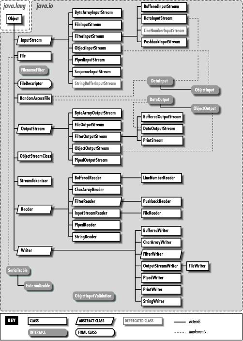
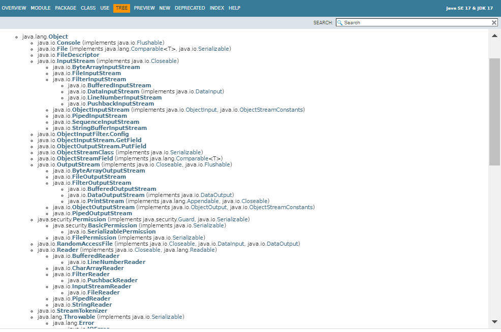
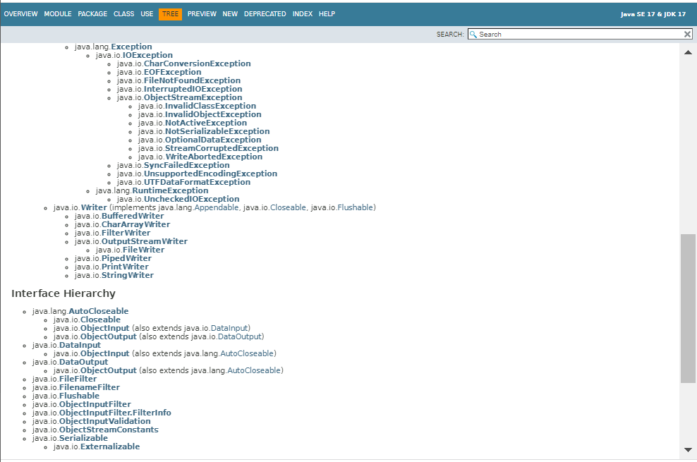
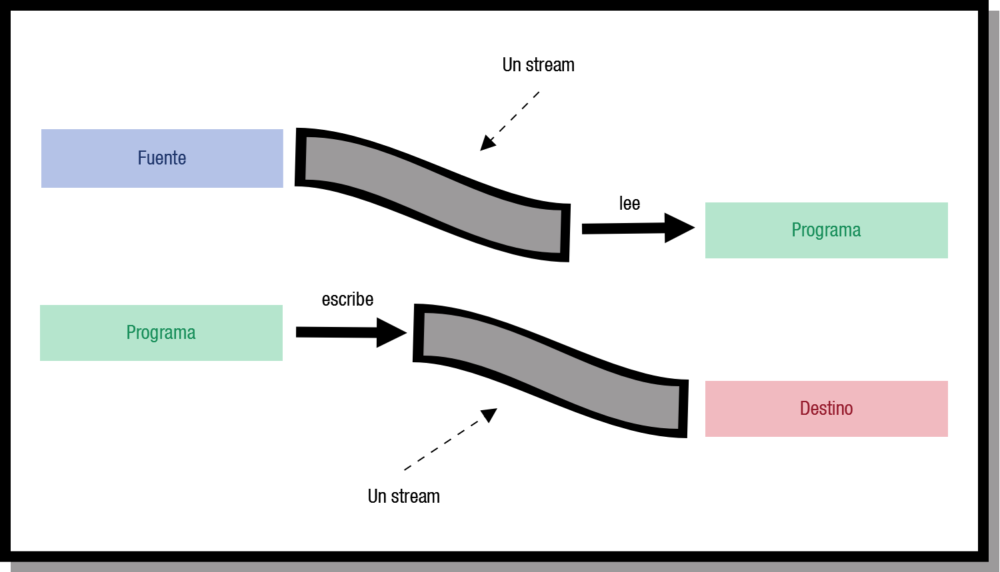
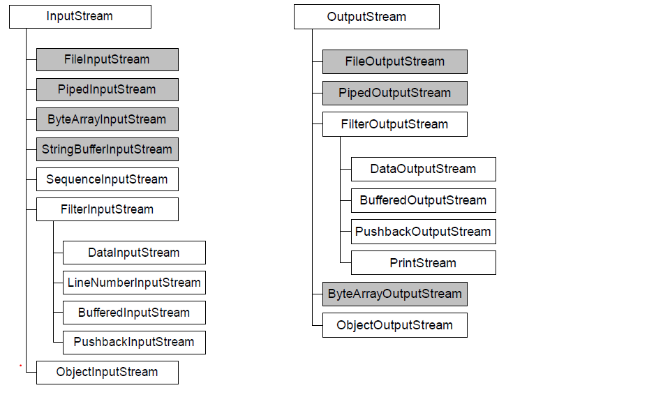
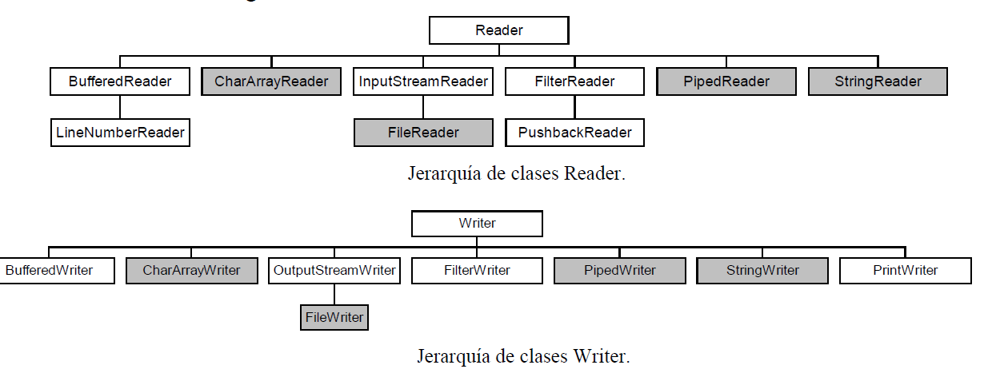

# UT02-A — Manejo de ficheros — Resumen completo para NotebookLM

## A00. Alcance, procedencia y modo de lectura

**Asignatura:** Acceso a Datos, segundo de DAM. **Examen:** primero; UT02-A sin el capítulo 3 de NIO y UT02-B completo. **Exclusión confirmada por el estudiante: NIO no entra.** Según su información, una parte importante será tipo test, con hasta seis opciones y una respuesta correcta. No se conocen preguntas oficiales, ponderación ni fecha.

**Fuente docente principal:** `../temario/UT02-A-manejo-de-ficheros.md`. Este documento desarrolla sus capítulos 1 y 2 y añade aclaraciones y práctica. Al final se conserva ese texto como **anexo documental**, excluyendo el capítulo 3 de NIO. No es una segunda versión que deba explicarse otra vez en el podcast. Las referencias introductorias a NIO también se omiten del anexo para evitar que NotebookLM las convierta en materia de examen. Las figuras originales siguen enlazadas al temario; el desarrollo principal no exige verlas para entender los mecanismos. No se ha vuelto a procesar el PDF equivalente.

**Convenciones:** «Temario» identifica lo enseñado; «Aclaración técnica» precisa simplificaciones o errores; «Práctica añadida» no es una pregunta oficial. Java de referencia: **JDK 17**, sin modernizar las API del curso. Las explicaciones añadidas no amplían por sí solas el alcance oficial.

**Prioridad para NotebookLM:** estudiar A01–A10 y A14–A15; usar A16 como comprobación y el anexo solo para consultar formulaciones y ejemplos originales. Los identificadores A11–A13 quedan deliberadamente sin usar tras excluir NIO. Cuando haya una discrepancia, explicar la formulación docente y el matiz documentado de A15; no repetir como verdadera una afirmación incorrecta del anexo.

### Recorrido de aprendizaje

1. A01–A03: persistencia, familias de flujos y formas de acceso.
2. A04–A05: rutas con `File`, operaciones y filtrado.
3. A06–A07: bytes, primitivas y serialización.
4. A08–A09: caracteres, codificación y operaciones secuenciales.
5. A10: acceso aleatorio y cálculo de posiciones.
6. A14–A16: trazas, trampas, comprobaciones y preguntas.

## A01. Persistencia y entrada/salida

**Objetivo:** distinguir el dato, su representación en memoria, su representación persistente y el mecanismo de transferencia.

- **Dato persistente:** permanece más allá de la ejecución del programa que lo utiliza. El temario lo sitúa en ficheros de almacenamiento secundario: discos duros, ópticos y otros soportes. Que una variable exista en RAM no la hace persistente.
- **Entrada/salida, E/S o I/O:** transferencia de información entre el programa y el exterior. «Entrada» y «salida» se definen desde el punto de vista del programa, no del disco: leer del disco es entrada; escribir en disco es salida.
- **Flujo, stream:** abstracción de una fuente o destino de información y conexión por la que se transfieren datos en secuencia. Puede conectar archivos, memoria, teclado, consola o red; no significa necesariamente fichero.
- El sistema de E/S de Java vincula la abstracción al dispositivo. El programador usa operaciones comunes sin implementar el manejo físico de cada dispositivo.
- `java.io` aporta flujos, clases de ficheros y serialización. El examen aquí preparado se limita a las API de ficheros incluidas en sus capítulos 1 y 2.

**Trampa:** persistir no implica necesariamente serializar un objeto Java. Guardar texto, primitivas binarias o XML son otras formas de persistencia. Tampoco implica guardar automáticamente cualquier variable al terminar el programa.

## A02. Familias de clases y composición de flujos

### A02.1. Jerarquía funcional

| Datos y dirección | Abstracción principal | Clases del temario | Unidad lógica |
|---|---|---|---|
| Entrada binaria | `InputStream` | `FileInputStream`, `ObjectInputStream`, `DataInputStream` | Bytes |
| Salida binaria | `OutputStream` | `FileOutputStream`, `ObjectOutputStream`, `DataOutputStream` | Bytes |
| Entrada textual | `Reader` | `InputStreamReader`, `FileReader`, `BufferedReader`, `StringReader`, `CharArrayReader`, `PipedReader`, `FilterReader` | Unidades de código UTF-16 |
| Salida textual | `Writer` | `OutputStreamWriter`, `FileWriter`, `BufferedWriter`, `PrintWriter`, `StringWriter` | Unidades de código UTF-16 |

Las cuatro abstracciones principales son **clases abstractas**: no se construyen con `new InputStream()` o `new Reader()`. Una variable declarada con uno de esos tipos sí puede referirse a una subclase concreta.

El temario menciona `URLReader` entre las subclases de `Reader`: **no es una clase estándar de `java.io` en JDK 17**; no memorizarla como tal.

### A02.2. Origen/destino frente a funcionalidad añadida

```text
archivo con bytes → FileInputStream → InputStreamReader(UTF-8) → BufferedReader → programa
programa → BufferedWriter → OutputStreamWriter(UTF-8) → FileOutputStream → archivo con bytes
```

- `FileInputStream` y `FileOutputStream` conectan con un archivo y transfieren bytes.
- `InputStreamReader` **decodifica bytes a caracteres**; `OutputStreamWriter` **codifica caracteres a bytes**. Son puentes en direcciones distintas.
- `FileReader` hereda de `InputStreamReader`; `FileWriter`, de `OutputStreamWriter`.
- `BufferedReader` envuelve un `Reader`; `BufferedWriter`, un `Writer`. El búfer añade almacenamiento temporal y operaciones útiles, no cambia por sí mismo la codificación.
- `ObjectOutputStream` envuelve un `OutputStream`, no exclusivamente un `FileOutputStream`. En el curso se utiliza este último como destino físico.

**Aclaración técnica:** un byte tiene 8 bits; un `char` Java, 16 bits. No deducir que cada carácter visible ocupa 2 bytes en un fichero. UTF-8 tiene longitud variable; algunos caracteres Unicode requieren dos unidades `char` en UTF-16.

**Comprobación:** para leer líneas de un fichero UTF-8, ¿basta un `FileInputStream`? No: transporta bytes. Hace falta decodificación y una API de líneas, como `BufferedReader` sobre `InputStreamReader`.

### A02.3. Lectura textual de las jerarquías que aparecen como imágenes

Las figuras del temario muestran más clases que las desarrolladas después. Este mapa permite entenderlas sin depender de que NotebookLM lea las imágenes:

```text
InputStream
├── FileInputStream                      [origen: archivo]
├── ByteArrayInputStream                 [origen: array en memoria]
├── PipedInputStream                     [entrada de una tubería]
├── SequenceInputStream                  [concatenación de entradas]
├── ObjectInputStream                    [lectura de objetos]
└── FilterInputStream
    ├── DataInputStream                  [primitivas]
    ├── BufferedInputStream              [búfer de bytes]
    └── PushbackInputStream              [posibilidad de devolver bytes al flujo lógico]

OutputStream
├── FileOutputStream                     [destino: archivo]
├── ByteArrayOutputStream                [destino: memoria]
├── PipedOutputStream                    [salida de una tubería]
├── ObjectOutputStream                   [escritura de objetos]
└── FilterOutputStream
    ├── DataOutputStream                 [primitivas]
    ├── BufferedOutputStream             [búfer de bytes]
    └── PrintStream                      [impresión de valores]

Reader
├── BufferedReader → LineNumberReader
├── CharArrayReader
├── InputStreamReader → FileReader
├── FilterReader → PushbackReader
├── PipedReader
└── StringReader

Writer
├── BufferedWriter
├── CharArrayWriter
├── OutputStreamWriter → FileWriter
├── FilterWriter
├── PipedWriter
├── StringWriter
└── PrintWriter
```

Las flechas de las dos últimas familias significan «tiene como subclase», no dirección de datos. `PrintStream` pertenece a la familia de bytes y `PrintWriter`, a la de caracteres; que ambos impriman texto no cambia su jerarquía.

**Aclaración sobre figuras antiguas:** `StringBufferInputStream` y `LineNumberInputStream` aparecen en los diagramas y son API obsoletas; se conservan como referencia histórica, no se recomiendan para ejemplos nuevos. La figura de salida incluye el nombre `PushbackOutputStream`, pero **no existe como clase estándar de `java.io` en JDK 17**; el mecanismo estándar representado en la entrada es `PushbackInputStream`. No memorizar ese rótulo de salida como una clase válida del JDK.

La figura general también sitúa `File`, `FileDescriptor`, `RandomAccessFile`, `ObjectStreamClass` y `StreamTokenizer` fuera de las cuatro familias principales, y las interfaces `DataInput`, `DataOutput`, `ObjectInput`, `ObjectOutput`, `Serializable`, `Externalizable` y `ObjectInputValidation`. Su presencia en una captura no significa que todos sean flujos ni que el temario desarrolle todos sus contratos. En particular, `ObjectInput` extiende `DataInput`, `ObjectOutput` extiende `DataOutput` y `Externalizable` extiende `Serializable`; no confundir una interfaz con una clase concreta. No es necesario inventar usos y métodos no explicados en el curso para interpretar la figura.

## A03. Texto/binario y acceso secuencial/aleatorio

Son **dos ejes independientes**, no cuatro categorías excluyentes.

| Eje | Alternativa | Consecuencia |
|---|---|---|
| Representación | Texto | Los bytes se interpretan mediante una codificación; los números suelen representarse con dígitos |
| Representación | Binario | Se acuerda un formato de bytes: primitivas, objetos serializados, imágenes, etc. |
| Acceso | Secuencial | Se procesa en orden; para localizar un dato suele recorrerse lo anterior |
| Acceso | Aleatorio/directo | Se cambia una posición en bytes y se accede desde allí |

El texto también está físicamente formado por bytes. La extensión `.txt`, `.dat`, `.obj` o `.xml` no transforma el formato: lo determina cómo se escribió.

El temario cita concatenación/tuberías o *pipes* como una tercera forma según algunas clasificaciones. Una tubería conecta un productor y un consumidor; no equivale al acceso directo ni debe confundirse con `append=true`, que añade al final de un archivo.

El acceso secuencial sirve para fuentes cuyo final no se conoce de antemano, como teclado o flujos de red. El acceso aleatorio requiere un soporte que permita reposicionarse; no puede aplicarse sin más a una entrada que todavía no ha llegado.

**Aclaración técnica:** los registros de tamaño fijo facilitan calcular desplazamientos, pero `RandomAccessFile` no obliga a que todos los registros tengan ese tamaño. Con registros variables hacen falta posiciones conocidas, un índice u otro mecanismo.

## A04. `File`: representar rutas no es abrir el contenido

### A04.1. Constructores y rutas

`java.io.File` representa de forma abstracta el nombre/ruta de un fichero o directorio. No es un flujo, no tiene un cursor de lectura del contenido y no contiene una copia del archivo.

| Constructor docente | Parámetros | Ejemplo |
|---|---|---|
| `File(String pathname)` | Ruta completa o relativa | `new File("datos/personas.dat")` |
| `File(String parent, String child)` | Ruta del padre y nombre/ruta hija | `new File("datos", "personas.dat")` |
| `File(File parent, String child)` | Padre representado por un `File` y ruta hija | `new File(new File("datos"), "personas.dat")` |

Crear la representación no exige que el destino exista ni crea sus padres. La ausencia del archivo no causa por sí sola una excepción del constructor. Esto no significa que cualquier argumento inválido sea aceptado ni que posteriores operaciones no puedan fallar.

- Ruta **relativa**: se interpreta respecto al directorio de trabajo, no necesariamente respecto a la carpeta del `.java`.
- Ruta **absoluta**: parte de la raíz correspondiente al sistema de ficheros.
- En un literal Java de Windows, `"C:\\datos\\a.txt"` requiere escapar las barras; la ruta real contiene barras simples. `"C:/datos/a.txt"` también se utiliza en Windows.
- La interpretación de una ruta depende del sistema operativo. Un texto con aspecto de ruta Windows no tiene automáticamente la misma semántica en Linux.

### A04.2. Catálogo de métodos y valores que pueden engañar

| Operación | Retorno / parámetros | Significado y condición relevante |
|---|---|---|
| `exists()` | `boolean` | Existe el archivo o directorio en ese momento |
| `isFile()` / `isDirectory()` | `boolean` | Existe y es del tipo correspondiente; `false` no significa necesariamente «es del otro tipo» |
| `canRead()` / `canWrite()` | `boolean` | Accesibilidad estimada en ese instante; no garantiza una operación posterior |
| `isAbsolute()` | `boolean` | Propiedad de la ruta, no prueba de existencia |
| `getName()` | `String` | Último nombre de la ruta; no devuelve todo el recorrido |
| `getPath()` | `String` | Representación de la ruta, que puede ser relativa |
| `getAbsolutePath()` | `String` | Ruta absoluta; no equivale necesariamente a canónica |
| `getCanonicalPath()` | `String`; `IOException` | Forma absoluta canónica, eliminando redundancias y resolviendo particularidades del sistema; no exige en general que el destino final exista |
| `getParent()` | `String` o `null` | Padre según la ruta abstracta |
| `getParentFile()` | `File` o `null` | Mismo concepto, con retorno `File` |
| `length()` | `long` | Tamaño en **bytes**; 0 puede ser archivo vacío o inexistente; tamaño de directorios no especificado por este contrato |
| `lastModified()` | `long` | Milisegundos desde el 1 de enero de 1970 UTC; 0 si no existe o hay error de E/S |
| `setLastModified(long time)` | `boolean` | Cambia la fecha; el parámetro se expresa en milisegundos desde esa época |
| `createNewFile()` | `boolean`; `IOException` | Crea un archivo vacío si no existe: `true` creado, `false` ya existía; no crea padres |
| `delete()` | `boolean` | Borra archivo o directorio vacío; informa del éxito, no del motivo detallado del fallo |
| `deleteOnExit()` | `void` | Solicita borrado al terminar normalmente la JVM; no borra inmediatamente ni garantiza limpieza tras un cierre abrupto |
| `mkdir()` | `boolean` | Crea el directorio solicitado, no todos sus padres |
| `mkdirs()` | `boolean` | Intenta crear el directorio y padres inexistentes; puede haber creación parcial si falla |
| `renameTo(File dest)` | `boolean` | Renombra/mueve según capacidades del sistema; comprobar el retorno |
| `list()` | `String[]` o `null` | Nombres inmediatos del directorio, no rutas completas |
| `listFiles()` | `File[]` o `null` | Representaciones de sus entradas inmediatas |
| `File.listRoots()` | `File[]` | Método estático: raíces disponibles del sistema |
| `File.createTempFile(String prefix, String suffix)` | `File`; `IOException` | Método estático: **crea físicamente** un archivo temporal de nombre no repetido en esa creación; no lo borra automáticamente |

**Matices añadidos:** un prefijo de `createTempFile` debe tener al menos tres caracteres; un sufijo `null` usa `.tmp`. `setLastModified(new Date().getTime())` es la operación ilustrada en el curso.

Tras un `renameTo` correcto, el objeto `File` original **no cambia su ruta**. Si `a` representaba `viejo.txt` y el archivo se renombra a `nuevo.txt`, `a.getName()` sigue devolviendo `viejo.txt`.

No interpretar todo `false` como una excepción: si `createNewFile()` devuelve `false`, el caso normal es «ya existía», no «se ha producido cualquier error posible». Los fallos de E/S pueden producir `IOException`.

### A04.3. Secuencia correcta de creación

**Práctica añadida, fragmento:** requiere imports de `java.io` y manejo de `IOException`.

```java
File carpeta = new File("datos");
if (!carpeta.exists() && !carpeta.mkdirs()) {
    throw new IOException("No se pudo crear la carpeta");
}
File archivo = new File(carpeta, "alumnos.txt");
boolean creado = archivo.createNewFile();
```

Resultado: si todo es correcto, hay una carpeta y un archivo; `creado` distingue creación nueva de existencia anterior. La comprobación previa no elimina posibles cambios concurrentes. Si `datos` existe pero es un archivo, las operaciones posteriores pueden fallar: `exists()` no sustituye a `isDirectory()`.

## A05. `FilenameFilter`, polimorfismo y listados

Contrato: `boolean accept(File dir, String name)`.

- `dir`: directorio que se está listando.
- `name`: nombre de una entrada candidata, no su ruta completa.
- `true`: incluir esa entrada; `false`: descartarla.
- `list(filtro)` devuelve `String[]`; `listFiles(filtro)` devuelve `File[]`.
- `null` como filtro significa aceptar todos los nombres.
- Si se necesita tamaño, fecha o tipo, puede construirse `new File(dir, name)` dentro del filtro.
- Que se llame `FilenameFilter` no significa que su criterio solo pueda examinar cadenas; recibe también el directorio.

**Práctica añadida, fragmento dentro de un método:**

```java
File dir = new File("datos");
String[] nombres = dir.list((padre, nombre) ->
    nombre.endsWith(".txt") && new File(padre, nombre).isFile());
if (nombres == null) {
    System.out.println("No es un directorio o ha fallado la E/S");
} else if (nombres.length == 0) {
    System.out.println("Sin coincidencias");
} else {
    for (String nombre : nombres) System.out.println(nombre);
}
```

La clase docente `Filtrar implements FilenameFilter` es válida donde se exige esa interfaz por **polimorfismo**. No se instancia una interfaz; se pasa una instancia de una clase que la implementa. La lambda anterior es una alternativa añadida para la misma interfaz funcional.

**Casos límite:** `endsWith(".txt")` diferencia mayúsculas/minúsculas; también puede aceptar un directorio llamado `cosas.txt` si no se comprueba `isFile()`. El orden del listado no está garantizado. `null` no es un array vacío: acceder a `.length` sobre `null` produce `NullPointerException`. El `catch (Exception)` del original puede capturarlo, pero no sustituye a distinguir explícitamente el caso.

## A06. Bytes: `FileInputStream`, `FileOutputStream` y primitivas

### A06.1. Apertura y escritura

Constructores de salida del temario: `FileOutputStream(File)`, `FileOutputStream(File, boolean append)`, `FileOutputStream(String)`, `FileOutputStream(String, boolean append)`.

- Sin `append`, o con `false`: al abrir correctamente un archivo existente para escritura se trunca; no se espera a `write()` para perder su contenido anterior.
- Con `append=true`: escribe al final; crea el archivo si no existe y las condiciones lo permiten. No crea directorios padre.
- Abrir para lectura no crea el archivo: `FileInputStream(File)` y `FileInputStream(String)` necesitan un destino existente y accesible. Los constructores pueden lanzar `FileNotFoundException`, subclase de `IOException`.

| Método | Parámetros y retorno | Clave de examen |
|---|---|---|
| `int read()` | Sin argumentos | Byte entre 0 y 255 o `-1` al final; retorno `int`, no `byte` |
| `int read(byte[] b)` | Array destino | Cantidad efectivamente leída; como máximo `b.length`; `-1` al final |
| `int read(byte[] b, int off, int len)` | Destino, índice inicial y cantidad máxima | Modifica el tramo del array; el retorno no es el byte ni la posición del archivo |
| `int available()` | Sin argumentos | Estimación de bytes legibles sin bloqueo; no es un detector general de EOF ni tamaño total |
| `void write(int b)` | Un entero | Escribe los ocho bits bajos: **un byte**, no un entero binario de cuatro bytes |
| `void write(byte[] b)` | Array origen | Escribe todo el array |
| `void write(byte[] b, int off, int len)` | Origen, índice inicial y cantidad | Escribe exactamente ese tramo si tiene éxito; no añade saltos de línea |
| `close()` | `void` | Libera recursos; hay que cerrar también ante excepciones |

Para las operaciones por tramo, `off` y `len` son índices/cantidades **del array**, no posiciones del fichero. Rango: `off >= 0`, `len >= 0`, `off + len <= b.length`. El extremo final es exclusivo. Con longitud solicitada cero, una lectura puede devolver 0; no confundirlo con EOF.

### A06.2. Copia por bloques y traza

**Práctica añadida, fragmento:** requiere imports de `java.io` y manejo/propagación de `IOException`.

```java
try (InputStream in = new FileInputStream("origen.bin");
     OutputStream out = new FileOutputStream("destino.bin")) {
    byte[] buffer = new byte[4];
    int leidos;
    while ((leidos = in.read(buffer)) != -1) {
        out.write(buffer, 0, leidos);
    }
}
```

Con entrada ASCII `ABCDEF`, **una secuencia posible** es:

| Lectura | Retorno | Búfer después | Tramo escrito |
|---|---:|---|---|
| 1 | 4 | `A B C D` | `A B C D` |
| 2 | 2 | `E F C D` | `E F`, no los restos `C D` |
| 3 | -1 | No hay nuevos datos válidos | Nada |

No está garantizado llenar el búfer en cada lectura. El ejemplo docente utiliza `> 0`; para esta copia de archivo con búfer no vacío funciona, pero la señal contractual de EOF es `-1`.

La copia binaria conserva bytes sin interpretarlos y sirve también para imágenes. Una copia por líneas puede cambiar terminadores y codificación: no es equivalente byte a byte.

### A06.3. `DataOutputStream` y `DataInputStream`

`DataOutputStream` escribe primitivas con métodos como `writeByte`, `writeInt`, `writeFloat`, `writeDouble` y cadenas mediante operaciones específicas como `writeUTF`. `DataInputStream` debe leer con el método y el orden compatibles.

**Aclaración añadida:** `writeInt(65)` ocupa cuatro bytes; `write(65)` ocupa uno; escribir `"65"` como texto UTF-8 ocupa dos bytes. `writeUTF` usa UTF-8 modificado con longitud, no un simple texto UTF-8 sin cabecera. No se intercambian estos formatos arbitrariamente.

**Regla:** acordar formato antes de leer. El flujo no deduce por sí solo que los cuatro bytes siguientes son un `int`.

## A07. Serialización binaria de objetos

### A07.1. Qué se guarda y qué no

Serializar consiste en convertir el estado de objetos a una representación transmisible/almacenable; deserializar, en reconstruir objetos a partir de ella. El término puede usarse de forma general para XML/JSON, pero en este bloque se estudia **la serialización binaria nativa de Java**.

- `Serializable` es una **interfaz marcadora sin métodos**. `implements Serializable` permite participar en el protocolo; no añade un método `serialize()` que haya que implementar.
- `ObjectOutputStream.writeObject(Object obj)` escribe el objeto; `ObjectInputStream.readObject()` devuelve `Object`. Para asignarlo a `Persona`, el ejemplo usa `(Persona)`.
- Se necesita que las clases compatibles estén disponibles al reconstruir el objeto; el archivo no contiene el código ejecutable de los métodos.
- Se recorre el grafo de objetos referenciados por los campos serializados. Sus objetos deben ser serializables o aparecerá `NotSerializableException` en el mecanismo ordinario.
- `String` es serializable. El ejemplo de un `Vector` con cadenas ilustra que se conserva la estructura con sus miembros, no solo la referencia de memoria del contenedor.
- Deserializar reconstruye estado; **no recupera la misma identidad de objeto en la JVM original** ni hace persistente cualquier recurso externo asociado.

**Aclaraciones añadidas para el test:**

| Elemento | Tratamiento habitual en serialización por defecto |
|---|---|
| Campo de instancia normal, incluido `private` | Se serializa |
| Campo `transient` | Se omite; al recuperar tiene el valor predeterminado del tipo si no hay lógica personalizada |
| Campo `static` | No forma parte del estado de instancia serializado |
| Métodos / `toString()` | No se guardan como datos del objeto |
| `serialVersionUID` | Identificador de compatibilidad de clase, no identificador único de cada objeto |

`transient int` vuelve normalmente a 0; `transient String`, a `null`; `transient boolean`, a `false`. No afirmar que recuperan automáticamente el inicializador escrito en la declaración del campo.

### A07.2. Flujo de trabajo, contratos y fallos

```text
Persona → writeObject → ObjectOutputStream → FileOutputStream → persona.dat
persona.dat → FileInputStream → ObjectInputStream → readObject → Object → cast a Persona
```

Excepciones relevantes: `IOException` en E/S, `ClassNotFoundException` durante lectura si falta una clase, `InvalidClassException` por incompatibilidad de serialización y `ClassCastException` si el objeto leído no es del tipo al que se convierte. Las dos primeras se capturan o propagan en el curso.

**Práctica añadida, fragmento:** presupone `Persona implements Serializable`, una variable `persona` y los imports de `java.io`.

```java
try (ObjectOutputStream out = new ObjectOutputStream(
        new FileOutputStream("persona.dat"))) {
    out.writeObject(persona);
}
try (ObjectInputStream in = new ObjectInputStream(
        new FileInputStream("persona.dat"))) {
    Persona recuperada = (Persona) in.readObject();
    System.out.println(recuperada);
}
```

El ejemplo docente `Alumno` guarda `dni`, `nmatricula`, `nombre`, `ape1` y `ape2`; el de `Persona` guarda `nombre="Juan"` y `edad=30`. `toString()` proporciona la representación al imprimir **una instancia**, no «la clase» como objeto abstracto.

**Advertencia sobre el ejemplo `Alumno`:** su constructor declara primero `dni`, después `nmatricula`, `nombre`, `ape1`, `ape2`, pero la llamada con `"gallego", "gomez", "1", "100", "natalia"` asigna esos literales en ese orden. No reinterpretarlos según lo que parezcan nombres o apellidos. Si se copia el paquete `ObjetoAByte`, también debe respetarse o importarse al compilar.

### A07.3. Anexado, cierre y límites

`append=true` del `FileOutputStream` solo controla bytes. **No basta con crear sucesivos `ObjectOutputStream` anexados al mismo archivo:** cada nuevo flujo escribe una cabecera y la lectura secuencial ordinaria puede fallar por esa cabecera intermedia. La estrategia del curso más segura para varios objetos es escribirlos con el mismo flujo abierto, o guardar una colección completa. No presentar el comentario del original sobre anexar como una solución completa a la serialización incremental.

`try-with-resources` cierra en orden inverso a la declaración incluso cuando se produce una excepción. Cerrar el envoltorio cierra normalmente el flujo subyacente. Abrir recursos y llamar a `close()` solo al final de un `try` no asegura que se cierren si una instrucción anterior falla.

**Ampliación de seguridad, no materia adicional presupuesta:** no deserializar datos no confiables como si fueran seguros por implementar `Serializable`.

## A08. Caracteres, codificación, lectores y escritores

### A08.1. `Reader` y sus lectores

| API | Construcción / métodos del temario | Interpretación exacta |
|---|---|---|
| `Reader` | `read()`, `read(char[], off, len)`, `close()` | Lectura de caracteres; `read()` devuelve `int` o `-1`; el retorno por bloques es una cantidad |
| `InputStreamReader` | `(InputStream)`, `(InputStream, Charset)`, `(InputStream, String)` | Decodifica bytes; sin charset explícito usa el predeterminado |
| `InputStreamReader.getEncoding()` | `String` | Nombre de la codificación usada; devuelve `null` si el lector está cerrado, no por haber elegido la predeterminada |
| `FileReader` | `(File)`, `(String)`, `(File, Charset)`, `(String, Charset)` | Lee texto de archivo; variantes con charset disponibles en JDK 17 |
| `BufferedReader` | `(Reader)`, `(Reader, int sz)` | Búfer de caracteres; `sz` es tamaño del búfer, no número de líneas |
| `BufferedReader.readLine()` | `String` o `null` | Línea sin terminador; `null` si no quedan caracteres para una nueva línea |

**Trampa crítica:** comparar un `char` con `-1` después de convertir el resultado pierde la señal de EOF. Guardar primero `int c = reader.read()` y solo convertir a `(char)` cuando `c != -1`.

`readLine()` reconoce `\n`, `\r` y `\r\n`; una línea vacía produce `""`, no `null`. La última línea puede devolverse aunque no termine con un salto. Un archivo vacío produce `null` en la primera lectura. Un salto final no implica necesariamente una línea vacía adicional después de él.

**Traza:** para los caracteres `A\n\nB`, las llamadas devuelven `"A"`, `""`, `"B"`, `null`. El bucle correcto es `while ((linea = reader.readLine()) != null)`.

### A08.2. `Writer` y sus escritores

| API | Parámetros / métodos | Claves |
|---|---|---|
| `Writer` | `write(int)`, `write(char[])`, `write(char[], off, len)`, `write(String)`, `flush()`, `close()` | No añade automáticamente separadores de línea |
| `FileWriter` | `File` o `String`; sobrecargas con `append`; sobrecargas con `Charset` y con `Charset, append` | Escribe texto; sin anexado trunca al abrir; sin charset explícito usa el predeterminado |
| `BufferedWriter` | `(Writer)`, `(Writer, int sz)` | Amortigua escrituras; tamaño expresado en caracteres |
| `BufferedWriter.newLine()` | Sin argumentos | Escribe el separador de línea de la plataforma |
| `PrintWriter` | Citado como subclase de `Writer` | Facilita salida textual y líneas; no es un escritor de objetos serializados |
| `StringWriter` | Citado como subclase de `Writer` | Destino textual en memoria, no archivo de disco |

El constructor `FileWriter(String, boolean)` se utiliza en los ejemplos aunque no figure en una de las enumeraciones de constructores. `append=true` no escribe un salto previo ni uno posterior por sí mismo.

`flush()` vacía búferes hacia el destino subyacente pero **no cierra**. `close()` cierra y realiza el vaciado pertinente. Ninguno equivale por sí solo a prometer persistencia física frente a cualquier corte de energía; existen capas del sistema operativo.

### A08.3. Elegir codificación y copiar texto

**Práctica añadida, fragmento con imports de `java.io` y manejo de `IOException`:**

```java
try (BufferedReader in = new BufferedReader(new InputStreamReader(
        new FileInputStream("origen.txt"), "UTF-8"));
     BufferedWriter out = new BufferedWriter(new OutputStreamWriter(
        new FileOutputStream("destino.txt"), "UTF-8"))) {
    String linea;
    while ((linea = in.readLine()) != null) {
        out.write(linea);
        out.newLine();
    }
}
```

Resultado: conserva el contenido lógico de cada línea, pero normaliza los terminadores a la plataforma e incorpora un salto tras la última línea procesada. Para conservar **exactamente** los bytes, usar copia binaria.

Los ejemplos de `FileWriter` anexan mensajes a `HolaMundo.txt`; los de `BufferedWriter` escriben dos líneas en `salida.txt` y luego ilustran un anexado precedido de `newLine()`. Si el archivo ya terminaba con salto, ese salto inicial añadido puede crear una línea vacía.

**Error típico:** convertir cada byte UTF-8 individual a `char` no decodifica correctamente acentos ni otros caracteres multibyte. Usar un lector con charset o `new String(bytes, StandardCharsets.UTF_8)`.

## A09. Operaciones secuenciales: crear, leer, copiar, buscar y borrar

El temario enumera crear/abrir para grabar, leer, borrar información, copiar, buscar y cerrar. Las clases ya estudiadas implementan la lectura/escritura; no existe un método universal de `Reader` que elimine una línea en medio.

| Objetivo | Procedimiento coherente | Precaución |
|---|---|---|
| Crear/escribir texto | Abrir escritor, escribir, cerrar | Una apertura no anexada puede borrar lo anterior |
| Leer | Repetir hasta la señal de EOF de la API | `-1` para lectura de unidad; `null` para `readLine()` |
| Copiar binario | Leer bloques y escribir la cantidad válida | No escribir restos del búfer |
| Buscar | Recorrer registros y comparar campos | Diferenciar ausencia de coincidencia de error de E/S |
| Eliminar un registro textual | Copiar los registros conservados a otro archivo y sustituir después | No truncar el original antes de leerlo |
| Vaciar un archivo | Truncar deliberadamente | No equivale a borrar su entrada del sistema de ficheros |
| Borrar archivo completo | `File.delete()` | No es «eliminar una línea» |

**Práctica añadida razonada:** entrada `1;Ana`, `2;Luis`, `3;Eva`; eliminar identificador 2. Leer por líneas, separar el identificador, escribir las líneas 1 y 3 en un temporal, cerrar ambos y solo entonces sustituir el original. Resultado esperado: `1;Ana` y `3;Eva`. Variante: identificador inexistente conserva todos los registros. Si puede haber identificadores repetidos, decidir explícitamente si se elimina uno o todos; no asumirlo sin enunciado.

Un búfer conserva posición y datos ya leídos para satisfacer solicitudes sucesivas. **No hay una lectura física de disco obligatoria por cada llamada a `readLine()`**; precisamente puede resolver muchas desde su memoria interna.

## A10. `RandomAccessFile`: posiciones, tamaño y formato

### A10.1. Apertura y métodos

`RandomAccessFile` permite lectura y escritura con un mismo objeto según el modo. Implementa `DataInput` y `DataOutput`; **no hereda de `InputStream` ni de `OutputStream`**.

Constructores: `RandomAccessFile(File file, String mode)` y `RandomAccessFile(String name, String mode)`.

- `"r"`: solo lectura, requiere archivo existente.
- `"rw"`: lectura/escritura; puede crear el archivo si falta, pero no sus directorios padre. **No trunca un archivo existente al abrirlo**.
- Otros modos existen (`"rws"`, `"rwd"`); son referencia añadida, no sustituir los dos modos estudiados.
- El puntero inicial está en 0; leer o escribir lo avanza. La unidad del puntero es el byte, no el registro ni el carácter.

| Método | Retorno / parámetro | Efecto |
|---|---|---|
| `getFilePointer()` | `long` | Posición actual |
| `length()` | `long` | Tamaño total, no bytes leídos acumulados |
| `seek(long pos)` | `void` | Posición absoluta desde el inicio; no un desplazamiento relativo |
| `skipBytes(int n)` | `int` | Intenta saltar hacia delante y devuelve bytes efectivamente saltados; puede ser menos que `n` |
| `read()` | `int` | Un byte 0–255 o `-1` al final |
| `readLine()` | `String` o `null` | Lectura de línea; no es un decodificador general UTF-8 |
| `readInt()`, `readDouble()`, etc. | Tipo correspondiente | Leen el número de bytes de ese tipo; pueden lanzar `EOFException` si faltan |
| `readFully(byte[] b)` | `void` | Llena el array o falla con `EOFException`; no devuelve cantidad |
| `write(int b)` | `void` | Un byte, no cuatro |
| `write(byte[], off, len)` | `void` | Tramo de bytes del array |
| `writeBytes(String s)` | `void` | Escribe el byte bajo de cada `char`; no codifica UTF-8 |
| `writeChar`, `writeInt`, `writeDouble`, etc. | Valor del tipo | Escriben el formato primitivo correspondiente |
| `close()` | `void` | Libera el recurso |

`seek(length())` permite anexar; `seek(0)` permite releer desde el principio. `seek` por sí solo no lee, no escribe ni aumenta el tamaño aunque se sitúe más allá del final; una escritura posterior puede extenderlo. Una posición negativa no es válida.

### A10.2. Mapa de registros fijos

**Práctica añadida:** cada registro contiene `int id` seguido de `double nota`. `int` ocupa 4 bytes y `double` 8: **12 bytes por registro**, sin cabeceras adicionales en este formato.

```text
índice 0: bytes  0..3 id |  4..11 nota
índice 1: bytes 12..15 id | 16..23 nota
índice 2: bytes 24..27 id | 28..35 nota
```

Fórmulas: inicio = `indice * tamañoRegistro`; campo = `inicio + desplazamientoCampo`. Si el enunciado numera desde 1, convertir primero: `(numeroRegistro - 1) * tamañoRegistro`.

**Fragmento añadido:** presupone un archivo con al menos tres registros y manejo de `IOException`.

```java
try (RandomAccessFile raf = new RandomAccessFile("notas.dat", "rw")) {
    raf.seek(2L * 12 + 4);
    raf.writeDouble(9.5);
}
```

Antes: puntero no relevante tras apertura, registro 2 con una nota antigua. Después: bytes 28–35 reemplazados por la representación de 9.5; puntero en 36; identificador y registros anteriores sin cambios. Si el archivo ya medía al menos 36 bytes, no aumenta por esta actualización.

**Variantes que hay que saber resolver:** tras `seek(12)` y `readInt()`, puntero 16; después de `readDouble()`, 24. Un campo de 10 caracteres escrito con `writeChar` por unidad ocupa 20 bytes; `writeBytes` ocupa uno por `char`, con pérdida potencial de información; texto UTF-8 y `writeUTF` no dan el mismo tamaño fijo automáticamente.

### A10.3. Lectura del ejemplo original

El ejemplo `java.log` abre `"rw"`, se sitúa al final y usa `writeBytes(s)`. No añade salto si `s` no lo contiene. La variante `HolaMundo.txt` vuelve a 0 para leer líneas y luego vuelve a 0 para `readFully`.

El mensaje docente `"Bytes leídos: " + length()` imprime **el tamaño del archivo**, no un contador real de lectura. `new byte[(int) length()]` solo es razonable para tamaños que caben en un array y en memoria; el cast no garantiza esa condición. `new String(b)` usa la codificación predeterminada, que puede no coincidir con el formato escrito por `writeBytes`.

## A14. Laboratorio mínimo añadido y resultados comprobables

**Objetivo:** comprobar cuatro trampas sin tocar archivos personales. **Entrada:** se crea una carpeta nueva pasada como argumento. **Requisitos:** JDK 17 o posterior; un directorio de pruebas vacío o nuevo. El programa genera sus archivos dentro de ese directorio usando `java.io`; no utiliza rutas del temario.

**Programa completo `PruebaFicheros.java`:**

```java
import java.io.*;

public class PruebaFicheros {
    public static void main(String[] args) throws Exception {
        File base = new File(args[0]);
        if (!base.isDirectory() && !base.mkdirs()) throw new IOException("Directorio");
        File representacion = new File(base, "no-creado.txt");
        System.out.println("File crea: " + representacion.exists());

        File p = new File(base, "opciones.txt");
        try (FileWriter out = new FileWriter(p)) { out.write("ABCDE"); }
        try (FileWriter out = new FileWriter(p, true)) { out.write("XY"); }
        try (BufferedReader in = new BufferedReader(new FileReader(p))) {
            System.out.println("Anexado: " + in.readLine());
        }
        try (FileWriter out = new FileWriter(p)) { out.write("XY"); }
        try (BufferedReader in = new BufferedReader(new FileReader(p))) {
            System.out.println("Sobrescrito: " + in.readLine());
        }

        try (BufferedReader in = new BufferedReader(new StringReader("A\n\nB"))) {
            String linea;
            while ((linea = in.readLine()) != null) {
                System.out.println("Linea: [" + linea + "]");
            }
        }

        File datos = new File(base, "registros.dat");
        try (RandomAccessFile raf = new RandomAccessFile(datos, "rw")) {
            raf.setLength(0);
            for (int i = 0; i < 3; i++) {
                raf.writeInt(i + 1);
                raf.writeDouble(5.0 + i);
            }
            raf.seek(28);
            raf.writeDouble(9.5);
            System.out.println("Puntero: " + raf.getFilePointer());
            raf.seek(24);
            System.out.println("Registro: " + raf.readInt() + ";" + raf.readDouble());
            System.out.println("Tamano: " + raf.length());
        }
    }
}
```

Salida esperada:

```text
File crea: false
Anexado: ABCDEXY
Sobrescrito: XY
Linea: [A]
Linea: []
Linea: [B]
Puntero: 36
Registro: 3;9.5
Tamano: 36
```

Explicación: no se crea el archivo al construir `File`; `append=true` conserva y añade, mientras que el constructor sin anexado trunca; la línea vacía existe; el índice 2 corresponde al tercer registro, cuyo identificador se escribió como 3. Variante: modificar el índice 1 implica escribir su `double` desde el byte 16 y dejar el puntero en 24.

## A15. Matices técnicos y trampas de alta discriminación

| Afirmación susceptible de aparecer como distractor | Evaluación y corrección |
|---|---|
| «`new File` abre o crea el archivo» | Falso: representa una ruta |
| «Si `length()` da 0, el archivo existe y está vacío» | No se deduce: puede no existir |
| «Array vacío y `null` indican lo mismo en `list`» | Falso: sin entradas aceptadas frente a no directorio/error |
| «El filtro recibe un `File` por cada archivo» | En `FilenameFilter`, recibe directorio y nombre; no confundir con `FileFilter.accept(File)` |
| «`read(byte[])` devuelve los bytes leídos» | Devuelve una cantidad; los bytes quedan en el array |
| «`write(300)` escribe un `int` de cuatro bytes» | Falso en `OutputStream`: escribe el byte bajo; 300 módulo 256 es 44 |
| «EOF siempre se indica con `null`» | Depende de la API: `read()` usa `-1`, `readLine()` usa `null`, `readInt()` puede lanzar `EOFException` |
| «Los caracteres siempre ocupan dos bytes en disco» | Falso; distinguir unidad `char` y codificación externa |
| «`InputStreamReader` convierte caracteres en bytes» | Dirección inversa: bytes → caracteres |
| «`getEncoding()` da `null` al usar el charset predeterminado» | Error del temario: devuelve el nombre mientras está abierto; `null` si cerrado |
| «Cada lectura del búfer accede al disco» | Falso: muchas se satisfacen con lo ya almacenado |
| «Todo campo se serializa» | Matizar: estado de instancia serializable, no `static` ni `transient` por defecto |
| «El cast transforma bytes en objeto» | No: deserializa `readObject`; el cast comprueba/adapta la referencia al tipo esperado |
| «`RandomAccessFile("rw")` borra lo anterior» | Falso: no trunca al abrir |
| «`seek(12)` salta doce bytes desde donde esté» | Falso: se sitúa en byte absoluto 12 |
| «`writeBytes` es UTF-8» | Falso: descarta el byte alto de cada `char` |
| «Añadir un búfer cambia la codificación» | Falso: la codificación corresponde al puente/lector/escritor configurado |

### Fuentes técnicas de contraste

- `InputStreamReader`, contrato de decodificación y `getEncoding`: https://docs.oracle.com/en/java/javase/17/docs/api/java.base/java/io/InputStreamReader.html
- Referencias docentes de `File`, serialización y `RandomAccessFile`: conservadas en el anexo. Los matices anteriores son aclaraciones técnicas, no requisitos nuevos atribuidos al profesor.

## A16. Cuestionario de contraste añadido — seis opciones y una respuesta

Estas preguntas entrenan distinciones; no predicen la distribución del examen. Resolver antes de consultar la explicación.

### A16.1. Filtrado y retorno

Un directorio existente y accesible contiene entradas, pero ninguna cumple el filtro. ¿Qué devuelve `dir.list(filtro)`?

A. `null`. B. Un array vacío de `String`. C. Un array vacío de `File`. D. `false`. E. Lanza necesariamente `IOException`. F. Un array con los nombres descartados.

**Correcta: B.** A correspondería a no directorio/error de E/S; C confunde `list` con `listFiles`; D confunde tipos de retorno; E no es el contrato de esta ausencia de coincidencias; F invierte el criterio de aceptación.

### A16.2. Apertura con anexado

El archivo contiene los bytes ASCII de `ABCDE`. Se abre `new FileOutputStream(archivo, true)`, se escriben los bytes 88 y 89 y se cierra sin errores. ¿Contenido final?

A. `XY`. B. `ABCDEXY`. C. Archivo vacío. D. `XYCDE`. E. Error por existir. F. `ABXYE`.

**Correcta: B.** `true` activa el anexado. A corresponde a una apertura que trunque; C ignora la escritura; D presupone escribir desde el principio sin truncar, que no es esta apertura; E contradice la posibilidad de abrir un archivo existente; F inventa un desplazamiento intermedio.

### A16.3. Puntero y registros

Registros de `int` + `double`, sin cabecera. Tras `seek(12)` y `readInt()`, ¿dónde queda el puntero?

A. 4. B. 12. C. 16. D. 20. E. 24. F. 28.

**Correcta: C.** A olvida el desplazamiento; B no avanza; D añade ocho bytes como si leyera `double`; E consume el registro entero; F cuenta desplazamientos adicionales inexistentes.

### A16.4. Fin de lectura de líneas

El contenido es `A\n\nB`, sin salto final. ¿Secuencia completa de `readLine()`?

A. `A`, `B`, `null`. B. `A`, `null`. C. `A\n`, `\n`, `B`, `null`. D. `A`, `""`, `B`, `-1`. E. `A`, `""`, `B`, `null`. F. `A`, `""`, `null`.

**Correcta: E.** A descarta una línea vacía; B confunde vacío con EOF; C conserva terminadores que la API retira; D usa un retorno de otro tipo/API; F pierde la última línea sin terminador.

### A16.5. Serialización

En serialización por defecto de una clase compatible, un campo de instancia `transient int intento = 7` no se personaliza con métodos especiales. ¿Valor al deserializar?

A. Siempre 7. B. `null`. C. Se convierte en `static`. D. La clase deja de ser serializable. E. El valor anterior del campo en otro objeto. F. 0.

**Correcta: F.** A supone que se reejecuta ese inicializador del objeto serializable; B no es valor de un `int`; C no cambia modificadores; D no es una consecuencia de `transient`; E no forma parte del protocolo.

### A16.6. Puentes de codificación

¿Qué afirmación es técnicamente correcta?

A. `InputStreamReader` decodifica bytes a caracteres con una codificación. B. `BufferedReader` cambia por sí mismo cualquier archivo a UTF-8. C. `FileInputStream.read()` devuelve un `char`. D. `OutputStreamWriter` convierte bytes a caracteres. E. Cada carácter visible ocupa exactamente dos bytes en cualquier archivo. F. `getEncoding()` devuelve `null` mientras se usa la codificación predeterminada y el lector sigue abierto.

**Correcta: A.** B atribuye al búfer la función del puente; C confunde el retorno `int` de bytes con un carácter; D invierte la dirección del escritor; E confunde `char` y representación externa; F repite el error del temario sobre `getEncoding()`.

### A16.7. Lista final de dominio

Poder explicar sin consultar: dirección de cada flujo; retorno de cada lectura; `off`/`len`; creación frente a representación; array vacío frente a `null`; codificación; truncado/anexado; objeto/primitiva/texto; grafo serializable y campos excluidos; cálculo de posiciones; `seek` frente a salto relativo; creación y borrado de archivos/directorios con `File`. No considerar dominado un bloque solo por haber escuchado el podcast. NIO está excluido.

<!-- INICIO ANEXO DOCENTE -->

## Anexo documental — texto original para consulta

El texto siguiente conserva el material docente del alcance indicado, incluidas sus repeticiones, ejemplos y formulaciones. **No usarlo para repetir el podcast completo ni para anular las aclaraciones técnicas del desarrollo principal.** Los ejemplos originales no se declaran ejecutados. Las imágenes son recursos locales de consulta; el contenido conceptual necesario para el audio está desarrollado en texto antes de este anexo.

Transformaciones editoriales declaradas:

- Codificación de salida UTF-8 y finales de línea LF.
- Encabezados docentes desplazados un nivel y prefijados para distinguirlos del desarrollo elaborado; contenido de código sin modificar.
- Rutas ./img/ adaptadas a ../temario/img/ para conservar recursos originales.
- Excluido íntegramente el capítulo 3 (NIO).
- Omitido el tramo introductorio de comparación IO/NIO y su enlace externo en 2.13; omisión expresa, no pérdida accidental.

## Docente — UT02-A: Manejo de ficheros

> **Módulo:** Acceso a Datos (DAM 2)
> **Unidad:** UT02 - Persistencia en ficheros y XML
> **Tema:** 2A - Manejo de ficheros (`java.io`)
> **Documento oficial PDF:** [`2A Manejo de ficheros _ AulaVirtual.pdf`](../recursos/2A%20Manejo%20de%20ficheros%20_%20AulaVirtual/2A%20Manejo%20de%20ficheros%20_%20AulaVirtual.pdf)
---

### Docente — 1. Introducción

Si estás estudiando este módulo, es probable que ya hayas estudiado el de programación, por lo que no te serán desconocidos muchos conceptos que se tratan en este tema.

Ya sabes que cuando apagas el ordenador, los datos de la memoria RAM se pierden. Un ordenador utiliza ficheros para guardar los datos.

Se llama **datos persistentes** a los datos que se guardan en ficheros porque persisten más allá de la ejecución de la aplicación que los trata. Los ordenadores almacenan los ficheros en unidades de almacenamiento secundario, como discos duros, discos ópticos, etc. En esta unidad veremos, entre otras cosas, cómo realizar con Java las operaciones de creación, actualización y procesamiento de ficheros.

Las operaciones que constituyen un flujo de información entre el programa y el exterior se conocen como entrada/salida (E/S).

> Nota editorial de alcance: se omite aquí la comparación introductoria con NIO (desde «Hay dos paquetes en Java» hasta el capítulo 2), además de todo el capítulo 3, porque el estudiante confirma que NIO no entra en el examen. El original permanece intacto.

### Docente — 2. java.io

Este capítulo cubre las clases de la plataforma Java utilizadas para la E/S básica.

La librería `java.io` contiene las clases necesarias para gestionar las operaciones de entrada y salida con Java. Se basa en flujos de E/S (_streams_), un potente concepto que simplifica enormemente las operaciones de E/S. Más adelante, analizaremos la serialización, que permite que un programa escriba objetos completos en flujos y los vuelva a leer, y las operaciones de E/S de archivos y del sistema de archivos, _incluidos los archivos de acceso aleatorio_.

Las clases de E/S de la librería `java.io` se pueden agrupar fundamentalmente en:

- Clases para leer entradas desde un flujo de datos.
- Clases para escribir entradas a un flujo de datos.
- Clases para operar con ficheros en el sistema de ficheros local.
- Clases para gestionar la serialización de objetos.

En la imagen puedes ver las clases disponibles en `java.io`.



[Enlace a la documentación de Oracle para JDK 17](https://docs.oracle.com/en/java/javase/17/docs/api/java.base/java/io/package-summary.html):





#### Docente — 2.1. Streams o flujos

Un **flujo** es una **abstracción de todo aquello que produce o consume información**.

La vinculación de este flujo al dispositivo físico la hace el sistema de entrada y salida de Java.

Un flujo (_stream_) es una conexión entre el programa y la fuente o el destino de los datos. La información se traslada en serie (un carácter a continuación de otro) a través de esta conexión. Esto da lugar a una forma general de representar muchos tipos de comunicaciones.

Las clases y los métodos de E/S que necesitamos emplear son los mismos, independientemente del dispositivo con el que estemos actuando. El núcleo de Java sabrá si tiene que tratar con el teclado, el monitor, un sistema de archivos o un socket de red, lo que libera al programador de tener que saber con quién está interactuando.



Java define dos tipos de flujos en el paquete `java.io`:

- **Byte streams (8 bits):** proporcionan lo necesario para la gestión de entradas y salidas de bytes, y su uso está orientado a la lectura y escritura de datos binarios. El tratamiento del flujo de bytes viene determinado por dos clases abstractas: `InputStream` y `OutputStream`. Estas dos clases definen los métodos que implementarán sus subclases y, entre todos ellos, destacan `read()` y `write()`, que leen y escriben bytes de datos, respectivamente.
- **Character streams (16 bits):** de manera similar a los flujos de bytes, los flujos de caracteres están determinados por dos clases abstractas: `Reader` y `Writer`. Dichas clases manejan flujos de caracteres Unicode. De ellas también derivan subclases concretas que implementan los métodos definidos en ellas; los más destacados son `read()` y `write()`, que leen y escriben caracteres, respectivamente.

#### Docente — 2.2. Clases asociadas a los flujos

**Flujos de bytes**

La entrada y salida de datos del programa se puede realizar con clases derivadas de `InputStream` (para lectura) y `OutputStream` (para escritura). Estas clases tienen los métodos básicos `read()` y `write()`, que **manejan bytes**. En la siguiente figura se muestran las clases que derivan de `InputStream` y las que derivan de `OutputStream`.



Las clases `FileInputStream` y `FileOutputStream` manejan los flujos de bytes dirigidos hacia ficheros o provenientes de ficheros. Los veremos más adelante.

**Flujos de caracteres**

Las clases que manejan flujos de caracteres Unicode son `Reader` y `Writer`, de las que derivan, entre otras, `FileReader` y `FileWriter`, que se utilizan para la lectura y escritura de caracteres en un fichero.



Las clases con fondo gris definen de dónde proceden o adónde se envían los datos, es decir, el dispositivo con el que conecta el flujo. Las demás (con fondo blanco) añaden características particulares a la forma de enviarlos.

Las clases `InputStreamReader` y `OutputStreamWriter` convierten flujos de caracteres en flujos de bytes.

#### Docente — 2.3. Formas de acceso a un fichero

En Java puedes utilizar dos tipos de ficheros (de texto o binarios) y dos tipos de acceso a los ficheros (secuencial o aleatorio). No obstante, según la literatura que consultemos, a veces se distingue una tercera forma de acceso denominada concatenación, tuberías o _pipes_.

- Acceso aleatorio: los archivos de acceso aleatorio, al igual que sucede habitualmente con la memoria (RAM = _Random Access Memory_), permiten acceder a los datos de forma no secuencial o desordenada. Esto implica que el archivo debe estar disponible en su totalidad en el momento de acceder a él, algo que no siempre es posible.
- Acceso secuencial: en este caso, los datos se leen de manera secuencial, desde el comienzo del archivo hasta el final (que muchas veces no se conoce a priori). Este es el caso de la lectura del teclado o la escritura en una consola de texto: no se sabe cuándo terminará de escribir el operador.

#### Docente — 2.4. Clase File

**¿Para qué sirve esta clase, qué nos permite?** La clase `File` proporciona una representación abstracta de ficheros y directorios.

Esta clase permite examinar y manipular archivos y directorios, independientemente de la plataforma en la que se esté trabajando: Linux, Windows, etc.

Las instancias de la clase **`File`** representan nombres de archivo, no los archivos en sí mismos.

Es posible que el archivo correspondiente a un nombre no exista; por esta razón, habrá que controlar las posibles excepciones.

Un objeto de la clase `File` permite examinar el nombre del archivo, descomponerlo en su rama de directorios o crear el archivo si no existe, pasando el objeto de tipo `File` a un constructor adecuado, como `FileWriter(File f)`, que recibe como parámetro un objeto `File`.

Para los archivos que existen, un programa puede examinar sus atributos, cambiar su nombre, borrarlos o cambiar sus permisos a través del objeto `File`. Dado un objeto `File`, podemos realizar las siguientes operaciones con él:

- Renombrar el archivo con el método `renameTo()`. El objeto `File` dejará de referirse al archivo renombrado, ya que el `String` con el nombre del archivo en el objeto `File` no cambia.
- Borrar el archivo con el método `delete()`. También se puede usar `deleteOnExit()` para borrarlo cuando finalice la ejecución de la máquina virtual Java.
- Crear un nuevo fichero con un nombre único. El método estático `createTempFile()` crea un fichero temporal y devuelve un objeto `File` que apunta a él. Es útil para crear archivos temporales que luego se borrarán, con la garantía de disponer de un nombre de archivo no repetido.
- Establecer la fecha y la hora de modificación del archivo con `setLastModified()`. Por ejemplo, se podría usar `new File("prueba.txt").setLastModified(new Date().getTime());` para asignar la fecha actual al fichero que se pasa como parámetro, en este caso, `prueba.txt`.
- Crear un directorio mediante el método `mkdir()`. También existe `mkdirs()`, que crea los directorios superiores si no existen.
- Listar el contenido de un directorio. Los métodos `list()` y `listFiles()` listan el contenido de un directorio. `list()` devuelve un vector de objetos `String` con los nombres de los archivos y `listFiles()` devuelve un vector de objetos `File`.
- Listar los nombres de archivo de la raíz del sistema de archivos mediante el método estático `listRoots()`.

La clase proporciona los siguientes constructores para crear objetos `File`:

```java
public File(String nombreFichero);
public File(String path, String nombreFichero);
public File(File path, String nombreFichero);
```

La ruta o **_path_** puede ser absoluta o relativa.

**Ejemplos utilizando el primer constructor:**

```java
// Crea un objeto File asociado a personas.dat en el directorio actual de trabajo (sin ruta)
File f = new File("personas.dat");

// Crea un objeto File con ruta relativa tomando como base el directorio actual
File f = new File("ficheros/personas.dat");

// Crea un objeto File con ruta absoluta
File f = new File("c:/ficheros/personas.dat");
```

**Ejemplos utilizando el segundo constructor:**

En este caso se crea un objeto `File` cuya ruta (absoluta o relativa) se indica en el primer argumento:

```java
// Crea un objeto File indicando la ruta y el nombre del fichero
File f = new File("ficheros", "personas.dat");
```

**Ejemplos utilizando el tercer constructor:**

Este constructor permite crear un objeto `File` cuya ruta se indica a través de otro objeto `File`:

```java
File ruta = new File("ficheros");
File f = new File(ruta, "personas.dat");
```

Debemos tener en cuenta que crear un objeto `File` no significa que el fichero o el directorio deban existir ni que la ruta sea correcta.

Si no existen, no se lanzará ningún tipo de excepción ni tampoco se crearán.

**Métodos**

Algunos métodos de la clase `File` son los siguientes:

| **Método**                           | **Descripción**                                                                                                                                                                                                           |
| ------------------------------------ | ------------------------------------------------------------------------------------------------------------------------------------------------------------------------------------------------------------------------- |
| boolean canRead()                    | Devuelve true si se puede leer el fichero                                                                                                                                                                                 |
| boolean canWrite()                   | Devuelve true si se puede escribir en el fichero                                                                                                                                                                          |
| boolean createNewFile()              | Crea el fichero asociado al objeto File. Devuelve true si se ha podido crear. Para poder crearlo el fichero no debe existir. Lanza una excepción del tipo **IOException**.                                                |
| boolean delete()                     | Elimina el fichero o directorio. Si es un directorio debe estar vacío. Devuelve true si se ha podido eliminar.                                                                                                            |
| boolean exists()                     | Devuelve true si el fichero o directorio existe                                                                                                                                                                           |
| String getName()                     | Devuelve el nombre del fichero o directorio                                                                                                                                                                               |
| String getAbsolutePath()             | Devuelve la ruta absoluta asociada al objeto File.                                                                                                                                                                        |
| String getCanonicalPath()            | Devuelve la ruta única absoluta asociada al objeto File. Puede haber varias rutas absolutas asociadas a un File pero solo una única ruta canónica. Lanza una excepción del tipo **IOException**.                          |
| String getPath()                     | Devuelve la ruta con la que se creó el objeto File. Puede ser relativa o no.                                                                                                                                              |
| String getParent()                   | Devuelve un String conteniendo el directorio padre del File. Devuelve null si no tiene directorio padre.                                                                                                                  |
| File getParentFile()                 | Devuelve un objeto File conteniendo el directorio padre del File. Devuelve null si no tiene directorio padre.                                                                                                             |
| boolean isAbsolute()                 | Devuelve true si es una ruta absoluta                                                                                                                                                                                     |
| boolean isDirectory()                | Devuelve true si es un directorio válido                                                                                                                                                                                  |
| boolean isFile()                     | Devuelve true si es un fichero válido                                                                                                                                                                                     |
| long lastModified()                  | Devuelve un valor en milisegundos que representa la última vez que se ha modificado (medido desde las 00:00:00 GMT del 1 de enero de 1970). Devuelve 0 si el fichero no existe o ha ocurrido un error.                      |
| long length()                        | Devuelve el tamaño en bytes del fichero. Devuelve 0 si no existe. Devuelve un valor indeterminado si es un directorio.                                                                                                    |
| String[] list()                      | Devuelve un array de String con el nombre de los archivos y directorios que contiene el directorio indicado en el objeto File. Si no es un directorio devuelve null. Si el directorio está vacío devuelve un array vacío. |
| String[] list(FilenameFilter filtro) | Similar al anterior. Devuelve un array de String con el nombre de los archivos y directorios que contiene el directorio indicado en el objeto File que cumplen con el filtro indicado.                                    |
| boolean mkdir()                      | Crea el directorio. Devuelve true si se ha podido crear.                                                                                                                                                                  |
| boolean mkdirs()                     | Crea el directorio incluyendo los directorios no existentes especificados en la ruta _padre_ del directorio a crear. Devuelve true si se ha creado el directorio y los directorios no existentes de la ruta padre.        |
| boolean renameTo(File dest)          | Cambia el nombre del fichero por el indicado en el parámetro dest. Devuelve true si se ha realizado el cambio.                                                                                                            |

#### Docente — 2.5. Creación y eliminación de ficheros y directorios

Cuando queramos **crear un fichero**, podemos proceder del siguiente modo:

```java
try {
    // Creamos el objeto que encapsula el fichero
    File fichero = new File("c:\\prueba\\miFichero.txt");
    // A partir del objeto File creamos el fichero físicamente
    if (fichero.createNewFile()) {
        System.out.println("El fichero se ha creado correctamente");
    } else {
        System.out.println("No ha podido ser creado el fichero");
    }
} catch (IOException ioe) {
    System.err.println("Error al crear fichero: " + ioe.getMessage());
}
```

Para **crear directorios** podemos usar la clase `File` con los métodos `mkdir()` y `mkdirs()`:

```java
try {
    // Declaración de variables
    String directorio = "C:\\prueba";
    String varios = "carpeta1/carpeta2/carpeta3";

    // Crear un directorio simple
    boolean exito = (new File(directorio)).mkdir();
    if (exito) {
        System.out.println("Directorio: " + directorio + " creado");
    }

    // Crear directorios anidados (incluyendo padres si no existen)
    exito = (new File(varios)).mkdirs();
    if (exito) {
        System.out.println("Directorios: " + varios + " creados");
    }
} catch (Exception e) {
    System.err.println("Error: " + e.getMessage());
}
```

#### Docente — 2.6. Interfaz `FilenameFilter`

Hemos visto cómo obtener la lista de ficheros de una carpeta o directorio. A veces no nos interesa ver la lista completa, sino los archivos que encajan con un determinado criterio.

Por ejemplo, nos puede interesar un filtro para ver los ficheros modificados después de una fecha o los que tienen un tamaño mayor que el que indiquemos, etc.

La interfaz **`FilenameFilter`** se puede usar para crear filtros que establezcan criterios de filtrado relativos al nombre de los ficheros. Una clase que la implemente debe definir el método:

```java
boolean accept(File dir, String nombre)
```

Este método devolverá verdadero en el caso de que el fichero cuyo nombre se indica en el parámetro **nombre** aparezca en la lista de los ficheros del directorio indicado por el parámetro `dir`.

En los ejemplos del tema, estamos usando las rutas de los ficheros tal y como se usan en Windows, por ejemplo:

```java
C:\\datos\\Programacion\\fichero.txt
```

**Ejemplo: uso del filtrado**

Listamos los ficheros de la carpeta `C:\datos` que tengan la extensión `.txt`. Usamos `try` y `catch` para capturar las posibles excepciones, como que no exista dicha carpeta.

```java
import java.io.File;
import java.io.FilenameFilter;

public class Filtrar implements FilenameFilter {
    String extension;

    // Constructor
    Filtrar(String extension) {
        this.extension = extension;
    }

    @Override
    public boolean accept(File dir, String name) {
        return name.endsWith(extension);
    }

    public static void main(String[] args) {
        try {
            // Obtendremos el listado de los archivos de ese directorio
            File fichero = new File("c:\\datos\\.");
            String[] listadeArchivos = fichero.list();

            // Filtraremos por los de extensión .txt
            listadeArchivos = fichero.list(new Filtrar(".txt"));

            // Comprobamos el número de archivos en el listado
            int numarchivos = listadeArchivos.length;

            // Si no hay ninguno lo avisamos por consola
            if (numarchivos < 1) {
                System.out.println("No hay archivos que listar");
            } else {
                // Y si hay, escribimos su nombre por consola
                for (int conta = 0; conta < listadeArchivos.length; conta++) {
                    System.out.println(listadeArchivos[conta]);
                }
            }
        } catch (Exception ex) {
            System.out.println("Error al buscar en la ruta indicada: " + ex.getMessage());
        }
    }
}
```

Si analizamos la línea:

```java
listadeArchivos = fichero.list(new Filtrar(".txt"));
```

Si vamos a la documentación de la clase `File` y del método `list(FilenameFilter)`: [https://docs.oracle.com/en/java/javase/25/docs/api/java.base/java/io/File.html#list()](<https://docs.oracle.com/en/java/javase/25/docs/api/java.base/java/io/File.html#list()>)

```java
public String[] list(FilenameFilter filter)
```

Devuelve una matriz de cadenas con los nombres de los archivos y directorios del directorio indicado por esta ruta abstracta que cumplen el filtro especificado. El comportamiento de este método es el mismo que el del método `list()`, salvo que las cadenas de la matriz devuelta deben cumplir el filtro. Si el filtro proporcionado es nulo, se aceptan todos los nombres. En caso contrario, un nombre cumple el filtro si y solo si se obtiene el valor `true` al invocar el método `FilenameFilter.accept(File, String)` del filtro sobre esta ruta abstracta y el nombre de un archivo o directorio del directorio al que hace referencia.

- **Parámetros:** `filter` - un filtro de nombres de archivo.
- **Devuelve:** Un array de cadenas que nombran los archivos y directorios del directorio al que hace referencia esta ruta abstracta y que han sido aceptados por el filtro dado. El array estará vacío si el directorio está vacío o si el filtro no ha aceptado ningún nombre. Devuelve `null` si esta ruta abstracta no hace referencia a un directorio o si se produce un error de E/S.

Aunque el parámetro de entrada es una interfaz de tipo `FilenameFilter`, lo que le hemos pasado es un objeto de la clase `Filtrar`. No obstante, `Filtrar` implementa la interfaz `FilenameFilter`, gracias al concepto del polimorfismo: una clase que implementa una interfaz es una instancia válida de esa interfaz.

#### Docente — 2.7. Flujos basados en bytes

Para el tratamiento de los flujos de bytes, Java proporciona dos clases abstractas fundamentales: **`InputStream`** y **`OutputStream`**.

Las clases principales que heredan de **`OutputStream`** para la escritura de ficheros binarios son:

- **`FileOutputStream`**: escribe bytes en un fichero.
- **`ObjectOutputStream`**: permite escribir objetos en un flujo de salida, serializándolos.
- **`DataOutputStream`**: da formato a los tipos primitivos y objetos `String`, convirtiéndolos en un flujo para que cualquier `DataInputStream` de cualquier máquina pueda leerlos. Todos los métodos empiezan por `write`, como `writeByte()`, `writeFloat()`, `writeInt()`, etc.

De **`InputStream`**, para la lectura de ficheros binarios, destacamos:

- **`FileInputStream`**: lee bytes de un fichero.
- **`ObjectInputStream`**: convierte en objetos y variables los vectores de bytes leídos desde un `InputStream`.

##### Docente — Escritura de bytes en un fichero: `FileOutputStream`

- **Cabecera:** `public class FileOutputStream extends OutputStream`
- **Constructores:**
  - `FileOutputStream(File file)`: crea un flujo de salida para escribir en el archivo representado por el objeto `File` especificado.
  - `FileOutputStream(File file, boolean append)`: crea un flujo de salida de archivo. Si `append` es `true`, los bytes se escribirán al final del archivo en lugar de sobrescribirlo.
  - `FileOutputStream(String name)`: crea un flujo de salida para escribir en el archivo con el nombre o la ruta especificados.
  - `FileOutputStream(String name, boolean append)`: igual que el anterior, pero permite anexar datos al final del archivo si `append` es `true`.
- **Métodos principales:**
  - `void write(byte[] b)`: escribe `b.length` bytes desde el array de bytes en el flujo de salida.
  - `void write(byte[] b, int off, int numBytes)`: escribe `numBytes` bytes desde el array `b`, comenzando en la posición `off`.
  - `void write(int b)`: escribe el byte especificado en el flujo de salida.
  - `void close()`: cierra el flujo de salida y libera los recursos del sistema.

##### Docente — Lectura de bytes de un fichero: `FileInputStream`

- **Cabecera:** `public class FileInputStream extends InputStream`
- **Constructores:**
  - `FileInputStream(File file)`: crea un `FileInputStream` abriendo una conexión al archivo real nombrado por el objeto `File`.
  - `FileInputStream(String name)`: crea un `FileInputStream` abriendo una conexión al archivo especificado por la ruta o el nombre.
- **Métodos principales:**
  - `int available()`: devuelve el número estimado de bytes que se pueden leer del flujo de entrada sin bloquear.
  - `int read()`: lee el siguiente byte de datos del flujo de entrada. Devuelve el byte (de 0 a 255) o `-1` si alcanza el fin del fichero.
  - `int read(byte[] b)`: lee hasta `b.length` bytes de datos en un array de bytes.
  - `int read(byte[] b, int off, int numBytes)`: lee hasta `numBytes` bytes en el array, comenzando en `off`.
  - `void close()`: cierra el flujo de entrada y libera los recursos asociados.
- **Manejo de excepciones:** `java.io.IOException` es la excepción general que se lanza cuando falla alguna operación de entrada/salida. Debe tratarse mediante un bloque `try-catch` o propagarse mediante `throws IOException`.

**Ejemplo: el siguiente código lee los datos de un fichero `origen.txt` y los escribe en otro, `destino.txt`:**

```java
import java.io.File;
import java.io.FileInputStream;
import java.io.FileOutputStream;
import java.io.IOException;
import java.io.InputStream;
import java.io.OutputStream;

public class CopiaFicheros {
    public static void main(String[] args) {
        // Copiar ficheros
        File origen = new File("origen.txt"); // origen.txt debe estar en el directorio del proyecto
        File destino = new File("destino.txt"); // Con new FileOutputStream(destino, true) escribiría al final

        try {
            InputStream in = new FileInputStream(origen);
            OutputStream out = new FileOutputStream(destino);

            byte[] buf = new byte[1024]; // Se leen y escriben hasta 1024 bytes cada vez
            int len;
            while ((len = in.read(buf)) > 0) {
                out.write(buf, 0, len);
            }

            in.close();
            out.close();
            System.out.println("Fichero copiado exitosamente.");
        } catch (IOException ioe) {
            ioe.printStackTrace();
        }
    }
}
```

- API oficial: [`FileInputStream`](https://docs.oracle.com/javase/7/docs/api/java/io/FileInputStream.html) y [`FileOutputStream`](https://docs.oracle.com/javase/7/docs/api/java/io/FileOutputStream.html).
- Tutorial Java: [tutorialspoint - Java Files and I/O](https://www.tutorialspoint.com/java/java_files_io.htm).

#### Docente — 2.8. Serialización de objetos

En ciencias de la computación, la **serialización** (o _marshalling_ en inglés) consiste en un proceso de codificación de un objeto en un medio de almacenamiento (como puede ser un archivo o un búfer de memoria) con el fin de transmitirlo a través de una conexión en red como una serie de bytes o en un formato legible como XML o JSON. La serie de bytes o formato resultante permite reconstruir un objeto idéntico al original, incluido su estado interno. La **serialización** es un mecanismo ampliamente usado para transportar objetos a través de la red, hacerlos persistentes en archivos o bases de datos, o distribuirlos a diferentes aplicaciones.

En este capítulo estudiaremos el proceso por el que un objeto cualquiera se puede convertir en una secuencia de bytes con la que, más tarde, se podrá reconstruir dicho objeto manteniendo el valor de sus variables. Esto permite guardar un objeto en un archivo o enviarlo por la red.

Para que un objeto sea serializable basta con que implemente la interfaz **`Serializable`**. Como la interfaz `Serializable` no tiene métodos (es una interfaz marcadora), es muy sencillo implementarla: basta con añadir `implements Serializable`. Por ejemplo, la clase `String` es `Serializable` y Java sabe enviarla o recibirla por red, escribirla en un fichero o reconstruirla a partir de él.

**Para escribir y leer objetos en ficheros se utilizan las siguientes clases:**

[ObjectInputStream](https://docs.oracle.com/en/java/javase/17/docs/api/java.base/java/io/ObjectInputStream.html) y [ObjectOutputStream](https://docs.oracle.com/en/java/javase/17/docs/api/java.base/java/io/ObjectOutputStream.html)

La clase pública **`ObjectInputStream`** hereda de `InputStream` e implementa las interfaces `ObjectInput` y `ObjectStreamConstants`.

Un **`ObjectInputStream`** obtiene objetos a partir de bytes escritos previamente mediante un `ObjectOutputStream`: deserializa.

La clase pública **`ObjectOutputStream`** hereda de `OutputStream` e implementa las interfaces `ObjectOutput` y `ObjectStreamConstants`.

Un `ObjectOutputStream` convierte objetos Java en bytes en un `OutputStream` con el fin de almacenarlos o transmitirlos: serializa.

Los objetos se pueden leer (reconstituir) utilizando un `ObjectInputStream`.

**Métodos**

- **`writeObject()`**.
- **`readObject()`**.

Es importante tener en cuenta que `readObject()` devuelve un `Object` sobre el que se deberá realizar **una conversión explícita de tipo (_casting_)** para que el objeto sea útil. La reconstrucción necesita que el archivo `.class` esté al alcance del programa para realizar esta conversión.

Al serializar un objeto, automáticamente se serializan todas sus variables y objetos miembro. A su vez, se serializan los que estos objetos miembro puedan tener (todos deben ser serializables). También se reconstruyen de igual manera. Si se serializa un `Vector` que contiene varios objetos `String`, todo ello se convierte en una serie de bytes. Al recuperarlo, la reconstrucción deja todo en el lugar en que se guardó.

**Ejemplo: escribir y leer en un fichero un objeto de tipo `String`:**

```java
// Escritura (serialización)
ObjectOutputStream objout = new ObjectOutputStream(new FileOutputStream("archivo.x"));
String s = new String("Me van a serializar");
objout.writeObject(s); // Escribimos el objeto String
objout.close();

// Lectura (deserialización)
ObjectInputStream objin = new ObjectInputStream(new FileInputStream("archivo.x"));
String s2 = (String) objin.readObject();
objin.close();
```

**Veamos un ejemplo completo:**

Vamos a serializar un objeto de la clase `Alumno` para guardar los datos del alumno instanciado en un fichero. Después, realizaremos el proceso contrario: leeremos del fichero bytes que se interpretan como objetos de la clase `Alumno`.

```java
package ObjetoAByte;

import java.io.Serializable;

public class Alumno implements Serializable {
    private String dni;
    private String nmatricula;
    private String nombre;
    private String ape1;
    private String ape2;

    public Alumno(String dni, String nmatricula, String nombre, String ape1, String ape2) {
        super();
        this.dni = dni;
        this.nmatricula = nmatricula;
        this.nombre = nombre;
        this.ape1 = ape1;
        this.ape2 = ape2;
    }

    @Override
    public String toString() {
        return "Alumno [dni=" + dni + ", nmatricula=" + nmatricula + ", nombre=" + nombre
                + ", ape1=" + ape1 + ", ape2=" + ape2 + "]";
    }
}
```

El método `toString()` se hereda de `Object` (la superclase de Java) y es la manera de describir la clase. Cuando imprimimos la clase, se invoca este método.

El programa que serializa y deserializa es:

```java
import java.io.FileInputStream;
import java.io.FileOutputStream;
import java.io.IOException;
import java.io.ObjectInputStream;
import java.io.ObjectOutputStream;

public class EscribeAlumnos {
    public static void main(String[] args) {
        try {
            // Para instanciar un ObjectOutputStream se parte de un objeto FileOutputStream.
            ObjectOutputStream oos = new ObjectOutputStream(new FileOutputStream("personas.obj"));

            // Para añadir al final, se pasa un segundo argumento append con valor true
            // (no es la opción predeterminada).
            Alumno a1 = new Alumno("gallego", "gomez", "1", "100", "natalia");
            oos.writeObject(a1); // Método de escritura
            oos.close();
        } catch (IOException e) {
            e.printStackTrace();
        }

        try {
            ObjectInputStream ois = new ObjectInputStream(new FileInputStream("personas.obj"));
            Alumno a2 = (Alumno) ois.readObject();
            System.out.println(a2.toString()); // Método de lectura
            ois.close();
        } catch (IOException e) {
            e.printStackTrace();
        } catch (ClassNotFoundException e) {
            e.printStackTrace();
        }
    }
}
```

#### Docente — 2.9. Ejemplo de serialización de objetos

**Serialización de objetos**

```java
import java.io.FileOutputStream;
import java.io.ObjectOutputStream;
import java.io.Serializable;

// Una clase que implementa Serializable
class Persona implements Serializable {
    private String nombre;
    private int edad;

    public Persona(String nombre, int edad) {
        this.nombre = nombre;
        this.edad = edad;
    }

    @Override
    public String toString() {
        return "Persona{nombre='" + nombre + "', edad=" + edad + "}";
    }
}

public class Main {
    public static void main(String[] args) {
        // Creamos una instancia del objeto a serializar
        Persona persona = new Persona("Juan", 30);

        // Serializamos el objeto usando try-with-resources
        try (FileOutputStream archivoSalida = new FileOutputStream("persona.dat");
             ObjectOutputStream salidaObjeto = new ObjectOutputStream(archivoSalida)) {
            // Escribir el objeto en el archivo
            salidaObjeto.writeObject(persona);
            System.out.println("Objeto serializado correctamente.");
        } catch (Exception e) {
            e.printStackTrace();
        }
    }
}
```

**Clase Persona:**

- Esta clase implementa la interfaz `Serializable`, lo que permite serializar los objetos de la clase `Persona`.

**FileOutputStream y ObjectOutputStream:**

- Se utiliza `FileOutputStream` para especificar el archivo en el que se escribirá el objeto.
- `ObjectOutputStream` serializa el objeto y lo escribe en el archivo de salida (en este caso, `persona.dat`).

**writeObject(persona):**

- Este método escribe el objeto `persona` en el archivo `persona.dat` con un formato serializado.

**Deserialización de objetos: lectura del objeto del fichero**

```java
import java.io.FileInputStream;
import java.io.ObjectInputStream;

public class Main {
    public static void main(String[] args) {
        // Deserializamos el objeto con try-with-resources
        try (FileInputStream archivoEntrada = new FileInputStream("persona.dat");
             ObjectInputStream entradaObjeto = new ObjectInputStream(archivoEntrada)) {
            Persona persona = (Persona) entradaObjeto.readObject();
            System.out.println("Objeto deserializado: " + persona);
        } catch (Exception e) {
            e.printStackTrace();
        }
    }
}
```

- `FileInputStream` abre el archivo `persona.dat`, que contiene el objeto serializado.
- `ObjectInputStream` lee los datos binarios del archivo y los convierte de nuevo en un objeto Java.
- `readObject()` recupera el objeto y lo convierte al tipo específico (en este caso, `Persona`).
- Se imprime el objeto deserializado utilizando el método `toString()` de la clase `Persona`.
- El bloque `try-with-resources` garantiza que los flujos de entrada se cierren automáticamente.
- Si ocurre alguna excepción, como problemas de entrada/salida o incompatibilidad de clases, se captura y se imprime el error.

#### Docente — 2.10. Flujos basados en caracteres

Como se ha explicado antes, Java dispone de dos clases abstractas: **`Reader`** y **`Writer`** para los flujos de caracteres.

##### Docente — Clase `Reader`

La clase `Reader` es una clase abstracta del paquete `java.io` que se utiliza para leer flujos de caracteres de diversas fuentes, como archivos, búferes o cadenas de texto. Al ser abstracta, no se puede instanciar directamente, pero ofrece métodos que implementan sus subclases, como `BufferedReader`, `InputStreamReader` y `FileReader` (subclase de `InputStreamReader`), entre otras.

Métodos:

- **`int read(char[] cbuf, int off, int len)`**: lee hasta `len` caracteres y los almacena en `cbuf` a partir de la posición `off`. Devuelve el número de caracteres leídos o `-1` si ha alcanzado el final del flujo.

```java
char[] buffer = new char[100];
int charsLeidos = reader.read(buffer, 0, 100);
```

- **`int read()`**: lee un único carácter, o `-1` si ha alcanzado el final del flujo.
- **`void close()`**: cierra el flujo de lectura y libera los recursos asociados.

Subclases:

`BufferedReader`, `CharArrayReader`, `FilterReader`, `InputStreamReader`, `PipedReader`, `StringReader` y `URLReader`.

##### Docente — Clase `InputStreamReader`

**Convierte un flujo de bytes (`InputStream`) en un flujo de caracteres (`Reader`).** Es especialmente útil cuando se leen datos de fuentes que entregan bytes (como archivos binarios, sockets de red o sistemas de entrada/salida) y se necesita interpretarlos como texto (caracteres). `InputStreamReader` realiza la conversión de bytes a caracteres utilizando una codificación de caracteres (como UTF-8, ISO-8859-1, etc.).

Constructores:

- **`InputStreamReader(InputStream in)`**: utiliza la codificación de caracteres predeterminada del sistema.
- **`InputStreamReader(InputStream in, Charset cs)`**: crea un `InputStreamReader` utilizando el flujo de entrada `in` y la codificación especificada por el conjunto de caracteres `cs`. Hay constantes disponibles en `StandardCharsets` (p. ej., `StandardCharsets.UTF_8`).
- **`InputStreamReader(InputStream in, String charsetName)`**: crea un `InputStreamReader` utilizando el flujo de entrada `in` y la codificación especificada por el `String` `charsetName` (p. ej., `"UTF-8"`).

Métodos:

- Heredados de `Reader`.
- **`String getEncoding()`**: devuelve el nombre de la codificación de caracteres que se está utilizando, o `null` si se usa la codificación predeterminada del sistema.

**Ejemplo:**

```java
import java.io.FileInputStream;
import java.io.IOException;
import java.io.InputStreamReader;

public class EjemploInputStreamReader {
    public static void main(String[] args) {
        try (InputStreamReader reader = new InputStreamReader(new FileInputStream("HolaMundo.txt"), "UTF-8")) {
            int caracter;
            while ((caracter = reader.read()) != -1) {
                System.out.print((char) caracter); // Mostrar el carácter leído
            }
        } catch (IOException e) {
            e.printStackTrace();
        }
    }
}
```

##### Docente — Clase `FileReader`

La clase de Java `FileReader` se utiliza para **leer datos de un archivo** (y no de otra fuente). De forma predeterminada, `FileReader` usa la codificación de caracteres del sistema para interpretar los datos del archivo.

Constructores (permiten abrir un archivo para lectura):

- **`FileReader(File file)`**: crea un nuevo `FileReader` para leer del objeto `File`, utilizando el juego de caracteres predeterminado.
- **`FileReader(File file, Charset charset)`**: crea un nuevo `FileReader` especificando el juego de caracteres.
- **`FileReader(String fileName)`**: crea un nuevo `FileReader` pasando el nombre o la ruta del archivo, con el juego de caracteres predeterminado.
- **`FileReader(String fileName, Charset charset)`**: crea un nuevo `FileReader` especificando la ruta y el juego de caracteres.

Métodos: heredados de `Reader`.

**Ejemplo:**

```java
import java.io.FileReader;
import java.io.IOException;

public class LeeCaracteres {
    public static void main(String[] args) {
        try {
            FileReader fileReader = new FileReader("HolaMundo.txt");
            int caracter = fileReader.read();
            while (caracter != -1) {
                System.out.println((char) caracter);
                caracter = fileReader.read();
            }
            fileReader.close();
        } catch (IOException e) {
            e.printStackTrace();
        }
    }
}
```

##### Docente — Clase `BufferedReader`

Se utiliza para leer texto de una fuente de entrada de manera eficiente. **Almacena los datos leídos en un búfer interno**, lo que permite leer grandes bloques de datos de una sola vez y luego procesarlos en fragmentos más pequeños. Esto reduce el número de accesos al disco y mejora el rendimiento. Además, **permite la lectura de líneas completas** mediante el método `readLine()`.

Constructores:

- **`BufferedReader(Reader in)`**: crea un flujo de entrada de caracteres con un búfer de tamaño predeterminado.
  ```java
  BufferedReader reader = new BufferedReader(new FileReader("archivo.txt"));
  ```
- **`BufferedReader(Reader in, int sz)`**: crea un flujo de entrada de caracteres que utiliza un búfer del tamaño especificado (`sz`).
  ```java
  BufferedReader reader = new BufferedReader(new FileReader("archivo.txt"), 16384);
  ```

Métodos:

- Heredados de `Reader`.
- **`String readLine()`**: lee una línea completa de texto hasta encontrar un salto de línea (`\n`), un retorno de carro (`\r`) o el fin del fichero. Devuelve `null` cuando no hay más líneas.

Al leer, la clase leerá más datos de los que se hayan pedido. En las siguientes lecturas nos dará lo que tiene almacenado hasta que necesite volver a leer físicamente. Esta forma de trabajar hace que los accesos al disco sean más eficientes y que el programa se ejecute más rápido. Además, `FileReader` no contiene métodos que permitan leer líneas completas, pero `BufferedReader` sí.

**Ejemplo: lectura de un fichero línea a línea**

```java
import java.io.BufferedReader;
import java.io.FileReader;
import java.io.IOException;

public class EjemploBufferedReader {
    public static void main(String[] args) {
        try (BufferedReader reader = new BufferedReader(new FileReader("origen.txt"))) {
            String linea;
            while ((linea = reader.readLine()) != null) {
                System.out.println(linea); // Imprime cada línea leída
            }
        } catch (IOException e) {
            e.printStackTrace();
        }
    }
}
```

##### Docente — Clase `Writer`

Es una clase abstracta que forma parte del paquete `java.io`. Los datos se escriben en el destino en forma de caracteres. Tiene subclases optimizadas para diferentes tipos de destinos.

Subclases:

- **`FileWriter`**: para escribir en archivos.
- **`BufferedWriter`**: para escribir de manera más eficiente utilizando un búfer.
- **`PrintWriter`**: para facilitar la escritura de texto, como la escritura de líneas completas.
- **`StringWriter`**: para escribir datos en una cadena de texto en memoria.

Métodos principales de la clase `Writer`:

- **`write(int c)`**: escribe un solo carácter.
- **`write(char[] cbuf)`**: escribe un array de caracteres.
- **`write(char[] cbuf, int off, int len)`**: escribe una parte de un array de caracteres desde la posición `off` y con longitud `len`.
- **`write(String str)`**: escribe una cadena de caracteres.
- **`flush()`**: fuerza la escritura en el destino de cualquier dato que esté en el búfer.
- **`close()`**: cierra el flujo y libera cualquier recurso asociado a él.

##### Docente — Clase `FileWriter`

Esta clase de flujo de caracteres se utiliza para escribir contenido en el archivo carácter a carácter. Se usa específicamente para escribir texto en archivos. Utiliza el juego de caracteres predeterminado del sistema, a menos que se indique lo contrario.

Puedes elegir si quieres sobrescribir el contenido existente del archivo o agregar contenido al final.

Constructores:

- **`FileWriter(File file)`**: sobrescribe el archivo.
- **`FileWriter(File file, boolean append)`**: si `append` es `true`, añade los caracteres al final del archivo.
- **`FileWriter(File file, Charset charset)`**: especifica la codificación de caracteres.
- **`FileWriter(File file, Charset charset, boolean append)`**: especifica la codificación y el modo de anexado (`append`).
- **`FileWriter(String fileName)`**: especifica la ruta del archivo que se creará o sobrescribirá.
- **`FileWriter(String fileName, Charset charset)`**: especifica la ruta y el juego de caracteres.
- **`FileWriter(String fileName, Charset charset, boolean append)`**: especifica la ruta, el juego de caracteres y el modo de anexado (`append`).

Métodos:

Métodos declarados en la clase `java.io.Writer` de flujo de salida:

- `write(char[] cbuf, int off, int len)` escribe una porción de un array de caracteres.
- `write(int c)` escribe un único carácter.

**Ejemplo:**

```java
import java.io.FileWriter;
import java.io.IOException;

public class EjemploFileWriter {
    public static void main(String[] args) {
        try {
            // Crear un FileWriter que añadirá texto al final del archivo (o lo creará si no existe)
            FileWriter writer = new FileWriter("HolaMundo.txt", true);

            // Escribir texto en el archivo
            writer.write("Este es un ejemplo de uso de FileWriter.\n");
            writer.write("FileWriter escribe directamente en el archivo.\n");

            // Cerrar el archivo para guardar los cambios
            writer.close();
            System.out.println("Archivo escrito con éxito.");
        } catch (IOException e) {
            e.printStackTrace();
        }
    }
}
```

##### Docente — Clase `BufferedWriter`

Es recomendable combinar `FileWriter` con un `BufferedWriter` para mejorar el rendimiento cuando se trabaja con grandes cantidades de texto. `BufferedWriter` utiliza un búfer en memoria, lo que reduce el número de accesos al disco y hace que las escrituras sean más eficientes.
Puedes especificar el tamaño del búfer. Si no se especifica, se utiliza un tamaño de búfer predeterminado.

Constructores:

- **`BufferedWriter(Writer salida)`**: este constructor crea un `BufferedWriter` que utiliza el tamaño de búfer predeterminado.
  El parámetro `salida` es un objeto de cualquier subclase de `Writer`, como `FileWriter`, `OutputStreamWriter` o incluso otro `BufferedWriter`.
- **`BufferedWriter(Writer salida, int sz)`**: este constructor también permite especificar el tamaño del búfer en caracteres mediante el parámetro `sz`.

Métodos:

- Los heredados de `Writer`.
- `newLine()`, para escribir una nueva línea en el archivo.

**Ejemplo:**

```java
package flujoCaracteres;

import java.io.BufferedWriter;
import java.io.FileWriter;
import java.io.IOException;

public class EjemploBufferedWriter {
    public static void main(String[] args) {
        try {
            // Crear un BufferedWriter que envuelve a un FileWriter
            BufferedWriter writer = new BufferedWriter(new FileWriter("salida.txt"));

            // Escribir varias líneas en el archivo
            writer.write("Primera línea del archivo.");
            writer.newLine();

            // Escribir una nueva línea
            writer.write("Segunda línea del archivo.");
            writer.newLine();

            // Cerrar el BufferedWriter para asegurar que se vuelque todo el contenido
            writer.close();
            System.out.println("Archivo escrito con éxito.");
        } catch (IOException e) {
            e.printStackTrace();
        }
    }
}
```

**Ejemplo: anexar una línea al final de un archivo**

```java
package flujoCaracteres;

import java.io.BufferedWriter;
import java.io.FileWriter;
import java.io.IOException;

public class EjemploAnexarBufferedWriter {
    public static void main(String[] args) {
        String rutaArchivo = "salida.txt"; // Ruta del archivo
        String nuevaLinea = "Esta es una nueva línea anexada al final."; // Línea a anexar

        try (BufferedWriter writer = new BufferedWriter(new FileWriter(rutaArchivo, true))) {
            // Anexar la nueva línea al final del archivo
            writer.newLine(); // Escribe salto de línea antes de anexar
            writer.write(nuevaLinea);
            System.out.println("Línea anexada con éxito.");
        } catch (IOException e) {
            e.printStackTrace();
        }
    }
}
```

#### Docente — 2.11. Operaciones básicas sobre ficheros de acceso secuencial

Para los ficheros secuenciales se usan las clases de flujo de bytes y caracteres vistas en el capítulo anterior. A continuación se incluye un resumen.

Las **operaciones más comunes en ficheros de acceso secuencial** son:

- Crear un fichero o abrirlo para grabar datos.
- Leer datos del fichero.
- Borrar información de un fichero.
- Copiar datos de un fichero a otro.
- Buscar información en un fichero.
- Cerrar un fichero.

Cuando se trabaja con ficheros de texto, se recomienda usar las clases **`Reader`**, para la entrada o lectura de caracteres, y **`Writer`**, para la salida o escritura de caracteres. Estas dos clases están optimizadas para trabajar con caracteres y con texto en general, ya que tienen en cuenta la codificación Unicode de los caracteres.

Las subclases de **`Writer`** y **`Reader`** que permiten trabajar con ficheros de texto son:

- **`FileReader`**, para la lectura desde un fichero de texto. Crea un flujo de entrada que trabaja con caracteres en vez de con bytes.
- **`FileWriter`**, para la escritura en un fichero de texto. Crea un flujo de salida que trabaja con caracteres en vez de con bytes.

También se puede montar un búfer sobre cualquiera de los flujos que definen estas clases:

- **`BufferedWriter`** se usa para montar un búfer sobre un flujo de salida de tipo `FileWriter`.
- **`BufferedReader`** se usa para montar un búfer sobre un flujo de entrada de tipo `FileReader`.

#### Docente — 2.12. Operaciones básicas sobre ficheros de acceso aleatorio

##### Docente — Ficheros de acceso aleatorio (o directo). Clase `RandomAccessFile`


A menudo no se necesita leer un fichero de principio a fin, sino simplemente acceder a él como si fuera una base de datos, saltando de un registro a otro, cada uno situado en una parte diferente del fichero. Java proporciona la clase [`RandomAccessFile`](https://docs.oracle.com/en/java/javase/17/docs/api/java.base/java/io/RandomAccessFile.html) para este tipo de entrada/salida.

`RandomAccessFile`:

- Permite leer y escribir en el fichero; no son necesarias dos clases diferentes.
- Necesita que especifiquemos el modo de acceso al construir un objeto de esta clase: solo lectura o lectura y escritura.
- Posee métodos específicos de desplazamiento como **`seek(long posicion)`** o **`skipBytes(int desplazamiento)`** para poder movernos de un registro a otro del fichero, o posicionarnos directamente en una posición concreta del fichero.

Por las características que presenta la clase, un archivo de acceso directo tiene registros de tamaño fijo o predeterminado de antemano.

###### Docente — Constructores

- **`RandomAccessFile(File file, String mode)`**.
- **`RandomAccessFile(String name, String mode)`**.

En el primer caso se pasa un objeto **`File`** como primer parámetro, mientras que en el segundo caso es un `String`. El modo es: `"r"` si se abre en modo solo lectura o `"rw"` si se abre en modo lectura y escritura.

###### Docente — Métodos principales de `RandomAccessFile`

| Método                                   | Descripción                                                                                                                            |
| :--------------------------------------- | :------------------------------------------------------------------------------------------------------------------------------------- |
| `void close()`                           | Cierra el flujo de acceso aleatorio y libera los recursos asociados.                                                                   |
| `long getFilePointer()`                  | Devuelve la posición actual del puntero del fichero (desplazamiento en bytes).                                                         |
| `long length()`                          | Devuelve la longitud del fichero en bytes.                                                                                             |
| `void seek(long pos)`                    | Coloca el puntero del fichero en la posición `pos` (en bytes desde el inicio). La posición `0` indica el inicio y `length()` el final. |
| `int read()`                             | Devuelve el byte leído en la posición del puntero, o `-1` si se alcanza el final.                                                      |
| `String readLine()`                      | Devuelve la línea de texto leída desde la posición del puntero hasta el siguiente salto de línea.                                      |
| `xxx readXxx()`                          | Métodos para tipos primitivos: `readChar()`, `readInt()`, `readDouble()`, `readBoolean()`, `readByte()`, etc.                          |
| `void write(int b)`                      | Escribe en el fichero el byte indicado.                                                                                                |
| `void write(byte[] b, int off, int len)` | Escribe `len` bytes del array `b` comenzando en la posición `off`.                                                                     |
| `void writeBytes(String s)`              | Escribe la cadena de caracteres como una secuencia de bytes.                                                                           |
| `void writeXxx(tipo val)`                | Métodos para escribir tipos primitivos: `writeChar()`, `writeInt()`, `writeDouble()`, `writeBoolean()`, etc.                           |
| `int skipBytes(int n)`                   | Salta `n` bytes de la entrada descartando los bytes omitidos.                                                                          |

**Ejemplo:** Vamos a ver un pequeño ejemplo (`Log.java`) que añade una cadena a un fichero existente (o lo crea si no existe):

```java
import java.io.IOException;
import java.io.RandomAccessFile;

public class RandomEjemplo {
    public static void main(String[] args) throws IOException {
        RandomAccessFile miRAFile;
        String s = "línea que se añadirá al final del fichero";

        // Abrimos el fichero de acceso aleatorio en modo lectura y escritura
        miRAFile = new RandomAccessFile("java.log", "rw");

        // Nos vamos al final del fichero
        miRAFile.seek(miRAFile.length());

        // Incorporamos la cadena al fichero
        miRAFile.writeBytes(s);

        // Cerramos el fichero
        miRAFile.close();
    }
}
```

El ejemplo de clase con todas las pruebas de métodos queda:

```java
package ejemploAccesoDirecto;

import java.io.IOException;
import java.io.RandomAccessFile;

public class RandomEjemplo {
    public static void main(String[] args) throws IOException {
        RandomAccessFile miRAFile;
        String s = "línea que se añadirá al final del fichero";

        // Abrimos el fichero de acceso aleatorio en modo lectura/escritura
        miRAFile = new RandomAccessFile("HolaMundo.txt", "rw");

        System.out.println("Posición del puntero en la apertura: " + miRAFile.getFilePointer());

        // Nos vamos al final del fichero
        miRAFile.seek(miRAFile.length());

        // Incorporamos la cadena al fichero
        miRAFile.writeBytes(s);

        // Recorremos el fichero y lo mostramos por pantalla leyendo línea a línea
        miRAFile.seek(0);
        String linea = miRAFile.readLine();
        while (linea != null) {
            System.out.println(linea);
            linea = miRAFile.readLine();
        }

        System.out.println("Bytes leídos: " + miRAFile.length());

        // Ejemplo de uso del método readFully()
        miRAFile.seek(0);
        byte[] b = new byte[(int) miRAFile.length()];
        miRAFile.readFully(b);
        System.out.println(new String(b));

        // Cerramos el fichero
        miRAFile.close();
    }
}
```

#### Docente — 2.13. Enlaces de interés

https://docs.oracle.com/javase/tutorial/essential/io/

https://www.tutorialspoint.com/java/java_files_io.htm

https://docs.oracle.com/javase/8/docs/technotes/guides/io/enhancements.html


http://chuwiki.chuidiang.org/index.php?title=Serializaci%C3%B3n_de_objetos_en_java

<!-- FIN ANEXO DOCENTE -->
