# UT2 · Sistemas de gestión empresarial

**Módulo:** Sistemas de Gestión Empresarial · **Curso:** 2026–2027

**Profesor diurno:** Mario Hermoso Calero  
**Profesor vespertino:** Enrique Nogués Julián

**Fuente:** [Markdown original](../recursos/UT02_Sistemas_de_Gestion_Empresarial.md)  
**Navegación:** [Índice del temario](README.md) · [Unidad anterior: UT1](ut01-la-empresa.md)

> **Sobre esta edición:** se conserva el contenido, los ejemplos, las actividades,
> los diagramas y la bibliografía del material original. Las estadísticas y las
> referencias comerciales mantienen el alcance y las advertencias de la fuente;
> no constituyen una verificación independiente de datos actuales.

---

## Índice

- [1. Introducción](#1-introducción)
- [2. Conceptos previos](#2-conceptos-previos)
  - [2.1. Concepto de proceso empresarial](#21-concepto-de-proceso-empresarial)
  - [2.2. Concepto de modelo de negocio](#22-concepto-de-modelo-de-negocio)
    - [Ejemplo: una empresa de transporte de paquetería](#ejemplo-una-empresa-de-transporte-de-paquetería)
    - [2.2.1. La importancia de construir modelos de negocio](#221-la-importancia-de-construir-modelos-de-negocio)
    - [2.2.2. Silos de información](#222-silos-de-información)
    - [2.2.3. Indicador clave de negocio (KPI)](#223-indicador-clave-de-negocio-kpi)
  - [2.3. Concepto de estrategia empresarial](#23-concepto-de-estrategia-empresarial)
- [3. El negocio electrónico (e-business)](#3-el-negocio-electrónico-e-business)
  - [3.1. El ERP: planificación de los recursos de la empresa](#31-el-erp-planificación-de-los-recursos-de-la-empresa)
    - [3.1.1. Áreas que gestiona un ERP](#311-áreas-que-gestiona-un-erp)
    - [3.1.2. Diferencia entre ERP y finanzas](#312-diferencia-entre-erp-y-finanzas)
      - [Tecnologías que amplían sus posibilidades](#tecnologías-que-amplían-sus-posibilidades)
    - [3.1.3. Fundamentos del ERP](#313-fundamentos-del-erp)
      - [Ejemplo: fabricación de automóviles](#ejemplo-fabricación-de-automóviles)
    - [3.1.4. Tendencias modernas y conceptos de nube](#314-tendencias-modernas-y-conceptos-de-nube)
      - [IaaS, PaaS y SaaS](#iaas-paas-y-saas)
    - [3.1.5. El valor empresarial del ERP](#315-el-valor-empresarial-del-erp)
    - [3.1.6. Breve historia del ERP](#316-breve-historia-del-erp)
    - [3.1.7. Modelos de implementación: del ERP local a la nube](#317-modelos-de-implementación-del-erp-local-a-la-nube)
    - [3.1.8. ERP en la nube: un nuevo modelo de entrega](#318-erp-en-la-nube-un-nuevo-modelo-de-entrega)
    - [3.1.9. Tipos comunes, ventajas y desventajas](#319-tipos-comunes-ventajas-y-desventajas)
    - [3.1.10. Motivos para adquirir o modernizar un ERP](#3110-motivos-para-adquirir-o-modernizar-un-erp)
    - [3.1.11. Estadísticas de uso del ERP](#3111-estadísticas-de-uso-del-erp)
    - [3.1.12. Desafíos de un proyecto ERP](#3112-desafíos-de-un-proyecto-erp)
    - [3.1.13. Ejemplo de flujo de trabajo: del pedido a la factura](#3113-ejemplo-de-flujo-de-trabajo-del-pedido-a-la-factura)
    - [3.1.14. Empresas que se benefician de un ERP](#3114-empresas-que-se-benefician-de-un-erp)
    - [3.1.15. ERP modular](#3115-erp-modular)
    - [3.1.16. Tipos de módulos](#3116-tipos-de-módulos)
    - [3.1.17. ERP de código abierto](#3117-erp-de-código-abierto)
    - [3.1.18. Visión global de diferentes sistemas ERP](#3118-visión-global-de-diferentes-sistemas-erp)
    - [3.1.19. Elección de un ERP](#3119-elección-de-un-erp)
    - [3.1.20. Sistemas operativos sobre los que funciona un ERP](#3120-sistemas-operativos-sobre-los-que-funciona-un-erp)
    - [3.1.21. Sistemas gestores de bases de datos](#3121-sistemas-gestores-de-bases-de-datos)
  - [3.2. El SCM: gestión de la cadena de suministro](#32-el-scm-gestión-de-la-cadena-de-suministro)
    - [3.2.1. La cadena de suministro](#321-la-cadena-de-suministro)
      - [Desafíos y beneficios](#desafíos-y-beneficios)
      - [Mejores prácticas](#mejores-prácticas)
      - [Procesos de la cadena](#procesos-de-la-cadena)
    - [3.2.2. Breve historia del SCM](#322-breve-historia-del-scm)
    - [3.2.3. ERP frente a SCM](#323-erp-frente-a-scm)
    - [3.2.4. Tareas de control en un SCM](#324-tareas-de-control-en-un-scm)
  - [3.3. El e-commerce: comercio electrónico](#33-el-e-commerce-comercio-electrónico)
    - [3.3.1. Integración entre e-commerce y ERP](#331-integración-entre-e-commerce-y-erp)
    - [3.3.2. El ERP como backoffice del e-commerce](#332-el-erp-como-backoffice-del-e-commerce)
    - [3.3.3. Gestión de la información del producto (PIM)](#333-gestión-de-la-información-del-producto-pim)
    - [3.3.4. Inventario adaptado a la venta online](#334-inventario-adaptado-a-la-venta-online)
      - [Venta a particulares (B2C)](#venta-a-particulares-b2c)
      - [Venta a empresas (B2B)](#venta-a-empresas-b2b)
      - [Devoluciones](#devoluciones)
    - [3.3.5. Precio basado en las reglas del ERP](#335-precio-basado-en-las-reglas-del-erp)
  - [3.4. El BI: inteligencia de negocio](#34-el-bi-inteligencia-de-negocio)
    - [ERP y BI: funciones complementarias](#erp-y-bi-funciones-complementarias)
    - [Ejemplo: análisis de un supermercado](#ejemplo-análisis-de-un-supermercado)
      - [Comprender una caída de ventas](#comprender-una-caída-de-ventas)
      - [Productos, promociones y centros](#productos-promociones-y-centros)
    - [3.4.1. Beneficios del BI](#341-beneficios-del-bi)
    - [3.4.2. Almacén de datos (DW, Data Warehouse)](#342-almacén-de-datos-dw-data-warehouse)
      - [Obtención y explotación de la información](#obtención-y-explotación-de-la-información)
      - [Data marts](#data-marts)
      - [Diseño orientado a objetivos y KPI](#diseño-orientado-a-objetivos-y-kpi)
      - [Modelado multidimensional](#modelado-multidimensional)
      - [Ejemplo: tickets de supermercado](#ejemplo-tickets-de-supermercado)
    - [3.4.3. Sistemas de ayuda a la decisión (DSS)](#343-sistemas-de-ayuda-a-la-decisión-dss)
      - [OLAP](#olap)
      - [OLAP y tablas dinámicas de Excel](#olap-y-tablas-dinámicas-de-excel)
      - [EIS y dashboards](#eis-y-dashboards)
    - [3.4.4. Minería de datos (DM, Data Mining)](#344-minería-de-datos-dm-data-mining)
      - [Etapas del proceso](#etapas-del-proceso)
      - [Técnicas de modelado](#técnicas-de-modelado)
      - [Evaluación y aplicación](#evaluación-y-aplicación)
    - [3.4.5. Cuadro de mando integral (CMI/BSC)](#345-cuadro-de-mando-integral-cmibsc)
    - [3.4.6. CMI frente a dashboard](#346-cmi-frente-a-dashboard)
      - [Ejemplo: lectura de un panel de control](#ejemplo-lectura-de-un-panel-de-control)
      - [Ejemplo: una empresa que vende ordenadores](#ejemplo-una-empresa-que-vende-ordenadores)
      - [Ejemplos de aplicación](#ejemplos-de-aplicación)
  - [3.5. El CRM: gestión de las relaciones con los clientes](#35-el-crm-gestión-de-las-relaciones-con-los-clientes)
    - [Información y funciones de un CRM](#información-y-funciones-de-un-crm)
    - [Personalización y experiencia omnicanal](#personalización-y-experiencia-omnicanal)
    - [Implantación de un CRM](#implantación-de-un-crm)
    - [3.5.1. El componente estratégico del CRM](#351-el-componente-estratégico-del-crm)
      - [Identificar el perfil del comprador](#identificar-el-perfil-del-comprador)
        - [Ejemplos de perfiles](#ejemplos-de-perfiles)
    - [3.5.2. El componente tecnológico del CRM](#352-el-componente-tecnológico-del-crm)
      - [CRM operativo u operacional](#crm-operativo-u-operacional)
      - [CRM analítico](#crm-analítico)
      - [CRM colaborativo](#crm-colaborativo)
      - [3.5.2.1. CRM local frente a nube](#3521-crm-local-frente-a-nube)
      - [3.5.2.2. CRM de código abierto frente a propietario](#3522-crm-de-código-abierto-frente-a-propietario)
      - [3.5.2.3. Estadísticas: proveedores y cuota de mercado](#3523-estadísticas-proveedores-y-cuota-de-mercado)
      - [3.5.2.4. Algunas soluciones CRM del mercado](#3524-algunas-soluciones-crm-del-mercado)
      - [3.5.2.5. Sistemas ERP que ofrecen soluciones CRM](#3525-sistemas-erp-que-ofrecen-soluciones-crm)
        - [Microsoft Dynamics 365](#microsoft-dynamics-365)
        - [Oracle NetSuite](#oracle-netsuite)
        - [SAP Customer Experience](#sap-customer-experience)
- [4. Bibliografía y recursos complementarios](#4-bibliografía-y-recursos-complementarios)
  - [4.1. Fuentes sobre procesos, estrategia y sistemas de información](#41-fuentes-sobre-procesos-estrategia-y-sistemas-de-información)
  - [4.2. ERP y cadena de suministro](#42-erp-y-cadena-de-suministro)
  - [4.3. Nube y tecnologías relacionadas](#43-nube-y-tecnologías-relacionadas)
  - [4.4. Comercio electrónico y BI](#44-comercio-electrónico-y-bi)
  - [4.5. CRM](#45-crm)
  - [4.6. Vídeos, casos y actividades](#46-vídeos-casos-y-actividades)

---

## 1. Introducción

En la unidad anterior se estudió la empresa desde dos perspectivas: la toma de
decisiones y la estructura funcional o departamental. Ahora se incorpora una
tercera: los **sistemas de información (SI)** y su soporte informático, que
permiten gestionar la información de la organización.

Un **ERP (Enterprise Resource Planning)** integra en una base de datos
centralizada las áreas de la empresa a las que presta soporte: recursos humanos,
producción, finanzas, compras, logística, ventas y marketing. Esta información
puede alimentar un **CRM (Customer Relationship Management)** para analizar las
relaciones con los clientes, realizar campañas de marketing, atender consultas
y elaborar informes que ayuden a la dirección.

La visión tecnológica obliga a considerar el **negocio electrónico
(e-business)**, que abarca al conjunto de la empresa. ERP, SCM, comercio
electrónico, BI y CRM son piezas complementarias: su integración permite
compartir información, coordinar procesos, mejorar la eficiencia, obtener una
visión global del negocio y detectar oportunidades.

[↑ Volver al índice](#índice)

---

## 2. Conceptos previos

### 2.1. Concepto de proceso empresarial

Un **proceso empresarial**, también llamado proceso de negocio, es un conjunto
de tareas o actividades que utiliza recursos para producir bienes o servicios
y **crear o añadir valor para consumidores externos o internos**. En él
intervienen las personas, la tecnología y la información que reciben ambas.

Según ISO 9000, un proceso es un conjunto de actividades relacionadas o que
interactúan y que transforman entradas en resultados. Una actividad, a su vez,
reúne tareas encaminadas a obtener un resultado.

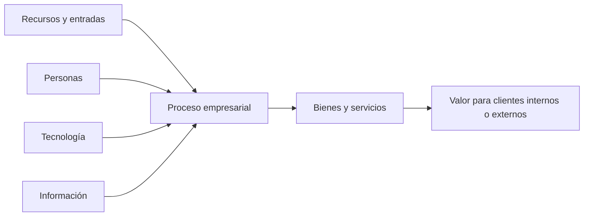

La salida no se valora únicamente por existir: importa el valor que aporta,
la **eficacia** para alcanzar los resultados y la **eficiencia** con que se
utilizan los recursos.

### 2.2. Concepto de modelo de negocio

El **modelo de negocio** explica cómo funciona una empresa y cómo puede
evolucionar: es el mecanismo con el que crea, entrega y captura valor para
generar ingresos y beneficios. Comprende tanto la estrategia como su
implementación.

Describe, entre otros aspectos:

- Cómo selecciona a sus clientes.
- Cómo define y diferencia su oferta de productos.
- Cómo crea utilidad para sus clientes.
- Cómo consigue y conserva a esos clientes.
- Cómo sale al mercado.
- Qué tareas deben llevarse a cabo.
- Cómo configura sus recursos.

Al estudiar un área de negocio se pretende medir resultados: ingresos, costes,
ventas, etc. La idea «aquello que no se mide, no se puede gestionar» expresa la
necesidad de definir qué interesa conocer y con qué métricas se evaluará.

#### Ejemplo: una empresa de transporte de paquetería

Supongamos una empresa con líneas fijas entre ciudades. Dispone de camiones
propios y subcontrata parte de los trayectos. Se plantean tres preguntas:

1. ¿Es rentable tener camiones propios?
2. ¿Todas las rutas son rentables?
3. ¿Qué rutas interesa potenciar?

Para responder a la primera se recopilan los costes de mantenimiento,
reparaciones, combustible y otros consumos, seguros, amortización de vehículos
y conductores. En el caso más sencillo, cada conductor está asignado a un
vehículo, por lo que se pueden calcular sus costes en un periodo.

Después se identifican los viajes realizados y se calcula cuánto habría
costado subcontratarlos. Este importe es un **ingreso ficticio o de referencia**
para evaluar la flota propia, no una venta real. Su diferencia con los costes
propios indica si la flota contribuye positivamente al resultado.

Para estudiar las rutas se distribuyen los ingresos y los costes de los viajes
entre ellas, tanto si se realizan con medios propios como subcontratados. La
contabilidad permite conocer el coste de los servicios externos. El resultado
depende fundamentalmente del precio cobrado y de la ocupación del camión.

Una posibilidad de mejora es potenciar la demanda en las rutas con baja
ocupación: aumentar su carga puede aprovechar capacidad disponible. La decisión
debe apoyarse en el análisis económico del modelo.

Construir el modelo obliga a documentar, probar y desarrollar las hipótesis
sobre el funcionamiento del negocio. También permite experimentar con cambios
y anticipar cómo afectarían a los resultados.

#### 2.2.1. La importancia de construir modelos de negocio

**La solución óptima para un departamento no siempre es la mejor para toda la
organización.** Por eso hay que estudiar los procesos de forma conjunta.

En la empresa de paquetería, Atención al Cliente puede intentar maximizar las
entregas a tiempo. Si actúa aisladamente, enviará camiones sin completar la
carga para no retrasar ningún envío. Cumplirá su objetivo local, pero provocará
un sobrecoste por circular con capacidad infrautilizada.

El modelo de negocio y el ERP deben ayudar a coordinar los objetivos
departamentales para maximizar el beneficio global, equilibrando los costes
operativos y el nivel de servicio.

#### 2.2.2. Silos de información

Existen **silos de información** cuando los departamentos no comparten los
datos necesarios para gestionar y analizar el negocio. Ventas, operaciones,
finanzas o recursos humanos mantienen información aislada, lo que dificulta la
coordinación, genera errores y perjudica la optimización del conjunto.

Los silos pueden deberse a sistemas de información no integrados o a razones
organizativas y políticas internas. No basta con disponer de datos: deben
fluir entre las áreas que los necesitan.

#### 2.2.3. Indicador clave de negocio (KPI)

Un **KPI (Key Performance Indicator)** es un indicador cuantificable que permite
evaluar si una organización está alcanzando sus objetivos. Debe medir mejoras
en actividades críticas para su éxito y guardar relación con los objetivos y
las actividades fundamentales del negocio.

Por ejemplo, en la venta telefónica es importante responder antes de que el
cliente cuelgue. Un KPI puede ser el **porcentaje de llamadas atendidas antes
de 20 segundos**. Si el objetivo es al menos el 80 % y se alcanza el 85 %, el
indicador muestra el cumplimiento de esa meta.

Los KPI deben definirse con la participación de los responsables de las áreas.
Conviene seleccionar un número reducido, centrado en los resultados esenciales,
y especificar para cada uno:

- Nombre.
- Definición.
- Método de cálculo.
- Valor objetivo.

Los indicadores permiten medir, analizar y mejorar mediante decisiones basadas
en datos; su utilidad depende de que el modelo de negocio esté bien definido.

### 2.3. Concepto de estrategia empresarial

La estrategia es el modo de dirigir una actuación para alcanzar un fin. En el
ámbito empresarial conecta la situación actual con la **visión**, es decir,
con el lugar al que quiere llegar la empresa.

Para elegirla hay que analizar alternativas según los beneficios tangibles e
intangibles esperados y estimar la probabilidad de hechos futuros, cuya
predicción puede ser incierta.

La estrategia responde a dos preguntas:

- ¿Cómo vamos a conseguir lo planteado en la misión?
- ¿Qué caminos permiten llegar al punto final deseado?

[↑ Volver al índice](#índice)

---

## 3. El negocio electrónico (e-business)

El **e-business** es un modelo de negocio de alto rendimiento basado en el uso
racional e intensivo de la tecnología y en la integración entre departamentos.
Combina procesos de negocio, aplicaciones empresariales y estructura
organizativa para agilizar la actividad y obtener información nueva, veraz y
rápida.

No debe confundirse con el **e-commerce**. El comercio electrónico se refiere a
la compraventa por medios electrónicos; el negocio electrónico es más amplio y
engloba también la gestión interna, los proveedores, el análisis y las
relaciones con los clientes.

Según ISO 9001:2000, la gestión comprende las actividades coordinadas para
dirigir y controlar una organización. En el e-business, diferentes sistemas
dan soporte a esa gestión:

| Sistema | Función principal |
|---|---|
| ERP | Planificar e integrar los recursos y procesos de la empresa. |
| SCM | Gestionar la cadena de suministro. |
| E-commerce | Facilitar el comercio electrónico. |
| BI | Transformar datos en información para decidir. |
| CRM | Gestionar las relaciones con los clientes. |

[↑ Volver al índice](#índice)

---

### 3.1. El ERP: planificación de los recursos de la empresa

Un **ERP (Enterprise Resource Planning)** integra mediante tecnología el
tratamiento de la información, el control de inventario, la planificación de
la producción, la distribución y la actividad financiera. Su objetivo es
gestionar de forma coordinada **personas, procesos y tecnología**.

Actúa como eje central de la organización, conecta departamentos y puede
implantarse en local o en la nube. Se relaciona con otros componentes del
negocio electrónico, como el SCM, y ofrece paquetes adaptables a empresas
grandes, medianas y pequeñas.

#### 3.1.1. Áreas que gestiona un ERP

Sus áreas principales son contabilidad y finanzas, adquisiciones o compras,
gestión de proyectos, cadena de suministro y fabricación o producción. La
integración evita silos, facilita el acceso a información común, aumenta el
control y mejora la toma de decisiones.

#### 3.1.2. Diferencia entre ERP y finanzas

**Las finanzas son una parte del ERP, no un sinónimo de ERP.** El área financiera
incluye contabilidad general y auxiliar, cuentas por cobrar y pagar,
facturación y cobros, gastos, activos o inmovilizado, proyectos y subvenciones.

El ERP también cubre compras, inventario, fabricación, mantenimiento, órdenes,
logística, proyectos, ciclo de vida del producto, riesgos, rendimiento
empresarial (EPM), recursos humanos e integración con CRM.

##### Tecnologías que amplían sus posibilidades

Los sistemas modernos pueden incorporar tecnologías que automatizan tareas,
aportan datos y crean nuevos servicios:

- **Inteligencia artificial (IA):** ciencia e ingeniería orientadas a crear
  máquinas y programas inteligentes. Intenta comprender y reproducir
  capacidades de la inteligencia, sin limitarse a mecanismos observables
  biológicamente, según la definición de John McCarthy recogida por IBM.
- **Aprendizaje automático (machine learning, ML):** técnica de IA que utiliza
  algoritmos para identificar patrones en datos y crear modelos predictivos.
  Los modelos se entrenan con datos para mejorar su precisión; no se programa
  explícitamente cada respuesta.
- **Internet de las cosas (IoT):** conexión de dispositivos físicos a Internet
  para recopilar, compartir y analizar datos. Tiene aplicaciones en vehículos,
  hogares, salud, comercio, medio ambiente, ciudades, agricultura,
  infraestructura y logística.
- **Internet industrial de las cosas (IIoT):** aplicación industrial del IoT,
  centrada en seguridad, eficiencia y producción. Por ejemplo, sensores de
  máquinas permiten hacer mantenimiento predictivo, reducir costes y evitar
  tiempos de inactividad.
- **Blockchain:** registro distribuido de transacciones que aporta trazabilidad
  y dificulta su alteración. El ejemplo consiste en iniciar una transferencia,
  representarla en un bloque, distribuirla a los nodos, validarla e incorporar
  el bloque a la cadena antes de completar la operación. El mecanismo de
  consenso depende de la red; no toda validación utiliza minería.
- **Asistentes digitales:** permiten consultar y manejar información del ERP
  mediante lenguaje natural, por texto o voz. Un asistente puede ayudar a
  localizar facturas o responder consultas automáticamente.

La IA es el campo general; el aprendizaje automático es una de sus técnicas.
Un sistema de recomendación que aprende de compras anteriores es un ejemplo de
ML, y un chatbot es una aplicación posible de IA. Un frigorífico que avisa de
productos agotados ilustra el IoT.

La integración tecnológica también alcanza la fabricación mediante **CIM
(Computer Integrated Manufacturing)**:

1. **CAD (Computer-Aided Design):** diseño asistido por ordenador para crear,
   modificar, analizar y optimizar diseños, incluidos modelos 3D.
2. **CAM (Computer-Aided Manufacturing):** fabricación asistida por ordenador;
   convierte el diseño en instrucciones de fabricación.
3. **CNC (Computer Numerical Control):** la máquina de control numérico ejecuta
   las instrucciones para mecanizar la pieza real.

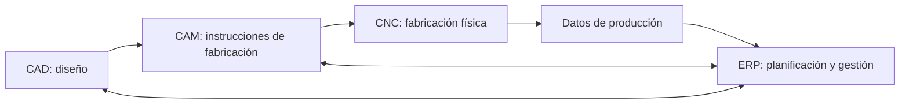

Estas tecnologías conectan diseño, fabricación y gestión. Como el ERP abarca a
toda la empresa, su implantación exige implicación de la dirección ejecutiva,
no solo del departamento informático.

#### 3.1.3. Fundamentos del ERP

Un ERP se apoya en tres principios:

1. **Base de datos común y centralizada.** La organización utiliza un esquema
   compartido y datos normalizados: una sola versión de la información, sin
   duplicidades ni inconsistencias.
2. **Procesos integrados.** Conecta ventas, finanzas, compras, producción y
   recursos humanos. Un evento en un departamento actualiza la información que
   necesitan los demás.
3. **Nexo entre personas, procesos y tecnología.** La plataforma integra el
   talento, la eficiencia operativa y la innovación.

##### Ejemplo: fabricación de automóviles

Una fábrica necesita miles de piezas de muchos proveedores. Sin integración,
Almacén puede registrar una pieza como «frenos delanteros» y Compras como
«pastillas F.», sin poder determinar si se refieren al mismo componente ni
cuánto se gasta realmente en él.

Con ERP, cada pieza dispone de un **registro maestro único** con identificador,
nombre, dimensiones, proveedor, lote, número de serie y coste. Compras,
almacén, producción y finanzas consultan la misma información.

La identificación permite comprobar calidad y compatibilidad y relacionar
cada componente con sus especificaciones. El ejemplo reúne proveedores de
acero, electrónica y plásticos; ilustra cómo se verifican materiales y se
unifican los flujos de recepción antes de incorporarlos a producción.

El sistema permite seguir solicitudes, órdenes de compra, recepción y consumo
de materiales. Cuando llega una pieza se actualiza el inventario; los
movimientos correspondientes se reflejan en contabilidad, con imputación a las
cuentas pertinentes del libro mayor. Se obtiene trazabilidad desde el pedido
al proveedor hasta su instalación en el vehículo.

La información unificada permite conocer costes, comparar proveedores,
negociar descuentos por volumen y elaborar informes. El valor no está solo en
usar un programa, sino en **estandarizar y centralizar los datos y conectar los
procesos**.

#### 3.1.4. Tendencias modernas y conceptos de nube

La expansión del **software como servicio (SaaS)**, la movilidad y el trabajo
descentralizado ha cambiado el ERP. Las soluciones modernas permiten acceso
desde distintos dispositivos y lugares, mayor flexibilidad y adaptación a
mercados cambiantes. Integrar los datos y los procesos mejora la alineación
departamental y reduce trabajo innecesario.

En **on-premises** los servidores, aplicaciones, redes y almacenamiento están
en la infraestructura propia, y la organización asume su gestión. La
**computación en la nube** ofrece recursos y servicios accesibles por red,
habitualmente a través de Internet y de un proveedor.

| Tipo de nube | Características |
|---|---|
| Privada | Uso exclusivo de una organización; mayor control sobre recursos y acceso. Puede estar en instalaciones propias o alojada externamente. |
| Pública | Recursos ofrecidos y gestionados por un proveedor externo, con flexibilidad y escalabilidad. |
| Híbrida | Combina recursos privados y públicos; por ejemplo, mantiene datos críticos en un entorno privado y aprovecha servicios públicos para otras cargas. |

##### IaaS, PaaS y SaaS

El **runtime** es el entorno necesario para ejecutar una aplicación, como la
JVM, el intérprete de Python y sus bibliotecas. El **middleware** conecta
aplicaciones, servicios o sistemas; algunos ejemplos son Tomcat, Kafka y las
colas de mensajes.

| Modelo | Qué aporta el proveedor | Qué gestiona principalmente la empresa |
|---|---|---|
| Local | No se contrata la plataforma como servicio. | Aplicación, datos, runtime, middleware, sistema operativo, virtualización, servidores, almacenamiento y red. |
| IaaS: infraestructura como servicio | Red, almacenamiento, servidores y virtualización. | Sistema operativo, middleware, runtime, aplicación y datos. |
| PaaS: plataforma como servicio | Infraestructura y plataforma de ejecución, incluido sistema operativo, middleware y runtime. | Desarrollo de la aplicación y sus datos. |
| SaaS: software como servicio | La aplicación completa y su plataforma. | Uso, configuración permitida y gestión funcional de su información. |

En SaaS el proveedor asume gran parte de la operación técnica, pero la empresa
sigue siendo responsable del uso adecuado del servicio, sus usuarios y sus
datos.

#### 3.1.5. El valor empresarial del ERP

Las ventajas que aporta la integración son:

1. Mejor visión del negocio mediante informes e información actualizada.
2. Menores costes operativos por optimización de procesos y mejores prácticas.
3. Mayor colaboración al compartir contratos, solicitudes y órdenes de compra.
4. Mayor eficacia, con procesos definidos y una experiencia de usuario común.
5. Infraestructura homogénea entre administración y dirección.
6. Mayor facilidad de adopción gracias a interfaces y criterios uniformes.
7. Menor riesgo por integridad de datos y controles financieros.
8. Menores costes de explotación y gestión de sistemas dispersos.

#### 3.1.6. Breve historia del ERP

La evolución va de las fichas de papel a los sistemas integrados y móviles:

| Etapa | Aportación |
|---|---|
| Gestión manual | Inventarios mediante fichas y tarjetas de papel. |
| EOQ, 1913 | Ford Whitman Harris formula la cantidad económica de pedido: cuánto pedir, equilibrando costes de pedido y almacenamiento. |
| MRP, década de 1960 | La informática automatiza la planificación de necesidades de materiales. El material cita a Black & Decker como pionera en 1964. Calcula cantidades y fechas de compra para reducir retrasos. |
| MRP II, 1983 como hito del tema | Amplía la planificación a recursos de fabricación: capacidad de la planta, maquinaria, turnos y calendarios. Ayuda a reducir residuos y cuellos de botella. |
| ERP, 1990 | Gartner acuña el término para sistemas que integran toda la empresa, no solo la fábrica: comercial, finanzas, personal y otras áreas comparten información. |
| ERP modernos | Acceso web y móvil, servicios en la nube e integración con otras tecnologías y sistemas. |

**MRP** significa Material Requirements Planning; **MRP II**, Manufacturing
Resource Planning. El primero se centra en necesidades de materiales; el
segundo incorpora capacidad y tiempo de fabricación.

Conviene distinguir **cuánto pedir**, que responde el modelo EOQ, de **cuándo
pedir**, que requiere además establecer un punto de pedido o una política de
reposición. Ambos problemas forman parte de la planificación del inventario.

#### 3.1.7. Modelos de implementación: del ERP local a la nube

En los años noventa y comienzos de los dos mil se extendió el ERP instalado en
el centro de procesamiento de datos (CPD) propio. Requería servidores,
licencias e inversiones importantes, amortizadas en plazos largos, de cinco a
diez años en el ejemplo del tema.

A la inversión inicial se añadían consultoría, personalizaciones, formación y
mantenimiento de hardware y software. Las arquitecturas tradicionales podían
ser monolíticas, difíciles de escalar y con integración externa o acceso
remoto complejos, mediante VPN o clientes pesados.

La aparición de la web, la movilidad y el análisis en tiempo real puso de
manifiesto esas limitaciones y favoreció otras formas de despliegue.

#### 3.1.8. ERP en la nube: un nuevo modelo de entrega

En el **ERP SaaS**, el software se ejecuta en servidores del proveedor y se
utiliza como servicio. El proveedor aplica parches, mantiene la plataforma y
realiza actualizaciones periódicas, evitando que la empresa tenga que abordar
por sí sola grandes proyectos de actualización.

Sus principales beneficios potenciales son menor inversión inicial, menos
gestión técnica interna y mayor capacidad de centrarse en el negocio. Una
suscripción sustituye parte de la inversión en infraestructura y licencias;
el coste total debe evaluarse según el contrato y el uso.

La migración puede ser gradual: no siempre es necesario reemplazar todo el
ERP local. También se pueden incorporar servicios de nube a un sistema
existente. El tema recoge seis razones para plantearlo:

1. **Adoptar tecnologías como IA.** Por ejemplo, extraer datos de facturas PDF
   con OCR y proponer su registro contable.
2. **Extender el ERP heredado.** Una API puede conectar un ERP local con una
   solución de partes de trabajo alojada en la nube.
3. **Acceder a nuevas tecnologías y experiencias de usuario.** Una aplicación
   web progresiva (PWA) puede permitir leer códigos QR con el móvil y
   actualizar inventario.
4. **Reducir dependencias externas para analítica.** Los usuarios pueden crear
   paneles con herramientas integradas sin encargar cada informe a terceros.
5. **Disponer de recursos de seguridad más sólidos.** El proveedor puede
   contar con equipos especializados para responder a vulnerabilidades.
6. **Atraer talento.** Las herramientas web modernas pueden resultar más
   accesibles para nuevas incorporaciones que los clientes antiguos.

#### 3.1.9. Tipos comunes, ventajas y desventajas

Los tres modelos habituales son **local**, **nube** e **híbrido**. Un ejemplo
de despliegue híbrido es mantener el ERP central en la sede y utilizar
soluciones en la nube en las filiales.

Entre las ventajas generales del ERP destacan centralización de información,
automatización del trabajo manual y disponibilidad de datos para las funciones
operativas y estratégicas.

Las principales dificultades son:

- **Coste del paquete y de los desarrollos a medida**, especialmente cuando
  los procesos no están cubiertos por la funcionalidad estándar.
- **Complejidad y duración de la implantación**, con impacto sobre toda la
  organización y necesidad de revisar las personalizaciones al actualizar.
- **Preparación y gestión del cambio:** implicación de la dirección,
  formación, adaptación de los empleados y comparación rigurosa de opciones.

#### 3.1.10. Motivos para adquirir o modernizar un ERP

La modernización busca operaciones más eficientes, vincular la información
clave entre departamentos, visualizar datos actualizados e introducir cada
dato una sola vez.

También puede mejorar el cumplimiento de normas, la colaboración interna y
con clientes y proveedores mediante API y servicios web, la calidad de los
datos y la imagen profesional. Una empresa con procesos sólidos puede incluso
aumentar su valor de venta.

La encuesta **IDC Future Enterprise Resiliency and Spending Survey, Wave 8
(octubre de 2025), citada en IDC Analyst Brief de enero de 2026**, presenta
estos motivos para modernizar aplicaciones empresariales:

| Motivo | Organizaciones encuestadas |
|---|---:|
| Incorporar IA a las aplicaciones principales | 44 % |
| Mejorar su ciberresiliencia | 40 % |
| Modernizar aplicaciones, infraestructura y datos | 33 % |
| Reducir costes de operación | 28 % |

Son resultados de esa encuesta, no porcentajes universales ni categorías que
deban sumar el 100 %.

#### 3.1.11. Estadísticas de uso del ERP

La serie incluida en el tema muestra una adopción creciente entre empresas
con más de diez empleados:

| Año | Empresas que usan ERP |
|---|---:|
| 2013 | 44 % |
| 2015 | 52 % |
| 2017 | 56 % |
| 2019 | 57 % |
| 2021 | 62 % |
| 2023 | 63 % |
| 2026 | 66 % |

El gráfico comparativo por tamaño recoge:

| Empleados | 2013 | 2026 |
|---|---:|---:|
| 2 a 9 | No indicado | 32 % |
| 10 a 49 | 40 % | 60 % |
| 50 a 249 | 68 % | 85 % |
| 250 o más | 80 % | 95 % |

La conclusión es que la adopción aumenta con el tamaño de la empresa. Estas
cifras se reproducen como datos del material docente, cuya bibliografía remite
a **Statistiek Vlaanderen (Flandes)**; no deben interpretarse como estadísticas
generales de España o del mundo.

#### 3.1.12. Desafíos de un proyecto ERP

Implantar un ERP no es una tarea exclusivamente técnica: hay que coordinar
**personas, procesos, tecnología y organización**. Los costes, la integración,
las adaptaciones y el cambio de hábitos pueden plantear dificultades.

El recurso complementario *¿Qué es ERP? El documental*, de 1:06:01, recoge
experiencias de responsables de proyectos, retos reales y soluciones
adoptadas. Se enlaza al final del tema como material de ampliación.

#### 3.1.13. Ejemplo de flujo de trabajo: del pedido a la factura

1. **Ventas/CRM:** registra el pedido y lo vincula al cliente.
2. **Inventario/MRP y Compras:** comprueba materias primas y genera órdenes de
   compra si faltan existencias.
3. **Fabricación:** asigna órdenes de trabajo, capacidad y turnos.
4. **Logística:** prepara la expedición, reserva transporte y genera albaranes.
5. **Contabilidad:** emite la factura y registra el asiento correspondiente.

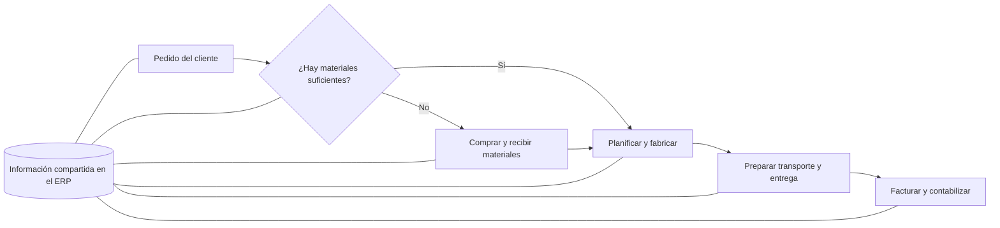

La integración evita volver a introducir los mismos datos en cada etapa y
mantiene conectada toda la empresa.

#### 3.1.14. Empresas que se benefician de un ERP

El ERP no se limita a grandes corporaciones. La nube reduce barreras de entrada
al sustituir parte de la inversión inicial (**CAPEX**) por gasto operativo
(**OPEX**), mediante suscripciones y licencias que pueden contratarse para
pocos usuarios.

- **Pequeñas empresas y startups:** soluciones estándar de contabilidad,
  ventas e inventario, ampliables con el crecimiento.
- **Pymes:** funciones adaptadas y módulos específicos del sector.
- **Grandes empresas:** soluciones completas, multinacionales, personalizables
  e integrables.

También hay necesidades sectoriales: salud (historias clínicas, citas y
trazabilidad de fármacos), construcción (certificaciones, subcontratas,
mediciones y presupuestos) e industria (costes de producción, listas de
materiales o BOM y trazabilidad de lotes).

#### 3.1.15. ERP modular

Un ERP modular permite implantar solo los módulos necesarios y ampliarlos
después. Los módulos comparten información y evitan tanto sistemas aislados
como una implantación inicial desproporcionada.

Sus ventajas son inversión progresiva, escalabilidad, implantación por fases
e información integrada en un mismo repositorio. Puede incorporar e-commerce,
SCM, CRM y BI para mejorar el análisis, reducir duplicidades y limitar
integraciones externas innecesarias.

| Módulo | Funcionalidades |
|---|---|
| Finanzas y contabilidad | Contabilidad general y analítica, cobros, pagos, activos e informes financieros. |
| Inventario | Existencias, lotes, trazabilidad, ubicaciones y reposición. |
| Compras | Solicitudes, órdenes de compra, proveedores y costes. |
| Ventas | Presupuestos, ofertas, pedidos, tarifas, facturación y análisis comercial. |
| Proyectos | Planificación, recursos, costes, tiempos y rentabilidad. |
| Recursos humanos | Nóminas, selección, contratación, evaluación, formación y talento. |
| Producción | Planificación, órdenes de fabricación, calidad, materiales y seguimiento. |
| Gestión documental | Almacenamiento, versiones, aprobaciones, firma digital y cumplimiento normativo. |

El caso del **Grupo COPASA**, presentado mediante una entrevista, invita a
analizar cómo se eligieron los módulos, cómo se alinearon las necesidades
departamentales con las generales y qué personalizaciones se realizaron.

#### 3.1.16. Tipos de módulos

Existen dos clasificaciones que responden a criterios diferentes:

| Criterio | Tipo | Características y ejemplos |
|---|---|---|
| Necesidad | Básicos o core | Funciones esenciales: contabilidad, ventas y compras. |
| Necesidad | Opcionales o complementarios | Se incorporan si el negocio los necesita: servicios de campo, proyectos y e-commerce. |
| Especialización | Horizontales | Funciones aplicables a varios sectores: inventario, RR. HH., CRM y producción estándar. |
| Especialización | Verticales | Soluciones para un sector: LIMS en laboratorios, trazabilidad alimentaria o reservas hoteleras. |

#### 3.1.17. ERP de código abierto

Un ERP **open source** permite estudiar, modificar y adaptar su código según
su licencia. Esto facilita cambiar la lógica de negocio y ampliar
funcionalidades.

Puede reducir el coste de licencias, pero no elimina el coste de desarrollo,
implantación y mantenimiento. Requiere personal técnico especializado, propio
o contratado. **Odoo** es uno de los ejemplos destacados del tema.

#### 3.1.18. Visión global de diferentes sistemas ERP

No existe un ERP que sea el mejor para todas las organizaciones. El mercado
ofrece soluciones con alcances y destinatarios distintos:

| Fabricante | Soluciones citadas y orientación del material |
|---|---|
| SAP | S/4HANA para grandes empresas; Business One para pymes; Business ByDesign para medianas empresas. |
| Microsoft | Dynamics 365 Business Central para pymes; Dynamics 365 Finance y Supply Chain Management para organizaciones grandes. |
| Oracle | Cloud ERP para grandes empresas; NetSuite para pymes; JD Edwards EnterpriseOne para industria, construcción y distribución. |

La disponibilidad y denominación comercial dependen del momento y del
proveedor; aquí se conserva la visión del material docente.

#### 3.1.19. Elección de un ERP

El proceso de selección debe comenzar por los requisitos, no por una marca:

1. Reunirse con los responsables y usuarios para identificar necesidades.
2. Estudiar beneficios, presupuesto y **retorno de la inversión (ROI)**,
   incluido el plazo previsto para recuperarla.
3. Buscar y comparar sistemas y proveedores.

Conviene valorar popularidad sin confundirla con adecuación, despliegue local,
nube o híbrido, código abierto o propietario, y orientación horizontal o
vertical.

Un sistema propietario limita las modificaciones a lo permitido por el
proveedor. Uno abierto ofrece mayor capacidad de adaptación, pero sus cambios
deben mantenerse y probarse tras actualizaciones. Un ERP horizontal es más
general; uno vertical incorpora experiencia del sector, aunque puede ser más
caro o no cubrir todas las necesidades de la empresa.

Un producto menos conocido puede incluir justo la funcionalidad necesaria.
Las experiencias de otras organizaciones ayudan, pero no sustituyen el
análisis propio.

#### 3.1.20. Sistemas operativos sobre los que funciona un ERP

El sistema operativo es la base de ejecución. Su elección depende del ERP,
la infraestructura, los requisitos de la organización y las integraciones.

**Linux** tiene una presencia destacada en servidores y nube. El tema cita
distribuciones como RHEL, SUSE y Debian/Ubuntu, y destaca:

- Seguridad, estabilidad y disponibilidad.
- Optimización del coste total de propiedad (**TCO**), según distribución y
  soporte contratados.
- Buen aprovechamiento de recursos y rendimiento de entrada/salida.
- Modularidad, automatización por scripts y despliegues con contenedores.
- Ecosistema de software abierto y compatibilidad con Docker y Kubernetes.

Entre los ejemplos del material aparecen **Odoo**, desarrollado en Python y
habitual en servidores Linux, y **SAP S/4HANA**, vinculado a SAP HANA sobre
plataformas Linux certificadas. También se mencionan AWS, Azure y Google
Cloud como entornos donde se despliegan sistemas empresariales.

**Windows Server** es relevante en entornos integrados con Microsoft, como
Active Directory, SQL Server y .NET. La integración puede ser una ventaja,
aunque deben considerarse licencias y consumo de recursos.

Frente al UNIX propietario tradicional —Solaris, AIX o HP-UX—, Linux ha ganado
terreno por flexibilidad, disponibilidad de hardware estándar y costes.
FreeBSD y NetBSD destacan por estabilidad y seguridad, pero Linux cuenta con
un ecosistema más amplio de aplicaciones empresariales, imágenes de
contenedores y soporte de fabricantes y proveedores de nube.

#### 3.1.21. Sistemas gestores de bases de datos

El SGBD aporta persistencia, integridad y escalabilidad. El material presenta
PostgreSQL como referencia en ERP abiertos, SQL Server en el ecosistema
Microsoft, Oracle Database y SAP HANA para soluciones de gran volumen, y
MariaDB/MySQL en determinados ERP y desarrollos a medida.

**La compatibilidad concreta debe comprobarse para cada producto y versión**:
no todos los ERP abiertos usan el mismo motor, ni todos los productos de un
fabricante comparten una base de datos.

Los nombres citados incluyen Odoo y ERPNext entre los ERP abiertos, además de
soluciones Microsoft, SAP, Oracle y desarrollos a medida. Sirven para
identificar ecosistemas diferentes, no para asumir que cualquier motor de
una misma categoría es intercambiable.

El acceso habitual se realiza a través de una capa de persistencia, a menudo
un **ORM (Object-Relational Mapping)**, que relaciona objetos de la aplicación
con datos relacionales. Modificar directamente la base por SQL puede saltarse
reglas de negocio y comprometer la integridad.

La integración externa puede realizarse mediante API REST con JSON,
servicios SOAP/XML o conectores ODBC/JDBC. Así se comunica el ERP con CRM, BI,
otras aplicaciones y bases de datos.

[↑ Volver al índice](#índice)

---

### 3.2. El SCM: gestión de la cadena de suministro

El **SCM (Supply Chain Management)** coordina los flujos de **materiales,
información y dinero** entre las empresas que participan en una transacción
de negocio. Una transacción es una unidad lógica de actividad entre dos o más
partes que produce un resultado reconocible de éxito o fracaso, según el
glosario ebXML citado en el tema.

Puede entenderse como gestión logística de materiales —aprovisionamiento,
almacenamiento, transporte y distribución— o, de forma más amplia, como
gestión integral desde la compra de materias primas hasta el usuario final.

#### 3.2.1. La cadena de suministro

Es el conjunto de procesos y actividades para producir y entregar bienes o
servicios al consumidor final. Sus actores fundamentales son:

- **Proveedores:** suministran materias primas y componentes.
- **Fabricantes:** transforman esos materiales en productos.
- **Distribuidores:** almacenan y transportan los productos terminados.
- **Clientes:** reciben y utilizan los productos; su satisfacción y fidelidad
  son esenciales para el éxito de la cadena.

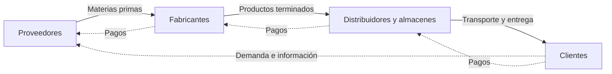

La representación es simplificada: en la práctica hay redes de participantes,
intercambio de información en ambos sentidos y también devoluciones.

##### Desafíos y beneficios

La cadena presenta dificultades por su complejidad, la cantidad de actores y
ubicaciones, la incertidumbre de demanda y precios, y la disponibilidad de
materias primas. Está expuesta a desastres naturales, interrupciones,
problemas operativos y cambios regulatorios.

Además, debe reducir costes sin perjudicar el servicio, entregar con calidad
y a tiempo y adaptarse rápidamente a cambios del mercado. Una gestión eficaz
mejora la rentabilidad, la satisfacción del cliente y la flexibilidad de
fabricación y distribución.

##### Mejores prácticas

Tres palancas principales son:

1. **Colaborar con proveedores** para mejorar calidad, condiciones, costes y
   continuidad del suministro.
2. **Automatizar** inventarios, planificación y tareas repetitivas para ganar
   eficiencia y reducir errores.
3. **Monitorizar y analizar** para detectar problemas, actuar y evaluar las
   mejoras.

##### Procesos de la cadena

| Proceso | Contenido |
|---|---|
| Planificación | Definir objetivos, recursos, políticas y procedimientos. |
| Adquisición | Seleccionar proveedores, negociar contratos y comprar materiales y componentes. Puede apoyarse en SRM, Supplier Relationship Management. |
| Producción | Fabricar o contratar a terceros la producción del bien o servicio. |
| Almacenamiento | Conservar los productos hasta su expedición. |
| Distribución | Transportar y entregar al cliente. |
| Servicio al cliente | Atender consultas, dar soporte y gestionar devoluciones. |

Mejorar la cadena exige actuar de forma conjunta sobre previsión de demanda,
selección de proveedores, automatización, eficiencia productiva,
almacenamiento, transporte y atención al cliente.

#### 3.2.2. Breve historia del SCM

En el modelo tradicional predominaba un flujo lineal: materia prima,
fabricación, distribución y cliente. La estandarización de piezas y la
producción en masa de Henry Ford, a comienzos del siglo XX, permitieron
planificar la logística a gran escala y reducir paradas.

En las décadas de 1970 y 1980, la informática digitalizó inventarios,
contabilidad y otros procesos internos. Sin embargo, las empresas
intercambiaban archivos por lotes (**batch**) y cada departamento podía
mantener sistemas aislados: los datos no se compartían en tiempo real.

Internet y el comercio electrónico impulsan una **red interconectada y
orientada a eventos**, con el consumidor en el centro. Fabricantes, almacenes,
transporte y tiendas comparten información con mayor rapidez.

Por ejemplo, una compra en una tienda online genera una petición a una API;
el ERP reserva existencias, se avisa al transportista y se recalculan las
necesidades de reposición. La integración aumenta la visibilidad y permite
automatizar la respuesta.

#### 3.2.3. ERP frente a SCM

| ERP | SCM |
|---|---|
| Integra principalmente los procesos internos de la empresa. | Coordina la cadena de suministro de extremo a extremo. |
| Conecta finanzas, RR. HH., compras, ventas y producción. | Conecta proveedores, fabricación, distribución y clientes. |
| Ofrece gestión unificada, control y soporte a decisiones internas. | Optimiza flujos, tiempos de entrega, costes y servicio a lo largo de la cadena. |

**Son complementarios:** el ERP gestiona el motor interno y el SCM lo conecta
con su entorno. Comparten datos, procesos y decisiones.

#### 3.2.4. Tareas de control en un SCM

Una herramienta de control permite registrar tareas con código, título,
estado, descripción, responsable, fecha de apertura y fecha límite. También
debe mostrar prioridades, detalle y seguimiento.

El ejemplo del tema parte de una reclamación por un retraso de quince días:
se registra una tarea urgente para enviar la mercancía y contactar con el
cliente, y otra de seguimiento para remitir una carta de disculpas con un
compromiso de no repetición. Las acciones tienen responsables y plazos
definidos y pueden actualizarse, adjuntar documentos y cambiar de estado.

| Tarea | Acción | Responsable | Apertura | Plazo |
|---|---|---|---|---|
| Urgente, 00001 | Enviar la mercancía y llamar al cliente para explicarle la situación. | Rafael Reig | 03/08/2021 | 05/08/2021 |
| Seguimiento, 00002 | Remitir una carta de disculpas con compromiso de no repetición. | Rafael Reig | 03/08/2021 | 05/08/2021 |

Las fechas son las del caso ilustrativo. La herramienta también permite
actualizar o crear tareas, consultar el seguimiento, comunicar actuaciones,
cerrar asuntos y gestionar anexos.

[↑ Volver al índice](#índice)

---

### 3.3. El e-commerce: comercio electrónico

El **comercio electrónico** consiste en comprar y vender productos o servicios
por medios electrónicos. Una tienda virtual muestra un catálogo y permite
consultar productos, precios, disponibilidad y condiciones, realizar pedidos
y seguir su evolución.

Las dos modalidades principales tratadas son:

- **B2C (Business to Consumer):** venta de una empresa al consumidor final.
- **B2B (Business to Business):** transacciones entre empresas.

La definición amplia de la OCDE también contempla particulares, gobiernos y
otras organizaciones públicas o privadas como participantes. El carrito y el
catálogo electrónico son herramientas de este comercio; un catálogo puede
formar parte del canal de venta, aunque su mera publicación sin posibilidad
de realizar pedidos no constituye por sí sola una transacción electrónica.

En una tienda como la de recambios **TVH/MyTotalSource**, el usuario puede
consultar referencias, fotografías, datos técnicos, precios, existencias y
plazos de entrega las 24 horas. El sistema registra quién se conecta, qué
productos consulta o compra, cuándo lo hace y cómo progresa el pedido.

El seguimiento puede incluir número de pedido, cliente, fecha, origen,
estado, líneas, incidencias, transporte y entrega. Esta trazabilidad ayuda a
controlar la actividad, analizarla y atender mejor al cliente.

#### 3.3.1. Integración entre e-commerce y ERP

La tienda online genera pedidos en cualquier momento y necesita un flujo
automático de información con el ERP. En B2B y B2C se busca reducir la
intervención manual, acelerar la venta y mantener los datos actualizados.

La integración exige que el ERP soporte un volumen mayor de transacciones,
actualice existencias en tiempo real y automatice facturación y logística.
Los pedidos llegan al ERP y la tienda recibe confirmaciones, disponibilidad
y actualizaciones.

El caso de **Aurum Bikes**, expuesto por Antoine Berte, plantea una decisión
de arquitectura: utilizar el e-commerce integrado en el ERP o una plataforma
independiente especializada, siguiendo un enfoque **best-of-breed**, conectada
con él. La elección depende de los requisitos y del esfuerzo de integración.

#### 3.3.2. El ERP como backoffice del e-commerce

La tienda es el **frontend**, la capa de presentación al cliente. El ERP es el
**backoffice**, donde se gestionan los datos y procesos internos. Puede actuar
como **SSOT (Single Source of Truth)**: fuente única y fiable para el catálogo,
stock, tarifas y reglas de precios.

Mantener manualmente los datos en ambos sistemas cuesta tiempo, retrasa los
cambios y crea inconsistencias de precios o disponibilidad. La sincronización
bidireccional evita duplicar el trabajo:

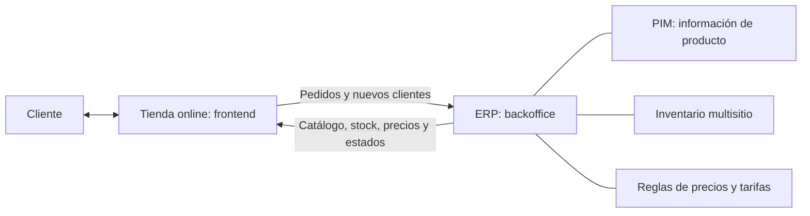

La experiencia de compra depende de tres cualidades de los datos:

- **Precisión:** información correcta y sin errores.
- **Integridad:** información completa y consistente.
- **Disponibilidad en tiempo real:** cambios reflejados oportunamente.

Los módulos clave son información de producto, inventario y precios. El
**inventario multisitio** permite gestionar centralizadamente existencias en
varias ubicaciones físicas o lógicas y sincronizarlas entre canales.

#### 3.3.3. Gestión de la información del producto (PIM)

Un **PIM (Product Information Management)** organiza la información del
producto. Puede formar parte del ERP o ser una solución independiente. En una
tienda online actúa como un **dependiente virtual**: responde a las preguntas
que en una tienda física resolvería un vendedor.

Gestiona o reúne para su presentación:

- Especificaciones técnicas: materiales, dimensiones, peso, etc.
- Variantes: tallas, colores, modelos.
- Compatibilidades con accesorios y repuestos.
- Imágenes, vídeos, manuales y documentación.
- Relaciones entre productos.
- Disponibilidad, coordinada con el inventario.

Una ficha completa y clara genera confianza, reduce consultas y abandono de
carrito y puede mejorar la conversión. Las relaciones entre productos
permiten aumentar las ventas mediante:

- **Cross-selling o venta cruzada:** ofrecer complementos. Al comprar una
  bicicleta se proponen casco, luces y candado.
- **Up-selling o venta de mayor valor:** sugerir una alternativa de gama
  superior que responda mejor a las necesidades del comprador.

También se pueden mostrar repuestos compatibles o productos que otros
clientes compraron conjuntamente.

#### 3.3.4. Inventario adaptado a la venta online

El cliente necesita conocer las existencias reales y las fechas previstas de
reposición. Sin sincronización entre tienda y ERP puede producirse
**overselling**, es decir, vender más unidades de las disponibles.

La integración bidireccional mantiene los datos al día, automatiza alertas
antes de una rotura de stock y mejora la planificación de compras y
reposiciones. El caso de Aurum Bikes ilustra los retos de reconciliar el
inventario físico y el virtual, atender picos de demanda y mantener una
operativa escalable.

##### Venta a particulares (B2C)

La falta de disponibilidad puede provocar que el consumidor compre en otra
tienda. Para mitigarla, el ERP puede gestionar:

1. **Stock de seguridad dinámico:** ajustar niveles de protección a la
   demanda y a sus cambios.
2. **Reservas temporales:** bloquear una unidad durante un tiempo mientras se
   completa la compra, evitando que varios usuarios adquieran la última.
3. **Backorders y alertas de reposición:** admitir pedidos pendientes cuando
   proceda o avisar de que el producto vuelve a estar disponible (*back in
   stock*).

##### Venta a empresas (B2B)

El comprador empresarial necesita previsibilidad para organizar sus propias
operaciones. Son importantes las fechas de recepción claras, los pedidos
masivos o agrupados y la optimización del transporte.

##### Devoluciones

La logística inversa forma parte de la venta online. El tema recuerda el
derecho de desistimiento de 14 días en la UE para compras de consumo a
distancia, **con las condiciones y excepciones legales aplicables**; no es
una regla general de devolución para cualquier compra B2B.

Tras recibir una devolución, el almacén inspecciona el producto y, si es
apto, lo reintegra al inventario del ERP. La actualización ágil permite que
vuelva a estar disponible sin crear diferencias entre stock físico y online.

#### 3.3.5. Precio basado en las reglas del ERP

El ERP centraliza la lógica de precios para evitar reglas divergentes entre
canales. La tienda consulta el motor de precios y muestra un desglose antes
de confirmar el pago.

El cálculo puede considerar:

1. Precio base del producto.
2. Tarifas, descuentos por cantidad, grupo de clientes o contrato.
3. Transporte según destino, pedido y acuerdos.
4. Impuestos y tasas aplicables.
5. Costes adicionales, como envoltorio o seguro.
6. Costes del medio de pago, **solo cuando sean legalmente repercutibles**.

En B2C son frecuentes los códigos promocionales y los costes según el destino
del consumidor. En B2B predominan tarifas negociadas, contratos y condiciones
vinculadas al volumen. El backend puede simular carritos y presupuestos sin
duplicar la lógica financiera en el frontend.

El resultado buscado es un precio transparente y consistente, con menos
errores, mayor confianza y mejor control de la rentabilidad.

[↑ Volver al índice](#índice)

---

### 3.4. El BI: inteligencia de negocio

Las empresas generan muchos datos, pero disponer de ellos no equivale a
comprenderlos. La dirección puede tener cada vez más información y menos
tiempo para analizarla, mientras los equipos de sistemas reciben peticiones
urgentes y poco coordinadas.

El **BI (Business Intelligence)** transforma datos en información significativa
y conocimiento para tomar decisiones. Se alimenta del ERP y, cuando es
necesario, de otras fuentes. Facilita información veraz, no redundante,
estructurada, accesible y accionable.

Según la definición de Gartner recogida en el tema, es un **proceso
interactivo** para explorar y analizar información estructurada, normalmente
almacenada en un data warehouse, descubrir tendencias y patrones, extraer
conclusiones, comunicarlas y efectuar cambios.

Por tanto, BI implica:

- Análisis continuado, no únicamente una consulta aislada.
- Exploración para comprender qué ocurre y descubrir relaciones.
- Datos estructurados y relacionados.
- Un objeto de análisis: clientes, proveedores, productos, servicios o
  competidores, con un objetivo concreto.
- Comunicación de resultados y actuación para mejorar la competitividad.

La propuesta original es dar acceso directo a los usuarios de negocio para
que no dependan del departamento de sistemas en cada consulta.

#### ERP y BI: funciones complementarias

| ERP: capa operativa, OLTP | BI: capa analítica, OLAP |
|---|---|
| Gestiona transacciones del día a día. | Analiza datos, tendencias y resultados. |
| Registra ventas, compras, facturas y movimientos de stock. | Calcula métricas, KPI y modelos que apoyan decisiones. |
| Prioriza la operación y la escritura fiable de datos. | Prioriza consultas, agregaciones y exploración. |
| Genera datos operativos y maestros. | Los integra y explota junto con otras fuentes. |

Un ERP transaccional por sí solo puede no estar optimizado para consultas
analíticas complejas. El BI añade esa capacidad; **no sustituye al ERP** y
puede formar parte de su oferta integrada.

**OLTP (Online Transaction Processing)** significa procesamiento de
transacciones en línea; **OLAP (Online Analytical Processing)**, procesamiento
analítico en línea. La diferencia es la finalidad de la carga de trabajo,
no simplemente que un sistema esté conectado a Internet.

#### Ejemplo: análisis de un supermercado

Un ticket contiene número, fecha, hora, cajero, supermercado, líneas con
artículo, cantidad, precio e importe y forma de pago. A partir de esos datos
operativos se calculan medidas como:

- Ventas totales del día.
- Número de tickets por día, hora y cajero.
- Ventas por artículo, en unidades e importe.
- Cobros en efectivo y con tarjeta.
- Ticket medio y promedios de actividad.

Estas medidas permiten reponer productos, ajustar puntos de reposición,
asignar turnos de caja, identificar artículos ligados a determinados eventos
—cerveza y patatas durante un partido, por ejemplo— y conocer el medio de pago
preferido.

##### Comprender una caída de ventas

La disminución puede deberse a menos tickets, a un ticket medio menor o a
ambos factores. Las respuestas son diferentes:

- Si baja la afluencia, se puede promocionar el establecimiento para atraer
  clientes.
- Si cada cliente compra menos, conviene analizar la cesta y las acciones
  que pueden aumentar la compra.

Analizar por días revela patrones, como mayor venta los sábados y menor los
miércoles en el ejemplo. Una anomalía exige estudiar otros factores: festivos,
vísperas, meteorología, etc.

##### Productos, promociones y centros

Si caen las ventas de un producto perecedero, puede ser necesario ofrecerlo
antes de que caduque. Si se descubre que espaguetis y tomate se compran juntos,
se pueden crear promociones combinadas o estudiar su colocación.

Después hay que evaluar cada promoción: cuánto aumentó la venta, en qué
productos y por qué funcionó o no. Si existen varios supermercados, se
comparan centros y se investiga si las diferencias se deben al tipo de
cliente, ubicación, aprovisionamiento o roturas de stock.

El BI interesa a Compras, Ventas, Finanzas, Marketing y Personal, entre otras
áreas. Sirve tanto para decisiones **operativas**, como turnos y reposición,
como **estratégicas**, como expansión, inversión y política comercial.

Una referencia histórica de *Managed Healthcare Alliance* citada en el tema
señala que, en muchos hospitales estadounidenses, los analistas financieros
dedicaban el 80 % del tiempo a agregar y normalizar datos en Excel y solo el
20 % a analizarlos. La enseñanza es reducir la preparación manual y dedicar
más esfuerzo al análisis que genera valor, no tomar ese reparto como una
estadística universal actual.

#### 3.4.1. Beneficios del BI

El proceso puede resumirse como **datos → conocimiento → mejores decisiones**.
Por ejemplo, detectar una relación entre visitas a un concesionario y ventas
del mes siguiente convierte las visitas en un indicador útil.

| Tipo de beneficio | Ejemplos |
|---|---|
| Tangible | Reducción de costes, generación de ingresos y menor tiempo para realizar actividades. |
| Intangible | Mayor uso de información fiable, decisiones mejor fundamentadas y mejora competitiva. |
| Estratégico | Orientación sobre clientes, mercados, productos y formulación de la estrategia. |

Los principales componentes estudiados son DW, DSS, minería de datos y CMI.

#### 3.4.2. Almacén de datos (DW, Data Warehouse)

Un **data warehouse** es una colección de datos temática, integrada, no
volátil y variable en el tiempo, destinada a apoyar el análisis y los
sistemas de ayuda a la decisión. Sus características son:

- **Temática:** organizada alrededor de ámbitos relevantes del negocio.
- **Integrada:** reúne datos de diferentes sistemas en una estructura común.
- **No volátil:** orientada a consulta; no se modifica continuamente como una
  base transaccional. Esto no impide sus cargas y mantenimientos controlados.
- **Variable en el tiempo:** conserva la dimensión histórica para estudiar la
  evolución del negocio.

##### Obtención y explotación de la información

1. **Fuentes:** ERP, CRM, otros sistemas operativos, bases de datos, archivos
   Excel/CSV y fuentes externas.
2. **ETL (Extract, Transform, Load):** extraer, seleccionar, limpiar, integrar y
   transformar los datos y cargarlos en el almacén.
3. **DW:** almacenar datos históricos, integrados y preparados para análisis.
4. **Explotación:** consultas, informes, cubos OLAP, cuadros de mando,
   estadística, IA y minería de datos.

Entre las fuentes ilustradas aparecen SQL Server, otras bases relacionales,
Oracle, Microsoft Access y Excel. Los usuarios pueden ser departamentos de
negocio, analistas y directivos; acceden mediante informes, consultas
puntuales o **ad hoc**, visualizaciones y herramientas de análisis.

Los **metadatos** describen el significado, formato, procedencia, estructura y
reglas de los datos: son «datos sobre los datos». Su catálogo ayuda a que toda
la organización interprete la información de igual manera.

El reto no es solo técnico. Hay que acordar qué significa una «venta neta» o
un «cliente activo» para evitar que departamentos distintos midan conceptos
aparentemente iguales con criterios incompatibles.

Una empresa pequeña puede necesitar solo un CRM; al crecer en empleados,
ubicaciones, proveedores, almacenes o fases productivas puede requerir un ERP.
El DW puede integrar cualquiera de estos sistemas según la realidad de la
organización.

##### Data marts

Un **data mart** es un almacén de datos de un ámbito o departamento concreto,
con datos relevantes y el nivel de detalle necesario para sus análisis.
Cada uno se diseña de acuerdo con sus necesidades:

- Finanzas: presupuestos, rentabilidad y análisis financiero.
- Ventas: productos, clientes y rendimiento comercial.
- Marketing: campañas, segmentos y mercado.

| Tipo | Origen y características |
|---|---|
| Dependiente | Se alimenta de un DW corporativo; favorece coherencia y estabilidad. |
| Independiente | Se alimenta directamente de ERP, CRM u otras fuentes; puede desplegarse más rápido, pero corre el riesgo de crear nuevos silos. |

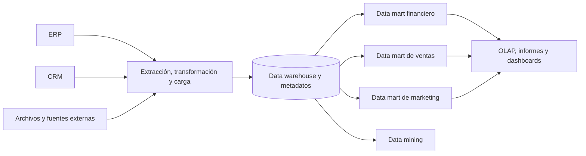

##### Diseño orientado a objetivos y KPI

Un DW no consiste en acumular datos sin criterio. El enfoque **top-down** parte
de objetivos estratégicos, identifica **factores críticos de éxito (CSF)** y
define los KPI necesarios para la dirección. Después establece agregaciones
como sumas de ventas, promedios mensuales o comparaciones interanuales e
implementa el modelo de datos que las soportará.

##### Modelado multidimensional

El modelo distingue:

- **Tabla de hechos:** contiene medidas numéricas, como importe, unidades o
  costes, y claves hacia las dimensiones. Expresa **qué se mide**.
- **Tablas de dimensiones:** aportan contexto para agrupar o filtrar: tiempo,
  cliente, producto, tienda, etc. Expresan **desde qué perspectivas se mide**.

En un **esquema en estrella**, las dimensiones se relacionan directamente con
la tabla central de hechos. En un **esquema en copo de nieve**, algunas
dimensiones se normalizan en tablas relacionadas para representar jerarquías
y reducir redundancias.

##### Ejemplo: tickets de supermercado

La tabla de hechos Tickets incluye número de ticket, fecha, hora, caja,
empleado, centro, forma de pago y total. Para analizar el **importe total del
ticket**, se relaciona con dimensiones como:

| Dimensión | Atributos de ejemplo |
|---|---|
| Tiempo | Fecha, día de la semana, día del mes, mes, trimestre, año, vacaciones y fin de semana. |
| Hora | Hora y franja horaria. |
| Empleado | Identificador, nombre y categoría. |
| Centro | Identificador, descripción, dirección, población, provincia, código postal, metros cuadrados y zona. |
| Forma de pago | Identificador y descripción: efectivo, tarjeta, etc. |

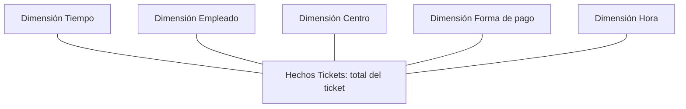

Con este esquema se analiza el total por fecha, zona, empleado, categoría,
forma de pago o franja horaria. Para estudiar unidades vendidas por artículo
se necesita el detalle de las líneas de ticket, no solo su cabecera.

Si la descripción de zona se repite en muchos centros, el copo de nieve
separa una dimensión Zona y hace que Centro la referencie. Se reduce la
redundancia y se representa la jerarquía mediante más relaciones.

#### 3.4.3. Sistemas de ayuda a la decisión (DSS)

Un **DSS (Decision Support System)** es una herramienta interactiva que combina
datos y modelos analíticos para apoyar decisiones. A diferencia del sistema
transaccional, no se centra en registrar el trabajo diario, sino en explorar
variables, simular escenarios **«¿qué pasaría si…?»**, comparar alternativas
y utilizar datos históricos y estadísticos.

##### OLAP

**OLAP (Online Analytical Processing)** permite acceder y analizar información
multidimensional mediante dimensiones y jerarquías, sin programar cada
navegación. Por ejemplo:

- Tiempo: año → mes → día.
- Geografía: país → región → ciudad.
- Producto: categoría → subcategoría → producto.

Los requisitos **FASMI** resumen las cualidades de una herramienta OLAP:

| Letra | Requisito | Significado |
|---|---|---|
| F | Fast | Respuesta rápida a consultas y exploración. |
| A | Analysis | Soporte para lógica de negocio y cálculos analíticos. |
| S | Shared | Acceso compartido con seguridad e integridad. |
| M | Multidimensional | Visión conceptual mediante dimensiones y jerarquías. |
| I | Information | Capacidad de manejar información relevante y derivada. |

Un **cubo OLAP** representa medidas en varias dimensiones; no está limitado a
tres. En el ejemplo de libros, cada celda contiene las unidades vendidas de
un libro a un cliente en un año. Los ejes son clientes, libros y años; las
unidades son la medida, no otra dimensión.

Las operaciones de exploración incluyen:

- **Rotar o pivotar:** cambiar la disposición de los ejes.
- **Slice:** fijar un valor de una dimensión para obtener una sección.
- **Dice:** seleccionar un subconjunto de valores de varias dimensiones.
- **Roll-up:** agregar hacia un nivel más general, como sumar libros por
  materia o ventas mensuales por año.
- **Drill-down:** bajar al detalle de una jerarquía, como de materia a libro
  o de año a mes.

El material llama *slicing* a la rotación de ejes; aquí se distinguen ambas
operaciones para evitar confundir rotar con seleccionar una sección.

##### OLAP y tablas dinámicas de Excel

Una tabla dinámica permite una exploración sencilla. En el ejemplo se
distribuyen almacenes o ciudades en filas, promociones como Navidad o verano
en columnas, productos como filtro y la **suma de unidades** como valor.
Filas, columnas y filtros son dimensiones; la suma es la medida.

Las herramientas compatibles también pueden abrir un libro OLAP desde Excel
para analizar datos y crear gráficos. El tema propone practicar con el
archivo «HERRAMIENTA OLAP» del aula virtual.

##### EIS y dashboards

Un **EIS (Executive Information System)** es una herramienta analítica dirigida
a la alta dirección. Presenta KPI mediante interfaces intuitivas, ofrece una
visión global y puede incluir **informes de excepción**, que alertan cuando
un indicador se desvía significativamente del objetivo.

Un panel ejecutivo puede combinar resumen estratégico —ventas, cuota de
mercado, rentabilidad, objetivos e innovación—, rendimiento por región,
eficiencia y costes operativos, y alertas sobre ventas, stock o margen.

Un **dashboard o cuadro de mando** monitoriza y representa visualmente KPI,
métricas y datos relevantes de una empresa, departamento, campaña o proceso.
Combina gráficos, tablas, tarjetas y filtros, con información actualizada en
tiempo real o periódicamente.

Su construcción comprende obtener los datos, calcular métricas —desviaciones,
medianas, acumulados, etc.— y crear visualizaciones adaptadas a los usuarios.
Debe facilitar no solo ver si algo va bien o mal, sino explorar por qué.

Los indicadores se personalizan según el negocio. Un EIS utiliza este tipo
de presentación para ofrecer información ejecutiva; no cualquier dashboard
constituye por sí mismo un EIS.

#### 3.4.4. Minería de datos (DM, Data Mining)

La **minería de datos** aplica algoritmos matemáticos, estadísticos y de
aprendizaje automático a grandes volúmenes de datos para descubrir patrones,
relaciones, reglas de asociación y tendencias no evidentes. Puede producir
modelos descriptivos y predictivos.

Mientras el análisis OLAP y muchos dashboards explican **qué ha pasado**, la
minería permite explorar también **qué puede pasar** y generar conocimiento
que apoye decisiones complejas.

##### Etapas del proceso

1. **Determinar objetivos y problemas.** Localizar la necesidad, definir
   objetivos medibles, analizar la situación e identificar la información
   necesaria. Por ejemplo: aumentar las ventas de un producto; el objetivo
   analítico sería identificar quién tiene mayor probabilidad de comprarlo.
2. **Recopilar y preparar datos.** Seleccionar fuentes internas, externas,
   servicios de nube o sensores IoT; comprobar su fiabilidad, corregir errores,
   eliminar duplicados, tratar datos incompletos y normalizar formatos. Se
   pueden usar ETL y gestión de datos maestros. La preparación debe quedar
   documentada.
3. **Modelar.** Aplicar algoritmos a los datos preparados y construir modelos
   predictivos o descriptivos. Si se detectan problemas de calidad, hay que
   volver a la preparación.
4. **Evaluar.** Verificar precisión, coherencia, utilidad y cumplimiento de los
   objetivos; interpretar los hallazgos con expertos del negocio y decidir si
   se implantan, ajustan o descartan los modelos.

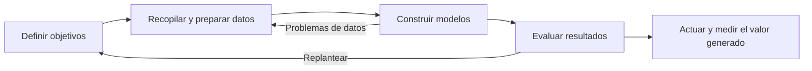

##### Técnicas de modelado

| Técnica | Finalidad y ejemplo |
|---|---|
| Regresión | Analizar relaciones y predecir valores numéricos; por ejemplo, estudiar la relación entre edad y salario. |
| Clasificación | Asignar categorías; por ejemplo, distinguir clientes con mayor o menor probabilidad de comprar un producto. |
| Clustering | Agrupar datos similares sin categorías previas; por ejemplo, segmentar compradores con hábitos semejantes. |
| Series temporales | Analizar evolución, ciclos y tendencias; por ejemplo, prever compras en distintos momentos del año. |
| Redes neuronales | Aprender relaciones complejas y no lineales mediante unidades conectadas; por ejemplo, detectar fraude o patrones de compra. |

Las redes neuronales se inspiran de forma simplificada en unidades
interconectadas; no reproducen literalmente el cerebro humano. El aprendizaje
ajusta sus parámetros a partir de los datos.

En el **aprendizaje supervisado** se entrena con ejemplos de entrada y
resultados o etiquetas conocidos. En el **no supervisado** se buscan
estructuras y agrupaciones sin proporcionar esas etiquetas de salida.

El tema utiliza la asociación entre pañales y cerveza como ejemplo ilustrativo
de un patrón de cesta que podría aprovecharse para colocar productos o crear
ofertas; no demuestra por sí mismo una relación causal.

##### Evaluación y aplicación

En clasificación se utilizan exactitud, precisión, exhaustividad o *recall*,
F1 y matriz de confusión. En regresión, error cuadrático medio (MSE), su raíz
(RMSE), error absoluto medio (MAE) y coeficiente de determinación (R²).

Conviene evaluar con datos no empleados para entrenar, comparar modelos,
documentar limitaciones y revisar su interpretabilidad y relevancia con
expertos. Un modelo no solo debe ser preciso: sus resultados deben ser
comprensibles y accionables.

Se puede comparar el estado inicial con el posterior a una actuación —por
ejemplo, ventas de julio y de septiembre— para valorar la mejora, teniendo
en cuenta los factores que puedan influir en la comparación.

#### 3.4.5. Cuadro de mando integral (CMI/BSC)

El **CMI (Balanced Scorecard, BSC)** es un modelo de gestión estratégica de
**Robert S. Kaplan y David P. Norton**. Traduce visión y estrategia en
objetivos, indicadores, metas y acciones concretas y medibles.

Surge para superar una gestión centrada exclusivamente en ingresos,
beneficios, costes, rentabilidad e inversiones. Añade factores no financieros
y los relaciona en cuatro perspectivas:

| Perspectiva | Pregunta | Metas e indicadores de ejemplo |
|---|---|---|
| Financiera | ¿Cómo nos ven los accionistas? | Rentabilidad, crecimiento, valor; ingresos, beneficios, costes e inversiones. |
| Cliente | ¿Cómo nos ven los clientes? | Satisfacción, fidelización, cuota de mercado e imagen; retención, nuevos clientes y recomendaciones. |
| Procesos internos | ¿En qué procesos debemos ser excelentes? | Calidad, eficiencia, innovación y orientación al cliente; tiempo de ciclo, productividad y cumplimiento de plazos. |
| Aprendizaje y crecimiento | ¿Podemos seguir mejorando y creando valor? | Formación, competencias, innovación, motivación y retención; horas de formación, satisfacción y rotación del personal. |

Las perspectivas se conectan mediante hipótesis de causa y efecto:

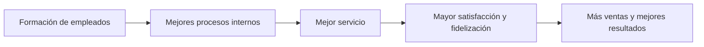

El CMI pregunta no solo qué está ocurriendo, sino **qué objetivos debemos
alcanzar para ejecutar la estrategia** y crear valor a largo plazo.

#### 3.4.6. CMI frente a dashboard

| Aspecto | CMI/BSC | Dashboard |
|---|---|---|
| Naturaleza | Modelo de gestión estratégica. | Herramienta de visualización. |
| Finalidad | Ejecutar y controlar la estrategia. | Monitorizar y analizar información. |
| Contenido | Objetivos, perspectivas, indicadores y relaciones. | KPI, gráficos, tablas y filtros. |
| Horizonte habitual | Medio y largo plazo. | Frecuentemente corto y medio plazo, aunque puede mostrar información estratégica. |
| Pregunta | ¿Avanzamos hacia nuestra estrategia? | ¿Qué está ocurriendo? |
| Ejemplo | Mejorar la fidelización. | Mostrar su tasa actual. |

Son complementarios: **el CMI es el mapa de la estrategia; el dashboard, el
panel de instrumentos que muestra el estado del camino**. Los colores
verde, ámbar y rojo pueden señalar cumplimiento, atención o desviación.

##### Ejemplo: lectura de un panel de control

El panel ilustrativo para enero-diciembre de 2026 combina cifras globales,
evolución temporal, distribución por canales, productos y estado de objetivos:

| Indicador | Valor | Variación frente al año anterior |
|---|---:|---:|
| Ventas | 1.250.000 € | +12 % |
| Clientes | 8.450 | +8 % |
| Pedidos | 1.320 | +5 % |
| Incidencias | 48 | +20 % |

Una subida no siempre es positiva: más ventas puede ser favorable, pero más
incidencias exige atención. El significado del color depende del indicador.

Los pedidos se reparten entre online (45 %), tienda física (30 %),
distribuidores (15 %) y otros canales (10 %). Los cinco productos destacados
permiten comparar su evolución:

| Producto | Ventas | Variación |
|---|---:|---:|
| A | 320.000 € | +18 % |
| B | 280.000 € | +12 % |
| C | 210.000 € | +5 % |
| D | 180.000 € | −3 % |
| E | 150.000 € | +1 % |

El panel marca ventas y clientes como «en objetivo», con avances del 95 % y
90 %; satisfacción requiere atención (70 %) y tiempo de respuesta figura
fuera de objetivo (45 %). El porcentaje de avance y el criterio que activa
cada estado deben estar definidos para interpretar correctamente el panel.

##### Ejemplo: una empresa que vende ordenadores

La estrategia es aumentar la rentabilidad ofreciendo buen servicio y
productos de calidad. El CMI establece objetivos y KPI en las cuatro
perspectivas:

| Perspectiva | Objetivo | KPI y meta |
|---|---|---|
| Financiera | Aumentar el beneficio. | Beneficio mensual; mejora del 15 % frente al año anterior. |
| Cliente | Mejorar satisfacción. | Puntuación igual o superior a 8,5/10. |
| Procesos internos | Reducir el tiempo de entrega. | Tiempo medio de entrega igual o inferior a 2 días. |
| Aprendizaje | Mejorar competencias. | Al menos 30 horas de formación por empleado y año. |

El dashboard representa los resultados y los compara con metas operativas:

| Indicador | Meta del panel | Resultado | Lectura |
|---|---:|---:|---|
| Beneficio mensual | 120.000 € | 125.000 € | Supera la meta absoluta. |
| Satisfacción del cliente | ≥ 8,5/10 | 8,4/10 | Requiere mejora. |
| Tiempo medio de entrega | ≤ 2 días | 2,1 días | Requiere mejora. |
| Formación por empleado | ≥ 30 h/año | 32 h | Supera la meta. |

El panel también muestra cambios frente a periodos anteriores: beneficio
+12 % respecto al mes anterior, satisfacción +0,6 y entrega −0,5 días frente
al trimestre anterior, y formación +10 horas frente al año anterior. Las
ventas se distribuyen entre portátiles (45 %), sobremesa (30 %), monitores
(15 %) y accesorios (10 %), con un total ilustrativo de 520.000 €.

Cada cifra debe compararse con la meta y el periodo adecuados: el +12 %
mensual del panel **no permite comprobar por sí solo** la meta estratégica
de mejorar un 15 % frente al año anterior. Son comparaciones diferentes.

##### Ejemplos de aplicación

El tema cita estas experiencias de aplicación del CMI:

| Organización | Uso y resultado descritos |
|---|---|
| Mobil North American Marketing and Refining, posteriormente ExxonMobil | Alineación de la nueva estrategia con objetivos y medidas; mejora de productividad y reducción del 20 % del coste de refinar, comercializar y distribuir un galón de gasolina. |
| Hilton Hotels | Alineación de objetivos financieros, de clientes, procesos y aprendizaje; mejora del enfoque al cliente y de la coordinación de la organización. |
| DuPont | Adopción temprana del CMI en una empresa industrial para gestionar su estrategia. |
| IBM | Alineación de la estrategia global y de sus unidades de negocio con indicadores financieros y no financieros. |
| UPS | Alineación estratégica, mejora de la ejecución y coordinación de iniciativas globales. |

También presenta paneles ilustrativos por sector, asociados a nombres
conocidos; sus cifras deben entenderse como ejemplos didácticos, no como
cuentas reales verificadas de esas empresas:

| Panel | Indicadores y análisis |
|---|---|
| Ventas minoristas, ejemplo Zara | Ventas, tickets, ticket medio, margen, categorías, evolución y tiendas. |
| Clientes de telecomunicaciones, ejemplo Telefónica | Clientes, altas, bajas o churn, satisfacción/NPS, servicios y distribución geográfica. |
| Producción industrial, ejemplo SEAT | Unidades, eficiencia OEE, paradas, defectos, modelos y estado de líneas. |
| Marketing digital/e-commerce, ejemplo Amazon | Visitas, conversión, pedidos, ingresos, canales y productos más vendidos. |

Los valores de las tarjetas de esos paneles ilustran qué se mide en cada
actividad:

| Panel | Valores ilustrativos |
|---|---|
| Ventas minoristas | Ventas de 1.284.500 €, 25.430 tickets, ticket medio de 50,5 € y margen del 40 %. |
| Telecomunicaciones | 4.350.000 clientes, 120.000 nuevos clientes, bajas del 1,8 % y NPS de 42. |
| Producción industrial | 12.450 unidades, OEE del 85 %, 3 paradas no planificadas y defectos del 1,2 %. |
| Marketing digital | 850.000 visitas, conversión del 2,8 %, 23.800 pedidos e ingresos de 1.190.000 €. |

En ventas se desglosan categorías —ropa de mujer 42 %, hombre 28 %, calzado
18 % y accesorios 12 %— y se comparan tiendas. En telecomunicaciones se
estudian servicios —móvil 52 %, fibra 28 %, televisión 12 % y otros 8 %—,
altas, bajas y provincias.

En producción se comparan modelos —León 35 %, Ibiza 30 %, Arona 20 % y
Tarraco 15 %—, la evolución semanal y el estado de cada línea: las líneas 1,
2 y 4 producen y la 3 está parada. En marketing se compara tráfico orgánico
(40 %), anuncios SEM (25 %), redes sociales (20 %), directo (10 %) y otros
(5 %), junto con ingresos y productos más vendidos: portátiles, auriculares,
monitores, teclados y discos duros.

**OEE (Overall Equipment Effectiveness)** mide la eficacia global de los
equipos de producción; **NPS (Net Promoter Score)** es un indicador de
recomendación del cliente. El **churn** expresa la tasa de bajas. No basta
con conocer sus valores: hay que interpretar su evolución y actuar sobre las
desviaciones.

[↑ Volver al índice](#índice)

---

### 3.5. El CRM: gestión de las relaciones con los clientes

El **CRM (Customer Relationship Management)** reúne la información necesaria
para conocer a los clientes, gestionar y analizar la relación con ellos y
mejorar su experiencia. Persigue clientes más satisfechos y un negocio más
rentable.

No es solo una base de datos ni un programa: combina **estrategia, personas,
procesos y tecnología** para construir relaciones duraderas. Sus funciones
concretas dependen del tipo de empresa, sus necesidades y la solución elegida.

#### Información y funciones de un CRM

Puede almacenar:

- Contactos, ubicación, tipo de cliente y preferencias.
- Clientes potenciales o **leads** y oportunidades comerciales.
- Compras, pedidos, productos contratados, renovaciones y garantías.
- Llamadas, correos, reuniones, formularios, chats y contactos en redes.
- Incidencias, solicitudes y reclamaciones.
- Necesidades, intereses, expectativas y valor del cliente para la empresa.

Con esta información permite diseñar y seguir campañas de marketing,
captar clientes potenciales, gestionar oportunidades y ventas, generar
presupuestos, contratos e informes, automatizar comunicaciones y tareas,
detectar nuevas oportunidades y analizar KPI.

Los beneficios potenciales incluyen información centralizada y actualizada,
visión **360° del cliente**, colaboración entre departamentos, más eficiencia,
mejor servicio, fidelización y aumento de ventas.

El CRM puede integrarse con ERP, web, e-commerce y analítica. La IA puede
apoyar el análisis de clientes, la personalización, la predicción de
oportunidades y la automatización de tareas.

La relación con la toma de decisiones puede resumirse así:

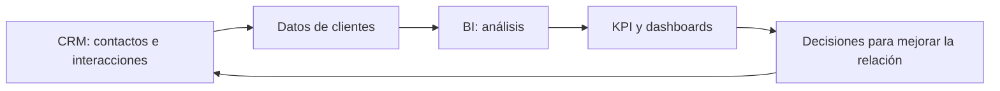

El CRM recopila y centraliza; el BI analiza; los dashboards visualizan. La
empresa utiliza ese conocimiento para actuar.

#### Personalización y experiencia omnicanal

Los clientes no son todos iguales. Conocer su historia permite adaptar el
servicio y la comunicación:

- Quien compra habitualmente un producto puede recibir información relacionada.
- Quien tiene una incidencia puede recibir seguimiento específico.
- Quien lleva tiempo sin comprar puede participar en una campaña de
  reactivación.
- Un comercial puede consultar el historial antes de contactar.

El **front office** comprende las actividades con contacto directo con el
cliente: ventas, atención telefónica, correo, chat, web, soporte, tienda
física o virtual y redes sociales. El CRM centraliza sus interacciones para
mantener el contexto aunque cambien el canal o el empleado.

Por ejemplo, un cliente empieza una consulta en la web, llama después y
recibe la respuesta por correo. Si todas las interacciones están registradas,
no necesita explicar de nuevo su problema. Esta **experiencia omnicanal**
coherente mejora la satisfacción, la fidelidad y la eficiencia interna.

Marketing, Ventas y Atención al Cliente son las áreas que más interacciones
generan, pero la estrategia afecta al conjunto de la empresa:

| Área | Contribución y preguntas relevantes |
|---|---|
| Marketing | Atraer, conocer y fidelizar. ¿A qué segmentos dirigir las campañas? |
| Ventas | Convertir oportunidades en clientes y seguir presupuestos, ofertas e historial comercial. ¿Qué oportunidades están abiertas? |
| Atención al cliente | Resolver dudas, incidencias, devoluciones y reclamaciones antes, durante y después de la compra. |
| Producción/producto | Utilizar necesidades y opiniones para mejorar productos y servicios. ¿Qué características se demandan? |
| Finanzas | Facilitar medios de pago y estudiar su impacto en la experiencia. |
| Personas/RR. HH. | Mejorar la formación de quienes atienden a clientes. |
| Informática | Integrar sistemas y garantizar seguridad, disponibilidad y calidad de datos. |
| Dirección | Revisar resultados, KPI y cumplimiento de objetivos. |

#### Implantación de un CRM

Implantarlo no consiste únicamente en instalar software. Hay que revisar la
estrategia, la arquitectura, los procesos y los datos:

1. **Definir la estrategia CRM:** concretar si se quiere mejorar la atención,
   aumentar ventas, fidelizar u otros objetivos medibles.
2. **Diseñar la arquitectura tecnológica:** elegir aplicaciones, bases de
   datos, integraciones, API, seguridad y dispositivos.
3. **Analizar y adaptar procesos:** revisar cómo se trabaja y rediseñar lo
   necesario. La **BPR (Business Process Reengineering)** o reingeniería de
   procesos de negocio busca hacerlos más eficientes con apoyo tecnológico.
4. **Preparar datos:** migrar, limpiar, integrar y organizar información,
   comprobando formatos y calidad.
5. **Formar y poner en marcha:** enseñar a los usuarios a trabajar con el
   sistema y gestionar el cambio.
6. **Medir y mejorar:** analizar KPI, identificar desviaciones y ajustar.

#### 3.5.1. El componente estratégico del CRM

La **estrategia CRM** define cómo y para qué se gestionará la relación con
los clientes. Establece objetivos y organiza personas, procesos y tecnología.
El **software CRM** es la herramienta que permite ponerla en práctica:
centralizar datos, registrar y compartir interacciones, analizar conductas,
personalizar productos y servicios y medir resultados.

La estrategia indica qué se quiere conseguir; el programa ayuda a hacerlo
realidad. **La tecnología apoya a la estrategia, no la define.**

Una hoja de ruta completa enlaza:

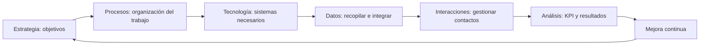

##### Identificar el perfil del comprador

Para satisfacer al cliente hay que identificar el **mercado objetivo** y
construir perfiles de comprador o **buyer personas**. Puede haber varios,
según los tipos de clientes.

La investigación de mercado estudia quién ha comprado a la empresa, qué
compra a la competencia y qué rasgos y comportamientos se repiten. El tema
propone métricas como edad, género, raza, ubicación, uso de tecnología, redes
preferidas y nivel socioeconómico. Su recogida y uso deben ser pertinentes y
respetar la normativa de protección de datos, especialmente cuando se trate
de categorías sensibles.

Un perfil debe ir más allá de lo demográfico: incluye motivaciones,
frustraciones, necesidades y hábitos digitales. Así se decide dónde contactar,
qué ofrecer y cómo personalizar las acciones.

###### Ejemplos de perfiles

- **Javier, 28 años, Madrid:** profesional joven, usuario intensivo de
  tecnología e Instagram, de nivel socioeconómico medio-alto. Le interesan
  productos innovadores, compra online y valora rapidez y personalización.
- **Daniela Vargas, 32 años, gerente de marketing, casada y con un hijo:**
  organizada, audaz, extrovertida y pragmática. Viaja sola tres o cuatro veces
  al año, participa en programas de fidelidad y busca productos que faciliten
  sus viajes. Su arquetipo se describe como «aventura asertiva»; valora más
  el confort y la comodidad que el precio, y le frustran especialmente el
  exceso de correos y la baja calidad. Se estudian su personalidad, sus
  motivaciones y canales como YouTube, LinkedIn, Instagram y Pinterest.

Son ejemplos de cómo combinar datos para diseñar experiencias, no etiquetas
rígidas que describan a todas las personas de una categoría.

El webinar de **José Noblejas para EALDE Business School**, «¿Cómo aumentar
las ventas usando una estrategia CRM?», refuerza esta idea: el CRM integra
compras, comunicaciones, respuestas, historial y preferencias para conocer
mejor al cliente, personalizar y mejorar la eficiencia comercial.

#### 3.5.2. El componente tecnológico del CRM

Siguiendo la clasificación de IBM Redbooks citada en el tema, se distinguen
tres componentes complementarios: **operativo, analítico y colaborativo**.

##### CRM operativo u operacional

Automatiza y organiza los procesos de venta, desde la captación hasta el
cierre y la fidelización. Establece procedimientos para atender al cliente,
gestionar oportunidades y aprovechar las existentes.

Sus funciones incluyen:

- Gestión de clientes potenciales, contactos y cuentas.
- Registro de preferencias del cliente.
- Preparación de ofertas en el momento del pedido.
- Seguimiento del desempeño comercial.
- Previsión de ventas.

El ciclo enlaza captación → atención → gestión de oportunidades → cierre.
Los beneficios son mayor eficiencia y productividad, mejor calidad de
servicio, fidelización y crecimiento de las ventas.

##### CRM analítico

Analiza los datos de clientes para convertirlos en conocimiento. Permite
identificar rentabilidad, frecuencia de compra, productos preferidos,
eficacia de campañas, necesidades repetidas y valor del cliente.

Se apoya en data warehouses, DSS, minería de datos, KPI y dashboards. El
proceso es recopilar → analizar → generar conocimiento → decidir. Ayuda a
anticipar necesidades, segmentar, detectar oportunidades y mejorar acciones
de marketing, ventas y servicio.

##### CRM colaborativo

Facilita que los departamentos compartan información y trabajen de forma
coordinada. Integra teléfono, correo, web, chat, redes y aplicaciones para
evitar que el historial quede aislado en un canal.

Marketing, Ventas, Atención al Cliente, Producto y otras áreas acceden a una
visión común. Esto mejora la comunicación interna, acelera respuestas y
favorece una experiencia consistente y personalizada.

##### 3.5.2.1. CRM local frente a nube

| Aspecto | Local/on-premises | Nube |
|---|---|---|
| Alojamiento | Servidores propios o infraestructura controlada por la empresa. | Infraestructura de un proveedor, accesible por red. |
| Ventajas | Mayor control técnico y sobre datos, capacidad de personalización y posibilidad de operación interna sin Internet, según arquitectura. | Menor inversión inicial, acceso desde distintos lugares y dispositivos, actualizaciones y escalabilidad del servicio. |
| Dificultades | Inversión, mantenimiento, personal técnico y gestión del crecimiento. | Dependencia del proveedor y de conectividad, límites de personalización y condiciones de acceso y tratamiento de datos. |

La seguridad no queda garantizada únicamente por elegir local o nube: depende
de configuración, controles, operación y contrato. La comparación sigue los
mismos criterios estudiados para ERP.

##### 3.5.2.2. CRM de código abierto frente a propietario

Un CRM **de código abierto** ofrece su código con una licencia que permite
usarlo, estudiarlo y modificarlo bajo determinadas condiciones. Puede
adaptarse a procesos y registros propios y reducir costes de licencia, pero
el trabajo de implantación y mantenimiento sigue teniendo coste.

Un CRM **propietario** se usa conforme a la licencia del fabricante, con
restricciones de modificación y distribución. Puede ofrecer configuraciones,
extensiones y API sin que eso lo convierta en abierto.

El material cita **OroCRM, SuiteCRM y SugarCRM** en el contexto de soluciones
abiertas. En SugarCRM hay que distinguir su trayectoria y antigua edición
comunitaria de las ediciones comerciales; **la licencia debe comprobarse para
la edición y versión concretas**.

También reúne Freshworks, Zoho CRM, HubSpot, Capsule CRM, Agile CRM, Bitrix24
y Streak bajo un encabezado de «open source». **Esa etiqueta no debe tomarse
como una clasificación fiable de sus licencias:** gratuito, freemium,
personalizable y de código abierto no significan lo mismo. Se conserva la
lista como catálogo de alternativas mencionadas, no como afirmación de que
todas publican su código.

| Alternativa mencionada | Orientación descrita en el tema |
|---|---|
| Freshworks/Freshsales | Ventas, automatización y relación con clientes. |
| Zoho CRM | Funciones flexibles y personalizables, integradas en su ecosistema. |
| HubSpot | Marketing, ventas y atención al cliente, con oferta gratuita y de pago. |
| Capsule CRM | Contactos, oportunidades y tareas, con enfoque sencillo. |
| Agile CRM | Ventas, marketing y servicio al cliente. |
| Bitrix24 | CRM, proyectos, comunicación y colaboración. |
| Streak | Gestión comercial y de contactos integrada en Gmail. |

##### 3.5.2.3. Estadísticas: proveedores y cuota de mercado

El gráfico del material presenta **cuotas por ingresos mundiales de software
CRM correspondientes a 2025, publicadas en 2026 y atribuidas a IDC**:

| Proveedor | Cuota |
|---|---:|
| Salesforce | 20,0 % |
| Oracle | 4,1 % |
| Microsoft | 4,0 % |
| Adobe | 3,4 % |
| SAP | 3,1 % |
| Otros | 65,4 % |

La conclusión destacada es el liderazgo de Salesforce. La categoría citada
incluye fuerza de ventas, campañas de marketing, atención al cliente,
contact center, publicidad y comercio digital. No debe compararse sin más
con gráficos de otras fuentes o definiciones de CRM. Se reproducen los datos
del tema, no una verificación independiente del mercado.

##### 3.5.2.4. Algunas soluciones CRM del mercado

No existe un CRM óptimo para cualquier empresa. Hay que evaluar necesidades,
integración, usuarios, costes y capacidad de crecimiento. El tema presenta:

| Solución | Funciones y rasgos destacados |
|---|---|
| **Kommo** | Orientación a ventas, leads y conversaciones; automatización comercial, múltiples canales de mensajería e interfaz visual para equipos comerciales. |
| **HubSpot** | Plataforma de marketing, ventas y servicio; pipeline, contactos, campañas, conversaciones y automatización, con amplias integraciones y facilidad de uso. |
| **Salesforce** | CRM escalable y altamente personalizable para diferentes tamaños; ventas, marketing, servicio, analítica e IA Einstein; ecosistema de aplicaciones AppExchange. |
| **Zoho CRM** | Ventas, marketing, clientes, automatizaciones e informes; integración con Zoho Mail, Books y otras herramientas, además de capacidades de IA Zia. |
| **Bitrix24** | CRM y ventas unidos a chat, videollamadas, tareas, proyectos y colaboración; automatización y comunicación multicanal en una plataforma. |
| **Pipedrive** | Gestión del proceso de ventas mediante pipelines visuales; contactos, oportunidades, actividades, automatizaciones e informes, con enfoque sencillo. |
| **Freshsales, de Freshworks** | Captación y gestión de leads, automatización, seguimiento de actividades, correo, llamadas, chat, informes y recomendaciones o predicciones con Freddy AI. |
| **SugarCRM** | CRM empresarial independiente para ventas, marketing y servicio; oportunidades, pipeline, analítica, automatización e IA, con personalización e integración con ERP. |

SugarCRM se presenta como integrable con sistemas de Oracle, SAP, Sage,
Microsoft Dynamics 365 y Epicor. La posibilidad real y el alcance de cada
integración deben comprobarse para el producto concreto.

Las capturas de estas herramientas ilustran elementos comunes: fichas de
clientes, tareas, actividades, fases comerciales, oportunidades, previsiones,
comunicaciones e indicadores. No es necesario que todas tengan idénticas
funciones para desempeñar el papel de CRM.

##### 3.5.2.5. Sistemas ERP que ofrecen soluciones CRM

Integrar CRM y ERP permite conectar la relación comercial con pedidos,
inventario, facturas y operaciones. El tema destaca tres ecosistemas:

###### Microsoft Dynamics 365

Ofrece gestión comercial con oportunidades y ciclo de ventas, analítica,
automatización e integración con Microsoft 365 —Outlook, Teams, Word y
Excel—. Copilot aporta asistencia mediante IA. Se orienta a empresas que
buscan mantener conectados los procesos y datos dentro del ecosistema
Microsoft.

###### Oracle NetSuite

Incorpora CRM en su ERP de nube para gestionar clientes, leads,
oportunidades, previsiones, campañas, pedidos y soporte. Comparte información
con finanzas, inventario, compras y otros procesos, buscando una visión
unificada y actualizada del cliente y del negocio.

###### SAP Customer Experience

Reúne capacidades de ventas, marketing, comercio y servicio. Centraliza datos
e interacciones y utiliza automatización, analítica e IA para gestionar
oportunidades, campañas y atención, desde el primer contacto hasta la
fidelización. Su integración con el ecosistema SAP conecta la experiencia de
cliente con la gestión empresarial.

En todos los casos, la integración debe valorarse como parte de la
arquitectura y la estrategia de la empresa, no solo como una lista de
funcionalidades comerciales.

[↑ Volver al índice](#índice)

---

## 4. Bibliografía y recursos complementarios

### 4.1. Fuentes sobre procesos, estrategia y sistemas de información

- **Kalakota, R. y Robinson, M. (2001).** *E-Business 2.0: Roadmap for Success*.
  Addison-Wesley.
- **Alter, S. (2002).** «The Work System Method for Understanding Information
  Systems and Information Systems Research». *Communications of the
  Association for Information Systems*, 9, 90-104.
- **Alter, S. (1999).** «A General, Yet Useful Theory of Information Systems».
  *Communications of the AIS*, 1(13).
- **Pérez Fernández de Velasco, J. A. (2009).** *Gestión por procesos*.
  ESIC, 3.ª edición.
- **ISO 9000 e ISO 9001:2000:** calidad y gestión de la calidad.
- **OECD/OCDE:** <http://www.oecd.org/>.
- **Gartner:** <https://www.gartner.com/>.
- **ebXML Glossary:** <http://www.ebxml.org/>. Electronic Business using
  eXtensible Markup Language es una iniciativa de OASIS y UN/CEFACT iniciada
  en 1999 para facilitar negocios por Internet. Sus especificaciones abordan
  procesos de negocio, componentes de datos, acuerdos de protocolos de
  colaboración, mensajería, registros y repositorios.

### 4.2. ERP y cadena de suministro

- Oracle: [¿Qué es ERP?](https://www.oracle.com/es/erp/what-is-erp/).
- TIC Portal: [¿Qué es un sistema ERP y para qué sirve?](https://www.ticportal.es/temas/enterprise-resource-planning/que-es-sistema-erp),
  actualización citada de agosto de 2024.
- TIC Portal: [Programas ERP: selección de software](https://www.ticportal.es/temas/enterprise-resource-planning/programas-erp),
  actualización citada de noviembre de 2023.
- TIC Portal: [Módulos y ERP modular](https://www.ticportal.es/temas/enterprise-resource-planning/modulos-erp),
  actualización citada de enero de 2024.
- [Odoo](https://www.odoo.com/es_ES).
- Corporativo Alaro: [Beneficios de un ERP en Linux](https://www.corporativoalaro.com/post/beneficios-de-un-erp-en-linux-un-an%C3%A1lisis-comparativo).
- Peerstone Research: [Linux ERP White Paper](http://www.peerstone.com/pdfs/Peerstone_Linux_ERP_White_Paper.pdf).
- Asana: [Supply Chain Management](https://asana.com/es/resources/supply-chain-management).
- Oracle: [¿Qué es SCM?](https://www.oracle.com/es/scm/what-is-supply-chain-management/).
- Gurusis: [Diferencias entre ERP, CRM y SCM](https://gurusis.com/5-claves-entender-diferencias-erp-crm-scm/).
- [Vídeo sobre cadena de suministro](https://www.youtube.com/watch?v=IHIxLtuYdNM).
- Aner: [MRP I y MRP II: diferencias](https://www.aner.com/blog/mrp-i-mrp-ii-diferencias.html).
- Statistiek Vlaanderen: [Uso de ERP en empresas](https://www.vlaanderen.be/statistiek-vlaanderen/digitale-economie/gebruik-van-erp-software-in-bedrijven).
- IDC: *Future Enterprise Resiliency and Spending Survey*, Wave 8,
  octubre de 2025; citada en *IDC Analyst Brief*, enero de 2026.

### 4.3. Nube y tecnologías relacionadas

- Microsoft: [Inteligencia artificial frente a machine learning](https://azure.microsoft.com/es-es/solutions/ai/artificial-intelligence-vs-machine-learning/#introduction).
- Microsoft: [¿Qué es la inteligencia artificial?](https://azure.microsoft.com/es-es/resources/cloud-computing-dictionary/what-is-artificial-intelligence/).
- IBM: [Inteligencia artificial y definición de John McCarthy](https://www.ibm.com/es-es/cloud/learn/what-is-artificial-intelligence).
- Huawei Forum: [On-premise, SaaS, PaaS e IaaS](https://forum.huawei.com/enterprise/en/the-key-differences-between-on-premise-saas-paas-iaas/thread/780671-893?page=2).
- Iberdrola: [¿Qué es IIoT?](https://www.iberdrola.com/innovacion/que-es-iiot).
- Cryptoconexión: [¿Qué es blockchain?](https://cryptoconexion.com/que-es-blockchain/).
- [Demostración de asistente digital](https://www.youtube.com/watch?v=nuo_okfM8K8).

### 4.4. Comercio electrónico y BI

- TIC Portal: [E-commerce y ERP: ventajas de la integración](https://www.ticportal.es/temas/enterprise-resource-planning/e-commerce-erp-tienda-online),
  actualización citada de diciembre de 2023.
- **Cano, J. L. (2007).** *Business Intelligence: competir con información*.
  Fundación Cultural Banesto.
- **Rice, M. B. (2004).** «Business Intelligence tools can help turn out
  savings in core cost areas». *Managed Healthcare Alliance*.
- **Inmon, W. H.; Terdeman, R. H.; Imhoff, C. (2000).**
  *Exploration Warehousing*. Wiley.
- **Rockart, J. F. y De Long, D. W. (1988).** *Executive Support Systems*.
  Dow Jones-Irwin.
- TIC Portal: [Data mining](https://www.ticportal.es/glosario-tic/data-mining),
  actualización citada de septiembre de 2022.
- **Peláez Chávez, N. (2012).** *Aprendizaje no supervisado y el algoritmo
  wake-sleep en redes neuronales*. Tesis de licenciatura en Matemáticas
  Aplicadas.
- Cyberclick: [¿Qué es un dashboard?](https://www.cyberclick.es/numerical-blog/que-es-un-dashboard).

### 4.5. CRM

- **Llamas Alonso, M. R.; Jiménez Zarco, A. I.; Martínez Ruiz, M. P.;
  Dawson, J. (2006).** «Medición de resultados en la estrategia CRM. Hacia
  un modelo holístico». Referencia ICE del material.
- **Ross, D. F. (2005).** «E-CRM from a supply chain management perspective».
  *Information Systems Management*, invierno, 37-44.
- **Anderson, K. y Kerr, C.** *Customer Relationship Management*.
  McGraw-Hill, 2001; el material utiliza la etiqueta de referencia
  «ANDERSON_KERR_2003».
- **Nartovich, A.; Abou Aly, T.; Mathur, V.; The, P. (2001).**
  *IBM Framework for e-business: Technology, Solution, and Design Overview*.
  IBM Redbooks.
- Evaluando Software: [Componentes de una estrategia CRM](https://www.evaluandosoftware.com/customer-experience/componentes-una-estrategia-crm/).
- Asana: [Estrategia CRM](https://asana.com/es/resources/crm-strategy).
- TIC Portal: [Gestión de relaciones con el cliente](https://www.ticportal.es/glosario-tic/crm-gestion-relaciones-cliente),
  actualización citada de septiembre de 2022.
- Findstack: [Estadísticas CRM](https://findstack.es/resources/crm-statistics).
- [CRM colaborativo](https://softwarepara.net/crm-colaborativo/).
- [CRM operacional](https://softwarepara.net/crm-operacional-operativo/).
- [SAP CRM](https://saps4hanainfo.com/que-es-sap-crm/).
- [SAP: qué es CRM](https://www.sap.com/spain/products/crm/what-is-crm.html).
- [Oracle NetSuite CRM](https://www.netsuite.com/portal/products/crm.shtml).
- [Soluciones Dynamics CRM](https://www.dynamics-crm.es/soluciones-crm/).
- IDC (2026): cifras de ingresos del mercado CRM de 2025 citadas en el tema.

### 4.6. Vídeos, casos y actividades

Estos enlaces amplían los conceptos del tema; el contenido completo de los
vídeos no forma parte de estos apuntes.

- [¿Qué es ERP? El documental](https://play.vidyard.com/vfWptB5zkRWefX36Zgzj1X?disable_popouts=1&v=4.3.15&type=inline).
- [Entrevista sobre ERP modular: Grupo COPASA](https://play.vidyard.com/4hLie6S8QYZhUKzdVgkT94?disable_popouts=1&v=4.3.15&type=inline).
- [Recurso sobre selección e implantación de ERP](https://play.vidyard.com/YEysaic6noV4WpHGYuxawG?disable_popouts=1&v=4.3.15&type=inline).
- [Aurum Bikes: arquitectura de integración e-commerce/ERP](https://play.vidyard.com/2Rvdzxkg5ybigGbiRrgio6?disable_popouts=1&v=4.3.15&type=inline).
- [Aurum Bikes: sincronización del inventario](https://play.vidyard.com/kAoDLid9aoFF5Sg2T6xmZD?disable_popouts=1&v=4.3.15&type=inline).
- [EIS](https://www.youtube.com/watch?v=rD1k-RQoMpc&t=16s).
- [Dashboard: vídeo 1](https://www.youtube.com/watch?v=4I40XzWo1YY).
- [Dashboard: vídeo 2](https://www.youtube.com/watch?v=dzh7faTkHCk).
- [Cómo funcionan las redes neuronales](https://www.youtube.com/watch?v=CU24iC3grq8).
- [Teoría de redes neuronales](https://www.youtube.com/watch?v=fJyGK_aXSdA&t=660s).
- [Teoría de modelos de lenguaje](https://www.youtube.com/watch?v=pFQyv4Qm0H4).
- [Cuadro de mando integral: vídeo introductorio](https://www.youtube.com/watch?v=WFaTv0HJwac).
- [CMI/BSC y mapa estratégico](https://www.youtube.com/watch?v=8gobNxwdxeU&list=PLnrSh8bJKKkalNLC52Y1tkCWaSlq8y2aU).
- [José Noblejas, EALDE: estrategia CRM y ventas](https://www.youtube.com/watch?v=Zuk-g8pG-2I&t=675s).
- **Actividad práctica:** explorar el archivo «HERRAMIENTA OLAP» del aula
  virtual, cambiar filas, columnas, filtros y medidas y observar cómo varían
  los resultados.

---

[↑ Volver al índice](#índice) · [Índice del temario](README.md) · [Unidad anterior: UT1](ut01-la-empresa.md)
