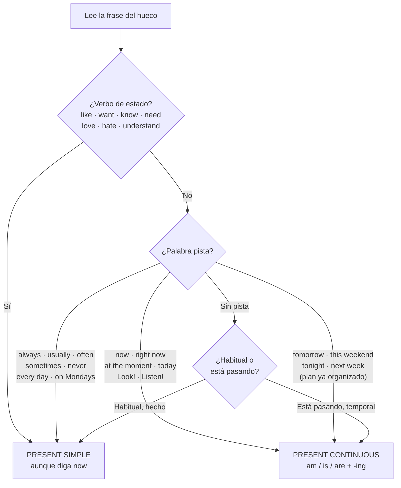

# Chuleta — Examen 1: present simple vs present continuous

> **En una línea:** lo **habitual** → present simple · lo que pasa **ahora** → present continuous.
> Truco: si en español dices «**estoy** + -ando/-iendo», es continuous.

## 1. ¿Cuál toca? Decide en 4 pasos



## 2. Las formas lado a lado

| | Present simple | Present continuous |
|---|---|---|
| ✅ Afirmativa | I / you / we / they **work** · he / she / it **works** | I **am** working · he / she / it **is** working · we / you / they **are** working |
| ❌ Negativa | I **don't** work · he **doesn't** work | I**'m not** working · he **isn't** working · they **aren't** working |
| ❓ Pregunta | **Do** you work? · **Does** he work? | **Are** you working? · **Is** he working? |
| 💬 Respuesta corta | Yes, I **do**. · No, he **doesn't**. | Yes, I **am**. · No, he **isn't**. |
| ❓ Wh- | **Where do** you live? · **What time does** she start? | **What are** you doing? · **Where is** he going? |

> ⚠️ **Después de `does` / `doesn't`, el verbo SIN -s**: *Does she **go**?* · *He doesn't **do**.* (nunca *does she goes*)

## 3. Leer el paréntesis

```text
(not / study)  →  hay "not"         →  NEGATIVA   →  don't / doesn't study  ·  isn't / aren't studying
(you / like) ? →  sujeto dentro + ? →  PREGUNTA   →  Do you like …?        ·  Are you …ing?
(work)         →  solo verbo         →  AFIRMATIVA →  work / works          ·  am / is / are working
Anne, Tom, my mum, it  =  he / she / it  →  -s · does · doesn't · is
```

## 4. Ortografía

| Present simple (he / she / it) | Present continuous (-ing) |
|---|---|
| normal + **-s**: eat → eat**s**, play → play**s** | normal + **-ing**: work → work**ing**, study → study**ing** |
| consonante + y → **-ies**: study → stud**ies**, carry → carr**ies** | acaba en -e → quita la e: make → mak**ing**, write → writ**ing** |
| -ss, -sh, -ch, -x, -o → **-es**: watch**es**, finish**es**, go**es**, do**es** | vocal + consonante → dobla: run → ru**nn**ing, sit → si**tt**ing, swim → swi**mm**ing |
| irregulares: have → **has** · be → **is** | |

## 5. Posición del adverbio de frecuencia

```text
                   ┌─ ANTES del verbo normal ─┐
He       usually        goes          to school.
                   ┌─ DETRÁS de be ─┐
She  is   always   happy.

always 100% ── usually ── often ── sometimes ── never 0%
```

## 6. Las tres trampas

| Trampa | ✅ Correcto | ❌ Mal |
|---|---|---|
| Verbo de estado con *now* | I **want** a coffee now. | ~~I am wanting~~ |
| Plan de futuro | I **am going** on holiday tomorrow. | ~~I go on holiday tomorrow~~ |
| *Look!* / *Listen!* | Look! It **is raining**. | ~~It rains~~ |

## 7. Autotest — tarea del profesor

<details>
<summary>1. You (not / like) ___ chocolate.</summary>

**don't like** — verbo de estado, negativa.
</details>

<details>
<summary>2. She (not / study) ___ at the moment.</summary>

**isn't studying** — *at the moment*.
</details>

<details>
<summary>4. He usually (not / do) ___ his homework.</summary>

**doesn't do** — *usually*; he → doesn't + verbo sin -s.
</details>

<details>
<summary>8. (She / go) ___ to Scotland often?</summary>

**Does she go** — *often*; pregunta con does.
</details>

<details>
<summary>9. (He / eat) ___ now?</summary>

**Is he eating** — *now*; se invierte is.
</details>

<details>
<summary>10. We (go) ___ to the cinema this weekend.</summary>

**are going** — plan de futuro.
</details>

<details>
<summary>13. She (work) ___ every Sunday.</summary>

**works** — *every Sunday*; -s.
</details>

<details>
<summary>16. It (rain) ___ a lot here.</summary>

**rains** — hecho habitual del lugar.
</details>

<details>
<summary>18. How long (she / stay) ___ in London?</summary>

**is she staying** — estancia temporal.
</details>

<details>
<summary>Las 20 soluciones seguidas</summary>

1 don't like · 2 isn't studying · 3 go · 4 doesn't do · 5 don't eat · 6 don't study · 7 Do you like · 8 Does she go · 9 Is he eating · 10 are going · 11 are studying · 12 clean · 13 works · 14 aren't sleeping · 15 doesn't go · 16 rains · 17 am going · 18 is she staying · 19 read · 20 don't drink
</details>
