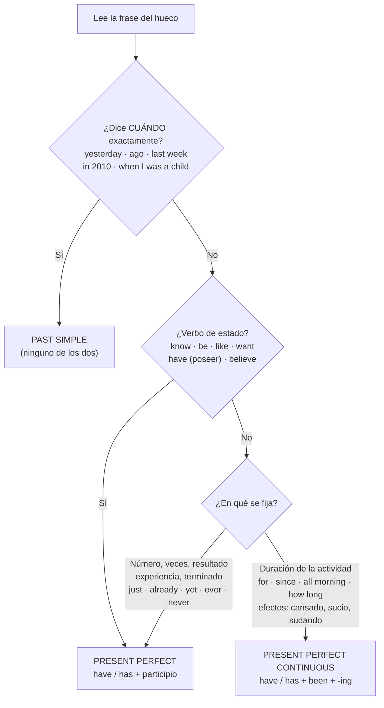
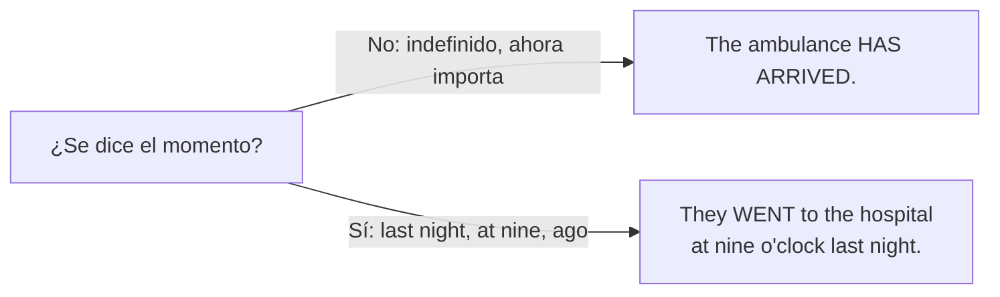

# Chuleta — Examen 2: present perfect vs present perfect continuous

> **En una línea:** **resultado / cuántas veces / experiencia** → present perfect · **cuánto tiempo lleva / efectos visibles** → present perfect continuous.
> Truco: «**he** + participio» → perfect · «**llevo** … -ando» / «**he estado** -ando» → perfect continuous.

## 1. ¿Cuál toca? Decide en 4 pasos



## 2. Las formas lado a lado

| | Present perfect | Present perfect continuous |
|---|---|---|
| ✅ Afirmativa | I / you / we / they **have** (**'ve**) **worked** · he / she / it **has** (**'s**) **worked** | I **have been working** · he **has been working** |
| ❌ Negativa | I **haven't worked** · she **hasn't worked** | I **haven't been working** · she **hasn't been working** |
| ❓ Pregunta | **Have** you **worked**? · **Has** she **worked**? | **Have** you **been working**? · **How long has** she **been working**? |
| 💬 Respuesta corta | Yes, I **have**. · No, she **hasn't**. | Yes, I **have**. · No, she **hasn't**. |

```text
PERFECT              have/has  +  PARTICIPIO          I have  written
PERFECT CONTINUOUS   have/has  +  BEEN  +  -ING       I have  been  writing
                                  ↑ siempre "been"
```

## 3. El mismo verbo, dos mensajes

| Present perfect → **resultado** | Present perfect continuous → **actividad / duración** |
|---|---|
| I**'ve written** five emails. *(he escrito cinco)* | I**'ve been writing** emails all morning. *(llevo toda la mañana)* |
| Who **has eaten** the cake? There's none left. | Ollie **has been cooking**. The kitchen's a mess. |
| I**'ve seen** that film. It was terrible. | Have you **been waiting** long? |
| No one **has scored** a goal yet. | They**'ve been playing** for forty minutes. |
| We **have known** each other for years. *(know = estado)* | He **has been learning** English for six years. |

## 4. Palabras pista y su posición

```text
have/has + just / already / ever / never + PARTICIPIO        I have just finished.
                                                              Have you ever been to China?
… + YET   (al final, en negativa y pregunta)                  He hasn't arrived yet.
… + FOR   + periodo   (durante / desde hace)                  for two years · for a month · for ages
… + SINCE + punto de inicio  (desde)                          since 2008 · since April · since Monday
```

| Palabra | Español | Tiempo |
|---|---|---|
| **just** | acabar de | perfect |
| **already** | ya (afirmativa) | perfect |
| **yet** | todavía (neg.) · ya (preg.) | perfect |
| **ever** | alguna vez (preguntas) | perfect |
| **never** | nunca | perfect |
| **so far** | hasta ahora | perfect |
| **how many / times** | cuántos / veces | perfect |
| **for / since** | desde hace / desde | los dos (continuous si se resalta la actividad) |
| **all morning / all day** | toda la mañana / todo el día | continuous |
| **how long** | cuánto tiempo | continuous (perfect con verbos de estado) |
| **lately / recently** | últimamente / recientemente | los dos |

> ⚠️ «desde hace dos años» = **for** two years (nunca ~~since two years~~).
> ⚠️ **'s** puede ser **is** o **has**: *she's working* (is) · *she's worked* (has) · *she's been working* (has).

## 5. La trampa del past simple



## 6. Participios irregulares más probables

| Verbo | Participio | Verbo | Participio | Verbo | Participio |
|---|---|---|---|---|---|
| be | **been** | eat | **eaten** | lose | **lost** |
| do | **done** | write | **written** | buy | **bought** |
| go | **gone / been** | have | **had** | take | **taken** |
| see | **seen** | make | **made** | find | **found** |
| know | **known** | speak | **spoken** | break | **broken** |
| fly | **flown** | win | **won** | forget | **forgotten** |
| meet | **met** | leave | **left** | read | **read** |
| come | **come** | become | **become** | think | **thought** |

Regulares: **-ed** → talk**ed**, finish**ed**, tri**ed** (y → ied), sto**pp**ed.
*gone* = se ha ido y sigue allí · *been* = ha ido y ha vuelto.

## 7. Autotest — tareas del profesor

<details>
<summary>I ___ (write) five emails today.</summary>

**have written** — hay un número.
</details>

<details>
<summary>Sorry the kitchen's a mess. Ollie ___ (cook).</summary>

**has been cooking** — efecto visible.
</details>

<details>
<summary>He ___ (learn) English for six years.</summary>

**has been learning** — duración.
</details>

<details>
<summary>We ___ (know) each other for years.</summary>

**have known** — *know* es de estado.
</details>

<details>
<summary>I really need a break! I ___ (revise) all morning!</summary>

**have been revising** — *all morning*.
</details>

<details>
<summary>Who ___ (eat) all the cake?! There's none left.</summary>

**has eaten** — resultado.
</details>

<details>
<summary>___ (you / ever / be) to China?</summary>

**Have you ever been** — experiencia; *ever* tras el sujeto.
</details>

<details>
<summary>Sorry, I ___ (already / see) it.</summary>

**have already seen**
</details>

<details>
<summary>He ___ (not / talk) to him since Monday.</summary>

**hasn't talked**
</details>

<details>
<summary>Breakfast ___ (be) ready at 8.00 am every morning.</summary>

**is** — *every morning*: present simple.
</details>

<details>
<summary>Todas las soluciones seguidas</summary>

**Gap fill (British Council):** 1 have written · 2 has been cooking · 3 been waiting · 4 has been learning · 5 have seen · 6 has scored · 7 have known · 8 have been revising · 9 changed · 10 have finished · 11 been doing · 12 has eaten

**Multiple choice:** 1a · 2c · 3b · 4c · 5b · 6a · 7a · 8b

**Present simple vs perfect:** 1 is · 2 have lost · 3 haven't tried · 4 don't want · 5 Have you ever been · 6 doesn't want · 7 have already seen · 8 have been · 9 hasn't talked
</details>
