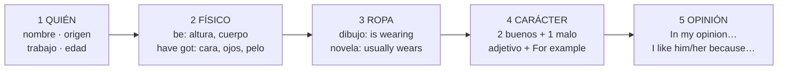

# Chuleta — Writing: describir a una persona o personaje

> **El patrón:** 5 párrafos, 1 pregunta cada uno. Cambia solo lo que va entre `[corchetes]`.
> Longitud y criterios de corrección desconocidos: el patrón da ≈ 130–170 palabras.

## 1. El esqueleto



## 2. be o have got

| **be** (ser / estar) | **have got** (tener) |
|---|---|
| altura · cuerpo · edad · carácter · aspecto | pelo · ojos · cara · barba · pecas · cicatriz |
| *She **is** tall and slim.* | *She **has got** long hair and blue eyes.* |
| *He **is** in his forties.* (tiene cuarenta y tantos) | *He **has got** a beard.* |
| *He **is** bald.* (es calvo) | gafas: *He **wears** glasses.* |

> ❌ *He has 40 years* → ✅ *He **is** 40 years old* · ❌ *She have got* → ✅ *She **has** got*

## 3. Frases para rellenar

```text
1 QUIÉN
This is [Name]. He/She is a/an [job] from [place]. He/She is in his/her [twenties/thirties/forties…].
NOVELA → [Name] is the main character of [title], a novel by [author].
                       (protagonista)                (una novela de)

2 FÍSICO
He/She is [tall / short / of medium height] and [slim / well-built / of average build].
He/She has got [a round / an oval / a thin] face and [big / small] [blue / brown / green] eyes.
He/She has got [LONGITUD] [FORMA] [COLOR] hair.            → long curly red hair
He/She has got [a beard / freckles / a scar / a tattoo] and he/she wears glasses.

3 ROPA
DIBUJO → In the picture, he/she is wearing a [color] [prenda], [color] [prenda] and [color] [prenda].
         He/She is holding [a book] and he/she looks [happy / tired / angry].
                   (sujeta)                        (parece)
NOVELA → He/She usually wears [prendas]. He/She looks [smart / scruffy].

4 CARÁCTER   (adjetivo + ejemplo = 2 frases)
He/She is very [bueno]. For example, he/she [verbo + s] …
He/She is also [bueno] because he/she always/never [verbo + s] …
However, he/she can be a bit [malo]: he/she sometimes [verbo + s] …
(sin embargo, puede ser un poco…)

5 OPINIÓN
In my opinion, [Name] is a [wonderful / fascinating] person/character.
I like him/her because he/she is [adj] and [adj].
+ EXTRA (examen 2): He/She has worked as a [job] for [ten years].
```

## 4. Vocabulario con traducción

### Edad, altura y cuerpo (con **be**)

| Inglés | Español | Inglés | Español |
|---|---|---|---|
| young / old | joven / mayor | in his/her twenties | de veintitantos |
| tall | alto | thirties · forties · fifties · sixties | treinta · cuarenta · cincuenta · sesenta y tantos |
| short | bajo | slim / thin | delgado / flaco |
| of medium height | de estatura media | skinny | muy flaco |
| tiny | muy pequeño | muscular / well-built | musculoso / fornido |
| attractive · good-looking | atractivo · guapo | of average build | de complexión normal |
| handsome (hombre) · pretty (mujer) | guapo · guapa | a bit overweight · plump | algo gordito · rellenito (⚠️ *fat* ofende) |
| pale · tanned | pálido · moreno de sol | stocky | robusto, corpulento |

### Cara, ojos y rasgos (con **have got**)

| Inglés | Español | Inglés | Español |
|---|---|---|---|
| a round / oval / square face | cara redonda / ovalada / cuadrada | a beard | barba |
| a thin face · thin-faced | cara delgada | a moustache | bigote |
| big / small eyes | ojos grandes / pequeños | freckles | pecas |
| almond / narrow eyes | ojos almendrados / rasgados | a mole | lunar |
| a charming smile | una sonrisa encantadora | a scar | cicatriz |
| wrinkles | arrugas | a tattoo | tatuaje |
| braces | aparato dental | a birthmark | marca de nacimiento |

### Pelo: **LONGITUD → FORMA → COLOR → hair**

| 1 Longitud | 2 Forma | 3 Color | Peinados y otros |
|---|---|---|---|
| long · largo | straight · liso | black · negro | a ponytail · coleta |
| short · corto | wavy · ondulado | brown · castaño | a bun · moño |
| shoulder-length · por los hombros | curly · rizado | blond / fair · rubio | braids · trenzas |
| | spiky · de punta | red · pelirrojo | a fringe · flequillo |
| | | grey · canoso · white · blanco | bald · calvo · receding hair · entradas |

### Ropa (color **delante**: *a red jumper*)

| Inglés | Español | Inglés | Español |
|---|---|---|---|
| shirt | camisa | trousers | pantalones |
| t-shirt | camiseta | jeans | vaqueros |
| jumper | jersey | shorts | pantalón corto |
| jacket · coat | chaqueta · abrigo | shoes · trainers · boots | zapatos · zapatillas · botas |
| dress · skirt | vestido · falda | hat · glasses | sombrero · gafas |
| smart · elegant · well-dressed | elegante · bien vestido | casual · scruffy | informal · desaliñado |

### Carácter

| 😊 Bueno | Español | 😠 Malo | Español |
|---|---|---|---|
| friendly · nice | simpático, amable | shy | tímido |
| kind | bondadoso | lazy | vago |
| generous | generoso | bossy | mandón |
| honest | honrado | selfish | egoísta |
| brave | valiente | stubborn | cabezota |
| patient | paciente | rude | maleducado |
| cheerful | alegre | impatient | impaciente |
| polite | educado | moody · bad-tempered | de mal humor |
| reliable | de fiar | forgetful · absent-minded | olvidadizo · despistado |
| hard-working | trabajador | clumsy | torpe |
| sociable · outgoing | sociable | arrogant · vain | creído · vanidoso |
| sensible | **sensato** | nosy | cotilla |
| loyal | leal | mean | **tacaño** o **cruel** |
| creative · ambitious | creativo · ambicioso | jealous | celoso |

> ⚠️ **Falsos amigos:** *sensible* = sensato (sensible = **sensitive**) · *sympathetic* = comprensivo (simpático = **friendly / nice**) · *mean* ≠ medio.

### Opinión (adjetivos extremos)

*wonderful* (maravilloso) · *fascinating* (fascinante) · *excellent* (excelente) · *hilarious* (divertidísimo) · *terrible* (horrible). Con extremos: **absolutely**, nunca *very*.

## 5. Dibujo vs novela

| | 🖼️ Dibujo | 📖 Novela |
|---|---|---|
| Ropa | **is wearing** (ahora) | **usually wears** (siempre) |
| Acción | *is holding · is smiling · is walking* | *lives · works · fights* |
| Carácter | inventado o *He **looks** friendly* | del libro + ejemplo de la historia |
| Abre con | *This is… / In the picture I can see…* | *… is the main character of …, a novel by …* |

## 6. Conectores

| Sumar | Contrastar | Ejemplo | Causa / efecto | Cerrar |
|---|---|---|---|---|
| and · also · In addition, | but · However, | For example, | because · so | In my opinion, · Overall, |

## 7. Repaso final de 2 minutos ✔️

- [ ] **-s** con he/she: *works, has, talks*
- [ ] **has got** (no *have got*) con he/she
- [ ] edad con **is** (*is in his forties*)
- [ ] pelo: **longitud → forma → color** + *hair* (sin plural: *her hair is*)
- [ ] color **delante**: *a blue shirt* · adjetivos sin plural: *blue eyes*
- [ ] **his** (de él) / **her** (de ella)
- [ ] cada adjetivo de carácter con su **For example**

## 8. Modelos

<details>
<summary>🖼️ Modelo dibujo — Tom</summary>

*This is Tom. He is a teacher from Manchester and he is in his forties.*

*Tom is tall and of average build. He has got a round face and small brown eyes. He has got short curly brown hair and a beard, and he wears glasses.*

*In the picture, he is wearing a red jumper, blue jeans and black shoes. He is holding a book and he is smiling, so he looks very cheerful.*

*I think Tom is very patient. For example, he always explains things twice to his students. He is also generous because he often helps his colleagues. However, he can be a bit absent-minded: he sometimes forgets his keys at school. He has worked at the same school for fifteen years.*

*In my opinion, Tom is a wonderful person. I like him because he is friendly and kind.*
</details>

<details>
<summary>📖 Modelo novela — Don Quixote</summary>

*Don Quixote is the main character of* Don Quixote, *a novel by Miguel de Cervantes. He is a gentleman from a village in La Mancha and he is in his fifties.*

*He is tall and very thin. He is thin-faced and in most pictures he has got a long grey beard and a moustache.*

*He usually wears old armour and a strange helmet, so he looks a bit scruffy. He rides an old, skinny horse called Rocinante.*

*Don Quixote is very brave. For example, he fights giants, but they are really windmills! He is also generous and honest because he always wants to help poor people. However, he can be very stubborn: he never listens to his friend Sancho.*

*In my opinion, Don Quixote is a fascinating character. I like him because he is passionate and funny.*
</details>
