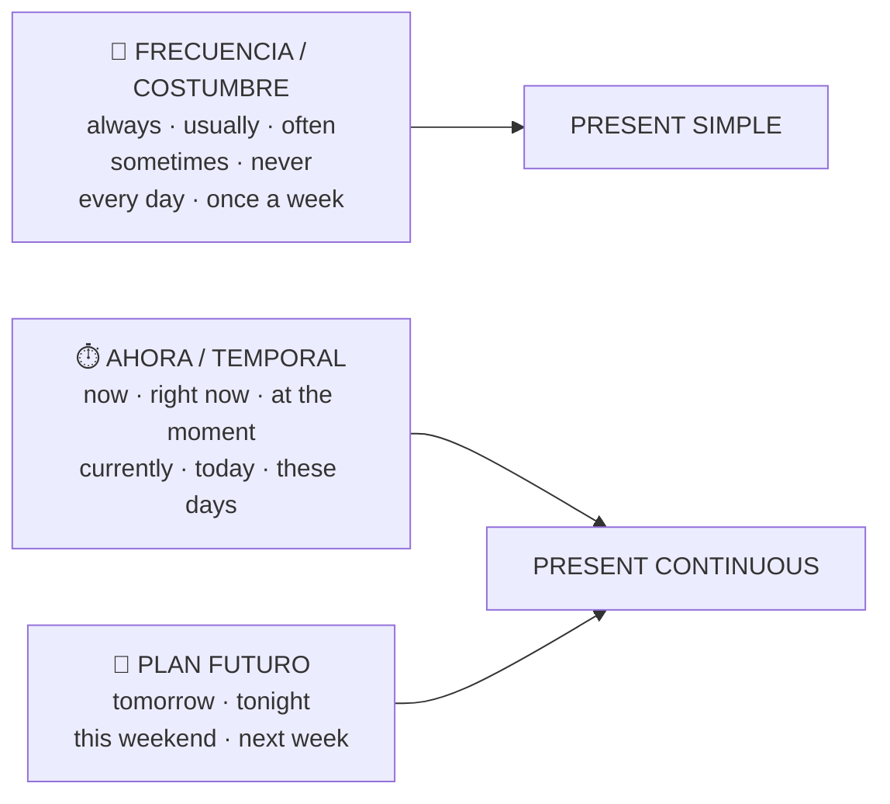

# Vocabulario — Examen 1 (present simple y present continuous)

> Selección para el examen: frecuencia, expresiones de presente y rutinas diarias. No es una lista oficial del profesor; sale del temario de la Unit 1.

## 1. ¿Qué tiempo pide cada palabra?



## 2. Adverbios de frecuencia → present simple

```text
always ── usually ── often / frequently ── sometimes ── occasionally ── rarely / seldom / hardly ever ── never
 100%                                                                                                     0%
```

| Inglés | Español | Ejemplo |
|---|---|---|
| always | siempre | *She is **always** happy.* (detrás de **be**) |
| usually | normalmente | *He **usually** goes to work by bus.* (delante del verbo) |
| often · frequently | a menudo | *We **often** go to the cinema.* |
| sometimes | a veces | *He **sometimes** plays games.* |
| occasionally | de vez en cuando | *I **occasionally** cook dinner.* |
| rarely · seldom · hardly ever | casi nunca | *She **hardly ever** watches TV.* |
| never | nunca | *I **never** drink coffee.* (sin *don't*) |

> ⚠️ *never* ya es negativo: *I never drink*, nunca ~~I don't never drink~~.

### Frecuencia exacta (al final de la frase)

| Inglés | Español | Inglés | Español |
|---|---|---|---|
| every day / week / month | cada día / semana / mes | daily · weekly · monthly · yearly | a diario · semanal · mensual · anual |
| every Sunday · on Mondays | cada domingo · los lunes | hourly · fortnightly | cada hora · quincenal |
| once a week | una vez a la semana | regularly | con regularidad |
| twice a day | dos veces al día | all the time · most of the time | todo el rato · casi siempre |
| three times a month | tres veces al mes | on a daily basis | a diario |
| at night · in the morning | por la noche · por la mañana | as usual | como de costumbre |

## 3. Expresiones de ahora → present continuous

| Inglés | Español | Ejemplo |
|---|---|---|
| now | ahora | *My mom is reading **now**.* |
| right now · right this second | ahora mismo | *What are you doing **right now**?* |
| at the moment · at present | en este momento | *She isn't studying **at the moment**.* |
| currently | actualmente | *She is **currently** learning French.* |
| today | hoy | *I'm working from home **today**.* |
| this week · this morning | esta semana · esta mañana | *We're studying for exams **this week**.* |
| these days · nowadays | estos días · hoy en día | *He's reading a lot **these days**.* |
| as we speak | mientras hablamos | *They're fixing it **as we speak**.* |
| Look! · Listen! | ¡Mira! · ¡Escucha! | ***Look!** It's raining.* |

### Planes de futuro (también continuous)

*tomorrow* (mañana) · *tonight* (esta noche) · *this weekend* (este fin de semana) · *next week / month* (la semana / el mes que viene) · *soon* (pronto) · *later today* (más tarde hoy).
*I'm going on holiday **tomorrow**.*

## 4. Verbos de estado → nunca con -ing

| Gustos | Deseos / necesidad | Mente | Otros |
|---|---|---|---|
| like · gustar | want · querer | know · saber, conocer | belong · pertenecer |
| love · encantar | need · necesitar | understand · entender | own · poseer |
| hate · odiar | prefer · preferir | believe · creer | seem · parecer |
| | | remember · recordar | mean · significar |

✅ *I **want** a coffee now.* · ❌ *I am wanting*

## 5. Rutinas diarias (daily routines)

| Inglés | Español | Con he / she |
|---|---|---|
| wake up | despertarse | she **wakes** up |
| get up | levantarse | she **gets** up |
| take a shower | ducharse | she **takes** a shower |
| have breakfast | desayunar | he **has** breakfast |
| cook breakfast | hacer el desayuno | he **cooks** breakfast |
| get dressed | vestirse | she **gets** dressed |
| put on makeup | maquillarse | she **puts** on makeup |
| brush my teeth | lavarse los dientes | he **brushes** his teeth (-es) |
| comb my hair | peinarse | she **combs** her hair |
| leave home | salir de casa | he **leaves** home |
| go to work / school | ir al trabajo / a clase | she **goes** to work (-es) |
| take the bus | coger el autobús | he **takes** the bus |
| get to work | llegar al trabajo | she **gets** to work |
| have lunch · have coffee | comer · tomar café | he **has** lunch |
| take a break | tomarse un descanso | she **takes** a break |
| finish work | terminar de trabajar | he **finishes** work (-es) |
| go home · get home | irse a casa · llegar a casa | she **goes** / **gets** home |
| have dinner | cenar | they **have** dinner |
| watch TV | ver la tele | he **watches** TV (-es) |
| go to bed · sleep | acostarse · dormir | she **goes** to bed |

> 💡 *have* → **has** con he/she: *he has breakfast*, *she has lunch*.

## 6. Autotest

<details>
<summary>¿Dónde va el adverbio? «She (always) is late» / «He goes (usually) by bus»</summary>

*She is **always** late* (detrás de be) · *He **usually** goes by bus* (delante del verbo).
</details>

<details>
<summary>Traduce: «Normalmente me levanto a las siete, pero esta semana me estoy levantando a las seis.»</summary>

*I **usually get up** at seven, but **this week** I**'m getting up** at six.*
</details>

<details>
<summary>¿Qué tiempo piden: «once a week», «at the moment», «hardly ever», «tonight»?</summary>

once a week → simple · at the moment → continuous · hardly ever → simple · tonight (plan) → continuous.
</details>
