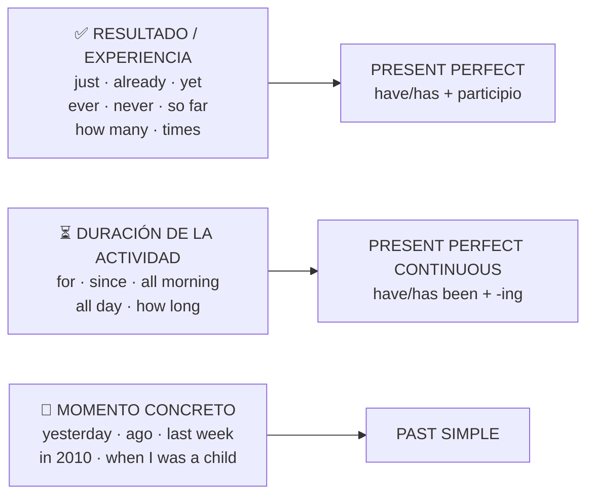

# Vocabulario — Examen 2 (present perfect y present perfect continuous)

> Selección para el examen: palabras pista del perfect, duración con *for / since*, expresiones de pasado (trampa del past simple) y participios. No es una lista oficial del profesor; sale del temario de la Unit 1.

## 1. ¿Qué tiempo pide cada palabra?



## 2. Palabras pista del present perfect

| Inglés | Español | Posición | Ejemplo |
|---|---|---|---|
| just | acabar de | entre *have* y participio | *They have **just** returned.* · Acaban de volver. |
| already | ya | entre *have* y participio | *I have **already** finished.* · Ya he terminado. |
| yet | todavía (neg.) · ya (preg.) | **al final** | *He hasn't arrived **yet**.* · *Have you finished **yet**?* |
| ever | alguna vez | entre sujeto y participio | *Have you **ever** been to China?* |
| never | nunca | entre *have* y participio | *I've **never** been rafting.* |
| still | todavía (sigue igual) | antes de *haven't* | *I **still** haven't finished.* |
| so far | hasta ahora | al final | *We've played four games **so far**.* |
| recently · lately | recientemente · últimamente | al final | *I haven't seen him **lately**.* |
| many times · once · twice | muchas veces · una · dos veces | al final | *I've been there **twice**.* |
| this year · today | este año · hoy (no terminado) | al final | *I've written five emails **today**.* |

## 3. Duración: for y since

```text
FOR   + CUÁNTO DURA (periodo)        SINCE + CUÁNDO EMPEZÓ (punto)
       durante / desde hace                  desde
       ─────────────────►                    ●──────────────►
       for two years                         since 2008
```

| **for** (periodo) | **since** (punto de inicio) |
|---|---|
| for 3 days · tres días | since Monday · desde el lunes |
| for 20 minutes · veinte minutos | since April · desde abril |
| for two years · dos años | since 2010 · desde 2010 |
| for a month · un mes | since last night · desde anoche |
| for ages · muchísimo tiempo | since last year · desde el año pasado |
| for some time · un tiempo | since the beginning of the year · desde principios de año |
| for a long time · mucho tiempo | since I was a child · desde que era niño |

Otras de duración (→ continuous): *all morning* (toda la mañana) · *all day* (todo el día) · *all night* (toda la noche) · *How long…?* (¿cuánto tiempo…?).

> ⚠️ «desde hace dos años» = **for** two years, nunca ~~since two years~~.

## 4. Expresiones de pasado → PAST SIMPLE (la trampa)

Si aparece una de estas, **no** es present perfect.

| Inglés | Español | Inglés | Español |
|---|---|---|---|
| yesterday | ayer | two days ago | hace dos días |
| the day before yesterday | anteayer | a few minutes ago | hace unos minutos |
| last night | anoche | a long time ago · ages ago | hace mucho |
| last week / year | la semana / el año pasado | not long ago | no hace mucho |
| in 1990 · in 2010 | en 1990 · en 2010 | when I was a child | cuando era niño |
| earlier today | hoy más temprano | in my childhood | en mi infancia |
| back then | por aquel entonces | in the past | en el pasado |

✅ *I **have lost** my keys.* (no dice cuándo) · ✅ *I **lost** my keys **yesterday**.* (dice cuándo)

## 5. Participios irregulares con traducción

| Verbo | Participio | Español | Verbo | Participio | Español |
|---|---|---|---|---|---|
| be | been | estado / sido | lose | lost | perdido |
| do | done | hecho | buy | bought | comprado |
| go | gone · been | ido | take | taken | cogido, tomado |
| see | seen | visto | find | found | encontrado |
| eat | eaten | comido | break | broken | roto |
| drink | drunk | bebido | forget | forgotten | olvidado |
| write | written | escrito | speak | spoken | hablado |
| read | read | leído | tell | told | dicho, contado |
| have | had | tenido | think | thought | pensado |
| make | made | hecho, fabricado | teach | taught | enseñado |
| know | known | sabido, conocido | meet | met | conocido (a alguien) |
| fly | flown | volado | leave | left | dejado, salido |
| swim | swum | nadado | win | won | ganado |
| come | come | venido | become | become | llegado a ser |
| give | given | dado | get | got | conseguido |
| run | run | corrido | sleep | slept | dormido |

Regulares, con **-ed**: *talk → talked* · *finish → finished* · *try → tried* · *stop → stopped* · *change → changed* · *wait → waited* · *score → scored*.

> 💡 *She has **gone** to Paris* = está allí · *She has **been** to Paris* = estuvo y ha vuelto.

## 6. Verbos de estado → present perfect aunque haya for / since

*know* (saber, conocer) · *be* (ser, estar) · *like · love · hate* · *want · need* · *have* (poseer) · *believe · understand*.
✅ *We **have known** each other **for** years.* · ❌ *have been knowing*

## 7. Autotest

<details>
<summary>¿for o since? … 2015 · … three weeks · … Monday · … ages · … I was born</summary>

since 2015 · for three weeks · since Monday · for ages · since I was born
</details>

<details>
<summary>¿Dónde va yet / already? «I haven't finished (yet)» · «I have (already) finished»</summary>

*yet* al final: *I haven't finished **yet**.* · *already* entre *have* y participio: *I have **already** finished.*
</details>

<details>
<summary>Traduce: «Llevo dos horas esperando» / «He visto esa peli tres veces»</summary>

*I**'ve been waiting for** two hours.* (duración → continuous) · *I**'ve seen** that film three times.* (veces → perfect)
</details>

<details>
<summary>¿Present perfect o past simple? «I (see) him yesterday» / «I (never / see) him»</summary>

*I **saw** him yesterday* (yesterday → past simple) · *I **have never seen** him* (experiencia).
</details>
